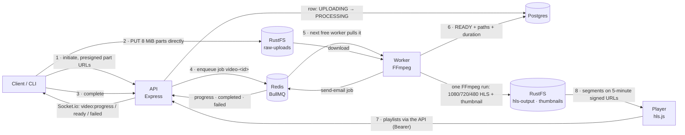
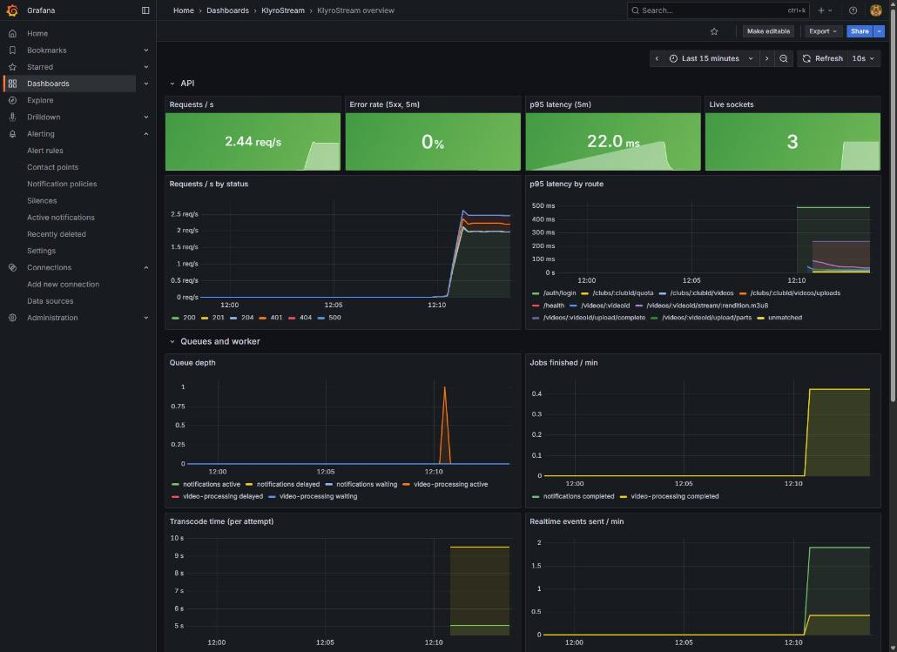

# KlyroStream

A private video platform for sports clubs: upload match footage from any device, have it transcoded into adaptive HLS streams, and share it only with your club.

## Run it locally

Needs Docker and Node 24.

```bash
docker compose up -d          # Postgres, Redis, RustFS (S3), Mailpit
cd backend
cp .env.example .env          # then fill in the secrets it lists
npm install
npm run db:migrate
npm run storage:init
npm run dev                   # API on http://localhost:4000
npm run dev:worker            # second terminal: the video worker (needs FFmpeg on PATH)
```

Or run the worker in Docker, with FFmpeg included: `docker compose up -d --build worker`. Don't run both at once; they'd share the jobs.

## How a video flows



Measured on a laptop: a 4K, 32 s clip (239 MB) transcodes in ~42 s; a 1080p, 2-minute clip (298 MB) in ~133 s. Details in [transcoding](docs/learning/transcoding.md).

| | |
|---|---|
| Upload a video from the CLI | `npm run upload -- <file> --club <clubId>` |
| Job dashboard (Bull Board) | http://localhost:4000/admin/queues, with `BULL_BOARD_USER` / `BULL_BOARD_PASSWORD` set in `.env` |
| Repair stuck videos | `npm run videos:requeue-stuck -- --dry-run` |
| Expire abandoned uploads | `npm run videos:expire-uploads -- --dry-run` |
| Watch READY videos (dev player, with a network throttle) | `npm run videos:play`, then http://localhost:4100; **play through the API** uses signed playlists and asks for an access token |
| Watch a club's live events (progress, ready, failed) | `npm run socket:listen -- --club <clubId>` with `KLYRO_EMAIL` / `KLYRO_PASSWORD` set |
| Metrics, logs and alerts (Grafana) | `docker compose --profile api --profile worker --profile observability up -d`, then http://localhost:3000 ([guide](docs/learning/monitoring-guide.md)) |
| Emails (invitations, resets, video ready/failed) | sent by the worker from the `notifications` queue; read them in Mailpit at http://localhost:8025 |
| Raise a club's download quota | `PATCH /admin/clubs/:clubId/quota` with the Bull Board credentials (Bruno: admin → Set club quota) |
| API requests | the Bruno collection in `bruno/` ([guide](docs/bruno.md)) |

How it works (**start with the [study roadmap](docs/learning/README.md)**): [uploads](docs/learning/uploads.md) · [job queues and workers](docs/learning/queues.md) · [transcoding and HLS](docs/learning/transcoding.md) · [library, playback and downloads](docs/learning/playback.md) · [real-time events and email](docs/learning/realtime.md) · [observability](docs/learning/observability.md) · [monitoring guide](docs/learning/monitoring-guide.md) · [transactions](docs/learning/transactions.md) · [locking](docs/learning/locking.md) · [indexes](docs/learning/indexes.md)

## Monitoring



Request rate, error rate, p95 latency, live sockets, queue depth, transcode time and live logs, provisioned from `docker/grafana/`. An alert emails when more than 5% of requests fail. How to read it: [monitoring guide](docs/learning/monitoring-guide.md).
