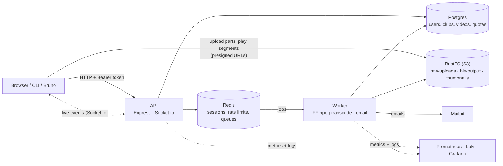
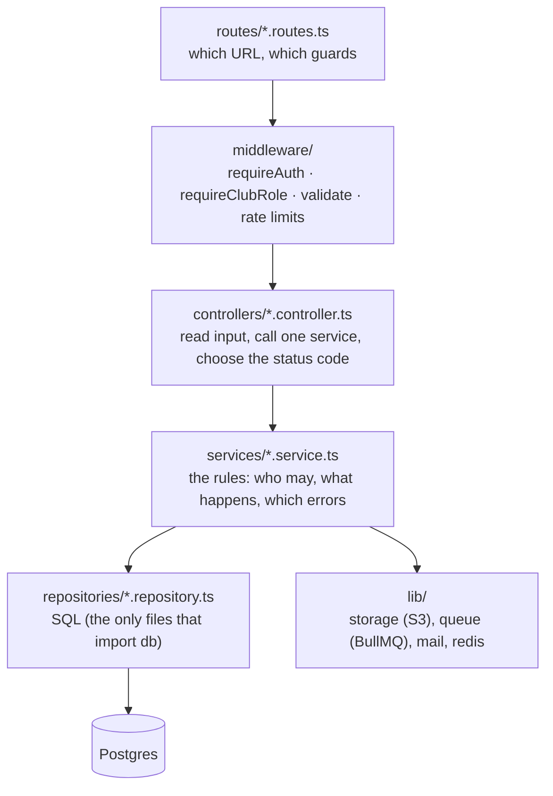

# Learning KlyroStream: a study roadmap

This folder is a course built from a real project. Every guide explains concepts using KlyroStream's own code, with numbers **measured on this project**. This page tells you **what to read, in what order, which code to open alongside, how to check you've understood**, and **what isn't covered yet**.

**Contents**

1. [How to use this folder](#1-how-to-use-this-folder)
2. [Before you start: what you should already know](#2-before-you-start-what-you-should-already-know)
3. [The project in one picture](#3-the-project-in-one-picture)
4. [The code in one tour](#4-the-code-in-one-tour)
5. [The reading path, phase by phase](#5-the-reading-path-phase-by-phase)
6. [Concept index: concept → guide → code](#6-concept-index-concept--guide--code)
7. [Sprints, guides and commits](#7-sprints-guides-and-commits)
8. [The missing pieces, part 1: built but not yet explained](#8-the-missing-pieces-part-1-built-but-not-yet-explained)
9. [The missing pieces, part 2: not built yet](#9-the-missing-pieces-part-2-not-built-yet)
10. [How to study code effectively](#10-how-to-study-code-effectively)
11. [Exercises: change something, then check it](#11-exercises-change-something-then-check-it)
12. [Self-check questions](#12-self-check-questions)
13. [External resources](#13-external-resources)

---

## 1. How to use this folder

Each guide follows the same rhythm, and so should your study:

1. **Concept.** What problem exists, explained without code ("why can't the API just process the video itself?").
2. **Design.** The options and the choice made ("a job queue, BullMQ, one job per video").
3. **Code.** The real files, quoted, with why they're written that way.
4. **Proof.** What was measured or tested, with real numbers.
5. **Walkthrough.** At the end of most guides, a "code walkthrough" section goes through every file of that sprint in reading order and ends with a **review checklist**.

**The golden rule:** don't just read. For every guide, **run the thing** (the dev player, the Bruno collection, the listener script, Grafana) and **open the code** next to the text. Understanding comes from seeing a concept work, then finding the five lines that make it work.

**Pace:** the whole path (section 5) is roughly **40–60 hours** if you run things and do the exercises. Don't rush the data-layer phase; everything else builds on it.

## 2. Before you start: what you should already know

| Topic | Enough to | If not, learn from |
|---|---|---|
| **JavaScript / TypeScript** | Read functions, objects, arrays, `import`/`export`, types like `string \| undefined` | [TypeScript handbook](https://www.typescriptlang.org/docs/handbook/intro.html) |
| **Promises and `async`/`await`** | Know what `await` does, why `Promise.all` runs things together, what an unhandled rejection is | [MDN: Using promises](https://developer.mozilla.org/en-US/docs/Web/JavaScript/Guide/Using_promises) |
| **HTTP** | Methods, status codes (200/201/204/400/401/403/404/409/429/500), headers, JSON bodies | [MDN: HTTP overview](https://developer.mozilla.org/en-US/docs/Web/HTTP/Overview) |
| **SQL** | `SELECT … WHERE … ORDER BY … LIMIT`, `INSERT`, `UPDATE`, joins, what a primary key is | [PostgreSQL tutorial](https://www.postgresql.org/docs/current/tutorial.html) |
| **Express basics** | What a route, a middleware and `next()` are | [Express guide](https://expressjs.com/en/guide/routing.html) |
| **Docker basics** | What an image, a container and `docker compose up` are | [Docker get started](https://docs.docker.com/get-started/) |
| **Git** | `git log`, `git show <commit>`, `git diff` | [Pro Git, chapters 1–3](https://git-scm.com/book/en/v2) |

If two or more rows are new to you, spend a few hours on them first. The guides explain project concepts in depth, but assume these basics.

## 3. The project in one picture

KlyroStream is a **private video platform for sports clubs**: members upload match footage, it's transcoded into adaptive streams, and only the club can watch it.



**The life of one video, in six steps** (each step is a guide):

1. **Upload:** the client asks the API for presigned URLs and sends 8 MiB parts **straight to storage**. The bytes never pass through Node → [uploads.md](uploads.md)
2. **Queue:** on "complete", the API marks the video `PROCESSING` and adds a job to Redis → [queues.md](queues.md)
3. **Transcode:** a worker downloads the original, runs **one** FFmpeg process producing 1080p/720p/480p HLS plus a thumbnail, uploads them, and marks the video `READY` → [transcoding.md](transcoding.md)
4. **Announce:** the API hears "completed" from the queue and pushes `video:ready` to the club over Socket.io; the worker emails the uploader → [realtime.md](realtime.md)
5. **Watch and download:** members list, stream (through signed playlists) and download (within a quota) → [playback.md](playback.md)
6. **Observe:** every step is counted and logged, and an alert fires if requests start failing → [observability.md](observability.md), [monitoring-guide.md](monitoring-guide.md)

Running underneath all of it: **transactions and locks** that keep data correct when things happen at the same time → [transactions.md](transactions.md), [locking.md](locking.md), [indexes.md](indexes.md).

## 4. The code in one tour

### The layers

Every HTTP request goes down the same staircase, and each layer only calls the one below it:



| Layer | Knows about | Never does |
|---|---|---|
| **routes** | URLs and which middleware guard them | business rules |
| **middleware** | auth, roles, validation, rate limits, logging, metrics | talk to storage or queues |
| **controllers** | HTTP: input in, status code out | rules or SQL |
| **services** | rules: visibility, permissions, state changes, errors to throw | build HTTP responses, import `db` |
| **repositories** | SQL via Drizzle | throw HTTP errors (they return `undefined`) |
| **lib** | one external system each | business rules |

### The folders of `backend/src`

| Folder | What's inside |
|---|---|
| `server.ts`, `worker.ts` | The two **entry points**: the API process and the worker process, with their startup and graceful shutdown |
| `app.ts` | The Express app: middleware order, routes, error handler |
| `config/env.ts` | Every environment variable, validated with Zod at startup |
| `routes/` | One file per area (`auth`, `clubs`, `videos`, `invitations`, `admin`, `health`), mounted in `routes/index.ts` |
| `middleware/` | Auth, roles, validation, rate limits, request logging, metrics, errors |
| `validators/` | Zod schemas for every request's params, query and body |
| `controllers/` | Thin HTTP handlers |
| `services/` | The rules for each area |
| `repositories/` | All SQL |
| `lib/db` | Drizzle client and **the schema** (`schema.ts`): the best single file to understand the data |
| `lib/storage` | S3 clients, multipart uploads, presigned URLs, deletes |
| `lib/queue` | BullMQ queues and Redis connections |
| `lib/mail`, `lib/redis`, `lib/metrics` | Mailer, Redis client, Prometheus registry |
| `realtime/` | Socket.io: auth, rooms, relaying queue events |
| `worker/` | Job processors and the transcoding pipeline (`pipeline/`: download → probe → transcode → thumbnail → upload) |
| `scripts/` | CLI tools: upload, dev player, listener, recovery, storage setup |
| `utils/` | Small helpers: errors, logger, tokens, pagination, roles |

**Start reading here:** `lib/db/schema.ts` (the data), then `routes/index.ts` (the whole API surface in 20 lines), then one feature top to bottom: `routes/clubs.routes.ts` → `controllers/club.controller.ts` → `services/club.service.ts` → `repositories/club.repository.ts`.

## 5. The reading path, phase by phase

Each phase lists what you'll learn, what to read, which code to open, what to **do**, and how to know you're done.

### Phase 0: run it and poke it (2–3 h)

- **Read:** the root `README.md`, [../bruno.md](../bruno.md).
- **Do:** start everything (`docker compose up -d`, `npm run dev`, `npm run dev:worker`). In Bruno: register, log in, create a club, upload the sample video, list videos, stream one, download one.
- **Done when:** you can upload a video and watch it in the dev player (`npm run videos:play`).

### Phase 1: the skeleton (4–6 h)

Not yet a guide of its own (see [section 8.1](#81-the-architecture-and-request-lifecycle)).

- **Read in code:** `server.ts`, `app.ts`, `routes/index.ts`, `middleware/validate.middleware.ts`, `middleware/error.middleware.ts`, `utils/errors.ts`, `config/env.ts`.
- **Then follow one request** end to end: `PATCH /clubs/:clubId` → `clubs.routes.ts` (`requireAuth` for the whole router) → `validate(updateClubSchemas)` → `requireClubRole('admin')` → `club.controller.ts update` → `club.service.ts updateClub` → `club.repository.ts updateName`.
- **Do:** send that request from Bruno with a bad body, as a viewer, and correctly. Find which file produced each response.
- **Done when:** you can explain why a validation error is a 400 with `details`, a non-member gets 404 and a viewer gets 403, and where each comes from.

### Phase 2: the data layer (6–8 h)

The most important phase: correctness under concurrency.

| Read | You'll learn | Open |
|---|---|---|
| [transactions.md](transactions.md) | connections and the pool, transactions, isolation, MVCC, row locks, deadlocks; every transaction in the project | `lib/db/client.ts`, `repositories/member.repository.ts`, `repositories/club.repository.ts` |
| [locking.md](locking.md) | check-then-act races, pessimistic locks, conditional writes, unique indexes as guards, atomic SQL | `repositories/invitation.repository.ts`, `repositories/video.repository.ts` (`transition`, `withUploadLock`) |
| [indexes.md](indexes.md) | B-tree indexes, composite and partial indexes, `EXPLAIN ANALYZE` | `lib/db/schema.ts` (every `index(...)`) |

- **Do:** the "Try it yourself" sections; open two `psql` sessions and watch a lock wait (locking.md).
- **Done when:** you can say why `UPDATE … WHERE used_count < quota_limit` is safe and `SELECT` then `UPDATE` isn't (playback.md §10 has the measured proof).

### Phase 3: files and storage (4–5 h)

| Read | You'll learn | Open |
|---|---|---|
| [uploads.md](uploads.md) | object storage, multipart uploads, presigned URLs, ETags, resume, the video state machine | `lib/storage/multipart.ts`, `services/video.service.ts` (upload functions), `scripts/upload.ts` |
| [uploads-lab.md](uploads-lab.md) | hands-on labs for each step | — |

- **Do:** all labs; kill `npm run upload` halfway and resume it.

### Phase 4: background work (8–10 h)

| Read | You'll learn | Open |
|---|---|---|
| [queues.md](queues.md) | why queues, BullMQ internals, retries and backoff, concurrency, durability, BullMQ vs RabbitMQ vs Kafka, the outbox pattern, recovery scripts | `lib/queue/*`, `worker.ts`, `scripts/requeue-stuck.ts`, `scripts/expire-uploads.ts` |
| [transcoding.md](transcoding.md) | HLS, bitrate ladders, keyframes, codecs, FFmpeg piece by piece, probing, one job vs a Flow | `worker/video.processor.ts`, `worker/pipeline/*` |

- **Do:** watch a job in Bull Board (`/admin/queues`); stop the worker mid-transcode and watch the job return to `waiting`; play a video with the throttle in the dev player and watch quality switch.

### Phase 5: the product features (6–8 h)

| Read | You'll learn | Open |
|---|---|---|
| [playback.md](playback.md) | pagination (offset vs keyset), safe search, per-video authorization (IDOR), 404 vs 403, deleting across systems, signed HLS playlists, atomic quotas, safe filenames | `services/video.service.ts`, `stream.service.ts`, `download.service.ts`, `quota.service.ts` |

### Phase 6: real time (6–8 h)

| Read | You'll learn | Open |
|---|---|---|
| [realtime.md](realtime.md) | polling vs SSE vs WebSockets, the Socket.io handshake, auth on long-lived connections, why CORS doesn't protect WebSockets, rooms, relaying queue events, email through a queue, several API processes | `realtime/*`, `services/notification.service.ts`, `worker/notification.processor.ts`, `scripts/socket-listen.ts` |

- **Do:** run `npm run socket:listen` in one terminal and upload in another.

### Phase 7: operations (6–8 h)

| Read | You'll learn | Open |
|---|---|---|
| [monitoring-guide.md](monitoring-guide.md) | **start here if monitoring is new to you:** metrics, logs and alerts from zero; Prometheus, Loki, Alloy, Grafana; exercises | Grafana at http://localhost:3000 |
| [observability.md](observability.md) | how it was built: labels and cardinality, PromQL, request ids across processes, the stack as code, the alert test | `lib/metrics/*`, `middleware/metrics.middleware.ts`, `worker/metrics.ts`, `docker/` |

- **Do:** the guided first session in monitoring-guide.md §14, including making the alert fire.

## 6. Concept index: concept → guide → code

| Concept | Explained in | Main code |
|---|---|---|
| Layered architecture | [§4 above](#4-the-code-in-one-tour), transactions.md Part 2 | `routes/` → `repositories/` |
| Validation with Zod | playback.md §7 (the `_errors` fix) | `middleware/validate.middleware.ts`, `validators/` |
| Error responses `{ error: { code, message } }` | [§8.1](#81-the-architecture-and-request-lifecycle) | `utils/errors.ts`, `middleware/error.middleware.ts` |
| JWT access + refresh tokens, rotation, reuse detection | [§8.2](#82-authentication-and-sessions) | `services/auth.service.ts`, `utils/tokens.ts`, `repositories/token-blacklist.repository.ts` |
| Rate limiting | [§8.2](#82-authentication-and-sessions), playback.md §11 | `middleware/rate-limit.middleware.ts` |
| Google OAuth (PKCE + state) | [§8.2](#82-authentication-and-sessions) | `middleware/google-auth.middleware.ts`, `utils/oauth-state.ts` |
| Tokens in the browser, single-flight refresh, multi-tab locks | client-auth.md | `frontend/src/lib/auth/` (Sprint 10) |
| CORS preflight, `SameSite` and same-site deployment | client-auth.md §6–7 | `app.ts` (`cors`), `utils/cookies.ts` |
| Roles (viewer / club_owner / admin) | [§8.3](#83-clubs-roles-and-invitations), playback.md §7 | `middleware/require-club-role.middleware.ts`, `utils/roles.ts` |
| Invitations with hashed tokens | [§8.3](#83-clubs-roles-and-invitations), locking.md §2 | `services/invitation.service.ts`, `repositories/invitation.repository.ts` |
| Transactions, isolation, MVCC | transactions.md | `lib/db/client.ts`, repositories |
| Pessimistic locks, `FOR UPDATE` | locking.md §1, transactions.md | `repositories/member.repository.ts`, `video.repository.ts` |
| Conditional writes, state machine | locking.md §2, §7 | `video.repository.ts` `transition` |
| Atomic counters | playback.md §10, locking.md §4 | `repositories/download.repository.ts` |
| Indexes, `EXPLAIN ANALYZE` | indexes.md, playback.md §4 | `lib/db/schema.ts` |
| Migrations | [§8.4](#84-the-schema-and-migrations), playback.md §10 | `backend/drizzle/*.sql` |
| Offset vs keyset pagination | playback.md §2 | `utils/pagination.ts`, `video.repository.ts` |
| SQL `LIKE` escaping | playback.md §3 | `video.repository.ts` `escapeLike` |
| IDOR, 404 vs 403 | playback.md §7 | `video.service.ts` `requireVisible` |
| Mass assignment | playback.md §7 | `validators/video.schema.ts` |
| Object storage, multipart uploads | uploads.md | `lib/storage/multipart.ts` |
| Presigned URLs | uploads.md, playback.md §5 | `lib/storage/objects.ts` `presignGet` |
| Header injection, `Content-Disposition` | playback.md §10, realtime.md §9 | `download.service.ts`, `notification.service.ts` |
| Job queues, retries, backoff | queues.md | `lib/queue/queues.ts`, `worker.ts` |
| Idempotent job ids | queues.md, realtime.md §9 | `transcodeJobId`, `videoEmailJobId` |
| Transactional outbox (not built) | queues.md, realtime.md §9 | — |
| Graceful shutdown | queues.md, realtime.md §5 | `server.ts`, `worker.ts` |
| Child processes, FFmpeg | transcoding.md §7, §11 | `worker/pipeline/transcode.ts` |
| HLS, adaptive bitrate | transcoding.md §2–5 | `worker/pipeline/transcode.ts` |
| Signed playlists, the VOD expiry trap | playback.md §9 | `services/stream.service.ts`, `scripts/hls-player.ts` |
| WebSockets, Socket.io, rooms | realtime.md §1–7 | `realtime/` |
| Cross-instance messaging (Redis adapter) | realtime.md §11 | `realtime/server.ts` |
| Timeouts on every network call | realtime.md §9 (SMTP), observability.md §9 (S3) | `lib/mail/mailer.ts`, `lib/storage/client.ts` |
| Metrics, labels, cardinality | monitoring-guide.md Part A, observability.md §2–3 | `lib/metrics/`, `middleware/metrics.middleware.ts` |
| Structured logs, correlation ids | monitoring-guide.md §4, observability.md §6 | `utils/logger.ts`, `middleware/request-logger.middleware.ts` |
| Alerting | monitoring-guide.md §5, §12 | `docker/grafana/provisioning/alerting/` |
| Infrastructure as code (Compose, provisioning) | observability.md §8 | `docker-compose.yml`, `docker/` |

## 7. Sprints, guides and commits

The project was built in sprints (the plan is [../klyrostream-phase-one-plan.md](../klyrostream-phase-one-plan.md)). To see exactly what one sprint changed, use git:

```bash
git log --oneline --reverse                      # the whole history, oldest first
git log --oneline -- backend/src/realtime        # every commit that touched one folder
git show <commit>                                # one commit's full change
git diff <first-commit>~1 <last-commit> --stat   # the size of a whole sprint
```

| Sprint | Built | Guide |
|---|---|---|
| S0 | Project skeleton, Docker, health check, config validation, logging | [§8.1](#81-the-architecture-and-request-lifecycle) (no guide yet) |
| S1–S2 | Register, login, JWT sessions, refresh rotation, logout everywhere, password reset, rate limits | [§8.2](#82-authentication-and-sessions) (no guide yet) |
| S3 | Google sign-in, clubs, roles, invitations | [§8.3](#83-clubs-roles-and-invitations) (no guide yet); locking.md, transactions.md cover its concurrency |
| S4 | Resumable uploads to S3 | uploads.md, uploads-lab.md, indexes.md |
| S5 | Job queue, worker process, retries, recovery | queues.md |
| S6 | FFmpeg transcoding to HLS | transcoding.md |
| S7 | Library, streaming, downloads, quotas | playback.md |
| S8 | Socket.io events, email queue, multi-instance | realtime.md |
| S9 | Metrics, logs, dashboards, alerts | observability.md, monitoring-guide.md |
| S10 | Frontend (Next.js + shadcn) | in progress: client-auth.md |
| S11–S12 | Polish, AI captions | not started |

## 8. The missing pieces, part 1: built but not yet explained

Sprints 0–3 were built before the learning folder existed, so their concepts have no guide. These short primers fill the gap until full guides are written.

### 8.1 The architecture and request lifecycle

**What happens to one request**, in `app.ts` order:

1. `metricsMiddleware` starts a timer.
2. `requestLogger` (pino-http) gives the request an id, reusing `X-Request-Id` if sent, and logs it when finished.
3. `helmet()` adds security headers; `cors()` allows `FRONTEND_URL`; `express.json({ limit: '1mb' })` parses the body; `cookieParser()` reads cookies.
4. The router runs its own middleware first: most routers start with `requireAuth` (401 without a valid access token). Then the matched route's middleware runs in order: `validate(schemas)` (400 if invalid) → `requireClubRole('…')` (404 if not a member, 403 if the role is too low).
5. The controller calls one service; the service applies rules and calls repositories and `lib/`.
6. **Errors:** anything thrown that extends `AppError` (`utils/errors.ts`) becomes `{ error: { code, message, details? }, requestId }` with its status code (`middleware/error.middleware.ts`). Anything else is a 500 that's logged in full but shown to the client only as "Something went wrong", so internals never leak.

**Configuration:** `config/env.ts` validates every environment variable with Zod at startup. A missing or wrong value stops the process immediately with a clear message, instead of failing later in some odd place.

**Graceful shutdown:** on SIGTERM, both processes stop accepting work, finish what's in flight, close connections, and exit, with a force-exit timer as a safety net (queues.md, realtime.md §5).

### 8.2 Authentication and sessions

| Piece | How KlyroStream does it | Where |
|---|---|---|
| **Passwords** | Hashed with **bcrypt** (cost 10), never stored or logged in plain text | `utils/password.ts` |
| **Access token** | A **JWT**, valid **15 minutes**, sent as `Authorization: Bearer …`. Stateless: the API verifies the signature and doesn't hit the database | `utils/tokens.ts`, `middleware/require-auth.middleware.ts` |
| **Refresh token** | A second JWT, valid **30 days**, with a unique id (`jti`) and the user's `tokenVersion`. Sent only in an **httpOnly cookie** named `rt`, scoped to `/auth`, `SameSite=Lax` (and `Secure` in production), so page JavaScript can't read it | `utils/cookies.ts` |
| **Rotation** | Every `POST /auth/refresh` returns a **new** refresh token, and the old one becomes unusable | `services/auth.service.ts` `refreshSession` |
| **Reuse detection** | Each refresh token's `jti` may be used **once**: a Redis `SET NX` claims it. A second use means it was stolen and replayed, so the API bumps the user's `tokenVersion`, which **logs out every session** of that user | `repositories/token-blacklist.repository.ts` `consume` |
| **Logout** | Blacklists that refresh token's `jti` until it would have expired | `logoutSession` |
| **Logout everywhere / password change** | Increments `users.token_version`; every refresh token carrying the old version is refused | `logoutAllSessions`, `user.repository.ts` |
| **Password reset** | A random token is emailed; only its **hash** is stored in Redis, for 30 minutes, and it works once | `forgotPassword`, `resetPassword`, `repositories/password-reset.repository.ts` |
| **Rate limits** | Login 5 / 15 min, register 5 / h, forgot-password 3 / h, reset 5 / 15 min per IP, stored in Redis so they work across API instances | `middleware/rate-limit.middleware.ts` |
| **Google sign-in** | OAuth 2.0 with **PKCE** and a **state** parameter (stored server-side) against CSRF; the callback sets the refresh cookie and redirects, never putting a token in the URL | `middleware/google-auth.middleware.ts`, `utils/oauth-state.ts` |

**Why two tokens?** A short access token limits the damage if one leaks (15 minutes), and needs no database lookup per request. The long refresh token lives in a cookie JavaScript can't read, and is checked against Redis and the user's version, so sessions **can** be revoked. The trade-off: a revoked session keeps working until its current access token expires, up to 15 minutes.

### 8.3 Clubs, roles and invitations

- **Roles are per club:** `viewer` < `club_owner` < `admin`, stored on `club_members`. Being an admin of one club means nothing in another.
- **`requireClubRole(min)`** loads your role for the club in the URL, answers **404** if you're not a member (so club ids can't be discovered) and **403** if your role is below `min`.
- **The creator is protected** (`CLUB_CREATOR_PROTECTED`): they can't be removed or demoted.
- **The last-admin rule:** a club can never lose its last admin, enforced with `SELECT … FOR UPDATE` on all admins in a fixed order (locking.md §1).
- **Invitations:** a random token goes in the email; only its hash is stored. A partial unique index allows one pending invitation per club and email. Accepting **claims** the invitation with a conditional `UPDATE … WHERE status = 'pending'`, so it can't be accepted twice (locking.md §2). Invitations expire after 7 days.

### 8.4 The schema and migrations

`lib/db/schema.ts` defines every table with **Drizzle**. To change the database: edit the schema, run `npm run db:generate` (writes a SQL file to `backend/drizzle/`), **read the generated SQL**, then `npm run db:migrate`. Never edit a migration that has already been applied anywhere. playback.md §10 shows why reading matters: Drizzle generated a `NOT NULL` column that would have failed on a table with data, and it was rewritten into the safe three-step form before being applied.

### 8.5 Docker and Compose

`docker-compose.yml` runs Postgres, Redis, RustFS (S3-compatible storage) and Mailpit always. The worker, the API and the monitoring stack are behind **profiles** (`--profile worker`, `api`, `observability`), so they start only when asked for. `backend/Dockerfile` is a multi-stage build: one stage installs dependencies, one compiles TypeScript, and the final images (`api`, `worker`) contain only what runs. The worker image adds FFmpeg (transcoding.md §11).

## 9. The missing pieces, part 2: not built yet

Things a production system needs that this project hasn't done yet. Knowing they're missing is part of understanding the system.

| Missing | What it is | Why it matters | Where to start |
|---|---|---|---|
| **Automated tests** | Unit tests (one function), integration tests (API + real database), end-to-end tests | **The biggest gap.** Every check in these guides was a script run by hand during development; nothing re-runs them on the next change, so a regression would go unnoticed | Vitest + Supertest against the Compose services; start with `services/` rules and the race tests from playback.md §10 |
| **Continuous integration (CI)** | A pipeline that runs `npm run check` and the tests on every push | Catches mistakes before they're merged | GitHub Actions |
| **Deployment** | Running on a real server or cloud | Everything here runs on one laptop | The plan's later sprints; a VPS with Compose is the simplest start |
| **HTTPS / TLS** | Encrypted connections | Tokens and cookies must never travel in plain text | A reverse proxy (Caddy, Nginx) in front of the API |
| **Secrets management** | Keeping passwords and keys out of `.env` files | `.env` is fine locally, not in production | Docker secrets, a cloud secret manager |
| **Backups and restore** | Regular database and storage backups, and **tested** restores | A disk failure would lose everything | `pg_dump` on a schedule; S3 versioning |
| **A frontend** | The web app users click | Today the clients are Bruno and CLI scripts | Sprint 10 |
| **Transactional outbox** | Writing "send this email" in the same database transaction as the state change | Closes the "READY but no email" gap | queues.md describes it |
| **Tracing** | OpenTelemetry spans across API, worker, S3, Postgres | Shows where time goes in one request | monitoring-guide.md §25 |
| **A CDN** | Serving video segments from edge servers | Fewer bytes from our storage, faster playback far away | playback.md §9 (signed cookies) |
| **Database connection pooling at scale** | PgBouncer in front of Postgres | Many API instances × 10 connections each runs out fast | transactions.md "Connections and the pool" |
| **Security review** | A systematic pass over the OWASP Top 10 | The guides cover many items (IDOR, injection, CSRF in OAuth, rate limits), but never as one checklist | [OWASP Top 10](https://owasp.org/Top10/) |

## 10. How to study code effectively

1. **Follow one request, not one file.** Pick an endpoint in Bruno, then trace it: route → middleware → controller → service → repository → SQL. Reading files alphabetically teaches nothing.
2. **Make the system tell you what it's doing.** Send the request, then look at the API's log line (`requestId`), the SQL it ran (set `LOG_LEVEL=debug` with `npm run dev`), the row in `psql`, the object in RustFS (http://localhost:9001), the job in Bull Board, the panel in Grafana.
3. **Break it on purpose.** Stop Redis, stop storage, kill the worker mid-job, send garbage input. Then find the code that handles it, or discover that nothing does. Many fixes in these guides were found exactly this way.
4. **Read the commit, not just the file.** `git show <commit>` shows a change together with its message; the code walkthroughs say why each line exists.
5. **Write down the "why".** For each file, write one sentence: "this exists because …". If you can't, re-read its guide section.
6. **Explain it out loud.** If you can explain a concept (say, why two tokens) to someone else without notes, you understand it.

## 11. Exercises: change something, then check it

From easier to harder. Each touches the layers you've studied; run `npm run check` after each.

| # | Exercise | Touches | How to check |
|---|---|---|---|
| 1 | Add `createdAt` to the `GET /clubs/:clubId/members` items | repository, service | Bruno |
| 2 | Add a `?sort=oldest` option to the video list | validator, repository | Bruno; `EXPLAIN` uses the same index |
| 3 | Add a Prometheus counter `uploads_initiated_total` | `lib/metrics`, service | Grafana Explore after an upload |
| 4 | Add a Grafana alert "worker down" (`1 - up{job="worker"}`) | `docker/grafana/provisioning/alerting/rules.yml` | stop the worker, wait for the email |
| 5 | Email the uploader when their video is **deleted** by an admin | service, notification service, queue | Mailpit |
| 6 | Add `GET /clubs/:clubId/downloads` (download history, paginated, admins only) | route, validator, controller, service, repository, index | Bruno; history survives a video delete |
| 7 | Write the first automated test: the quota race (20 parallel downloads, 5 left → exactly 5 succeed) | test setup | the test passes, and fails if you replace the atomic `UPDATE` with read-then-write |
| 8 | Switch the video list to **keyset pagination** | validator, repository | page 40 of 50k rows is as fast as page 1 (playback.md §2, §4) |

## 12. Self-check questions

Answer without looking, then check the guide named in brackets.

**Architecture and auth**
1. Why does a non-member get 404 on `/clubs/:id`, but a viewer gets 403 on `PATCH /clubs/:id`? [§8.3, playback.md §7]
2. Why is the refresh token in an httpOnly cookie but the access token isn't? [§8.2]
3. What happens when someone reuses an old refresh token, and why is that the right reaction? [§8.2]

**Data**
4. What's the difference between a pessimistic lock and a conditional write? When is each needed? [locking.md]
5. Why did the read-then-write quota code grant 20 downloads against a limit of 5? [playback.md §10]
6. What does a composite index on `(club_id, created_at)` make fast, and what not? [indexes.md]

**Storage and work**
7. Why do video bytes never go through the API? [uploads.md]
8. What makes adding a job idempotent? [queues.md, realtime.md §9]
9. Why does one FFmpeg run beat three for the three renditions? [transcoding.md §9]
10. Why can't you just presign `master.m3u8`? [playback.md §9]

**Real time and operations**
11. Why doesn't CORS protect a WebSocket, and why are we safe anyway? [realtime.md §4]
12. With two API instances, why does the relay use `io.local` while membership sync uses the adapter? [realtime.md §11]
13. Why must a video id never be a Prometheus label? [monitoring-guide.md §3]
14. Why does the alert need "at least 20 requests in 2 minutes"? [monitoring-guide.md §12]
15. Name three places where a missing timeout caused a real problem in this project, and what fixed each. [realtime.md §9, observability.md §9]

## 13. External resources

| Area | Resource |
|---|---|
| Node.js | [Node.js docs: event loop, streams](https://nodejs.org/en/learn) |
| PostgreSQL | [Use The Index, Luke](https://use-the-index-luke.com/) (indexes, explained brilliantly) · [Postgres docs: concurrency control](https://www.postgresql.org/docs/current/mvcc.html) |
| System design | *Designing Data-Intensive Applications* (Martin Kleppmann): the best book on everything in Phases 2, 4 and 6 |
| Security | [OWASP Cheat Sheet Series](https://cheatsheetseries.owasp.org/) (sessions, JWT, password storage, file upload) |
| Auth | [OAuth 2.0 Security Best Current Practice (RFC 9700)](https://datatracker.ietf.org/doc/html/rfc9700) |
| Video | [Apple HLS authoring spec](https://developer.apple.com/documentation/http-live-streaming/hls-authoring-specification-for-apple-devices) · [FFmpeg docs](https://ffmpeg.org/documentation.html) |
| Queues | [BullMQ docs](https://docs.bullmq.io) |
| Real time | [Socket.io docs](https://socket.io/docs/v4/) |
| Operations | [Google SRE book](https://sre.google/sre-book/table-of-contents/) · [Prometheus docs](https://prometheus.io/docs/) · [Grafana docs](https://grafana.com/docs/) |
