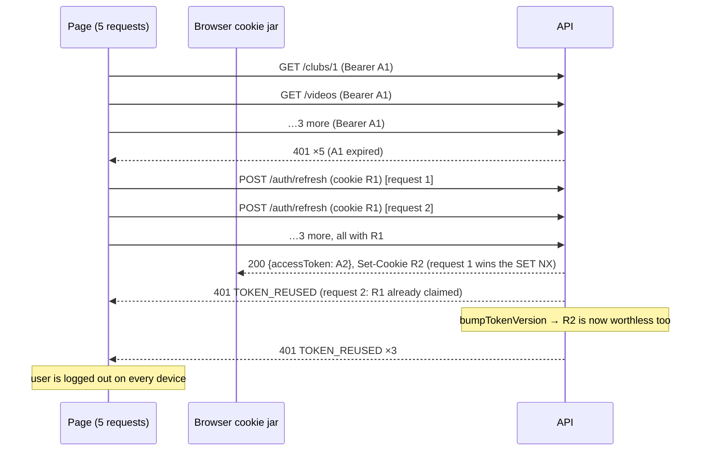
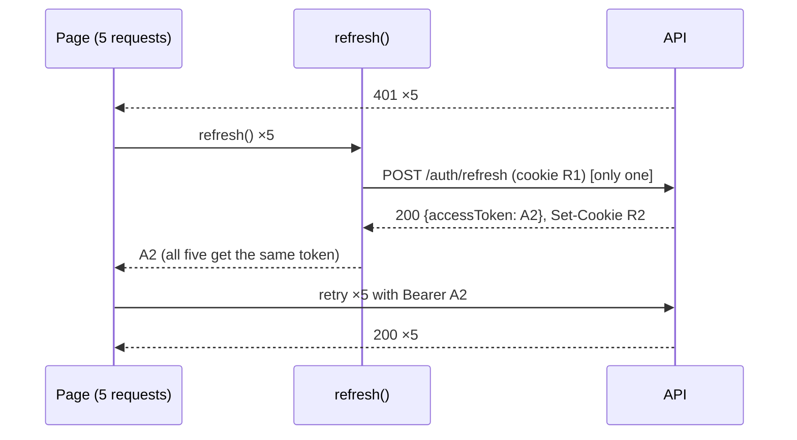

# Auth in the browser: tokens, refresh and single-flight

Sprint 10 builds the web app, and the first thing it needs is a way to stay logged in. The backend gives out a 15-minute access token and a 30-day refresh token that **rotates** and has **reuse detection** (README §8.2). That combination is secure, but it's unforgiving: a client that refreshes carelessly logs its own user out of every device. This guide explains the problem and the technique that solves it (**single-flight refresh**), then walks through every case the client has to handle, one at a time.

**Status:** written at the start of Sprint 10, before the frontend code exists. The backend behaviour quoted here is real and already built. The client code in [section 8](#8-the-whole-module) is the design we're building; the files and measured results get added here once it's done.

Related: README [§8.2](README.md#82-authentication-and-sessions) (how the backend issues and checks tokens) · [realtime.md §3](realtime.md#3-authentication-on-a-connection-that-lasts-for-hours) (tokens on a socket) · [playback.md §9](playback.md) (signed playlists).

**Contents**

1. [Words first: in-flight, single-flight, preflight, proactive](#1-words-first-in-flight-single-flight-preflight-proactive)
2. [Where the tokens live](#2-where-the-tokens-live)
3. [The problem: five requests, one expired token](#3-the-problem-five-requests-one-expired-token)
4. [Single-flight: share one refresh](#4-single-flight-share-one-refresh)
5. [Every case, one at a time](#5-every-case-one-at-a-time)
6. [Preflight: what CORS does to every API call](#6-preflight-what-cors-does-to-every-api-call)
7. [The cookie and the domain: a deployment rule](#7-the-cookie-and-the-domain-a-deployment-rule)
8. [The whole module](#8-the-whole-module)
9. [How to check it works](#9-how-to-check-it-works)
10. [What the server could do differently](#10-what-the-server-could-do-differently)
11. [Self-check questions](#11-self-check-questions)

---

## 1. Words first: in-flight, single-flight, preflight, proactive

These words sound alike but mean different things. The rest of the guide uses them exactly as defined here.

| Term | Meaning | Example here |
|---|---|---|
| **In-flight** | A request that has been sent and whose answer hasn't come back yet. It's "in the air". | "A refresh is in flight" = `POST /auth/refresh` was sent and we're waiting for it. |
| **Single-flight** | A rule: **at most one** copy of an operation is in flight at a time. Anyone who asks while it's running gets the result of the one already running, instead of starting another. The name comes from Go's [`singleflight`](https://pkg.go.dev/golang.org/x/sync/singleflight) package. Also called **request coalescing** or **deduplication**. | Five requests need a new token → one refresh goes out, all five wait for it. |
| **Thundering herd** (or **stampede**) | The failure single-flight prevents: many callers notice the same thing at once and all react at once. | Five 401s → five refreshes. |
| **Preflight** | Nothing to do with tokens. A **CORS** check the browser sends by itself (`OPTIONS`) before certain cross-origin requests, asking the server "may I send this?". [Section 6](#6-preflight-what-cors-does-to-every-api-call). | Every API call carrying `Authorization` is preflighted. |
| **Reactive refresh** | Refresh **after** the server says the token is expired (a 401), then retry. | The safety net. |
| **Proactive** (or pre-emptive) **refresh** | Refresh **before** the token expires, because we know when it will. | "Expires in under 30 s? Refresh first, then send." |
| **Rotation** | Every refresh returns a **new** refresh token and retires the old one. | Backend `refreshSession`. |
| **Reuse detection** | Using a retired refresh token is treated as theft: every session of that user is revoked. | Backend `tokenBlacklist.consume` + `bumpTokenVersion`. |

## 2. Where the tokens live

| | Access token | Refresh token (`rt`) |
|---|---|---|
| Lifetime | 15 minutes | 30 days |
| Where the browser keeps it | A **JavaScript variable**, in memory only (not `localStorage`, not a cookie) | An **httpOnly cookie** set by the API, `path: '/auth'`, `SameSite=Lax` |
| Who can read it | Our page's JavaScript | **Nobody's** JavaScript. The browser attaches it automatically. |
| Sent on | Every API call, as `Authorization: Bearer …` | Only requests to the API's `/auth/*` paths |

The browser talks to the API **directly**. The Next.js server never sees either token. We chose this model over "the Next server holds the tokens in its own cookies and calls the API for you" for three reasons:

1. **Rotation needs somewhere to save the new token.** A Next server component can't set cookies. If it refreshed while rendering a page, the rotated refresh token would be lost, and the next refresh would reuse the old one → reuse detection → logged out everywhere.
2. **The browser needs the token anyway.** hls.js loads playlists with `Bearer`, the socket connects with the token, and uploads talk to the API from the browser.
3. **Less exposure.** The long-lived token is unreadable by scripts and only ever travels to `/auth/*`.

The cost is that the access token is lost on every page reload (memory is wiped). [Section 5.4](#54-app-start-and-page-reload) shows how the app gets it back.

## 3. The problem: five requests, one expired token

### What the server does on refresh

`backend/src/services/auth.service.ts`:

```ts
if (!(await tokenBlacklist.consume(payload.jti, payload.exp))) {
  await userRepo.bumpTokenVersion(user.id);
  throw new UnauthorizedError('Refresh token already used', 'TOKEN_REUSED');
}

return {
  accessToken: signAccessToken(user.id),
  refreshToken: signRefreshToken(user.id, user.tokenVersion),
};
```

`consume` is a Redis `SET … NX`: the first request to present a refresh token's id (`jti`) claims it. Any later request presenting the **same** token finds it claimed, and the server concludes the token was stolen. It then bumps the user's `tokenVersion`, which makes every refresh token that user holds worthless, on every device.

That's the right reaction to theft. But the server can't tell a thief from **our own app sending the same token twice by accident**.

### The accident

A user opens the club page after lunch. The page loads five things at once: the club, the members, the videos, the quota and the notifications. The access token expired 20 minutes ago.



Each of the five 401 handlers did something reasonable by itself: "my token expired, refresh it". Together they are a thundering herd, and the server reads it as an attack.

The cookie can't save us: all five refresh requests left the browser **before** the first response arrived, so they all carried `R1`. Cookies are attached when a request is **sent**, not when it's answered.

## 4. Single-flight: share one refresh

The fix is to make "refresh" a shared thing. The first caller starts it; everyone who asks while it's in flight gets **the same promise**.

```ts
let inFlight: Promise<Session | null> | null = null;

export const refresh = () => {
  if (!inFlight) {
    inFlight = requestRefresh().finally(() => {
      inFlight = null;
    });
  }
  return inFlight;
};
```

- **The first call** finds `inFlight` empty, starts the request and stores its promise.
- **Calls 2 to 5** find the promise and return it. They don't send anything; they wait for the same answer.
- **When it settles**, `finally` clears `inFlight`, so the *next* expiry (15 minutes later) starts a fresh refresh. Without that line, every future call would get the old, already-used result forever.



### Why this is safe without a lock

On the server, the same "check, then act" needed Redis `SET NX` (locking.md §2), because many processes run at the same time. In a browser tab, JavaScript runs on **one thread**, and a function runs to its end, or to its next `await`, before anything else runs. Between `if (!inFlight)` and `inFlight = …` there's no `await`, so no other caller can sneak in between. The check-then-act is atomic for free.

That's true **inside one tab only**. Two tabs are two separate JavaScript worlds sharing one cookie, and [section 5.5](#55-two-tabs) needs a real lock for them.

## 5. Every case, one at a time

### 5.1 Many requests expire together

The case above: single-flight turns N refreshes into one. Every request that got a 401 awaits the shared refresh and then retries once with the new token.

### 5.2 A stale 401: sent before the refresh, answered after

Timing can be tighter than "all five fail, then refresh":

```
t=0     request X sent with A1
t=1     request Y gets 401, starts the refresh
t=50    refresh returns A2
t=60    request X's 401 finally arrives (it was slow)
```

If X now calls `refresh()`, nothing is in flight anymore, so it starts a **second** refresh. That one is harmless, because the cookie is already `R2`, but it's wasted, and with more requests it becomes a chain of pointless refreshes.

**Fix:** remember which token each request was sent with. On a 401, compare it with the current one:

```ts
const next = session && session.token !== sentWith ? session : await refresh();
```

If the token has changed since this request left, someone already refreshed; just retry with the current token.

### 5.3 Don't wait for the 401: refresh proactively

The reactive path costs a wasted round trip on every expiry: send → 401 → refresh → send again. Since a JWT says when it expires, the client can check **before** sending:

```ts
const isFresh = (s: Session | null): s is Session => !!s && s.expiresAt - Date.now() > EARLY_MS;
```

With `EARLY_MS = 30_000`, any request in the last 30 seconds of a token's life refreshes first. Single-flight still applies: five requests in that window share one refresh.

The 401 path stays as a safety net. A token can stop working early (a logout everywhere, a server restart with a new secret), and clocks can be wrong.

**Clocks.** The token's `exp` comes from the **server's** clock. If the user's laptop is 3 minutes fast, comparing `exp` with `Date.now()` would make every fresh token look nearly expired. So instead of trusting `exp` directly, the client measures the token's **lifetime** (`exp - iat`, both from the server) and adds it to its own clock at the moment the token arrived:

```ts
expiresAt: Date.now() + (payload.exp - payload.iat) * 1000
```

Now both sides of the comparison come from the same clock. Decoding the token's payload is fine, because it's only base64. The client doesn't verify the signature; it has no secret and doesn't need one. The server verifies on every request.

**Don't use a timer** ("refresh in 14m30s") as the main mechanism. Browsers throttle timers in background tabs and stop them entirely while a laptop sleeps. Checking at the moment of use always works; a `visibilitychange` listener that refreshes when the tab comes back is a nice extra.

### 5.4 App start and page reload

After a reload, the access token in memory is gone, but the `rt` cookie is still there. So the app's first step is a refresh:

| Refresh answers | Meaning | App state |
|---|---|---|
| 200 `{ accessToken }` | Still logged in | `authenticated` |
| 401 (no cookie, expired, revoked) | Not logged in | `anonymous` → show login |
| Network error / 5xx | Unknown | Show a "can't reach the server, retry" state; **don't** treat it as logged out |

This is also how **Google sign-in** finishes. The OAuth callback sets the `rt` cookie and redirects to the frontend, with no token in the URL (README §8.2). The page loads, the boot refresh turns the cookie into an access token, and the user is in.

Two traps at boot:

- **Every component asks at once.** The header wants the user, the page wants its data, the socket wants to connect. All of them call `getAccessToken()` while memory is empty. Single-flight covers this: it's the same herd as section 3, just at startup.
- **React Strict Mode runs effects twice in development.** A boot effect that calls the API directly sends two refreshes with the same cookie, and you'd be logged out every time you open the page in dev. Because `refresh()` keeps its state at **module** level (not in component state), the second call finds the first one in flight.

Until the boot refresh settles, the app should show a loading state and **not** fire data requests that would race it. That's one `status: 'loading' | 'authenticated' | 'anonymous'` value at the top of the app.

### 5.5 Two tabs

Every tab has its own memory (its own `session`, its own `inFlight`), but they all share **one cookie jar**. Single-flight inside each tab doesn't stop this:

```
tab A: token expires → POST /auth/refresh with R1
tab B: token expires → POST /auth/refresh with R1   (A's answer hasn't arrived)
→ TOKEN_REUSED → logged out everywhere
```

This happens easily: open two tabs, leave for lunch, come back, and click in one while the other reloads its data.

**Fix: a lock shared by all tabs of the same site.** The browser's [Web Locks API](https://developer.mozilla.org/en-US/docs/Web/API/Web_Locks_API) gives exactly that:

```ts
navigator.locks.request('klyro:refresh', requestRefresh)
```

- Tab A takes the lock and sends the refresh with `R1`.
- Tab B asks for the lock and **waits**.
- A's response arrives, and the browser stores `R2` in the shared jar. A's callback ends and the lock is released.
- B gets the lock and sends its refresh. The browser attaches the cookie **now**, so it sends `R2` and gets a valid `R3`. No reuse.

The lock must cover the **whole request and response**, not just "start the request". The danger window is between a request leaving and its `Set-Cookie` arriving, so that's what has to be serialized.

B's refresh is one extra call. A [`BroadcastChannel`](https://developer.mozilla.org/en-US/docs/Web/API/BroadcastChannel) could let A hand its new access token to B so B can skip it. That's an optimization; the lock alone is what makes it **correct**.

Web Locks only work in a secure context (HTTPS, or `localhost` in development), which is where the app runs anyway.

### 5.6 When the refresh itself fails

Not every failure means "logged out", and treating them alike is a classic bug.

| Refresh result | Server code | What the client does |
|---|---|---|
| 401, `UNAUTHORIZED` ("Refresh token missing") | no cookie | Signed out |
| 401, `INVALID_TOKEN` | expired, bad signature, user deleted | Signed out |
| 401, `SESSION_REVOKED` | logout everywhere or password change | Signed out |
| 401, `TOKEN_REUSED` | reuse detected; every session was just revoked | Signed out |
| Network error, timeout, 5xx | the server didn't answer properly | **Stay signed in.** Fail this request, keep the session; the next action tries again |

Every caller waiting on the shared promise gets the same outcome. On sign-out they all reject, and the app shows the login page **once**, not five times.

**The lost response, a case the client can't fix.** The refresh reaches the server, the server consumes `R1` and issues `R2`, and then the response is lost (Wi-Fi drops, the tab is closed mid-request). The browser still has `R1`. The next refresh sends it, and reuse detection fires. With strict rotation this is unavoidable from the client side; the user just logs in again. [Section 10](#10-what-the-server-could-do-differently) shows the server-side fix and why we haven't applied it.

### 5.7 Logging out while a refresh is in flight

```
t=0    refresh sent with R1
t=5    user clicks "Log out": POST /auth/logout (still sends R1, R2 hasn't arrived)
t=20   logout response: R1 revoked, cookie cleared
t=30   refresh response: Set-Cookie R2  ← the cookie comes back to life
```

The user saw the login page, but the jar now holds a valid `R2`. On the next reload, the boot refresh logs them straight back in. On a shared computer, that's a real security bug.

**Fixes, both needed:**

1. **Logout takes the same lock as refresh.** It waits for the in-flight refresh to finish, then sends `/auth/logout` with `R2`, so the server revokes the newest token and the cookie is cleared last.
2. **A generation counter for memory.** Logout does `generation++`. A refresh remembers the generation it started in, and when it finishes, it only saves its token if the generation hasn't changed. A late answer can't put a token back in memory after logout.

### 5.8 Logout and login in another tab

Logging out in tab A clears the cookie, but tab B still holds an access token in memory that works for up to 15 more minutes. B should follow along. A `BroadcastChannel` message from A (`'signed-out'`) makes B clear its memory and show the login page.

Logging **in** in tab A is less urgent. B is on the login page, and a message can make it run the boot refresh and pick up the new session.

### 5.9 Never loop

Retry logic loops forever if you let it. The rules:

- **Retry a request at most once.** If the retry with a brand-new token still gets 401, the server is rejecting the user, not the token (deleted account, revoked session). Sign out instead of refreshing again.
- **Never run the refresh logic for `/auth/*` calls.** `POST /auth/login` answers 401 `INVALID_CREDENTIALS` for a wrong password. That's not an expired token, and "refreshing" would be nonsense. Login, refresh and logout use plain `fetch`; only app calls go through `api()`.
- **A 403 is not a 401.** 403 means "you're logged in, but not allowed" (a viewer editing a club). Refreshing won't change that.

### 5.10 Is it safe to resend a POST?

Usually, resending a POST is dangerous: the first one might have worked. Here it's safe, because of where the 401 comes from. `requireAuth` is the **first** middleware on every protected router (`videosRouter.use(requireAuth)`), so a 401 means the request was rejected before any service code ran. Nothing happened, so there's nothing to duplicate.

One practical limit: the body must be sendable twice. Strings, `FormData` and `Blob` are fine. A `ReadableStream` is consumed by the first attempt. We never stream bodies to our API (file bytes go straight to storage), so this doesn't come up.

### 5.11 Sleep, background tabs and long sessions

A laptop wakes up after an hour: the access token is long dead, and the refresh token is fine. The proactive check (`isFresh`) sees it at the next request and refreshes first. Nothing special is needed, which is exactly why section 5.3 doesn't rely on timers.

After 30 days without a single refresh, the refresh token itself expires, and the user logs in again. Using the app once in 30 days keeps the session alive, because every refresh issues a new 30-day token.

### 5.12 The socket

The socket authenticates **once**, at connect, and the server disconnects it when that token expires (`disconnectAtExpiry`, realtime.md §3). It emits `auth:expired` first. A server-side disconnect is the one case where `socket.io-client` doesn't reconnect by itself.

So the client:

- passes `auth` as a **function**, not a fixed object, so every (re)connect asks `getAccessToken()` for a fresh token;
- on `auth:expired`, or a `connect_error` with `data.code === 'UNAUTHORIZED'`, calls `socket.connect()` again (once; if that fails too, it treats it as signed out, per section 5.9);
- after a reconnect, re-joins its club rooms (rooms don't survive a reconnect, realtime.md §10) and refetches anything that may have changed during the gap.

This means a socket reconnects roughly every 15 minutes. That's the price of short tokens on long connections, and it's cheap.

### 5.13 Video playlists and uploads

- **Playlists** (`master.m3u8` and the variant playlists) come from our API and need `Bearer`. The player asks `getAccessToken()` before loading, so the token is fresh. If a playlist still gets a 401, it refreshes and retries the load once.
- **Segments and upload parts** use **presigned URLs**: the permission is in the URL's query string. They must **not** carry an `Authorization` header. S3 refuses a request that carries two kinds of authentication at once, and our token would be sent to the storage server, which has no business seeing it. So they're fetched with plain `fetch`/XHR, never through `api()`.

### 5.14 Server rendering: this module is browser-only

In Next.js, a module's top-level variables live as long as the **process**, and on the server one process serves **every** user. If the token code ever ran on the server, user A's token could be handed to user B's request. Client components also render once on the server (SSR), so "it's only imported by client components" isn't enough on its own.

The rules:

- The token is only read or written in **event handlers and effects**, which never run during server rendering.
- `getAccessToken()` throws if `typeof window === 'undefined'`, so a mistake fails loudly instead of leaking.
- The module imports `client-only`, so a server component that imports it fails the build.

## 6. Preflight: what CORS does to every API call

The app runs at `http://localhost:5173` and the API at `http://localhost:4000`. Different ports mean different **origins**, so every call is **cross-origin**, and the browser applies CORS.

### Simple and preflighted requests

The browser sends some cross-origin requests directly. These are **simple requests**: `GET`, `HEAD` or `POST`, only basic headers, and a `Content-Type` that's at most a form or plain text. For anything else it first sends a **preflight**:

```
OPTIONS /videos HTTP/1.1
Origin: http://localhost:5173
Access-Control-Request-Method: GET
Access-Control-Request-Headers: authorization
```

The API answers with what it allows (`backend/src/app.ts`, via the `cors` package):

```
Access-Control-Allow-Origin: http://localhost:5173
Access-Control-Allow-Credentials: true
Access-Control-Allow-Headers: authorization
```

Only if the answer allows it does the browser send the real `GET`. If not, the real request is never sent, and the page sees a network error.

| Our request | Preflighted? | Why |
|---|---|---|
| `GET /videos` with `Authorization` | **Yes** | `Authorization` isn't a basic header |
| `POST /clubs` with a JSON body | **Yes** | `Content-Type: application/json` isn't a form type |
| `POST /auth/refresh`, no body, no headers | **No** | A plain POST with nothing extra is a simple request |
| `PUT` an upload part to a presigned URL | Yes, to **storage** | `PUT`; the storage bucket's own CORS rules answer |

So `refresh()` should **not** add `Content-Type: application/json` "just in case": it has no body, and the header would add a preflight to the most time-sensitive call.

### What preflight is not

- **It's not authentication.** It's the browser asking permission on behalf of the page. `curl` never sends one, which is why the API still checks the token on every request.
- **It's not free.** A preflight is a full round trip before the real one. The `cors` package doesn't set `Access-Control-Max-Age` by default, so browsers cache each preflight for only 5 seconds. Setting `maxAge` (Chrome caps it at 2 hours) would save most of those round trips. It's a small, optional backend change, noted for when we measure the frontend.

### Credentials and CORS

`fetch(…, { credentials: 'include' })` tells the browser to attach cookies to a cross-origin request, and to accept `Set-Cookie` from the response. The browser only lets the page see such a response if the server answers with:

- `Access-Control-Allow-Credentials: true`, and
- `Access-Control-Allow-Origin` set to the **exact** origin. `*` isn't allowed with credentials.

`app.ts` does both (`origin: env.FRONTEND_URL, credentials: true`). That's why `FRONTEND_URL` must match the app's real origin, port included.

## 7. The cookie and the domain: a deployment rule

`rt` is `SameSite=Lax`. A Lax cookie is sent on a cross-**site** `fetch` only in limited cases, and a background `POST` isn't one of them. So the refresh works only if the app and the API are the **same site**.

**Same site** isn't the same as **same origin**. A site is the scheme plus the registrable domain; ports and subdomains don't count.

| App | API | Same site? | Refresh works? |
|---|---|---|---|
| `http://localhost:5173` | `http://localhost:4000` | Yes (ports don't count) | Yes |
| `https://app.klyro.com` | `https://api.klyro.com` | Yes (same `klyro.com`) | Yes |
| `https://klyro.vercel.app` | `https://klyro-api.onrender.com` | **No** | **No**, the cookie isn't sent |

The last row would need `SameSite=None; Secure`, and browsers increasingly block such third-party cookies anyway. **Deployment rule: the app and the API live under one domain.** This belongs in the deployment plan, not as a surprise on launch day.

## 8. The whole module

This is the design for `frontend/src/lib/auth/session.ts`. Every line maps to a case above.

```ts
import 'client-only';

type Session = { token: string; expiresAt: number };

const API_URL = process.env.NEXT_PUBLIC_API_URL;
const LOCK = 'klyro:refresh';
const EARLY_MS = 30_000;

let session: Session | null = null;
let inFlight: Promise<Session | null> | null = null;
let generation = 0;

const listeners = new Set<() => void>();
const channel = typeof window === 'undefined' ? null : new BroadcastChannel('klyro:auth');

const signedOut = () => {
  generation++;
  session = null;
  listeners.forEach((listener) => listener());
};

channel?.addEventListener('message', (event) => {
  if (event.data === 'signed-out') signedOut();
});

const lifetimeMs = (token: string) => {
  const payload = JSON.parse(atob(token.split('.')[1].replace(/-/g, '+').replace(/_/g, '/')));
  return (payload.exp - payload.iat) * 1000;
};

const toSession = (token: string): Session => ({ token, expiresAt: Date.now() + lifetimeMs(token) });

const isFresh = (s: Session | null): s is Session => !!s && s.expiresAt - Date.now() > EARLY_MS;

const requestRefresh = async (): Promise<Session | null> => {
  const res = await fetch(`${API_URL}/auth/refresh`, { method: 'POST', credentials: 'include' });
  if (res.status === 401) return null;
  if (!res.ok) throw new Error(`Refresh failed with ${res.status}`);
  const { accessToken } = (await res.json()) as { accessToken: string };
  return toSession(accessToken);
};

export const refresh = (): Promise<Session | null> => {
  if (inFlight) return inFlight;
  const startedIn = generation;
  inFlight = navigator.locks
    .request(LOCK, requestRefresh)
    .then((next) => {
      if (startedIn !== generation) return null;
      if (!next) signedOut();
      session = next;
      return next;
    })
    .finally(() => {
      inFlight = null;
    });
  return inFlight;
};

export const getAccessToken = async (): Promise<string | null> => {
  if (typeof window === 'undefined') throw new Error('getAccessToken is browser-only');
  if (isFresh(session)) return session.token;
  return (await refresh())?.token ?? null;
};

const send = (path: string, init: RequestInit, token: string | null) => {
  const headers = new Headers(init.headers);
  if (token) headers.set('Authorization', `Bearer ${token}`);
  return fetch(`${API_URL}${path}`, { ...init, headers });
};

export const api = async (path: string, init: RequestInit = {}): Promise<Response> => {
  const sentWith = await getAccessToken();
  const res = await send(path, init, sentWith);
  if (res.status !== 401 || !sentWith) return res;

  const next = session && session.token !== sentWith ? session : await refresh();
  if (!next) return res;

  const retried = await send(path, init, next.token);
  if (retried.status === 401) signedOut();
  return retried;
};

export const startSession = (accessToken: string) => {
  generation++;
  session = toSession(accessToken);
};

export const logout = async () => {
  signedOut();
  await navigator.locks.request(LOCK, () =>
    fetch(`${API_URL}/auth/logout`, { method: 'POST', credentials: 'include' }),
  );
  channel?.postMessage('signed-out');
};

export const onSignedOut = (listener: () => void) => {
  listeners.add(listener);
  return () => listeners.delete(listener);
};
```

| Lines | Case |
|---|---|
| `inFlight` check and `finally` | 5.1 the herd (single-flight) |
| `sentWith` vs `session.token` | 5.2 stale 401 |
| `isFresh`, `EARLY_MS`, `lifetimeMs` (`exp - iat`) | 5.3 proactive refresh, clock skew |
| module-level state, `refresh()` from any caller | 5.4 boot herd, Strict Mode |
| `navigator.locks.request(LOCK, …)` | 5.5 two tabs |
| `401 → null`, other errors `throw` | 5.6 signed out vs "server unreachable" |
| `logout` under the same lock, `generation` | 5.7 logout during refresh |
| `BroadcastChannel` | 5.8 other tabs |
| one retry, `retried.status === 401 → signedOut()` | 5.9 no loops |
| `typeof window` check, `client-only` | 5.14 browser-only |
| no `Content-Type` on refresh | 6 no preflight on the critical call |

Login (`POST /auth/login`, plain `fetch` with `credentials: 'include'`) calls `startSession(accessToken)` with the token from the response. The refresh cookie arrives in the same response.

## 9. How to check it works

There are no automated frontend tests in this project, so each case gets a manual check in the browser's Network tab. To avoid waiting 15 minutes, temporarily set `ACCESS_TOKEN_TTL` in `backend/src/utils/tokens.ts` to `'20s'` while testing, and put it back afterwards.

| # | Do | Expect |
|---|---|---|
| 1 | Open a page that loads several things at once after the token expired | **Exactly one** `POST /auth/refresh`, then the requests succeed |
| 2 | Reload the page while logged in | One refresh, then data; no login page |
| 3 | Same, in development (Strict Mode on) | Still exactly one refresh |
| 4 | Two tabs, token expired in both, click in both quickly | Two refreshes **one after the other** (never overlapping in the timeline), still logged in |
| 5 | Stop the API, click something | An error message; after starting the API again, still logged in |
| 6 | Log out in tab A | Tab B goes to the login page; reloading B stays logged out |
| 7 | Wrong password on the login form | "Invalid email or password", **no** refresh call |
| 8 | Leave a video page open past expiry | The socket reconnects with a new token; notifications keep arriving |
| 9 | Watch the API logs during 1–4 | No `TOKEN_REUSED` |

Before the frontend exists, case 1's failure can be seen by hand. Log in with Bruno, copy the `rt` cookie, and send two `POST /auth/refresh` requests with that same cookie. The first succeeds, the second gets `TOKEN_REUSED`, and a third with the **new** cookie from the first answer gets `SESSION_REVOKED`, because reuse revoked everything.

## 10. What the server could do differently

Strict rotation punishes honest mistakes as harshly as theft, and some cases (5.6's lost response) can't be prevented by any client. Identity providers soften this in two common ways:

| Option | How | Trade-off |
|---|---|---|
| **Grace window** | Accept a just-retired refresh token for a few seconds after it was used, and answer with the **same** new tokens as the first time | Covers lost responses and racing tabs. A thief who replays within the window isn't detected. Needs storing the issued pair for those seconds. |
| **Revoke one family, not the user** | Tokens from one login form a "family"; reuse revokes only that family | Other devices stay logged in after a theft on one. Needs a family id in every token. |

KlyroStream keeps strict rotation: it's simpler to reason about, and a correct client (this guide) makes the false alarms rare. If the logs ever show `TOKEN_REUSED` from honest users, a grace window is the first thing to add.

## 11. Self-check questions

1. Why can't the browser cookie save us when five refreshes go out at once? [§3]
2. Why does `if (!inFlight) inFlight = …` need no lock inside one tab, but two tabs need `navigator.locks`? [§4, §5.5]
3. What goes wrong if `finally(() => { inFlight = null })` is removed? [§4]
4. A request was sent with token A1, and its 401 arrives after the refresh returned A2. What should it do, and why not refresh again? [§5.2]
5. Why compute the expiry from `exp - iat` instead of comparing `exp` with `Date.now()`? [§5.3]
6. Why must a network error during refresh **not** log the user out? [§5.6]
7. How can logging out bring a session back to life, and what two things prevent it? [§5.7]
8. Why is resending a POST after a 401 safe in this API? [§5.10]
9. Why must a presigned URL never get an `Authorization` header? [§5.13]
10. Which of our calls are preflighted, and why isn't `POST /auth/refresh`? [§6]
11. Why would the refresh fail if the app were on `vercel.app` and the API on `onrender.com`? [§7]
