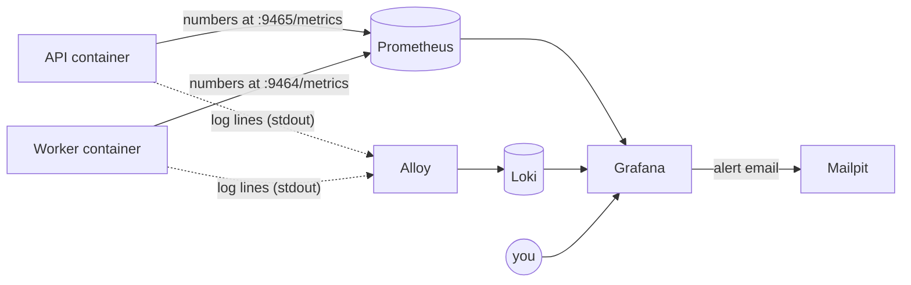

# Monitoring guide: Prometheus, Loki and Grafana in practice

This is the **user's guide** to KlyroStream's monitoring: what each tool is, how to open it, how to read every panel, and how to answer real questions with it. *How* it was built (and why) is in [observability.md](observability.md); this page is about **using** it.

**Contents**

1. [The five pieces, in plain words](#1-the-five-pieces-in-plain-words)
2. [Starting, stopping and opening everything](#2-starting-stopping-and-opening-everything)
3. [A tour of Grafana](#3-a-tour-of-grafana)
4. [Reading the KlyroStream dashboard, panel by panel](#4-reading-the-klyrostream-dashboard-panel-by-panel)
5. [How to read a graph without fooling yourself](#5-how-to-read-a-graph-without-fooling-yourself)
6. [The Prometheus UI](#6-the-prometheus-ui)
7. [Every KlyroStream metric](#7-every-klyrostream-metric)
8. [PromQL cookbook](#8-promql-cookbook)
9. [Logs: Loki and LogQL](#9-logs-loki-and-logql)
10. [Investigation playbooks](#10-investigation-playbooks)
11. [Alerts: reading, silencing, adding](#11-alerts-reading-silencing-adding)
12. [Changing the dashboard or adding a metric](#12-changing-the-dashboard-or-adding-a-metric)
13. [When the monitoring itself is broken](#13-when-the-monitoring-itself-is-broken)
14. [Glossary](#14-glossary)

---

## 1. The five pieces, in plain words

Think of the app as a car. **Metrics** are the dashboard gauges (speed, fuel, temperature). **Logs** are the trip recorder: every event, with details. **Alerts** are the warning lights.

| Piece | What it is | What it does for KlyroStream | Where |
|---|---|---|---|
| **Prometheus** | A database for numbers over time (a *time-series database*) | Every 15 s it asks the API and the worker "what are your numbers right now?" and stores the answers | http://localhost:9090 |
| **Loki** | A database for log lines, indexed by a few labels | Stores every line the containers print, searchable by service, level, request id, video id | no UI of its own; you use it through Grafana |
| **Alloy** | A collector (an agent) | Reads every KlyroStream container's output, parses our JSON log lines, and sends them to Loki | http://localhost:12345 (its own status UI) |
| **Grafana** | The screen in front of both databases | Dashboards, ad-hoc searching (*Explore*), and alerts | http://localhost:3000 |
| **Mailpit** | A fake mail server | Receives Grafana's alert emails (and the app's emails) so you can read them locally | http://localhost:8025 |



Two key ideas:

- **Prometheus pulls.** The app never sends metrics anywhere; it just keeps current numbers in memory and answers when asked. If the app is down, Prometheus notices because nobody answered.
- **Logs and metrics answer different questions.** Metrics: *how much / how often / how fast*, cheaply, for months. Logs: *what exactly happened*, for one request or one video. You usually start with a metric ("errors went up at 10:42") and finish in the logs ("this request failed because storage timed out").

---

## 2. Starting, stopping and opening everything

The monitoring stack is **opt-in** so it doesn't use memory while you code.

```bash
# everything: core services + API + worker + monitoring
docker compose --profile api --profile worker --profile observability up -d --build

# just the monitoring stack (when api/worker are already running)
docker compose --profile observability up -d

# stop the monitoring stack, keep the app running
docker compose stop prometheus loki alloy grafana
```

| Open | URL | Login |
|---|---|---|
| Grafana | http://localhost:3000 | Opens as a read-only viewer. Sign in (bottom left) as `admin` / `admin`, or your `GRAFANA_ADMIN_PASSWORD` if set, to edit or manage alerts |
| Prometheus | http://localhost:9090 | none |
| Alloy status | http://localhost:12345 | none |
| Mailpit | http://localhost:8025 | none |

**The API must run in Docker for its logs to reach Loki.** With `npm run dev` (hot reload) the API runs on your machine, outside Docker: metrics and logs from it won't appear, and Prometheus shows the `api` target as *down*. Switch with:

```bash
docker compose stop api        # then: cd backend && npm run dev
# …and back:
# stop npm run dev (Ctrl+C), then:
docker compose --profile api up -d
```

Data is kept in Docker volumes (`prometheus_data`, `loki_data`, `grafana_data`): **7 days** of metrics and **7 days** of logs.

---

## 3. A tour of Grafana

Open http://localhost:3000. The home page **is** the *KlyroStream overview* dashboard.

### The parts of the screen

| Where | What | Use it to |
|---|---|---|
| Top right: **time picker** (`Last 30 minutes`) | The time range every panel shows | Look at "last 6 hours", or a custom range like "yesterday 14:00–15:00" |
| Next to it: **refresh** (`10s`) | How often panels reload | Turn off while investigating so graphs stop moving |
| Left menu → **Dashboards** | All dashboards; ours is in the *KlyroStream* folder | Find dashboards |
| Left menu → **Explore** | A blank page to run any query against Prometheus or Loki | Ad-hoc questions, log searching |
| Left menu → **Alerting** | Alert rules, their state, contact points, silences | See what's firing, mute alerts during maintenance |
| Left menu → **Connections → Data sources** | Prometheus and Loki | Check they're connected ("Test" button) |

### Things you can do with any graph panel

- **Zoom:** drag across a time range on a graph; every panel follows. *Zoom out* is the magnifier in the time picker, or press `Ctrl+Z`.
- **Isolate a line:** click its name in the legend to show only that line; `Ctrl+click` to add more.
- **Read exact values:** hover. The tooltip lists every line at that moment.
- **Panel menu** (hover the title, click the `⋮` menu):
  - **View** (`v`): full screen.
  - **Explore**: open this exact query in Explore, to change it freely.
  - **Inspect → Data**: the numbers as a table (downloadable CSV).
  - **Inspect → Query**: the exact request sent to Prometheus and how long it took.
  - **Inspect → Panel JSON**: how the panel is defined.

### From a metric to the logs

Zoom into the minute something went wrong, then open **Explore**, choose **Loki**, and run `{service="api", level="50"}`. Explore keeps the time range you zoomed into, so you see the errors from exactly that moment. Section 9 shows more.

---

## 4. Reading the KlyroStream dashboard, panel by panel

The dashboard has four rows. For each panel: what it shows, how to read it, what's normal on this project, and what to do when it isn't.

### Row 1: API

**Requests / s** (big number). All HTTP requests per second, averaged over the last minute. Locally it's near 0 unless you're clicking around or running a test. Real meaning comes from **change**: a sudden drop to 0 while users are active means the API is unreachable, and a sudden spike may be a script or an attack.

**Error rate (5xx, 5m)** (big number, green/orange/red). The share of requests in the last 5 minutes that failed with a **server** error (500–599). Green below 1%, orange 1–5%, red above 5%. 4xx are **not** counted: a wrong password (401) or an unknown video (404) is the client's problem, not an outage. **When red:** go to the logs (`{service="api", level="50"}`) to see what's failing; section 10 has the full playbook.

**p95 latency (5m)** (big number). 95% of requests in the last 5 minutes were faster than this. Green below 0.5 s, orange to 1 s, red above. Measured locally: most routes answer in **5–25 ms**. A rise usually means the database, Redis or storage is slow. The per-route panel below says which route.

**Live sockets** (big number). Socket.io connections open right now (tabs and listeners). It should match the number of open app tabs plus any `npm run socket:listen`. If it drops to 0 suddenly, the API restarted or the socket layer broke; clients reconnect within seconds if the API is up.

**Requests / s by status** (stacked graph). The same traffic as the first number, split by status code: `200` is the healthy bulk, `201`/`204` writes, `4xx` client mistakes, `5xx` failures. A spike of `401` usually means a token problem (expired tokens, wrong secret); a band of `429` means rate limiting is kicking in.

**p95 latency by route** (graph, one line per route). Which endpoint is slow. Labels are route **patterns** like `/videos/:videoId`, never real ids. `unmatched` means "no route matched": unknown URLs (404), and also requests refused by `requireAuth` (401) before a route was chosen. Expected to be slower than the rest: `POST /videos/:videoId/download` (it checks the file in storage first) and the stream playlists (they read from storage and sign URLs).

### Row 2: Queues and worker

**Queue depth** (graph). Jobs per queue and state:

| Line | Meaning | Normal | Worry when |
|---|---|---|---|
| `video-processing waiting` | uploads waiting for a free worker | 0, or a short bump during uploads | it keeps **growing**: the worker can't keep up, or isn't running |
| `video-processing active` | transcodes running now | 0 or 1 (`WORKER_CONCURRENCY` is 1) | stuck at 1 for much longer than videos take |
| `video-processing delayed` | failed attempts waiting to retry (5 s, then 10 s backoff) | 0 | non-zero often: transcodes keep failing |
| `notifications waiting/active` | emails waiting / being sent | 0 | growing: SMTP down or slow |
| `notifications delayed` | emails waiting to retry | 0 | non-zero: the mail server is refusing or timing out (Sprint 8 measured this with Mailpit stopped) |

**Jobs finished / min** (graph). Outcomes per minute: `completed` is success; `retried` is an attempt that failed and will try again; `failed` is final failure (the video is ERROR, or an email gave up). A steady trickle of `retried` with no `failed` is the queue doing its job. Any `failed` deserves a look in the logs.

**Transcode time (per attempt)** (graph, p50 and p95). How long one transcode attempt takes, over the last 30 minutes. Measured: about **8 s** for a 12-second 720p clip, about **70 s** for a 90-second 1080p clip. It depends on the video's length and resolution, so compare like with like. A jump for similar uploads means the worker machine is overloaded.

**Realtime events sent / min** (graph). `video:progress`, `video:ready` and `video:failed` events pushed to sockets. Progress is throttled to at most 1 per second per video, so during one transcode expect up to 60/min. If videos become READY but no `video:ready` is sent, the API's queue-event listener isn't working (check the API logs for `queue events error`).

### Row 3: Runtime

**Event loop lag p99** (graph, per service). How late Node's single thread runs scheduled work. Below about 50 ms is healthy; seconds mean something is **blocking** the thread (a huge JSON parse, a synchronous file read, a CPU-heavy loop), and every request waits behind it.

**Heap used** (graph, per service). JavaScript memory in use. A saw-tooth (rising, then dropping at garbage collection) is normal. A floor that keeps rising for hours, never coming back down, is a **memory leak**.

### Row 4: Logs

**Warnings and errors (API and worker)**. Live log lines at `level` 40 (warn) and 50 (error) from both processes, newest first. Click a line to expand all its fields. This is the quickest "what's going wrong right now?" view.

---

## 5. How to read a graph without fooling yourself

**Counters only go up, so we graph their rate.** `http_requests_total` is "requests since the process started": a line that only climbs, and drops to 0 on restart. That's useless to look at, so every panel uses `rate()`: "per second, over the last N minutes". Restarts are handled automatically.

**Percentiles, not averages.** If 99 requests take 10 ms and 1 takes 5 s, the average is 60 ms: it describes no real request. p50 (the median) is 10 ms, what a typical user sees; p95/p99 is the slow tail, what an unlucky user sees. Watch p95, because that's where complaints come from.

**A percentile from a histogram is an estimate.** Prometheus knows how many requests fell into each bucket (≤ 5 ms, ≤ 10 ms, ≤ 25 ms …) and interpolates within one. "p95 = 18 ms" really means "somewhere between 10 and 25 ms, probably near 18".

**The window changes the story.** `rate(x[1m])` reacts fast but is jumpy; `rate(x[5m])` is smooth but slow to show a change. A spike that lasted 20 seconds is clearly visible at 1m and almost invisible at 5m.

**"No data" is not zero.** An empty panel means no series exist yet. For example, the error rate has no 5xx series until the first error ever happens, and the transcode panel is empty until a video has been processed since the worker started. The error-rate number uses `or vector(0)` so it shows 0% instead of "No data".

**Stacked graphs add up.** In *Requests / s by status*, the top edge is the total and each band is one status. Don't read a band's top edge as its own value.

**Every process restart resets counters.** After `docker compose up --build`, counters start from 0 again. `rate()` copes, but a raw counter value you compare by eye won't.

---

## 6. The Prometheus UI

http://localhost:9090 is Prometheus' own, simpler interface. Grafana is nicer for daily use, but this UI is the quickest way to check whether data **exists**.

| Page | What it's for |
|---|---|
| **Status → Target health** (`/targets`) | Is Prometheus able to scrape the API and the worker? Each target shows **UP** or **DOWN**, the last scrape time and any error. Start here when a panel is empty |
| **Query** (home page) | Type any PromQL and see a **Table** (values now) or **Graph** (over time). The input autocompletes metric names |
| **Status → Configuration** | The scrape config it's running with (`docker/prometheus/prometheus.yml`) |
| **Status → TSDB status** | How many series it stores, and which metrics have the most. Cardinality problems show up here first |

Try these in **Query → Table**:

```text
up                                          # 1 = target scraped fine, 0 = down
http_requests_total                         # every request series, with labels
count by (__name__) ({service="api"})       # how many series each API metric has
```

---

## 7. Every KlyroStream metric

| Metric | Type | Labels | Meaning |
|---|---|---|---|
| `http_requests_total` | counter | `method`, `route`, `status` | HTTP requests handled by the API |
| `http_request_duration_seconds` | histogram | `method`, `route` | How long each request took |
| `socket_connections` | gauge | | Sockets connected to this API instance now |
| `realtime_events_total` | counter | `event` | Socket events sent (`video:progress`, `video:ready`, `video:failed`) |
| `queue_jobs_total` | counter | `queue`, `status` | Jobs finished: `completed`, `retried`, `failed` |
| `queue_active_jobs` | gauge | `queue` | Jobs the worker is running now |
| `queue_depth` | gauge | `queue`, `state` | Jobs in the queue: `waiting`, `prioritized`, `active`, `delayed`, `failed` |
| `video_processing_duration_seconds` | histogram | `status` | Duration of one transcode attempt |
| `up` | gauge (added by Prometheus) | `job`, `instance` | 1 if the last scrape worked |
| `process_*`, `nodejs_*` | various | | Node runtime: CPU, memory, event loop, GC, handles (from prom-client's defaults) |

Every series also has `service` (`api` or `worker`), `job` and `instance`. Notable defaults: `process_resident_memory_bytes` (total memory of the process), `process_start_time_seconds` (when it started, handy for spotting restarts), `nodejs_eventloop_lag_p99_seconds`, `nodejs_heap_size_used_bytes`, `nodejs_gc_duration_seconds`.

---

## 8. PromQL cookbook

Paste these into **Explore → Prometheus** (switch the editor to **Code**), or into the Prometheus UI. Lines starting with `#` are explanations, not part of the query.

### Traffic and errors

```text
# requests per second, per route
sum by (route) (rate(http_requests_total[5m]))

# the 5 busiest routes
topk(5, sum by (route) (rate(http_requests_total[5m])))

# 5xx per second, per route — where are the errors?
sum by (route) (rate(http_requests_total{status=~"5.."}[5m]))

# 4xx per route — who's getting refused? (lots of 401s = token problems)
sum by (route, status) (rate(http_requests_total{status=~"4.."}[5m]))

# requests in the last hour, total
sum(increase(http_requests_total[1h]))

# error ratio now vs. the same time yesterday
  sum(rate(http_requests_total{status=~"5.."}[5m])) / sum(rate(http_requests_total[5m]))
/ (sum(rate(http_requests_total{status=~"5.."}[5m] offset 1d)) / sum(rate(http_requests_total[5m] offset 1d)))
```

### Latency

```text
# p50, p95, p99 for all requests
histogram_quantile(0.50, sum by (le) (rate(http_request_duration_seconds_bucket[5m])))
histogram_quantile(0.95, sum by (le) (rate(http_request_duration_seconds_bucket[5m])))
histogram_quantile(0.99, sum by (le) (rate(http_request_duration_seconds_bucket[5m])))

# p95 per route, slowest first (Table view)
sort_desc(histogram_quantile(0.95, sum by (le, route) (rate(http_request_duration_seconds_bucket[5m]))))

# average duration per route (fine for comparisons, hides the tail)
sum by (route) (rate(http_request_duration_seconds_sum[5m])) / sum by (route) (rate(http_request_duration_seconds_count[5m]))

# share of requests faster than 100 ms — an SLO-style number
sum(rate(http_request_duration_seconds_bucket{le="0.1"}[5m])) / sum(rate(http_request_duration_seconds_count[5m]))
```

### Queues and the worker

```text
# transcodes completed in the last hour
sum(increase(queue_jobs_total{queue="video-processing", status="completed"}[1h]))

# share of attempts that had to be retried
  sum(rate(queue_jobs_total{status="retried"}[1h]))
/ sum(rate(queue_jobs_total[1h]))

# backlog right now, per queue
sum by (queue) (queue_depth{state=~"waiting|prioritized|delayed"})

# is the backlog growing? (positive = growing, per second)
deriv(sum(queue_depth{queue="video-processing", state="waiting"})[10m:])

# median transcode time over the last 6 hours
histogram_quantile(0.5, sum by (le) (rate(video_processing_duration_seconds_bucket{status="completed"}[6h])))

# emails that gave up for good today
sum(increase(queue_jobs_total{queue="notifications", status="failed"}[1d]))
```

### Health of the processes

```text
# is everything being scraped? (0 = down)
up

# when did each process last start? (Grafana shows it as a date with unit "Date & time")
process_start_time_seconds * 1000

# restarts in the last hour
changes(process_start_time_seconds[1h])

# memory per process, in MiB
process_resident_memory_bytes / 1024 / 1024

# CPU use per process (1 = one full core)
rate(process_cpu_seconds_total[1m])
```

### The building blocks used above

| Piece | Means |
|---|---|
| `metric{label="x"}` | only series where `label` equals `x` (`!=` not equal, `=~` regex match, `!~` regex no-match) |
| `rate(counter[5m])` | per-second increase, averaged over 5 minutes |
| `increase(counter[1h])` | total increase over 1 hour |
| `sum by (label) (…)` | add series together, keeping only `label` |
| `topk(5, …)` / `sort_desc(…)` | the 5 largest / sort descending |
| `histogram_quantile(0.95, sum by (le) (rate(x_bucket[5m])))` | the 95th percentile from a histogram (always keep `le`) |
| `offset 1d` | the same query, one day earlier |
| `deriv(x[10m:])` | how fast a gauge is changing |
| `changes(x[1h])` | how many times a value changed |

---

## 9. Logs: Loki and LogQL

Logs are searched in **Explore → Loki**. A LogQL query has two parts: **which streams** (labels, in `{}`), then **filters** on the lines.

### The labels you can select on

| Label | Values |
|---|---|
| `service` | `api`, `worker`, `postgres`, `redis`, `rustfs`, `mailpit`, `prometheus`, `loki`, `grafana`, `alloy` |
| `level` | pino levels, for our two services: `20` debug, `30` info, `40` warn, `50` error, `60` fatal |

`requestId` and `videoId` are **structured metadata**: not labels (there are too many values), but you can still filter on them directly.

### What one API log line contains

```json
{"level":30,"time":"2026-10-19T19:42:13.873Z","env":"production","requestId":"685eca28-…",
 "req":{"id":"685eca28-…","method":"GET","url":"/videos/4dce8038-…"},
 "service":"api","res":{"statusCode":200},"responseTime":8,"msg":"request completed"}
```

Worker lines carry `jobId`, `videoId`, `requestId` and `attempt`. The `outputs uploaded` line also carries `timings` per stage, `sourceBytes`, `outputBytes` and `mediaSeconds`.

### Queries to keep

```text
# everything the API logged
{service="api"}

# errors from both of our processes
{service=~"api|worker", level="50"}

# everything about one request, across API and worker (paste the id from an error body or X-Request-Id)
{service=~"api|worker"} | requestId="685eca28-4df0-4b14-b5a2-97cb47c78eb7"

# everything about one video
{service=~"api|worker"} |= "4dce8038-4c87-4472-99e6-635ad14a2216"

# lines containing a word (case-sensitive) / not containing one
{service="worker"} |= "failed"
{service="api"} != "health"

# parse the JSON and filter on fields (nested keys are joined with _)
{service="api"} | json | res_statusCode >= 500
{service="api"} | json | responseTime > 500
{service="api"} | json | req_method="POST" | res_statusCode = 409

# worker stage timings for each transcode
{service="worker"} |= "outputs uploaded" | json | line_format "{{.videoId}}  total {{.totalMs}} ms  ({{.mediaSeconds}} s of video)"

# make lines readable: show only time-relevant fields
{service="api"} | json | line_format "{{.req_method}} {{.req_url}} → {{.res_statusCode}} in {{.responseTime}} ms"
```

### Turning logs into numbers

LogQL can count lines, which is useful for things we have no metric for:

```text
# errors per minute, per service
sum by (service) (count_over_time({service=~"api|worker", level="50"}[1m]))

# failed basic-auth attempts in the last hour (someone guessing the admin password?)
sum(count_over_time({service="api"} |= "basic auth failed" [1h]))

# emails that needed a retry, per 10 minutes
sum(count_over_time({service="worker"} |= "email not sent, will retry" [10m]))
```

Switch Explore's view to a graph to see these over time.

### Messages worth knowing

| Message | Service | Means |
|---|---|---|
| `request completed` | api | one HTTP request, with status and `responseTime` (ms) |
| `processing started` / `processing complete` | worker | a transcode attempt began / ended READY |
| `attempt failed, will retry` | worker | a transcode attempt failed; BullMQ retries it |
| `processing failed for good` | worker | final failure; the video is ERROR |
| `email sent` / `email not sent, will retry` / `email gave up after every retry` | worker | the email queue's three outcomes |
| `video deleted` | api | a delete finished, with object counts |
| `could not relay a video event` / `queue events error` | api | the socket relay has a problem |
| `basic auth failed` | api | wrong admin credentials |

---

## 10. Investigation playbooks

### "The error-rate alert fired"

1. **Dashboard → Requests / s by status:** when did 5xx start, and is it still happening?
2. **p95 latency by route,** or the query `sum by (route) (rate(http_requests_total{status=~"5.."}[5m]))`: **which route** fails? One route points at one dependency; all routes point at something shared (database, Redis).
3. **Logs:** `{service="api", level="50"}` around that time. Expand a line: `err.message` says what broke. Measured example, with storage stopped: `the request socket did not establish a connection with the server within the configured timeout of 3000 ms`.
4. **Check the dependency:** `docker compose ps`. Is postgres/redis/rustfs up and healthy?
5. Once fixed, the alert resolves by itself and Grafana sends a **RESOLVED** email.

### "A user says their upload is stuck"

1. Get the video id (from the app, or `SELECT id, status FROM videos ORDER BY created_at DESC`).
2. **Logs:** `{service=~"api|worker"} |= "<videoId>"`. You'll see the `complete` request, then the worker's `processing started` … `processing complete`, or where it stopped.
3. **Queue depth:** is `video-processing waiting` above 0 while `active` is 0? Then no worker is taking jobs: check `up{job="worker"}` and `docker compose ps worker`.
4. Is `delayed` above 0? The job failed and is waiting to retry. The logs show `attempt failed, will retry` with the reason.
5. Still `PROCESSING` with no job anywhere? That's the Sprint 5 case: `npm run videos:requeue-stuck`.

### "The API feels slow"

1. **p95 latency by route:** one route, or all of them?
2. **Event loop lag:** high means Node is blocked; that slows **all** routes at once.
3. **One route:** `{service="api"} | json | responseTime > 500 | req_url =~ ".*stream.*"` (adjust the pattern) to find concrete slow requests, then check what that route depends on (storage for playlists and downloads, Postgres for lists).
4. **Memory:** heap or `process_resident_memory_bytes` near the limit means garbage collection is running constantly.

### "Nobody got the 'video ready' email"

1. **Queue depth → notifications:** emails `waiting` or `delayed`?
2. **Logs:** `{service="worker"} |= "email"`: `email sent`, `will retry` (with the SMTP error), or `gave up`.
3. Not there at all? Search the video id: no `email-video-ready` job means the enqueue itself failed (`could not queue the video email`), the known gap described in [realtime.md §9](realtime.md#9-stage-5-email-through-a-queue).
4. Locally, check Mailpit at http://localhost:8025.

### "Live updates stopped arriving in the browser"

1. **Live sockets:** 0? The client isn't connected. Check the browser console for `connect_error`.
2. **Realtime events sent / min:** events going out but not received means the client isn't in the room (did it `club:join` after reconnecting?). Nothing going out while videos finish means the API's queue listener is broken: `{service="api"} |= "queue events"`.

### "Is the worker keeping up?"

Compare `sum(rate(queue_jobs_total{queue="video-processing", status="completed"}[1h]))` (finished per second) with the rate of new uploads. If `waiting` grows for an hour, it isn't: add worker containers (`docker compose --profile worker up -d --scale worker=2`) or raise `WORKER_CONCURRENCY` on a bigger machine.

---

## 11. Alerts: reading, silencing, adding

### The alert we have

**API error rate above 5%** (`docker/grafana/provisioning/alerting/rules.yml`):

```text
(sum(rate(http_requests_total{status=~"5.."}[2m])) / sum(rate(http_requests_total[2m])))
  and on() (sum(increase(http_requests_total[2m])) >= 20)
```

The query returns the error ratio, but only when there were at least 20 requests in the last 2 minutes (`and on()` drops the result otherwise). Grafana's threshold step fires when that value is **above 0.05** and has stayed above it **for 2 minutes**. The 20-request floor stops it firing because one request out of three failed on a quiet machine. It's checked every 30 s, and emails go to `ops@klyro.local` in Mailpit.

### Alert states

| State | Means |
|---|---|
| **Normal** | condition false |
| **Pending** | condition true, but not yet for the full 2 minutes |
| **Firing** | true for 2 minutes; the email is sent |
| **Resolved** (then Normal) | was firing, now false; a "RESOLVED" email is sent |
| **No data** | the query returned nothing (no traffic) — treated as OK for this rule |
| **Error** | the query itself failed (e.g. Prometheus down) |

See them under **Alerting → Alert rules**: expand a rule for its current value, state history and the query.

### Silencing

Planned maintenance (restarting storage on purpose)? **Alerting → Silences → New silence**, matching `alertname = API error rate above 5%`, for a set time. Alerts still evaluate, but no email is sent.

### Adding an alert

Rules are files, so they're reviewed like code. Add a rule to `docker/grafana/provisioning/alerting/rules.yml` following the existing one, then `docker compose restart grafana`. Good next candidates:

| Alert | Query (condition `> 0` or as shown) | `for` |
|---|---|---|
| Worker down | `1 - up{job="worker"}` (1 when the worker can't be scraped) | 1m |
| Transcode backlog | `sum(queue_depth{queue="video-processing", state="waiting"}) > 10` | 10m |
| Emails failing | `sum(increase(queue_jobs_total{queue="notifications", status="failed"}[15m])) > 0` | 0m |
| Slow API | `histogram_quantile(0.95, sum by (le) (rate(http_request_duration_seconds_bucket[5m]))) > 1` | 5m |

A good alert is **actionable** (someone can do something about it) and **user-visible** (it describes a symptom users feel, not a cause like "CPU at 80%").

---

## 12. Changing the dashboard or adding a metric

### Changing the dashboard

The dashboard is a **provisioned** file (`docker/grafana/dashboards/klyro.json`). It's read-only in the UI, so that what's in git is what everyone sees. To change it:

1. Sign in as admin. **Dashboards → New → Import**, paste the contents of `klyro.json`, and change its `uid` and title (e.g. `klyro-overview-draft`). You now have an editable copy.
2. Edit panels in the UI (**Edit** → change the query, visualisation, units, thresholds).
3. **Export → Export as JSON**. Copy the panels (or the whole JSON, restoring the original `uid` and title) into `docker/grafana/dashboards/klyro.json`.
4. `docker compose restart grafana` and check the result, then commit the file. Delete the draft.

Tips: set the **unit** (seconds, percent, bytes, requests/s) so numbers read naturally, and use `{{label}}` in **Legend** for readable line names.

### Adding a metric in code

1. Pick the type: counting events → **Counter**; a current level → **Gauge**; durations or sizes → **Histogram**.
2. Name it `<thing>_<unit>`, with the unit spelled out: `_seconds`, `_bytes`, or `_total` for counters (`email_send_duration_seconds`, not `emailTime`).
3. Labels from a **small, fixed set only**: route patterns, statuses, queue names. **Never** ids, emails, URLs or free text (see [observability.md §3](observability.md#3-labels-and-cardinality-why-ids-never-become-labels)).
4. Define it next to the code that updates it, with `registers: [registry]`:

```ts
const emailDuration = new Histogram({
  name: 'email_send_duration_seconds',
  help: 'Time to hand one email to SMTP',
  buckets: [0.05, 0.1, 0.25, 0.5, 1, 2.5, 5, 10],
  registers: [registry],
});
const end = emailDuration.startTimer();
await sendMail(mail);
end();
```

5. Check it at `:9464/metrics` (worker) or `:9465/metrics` (API) from inside the Docker network, or in Prometheus' Query page after the next scrape.

---

## 13. When the monitoring itself is broken

| Symptom | Check | Usual cause |
|---|---|---|
| Dashboard panels say "No data" | Prometheus → **Target health** | Target DOWN: the API is running outside Docker (`npm run dev`), or the container is stopped |
| Target DOWN with "no such host" | `docker compose ps api worker` | The app containers aren't running (they're behind their own profiles) |
| Only some panels empty | the panel's query in Explore | No events of that kind yet (no 5xx, no transcode since the worker started), which is normal |
| No logs in Loki | Alloy UI (http://localhost:12345) → components | Alloy can't read the Docker socket, or Loki isn't up. `docker compose logs alloy` |
| Logs present but `level` / `requestId` missing | `docker compose logs api` | The line isn't JSON: the API was started in development mode (pretty-printed logs) |
| Grafana shows the login page | — | Anonymous viewing is on for the dashboard; editing needs `admin` |
| Alert never fires during a test | Alerting → the rule's **query value** | Not enough traffic: fewer than 20 requests in 2 minutes never fires, by design |
| Machine short on memory | `docker stats` | Stop the observability profile when you don't need it: `docker compose stop prometheus loki alloy grafana` |

---

## 14. Glossary

| Term | Meaning |
|---|---|
| **Time series** | One metric name + one set of label values, with a value per timestamp |
| **Label** | A key=value pair that splits a metric (`route="/videos/:videoId"`) |
| **Cardinality** | How many series a metric has; ids as labels make it explode |
| **Scrape** | Prometheus fetching `/metrics` from a target (every 15 s here) |
| **Target** | Something Prometheus scrapes (`api:9465`, `worker:9464`) |
| **Counter / Gauge / Histogram** | Only-up count / up-and-down level / bucketed distribution |
| **Rate** | Per-second increase of a counter over a window |
| **Percentile (p95)** | The value 95% of observations are below |
| **PromQL / LogQL** | The query languages of Prometheus / Loki |
| **Stream** (Loki) | All log lines with the same label set |
| **Structured metadata** (Loki) | Per-line fields you can filter on without making them labels |
| **Provisioning** | Grafana loading datasources, dashboards and alerts from files at startup |
| **Pending / Firing / Resolved** | Alert condition true but waiting / true long enough, notified / no longer true |
| **Silence** | A time-limited mute for matching alerts |
