# Monitoring and observability: a guide from zero

This guide assumes **no prior experience** with monitoring. It starts with the ideas (what a metric is, what an alert is), then explains each tool we run, then teaches you to use them on KlyroStream with real screenshots from this project. Every concept is explained before it's used.

*How* the monitoring was built, and why, is in [observability.md](observability.md). This page is about **understanding and using** it.

> **How to read this:** Part A is theory with no tools; read it once, start to finish. Part B explains each tool; read the sections as you meet the tools. Part C is practical: do [the first session](#14-your-first-session-a-guided-tour-with-exercises) with Grafana open, then keep the rest as a reference.

**Contents**

**Part A: the ideas**
1. [Why monitor at all? A 2 a.m. story](#1-why-monitor-at-all-a-2-am-story)
2. [The vocabulary](#2-the-vocabulary)
3. [Metrics, from zero](#3-metrics-from-zero)
4. [Logs, from zero](#4-logs-from-zero)
5. [Alerts, from zero](#5-alerts-from-zero)

**Part B: the tools**

6. [The big picture: five tools, one job each](#6-the-big-picture-five-tools-one-job-each)
7. [Prometheus: the numbers database](#7-prometheus-the-numbers-database)
8. [Loki: the logs database](#8-loki-the-logs-database)
9. [Alloy: the log collector](#9-alloy-the-log-collector)
10. [Grafana: the screen in front of everything](#10-grafana-the-screen-in-front-of-everything)
11. [Grafana dashboards and panels in depth](#11-grafana-dashboards-and-panels-in-depth)
12. [Grafana alerting in depth: rules, policies, contact points](#12-grafana-alerting-in-depth-rules-policies-contact-points)
13. [Mailpit: where alert emails land](#13-mailpit-where-alert-emails-land)

**Part C: using it on KlyroStream**

14. [Your first session: a guided tour with exercises](#14-your-first-session-a-guided-tour-with-exercises)
15. [Starting, stopping, logging in](#15-starting-stopping-logging-in)
16. [The KlyroStream dashboard, panel by panel](#16-the-klyrostream-dashboard-panel-by-panel)
17. [Reading graphs without fooling yourself](#17-reading-graphs-without-fooling-yourself)
18. [Every KlyroStream metric](#18-every-klyrostream-metric)
19. [PromQL from zero, then a cookbook](#19-promql-from-zero-then-a-cookbook)
20. [LogQL from zero, then a cookbook](#20-logql-from-zero-then-a-cookbook)
21. [Investigation playbooks](#21-investigation-playbooks)
22. [Alerts day to day: reading, silencing, adding](#22-alerts-day-to-day-reading-silencing-adding)
23. [Changing the dashboard or adding a metric](#23-changing-the-dashboard-or-adding-a-metric)
24. [When the monitoring itself is broken](#24-when-the-monitoring-itself-is-broken)
25. [What we don't have yet](#25-what-we-dont-have-yet)
26. [Glossary](#26-glossary)
27. [Further reading](#27-further-reading)

---

# Part A: the ideas

## 1. Why monitor at all? A 2 a.m. story

A club admin emails at 2 a.m.: *"Uploads are broken."* Without monitoring, you'd have to guess. With it, you can answer in minutes:

- **Is it really broken, and for everyone?** A graph shows uploads succeeded all day and stopped at 01:40. Every upload since has failed.
- **Where?** The error count is on one route, `POST /videos/:videoId/upload/complete`. Other routes are fine.
- **Why?** The log lines for those failures say `the request socket did not establish a connection with the server within the configured timeout`, for the storage server.
- **Since when, exactly, and is it fixed now?** The graph shows the moment it broke and, after you restart storage, the moment it recovered.
- **Could we have known first?** An **alert** would have emailed you at 01:42, before the user noticed.

That's monitoring: the system **tells you about itself** (numbers, events, alarms), so problems become questions with answers instead of guesses.

## 2. The vocabulary

| Word | Meaning |
|---|---|
| **Monitoring** | Watching known things: "is the error rate above 5%?" You decide in advance what to watch |
| **Observability** | How well you can answer **new** questions about a system from what it emits, including ones you didn't plan for ("why only uploads from this club?") |
| **Telemetry** | The data a system emits about itself: metrics, logs, traces |
| **Signal** | One kind of telemetry. The "three pillars" are **metrics**, **logs** and **traces** |
| **Instrumentation** | The code inside the app that produces telemetry: a counter incremented per request, a log line written per job |
| **Symptom** | What users feel: errors, slowness, things not happening |
| **Cause** | Why: a disk is full, a dependency is down, a bug |

The three pillars in one table:

| | Metrics | Logs | Traces |
|---|---|---|---|
| What | Numbers measured over time | Individual events with details | The path of one request through many services, with timings |
| Example | "12 requests/s, 0.4% errors" | "request 685e… GET /videos/4dce… → 404 in 3 ms" | "upload took 72 s: 1 s API, 70 s worker (3 s download, 64 s FFmpeg, 3 s upload)" |
| Good for | Trends, dashboards, alerts | What exactly happened, and why | Where the time went |
| Cost | Very cheap | More expensive (every event stored) | Most expensive |
| KlyroStream | ✅ Prometheus | ✅ Loki | ❌ not yet ([section 25](#25-what-we-dont-have-yet)) |

**Rule of thumb:** alert on **symptoms** (users get errors) rather than causes (CPU is at 80%). High CPU that nobody notices isn't a problem; errors that users see always are.

## 3. Metrics, from zero

### A metric is a number that changes over time

Your car's dashboard shows speed, fuel and engine temperature: a few numbers, updated constantly. A metric is the same idea for software: *requests handled*, *jobs waiting*, *memory used*. If we write the number down every 15 seconds, we get a **time series**:

```text
time      requests handled so far
10:00:00  1,204
10:00:15  1,219
10:00:30  1,241
```

Each entry (a time plus a value) is a **sample**. From these samples we can draw a graph, compare today with yesterday, and set alarms.

### Labels: one name, many series

"Requests handled" is more useful split up: which route? which status? A metric gets **labels**, key=value pairs:

```text
http_requests_total{route="/videos/:videoId", status="200"}  1,190
http_requests_total{route="/videos/:videoId", status="404"}     14
http_requests_total{route="/clubs/:clubId/videos", status="200"} 37
```

Each unique combination of labels is its **own time series**. You can then ask "all requests", "only 404s" or "only this route" from the same data.

**The one rule about labels:** their values must come from a **small, fixed set**. `status` has a few dozen possible values; `route` has about 30 here. A label holding a **video id** would create a new series for every video ever uploaded. That's called **high cardinality**, and it slowly kills the metrics database. Ids belong in logs, never in metric labels.

### Three kinds of metric, with everyday examples

| Kind | Everyday example | Behaviour | KlyroStream examples |
|---|---|---|---|
| **Counter** | A car's odometer | Only goes **up** (resets to 0 when the app restarts) | `http_requests_total`, `queue_jobs_total` |
| **Gauge** | A car's speedometer or fuel gauge | Goes **up and down** | `socket_connections`, `queue_depth`, memory used |
| **Histogram** | Sorting runners into "under 20 min / under 25 min / under 30 min" groups | Counts measurements into **buckets** | `http_request_duration_seconds`, `video_processing_duration_seconds` |

**Why counters only go up:** the app just counts "+1" for each event. That's cheap and never loses information. The *speed* (events per second) is calculated later from how fast the counter grows. That calculation is called the **rate**.

### Rate: turning a counter into "per second"

If the odometer read 1,204 at 10:00:00 and 1,264 at 10:01:00, you drove 60 units in 60 seconds: **1 per second**. That's the rate. Graphs of counters always show the rate, never the raw ever-growing number.

### Percentiles: the honest way to talk about speed

Twenty requests took these times (ms):

```text
4, 5, 5, 5, 6, 6, 6, 7, 7, 7, 8, 8, 9, 9, 10, 11, 12, 15, 40, 900
```

- The **average** is 54 ms, which describes **no** real request. One slow 900 ms request dragged it up.
- The **median (p50)** is the middle value, 7.5 ms: what a typical request takes.
- The **p95** is the value 95% of requests were faster than: here about 40 ms. It shows the slow tail.
- The **p99** is the slowest 1%: about 900 ms.

Users remember the slow requests, so you watch **p95** (or p99). That's why we store durations in a **histogram**: from the bucket counts ("how many took ≤ 5 ms, ≤ 10 ms, ≤ 25 ms …"), any percentile can be estimated later, and combined across servers.

## 4. Logs, from zero

### A log line is a diary entry

Programs write a line whenever something happens: a request finished, a job started, an error occurred. Old-style logs are free text:

```text
2026-10-20 12:10:37 INFO email sent for video a37b… attempt 1
```

Readable by humans, hard for machines: "find every email for video a37b…" means guessing at text patterns.

### Structured logs: JSON, one object per line

KlyroStream writes **structured** logs: each line is a JSON object with named fields.

```json
{"level":30,"time":"2026-10-20T07:10:37.065Z","service":"worker","jobId":"email-video-ready-a37b…",
 "requestId":"362f2a51-…","attempt":1,"subject":"\"s9 demo short720.mp4\" is ready to watch","msg":"email sent"}
```

Now a machine can filter exactly: `service = worker` and `msg = "email sent"`.

### Levels: how serious a line is

Our logger (pino) uses numbers:

| Number | Name | Used for |
|---|---|---|
| 20 | debug | Detail for developers (off in the containers) |
| 30 | info | Normal events: request finished, job done |
| 40 | warn | Something unusual but handled: a 404, a retry |
| 50 | error | Something failed: a 500, a job that gave up |
| 60 | fatal | The process is about to die |

### Correlation: one id that ties a story together

One user action produces many lines in different programs: the API takes the upload, the worker transcodes it, the worker sends the email. If every one of those lines carries the same **request id**, you can pull the whole story with one search. KlyroStream does exactly that: `requestId` follows an upload from the API into the transcode job and into the email job.

## 5. Alerts, from zero

### An alert is a question asked every 30 seconds

"Is more than 5% of traffic failing?" A program asks this repeatedly. When the answer is "yes", it **notifies** someone, here by email.

### The parts of a good alert

| Part | Why |
|---|---|
| **A condition** | The question: error ratio > 5% |
| **A duration** | "for 2 minutes": one bad moment shouldn't wake anyone |
| **A minimum volume** | 1 error out of 3 requests is 33%, but meaningless. Ours needs ≥ 20 requests in the window |
| **A notification** | Who hears about it, and how (email, chat, a phone call) |
| **A recovery message** | "Resolved", so people know they can stop worrying |

### Good alerts vs bad alerts

- **Actionable:** someone can and should do something now. "Disk 90% full" might be; "a user typed a wrong password" never is.
- **Symptom-based:** it describes what users feel. "Errors > 5%" is good; "CPU > 80%" is often noise.
- **Rare:** an alert that fires every day trains people to ignore it ("alert fatigue"), and then the real one gets ignored too.

---

# Part B: the tools

## 6. The big picture: five tools, one job each

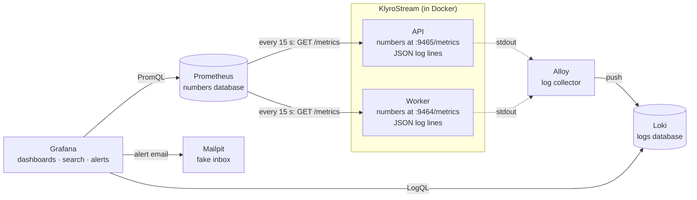

| Tool | One-line job | Analogy |
|---|---|---|
| **Prometheus** | Collect and store numbers | A meter reader who visits every 15 s and writes down every gauge |
| **Loki** | Store log lines cheaply and search them | A filing cabinet sorted by a few tabs (service, level) |
| **Alloy** | Pick up log lines from containers and deliver them to Loki | The courier between the app and the cabinet |
| **Grafana** | Show it all, search it, raise alarms | The control room with screens and alarm bells |
| **Mailpit** | Receive emails locally so nothing goes to a real inbox | A test mailbox |

Where they live in the project:

| Tool | Configured by | Container | URL |
|---|---|---|---|
| Prometheus | `docker/prometheus/prometheus.yml` | `prometheus` | http://localhost:9090 |
| Loki | `docker/loki/config.yml` | `loki` | (used through Grafana) |
| Alloy | `docker/alloy/config.alloy` | `alloy` | http://localhost:12345 |
| Grafana | `docker/grafana/**` | `grafana` | http://localhost:3000 |
| Mailpit | `docker-compose.yml` | `mailpit` | http://localhost:8025 |

## 7. Prometheus: the numbers database

### What it does

1. **Scrapes.** Every 15 seconds Prometheus sends `GET /metrics` to each **target** and reads the text that comes back (the current value of every metric).
2. **Stores.** It appends those values to its time-series database on disk, kept for **7 days** here.
3. **Answers queries.** It understands **PromQL**, a small language for questions like "requests per second by route over the last 5 minutes".
4. **Watches itself.** For each target it records `up`: 1 if the scrape worked, 0 if not.

### Scrape, target, job, instance

| Term | Meaning | KlyroStream |
|---|---|---|
| **Target** | An address Prometheus scrapes | `api:9465`, `worker:9464` |
| **Job** | A name for a group of targets doing the same thing | `api`, `worker` |
| **Instance** | One specific target in a job | `api:9465` |
| **Scrape interval** | How often | 15 s |

Prometheus adds `job` and `instance` labels to everything it scrapes. Our app adds `service` too.

**Pull, not push:** the app never sends metrics anywhere. It keeps the current numbers in memory and answers when asked. If the app is down, nobody answers, `up` becomes 0, and that's a signal in itself.

### What the app actually shows Prometheus

Open a metrics endpoint (they're private, so from inside Docker: `docker exec klyro-api-1 wget -qO- localhost:9465/metrics | head -20`):

```text
# HELP http_requests_total HTTP requests by method, route pattern and status code
# TYPE http_requests_total counter
http_requests_total{method="GET",route="/videos/:videoId",status="200",service="api"} 3
```

`# HELP` is the description, `# TYPE` the kind, then one line per series: name, labels, current value.

### The Target health page

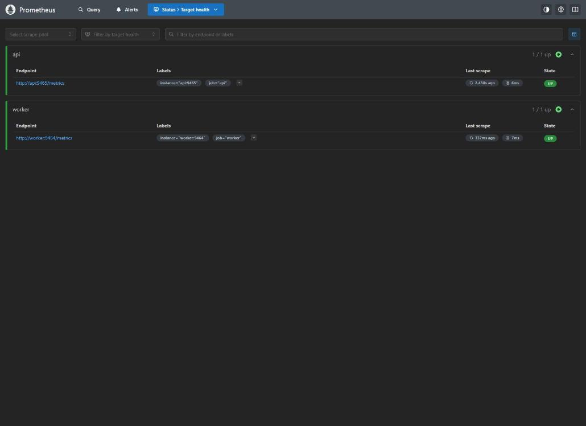

**Status → Target health** (http://localhost:9090/targets) is the first place to look when a graph is empty. Each target shows its labels, when it was last scraped, how long the scrape took (6–7 ms here) and **UP/DOWN**. A DOWN target shows the error, e.g. "no such host" if the container isn't running.

### What Prometheus is *not*

- **Not exact.** It samples every 15 s and estimates rates. Fine for "about 2.4 requests/s", wrong for billing ("charge for exactly 1,204 downloads"); the database is the source of truth for that.
- **Not for logs or individual events.** "Which request failed?" is a question for logs.
- **Not long-term storage** as configured: 7 days, then data is deleted.

## 8. Loki: the logs database

### What it does

Loki stores log lines and lets you search them. Its trick is to **index very little**. Each line belongs to a **stream**, identified by a small set of **labels**; only the labels are indexed. The lines themselves are compressed into **chunks** and scanned when you search. That makes storage cheap, and keeps searching fast enough as long as you first narrow down by label.

### Streams and labels in KlyroStream

| Label | Values | Set by |
|---|---|---|
| `service` | `api`, `worker`, `postgres`, `redis`, `rustfs`, `mailpit`, `prometheus`, `loki`, `grafana`, `alloy` | Alloy, from the Docker Compose service name |
| `level` | `20`, `30`, `40`, `50`, `60` (for our two services) | Alloy, from the JSON field |

So `{service="worker", level="50"}` selects one stream: the worker's errors.

### Structured metadata: searchable without being a label

`requestId` and `videoId` have unlimited values, so as labels they would create endless streams (the same cardinality problem as in Prometheus). Loki 3 has **structured metadata**: fields stored next to each line that you can filter on (`| requestId="…"`) without creating streams. That's where our ids go.

### Retention

Logs are kept **7 days**; a background job (the *compactor*) deletes older data.

## 9. Alloy: the log collector

Our programs don't send logs anywhere: they just print JSON lines to standard output, as Docker expects. Something has to collect those lines and deliver them to Loki. That's **Alloy** (Grafana's collector, successor to "Promtail").

Alloy's config is a **pipeline of components**, each passing data to the next:

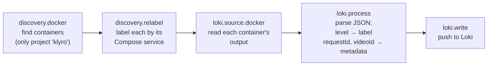

It reads containers through the **Docker socket** (`/var/run/docker.sock`, mounted read-only), the same channel the `docker` command uses. Its own UI at http://localhost:12345 shows each component and whether it's healthy, which is useful when logs stop arriving.

## 10. Grafana: the screen in front of everything

Grafana stores **no data of its own** (apart from its settings). It asks Prometheus and Loki, then draws the answers.

### Data sources

A **data source** is a connection to a database that Grafana can query. We have two, set up from `docker/grafana/provisioning/datasources/datasources.yml`:

| Name | Type | Address (inside Docker) | uid |
|---|---|---|---|
| Prometheus | prometheus | http://prometheus:9090 | `prometheus` |
| Loki | loki | http://loki:3100 | `loki` |

The **uid** is a fixed id that dashboards and alerts refer to. Because it's fixed in a file, the dashboard works on any machine.

### The main areas of Grafana

| Left menu | What it's for |
|---|---|
| **Home** | Our dashboard (set as the home page) |
| **Dashboards** | All dashboards, organised in **folders** (ours: *KlyroStream*) |
| **Explore** | A blank query page for any data source: ad-hoc questions and log searching |
| **Drilldown** | Grafana 12's point-and-click apps for exploring metrics and logs without writing queries |
| **Alerting** | Alert rules, contact points, notification policies, silences ([section 12](#12-grafana-alerting-in-depth-rules-policies-contact-points)) |
| **Connections** | Data sources and integrations |
| **Administration** | Users, organisations, settings |

### Users and roles

| Role | Can |
|---|---|
| **Viewer** | See dashboards, use Explore (read-only) |
| **Editor** | Also create and edit dashboards and alert rules |
| **Admin** | Also manage users, data sources and settings |

Here, anyone who opens Grafana is an anonymous **Viewer** (handy locally). Sign in as `admin` for more.

### Provisioning: Grafana as code

Normally people configure Grafana by clicking. That's fragile: nobody knows who changed what, and a fresh install starts empty. **Provisioning** loads data sources, dashboards and alerting from **files** at startup. Everything in our Grafana comes from `docker/grafana/` in git, and provisioned items are **read-only** in the UI (you'll see a "Provisioned" badge and "cannot be edited through the UI" notices).

## 11. Grafana dashboards and panels in depth

### Dashboard, row, panel

- A **dashboard** is a page of graphs about one topic, with one shared **time range**.
- A **row** is a collapsible group of panels (ours: *API*, *Queues and worker*, *Runtime*, *Logs*).
- A **panel** is one box: one or more **queries**, plus a **visualisation** that draws the result.


### Visualisations we use

| Visualisation | Shows | Ours |
|---|---|---|
| **Stat** | One big number, coloured by thresholds, with a small sparkline behind it | Requests / s, Error rate, p95 latency, Live sockets |
| **Time series** | Lines over time, one per series | Requests by status, latency by route, queue depth … |
| **Logs** | Log lines, newest first, expandable | Warnings and errors |

Others you'll meet: **Table**, **Gauge** (a dial), **Bar chart**, **Heatmap** (good for histograms), **State timeline**.

### Panel settings that matter

| Setting | What it does |
|---|---|
| **Query** | What to ask (PromQL or LogQL) |
| **Legend** | How each line is named: `{{route}}` means "use the value of the `route` label" |
| **Unit** | How to format numbers: `s`, `ms`, `bytes`, `percentunit` (0.05 → 5%), `reqps` |
| **Thresholds** | Value bands → colours (Error rate: green < 1%, orange < 5%, red ≥ 5%) |
| **Stacking** | Lines on top of each other (Requests by status), so the top edge is the total |

### The time range and refresh

Top right: **Last 15 minutes** (the range) and **10s** (auto-refresh). Every panel shows the same range. Zooming on a graph changes the range for the whole dashboard.

### The panel menu

Hover a panel title and open its menu (`⋮`):

| Item | Use |
|---|---|
| **View** (`v`) | Full screen |
| **Explore** | Open this panel's query in Explore to experiment |
| **Inspect → Data** | The numbers as a table, downloadable as CSV |
| **Inspect → Query** | The exact request sent to the data source and how long it took |
| **Inspect → Panel JSON** | How the panel is defined |

### "Make editable"

Our dashboard is provisioned and marked non-editable. Admins see a **Make editable** button: it lets you change things in the browser for experimenting, but provisioned dashboards **can't be saved** back. To keep a change, export the JSON into the file ([section 23](#23-changing-the-dashboard-or-adding-a-metric)).

## 12. Grafana alerting in depth: rules, policies, contact points

Grafana alerting has several parts that people mix up. Here's the whole pipeline, with each part explained below and mapped to our files.

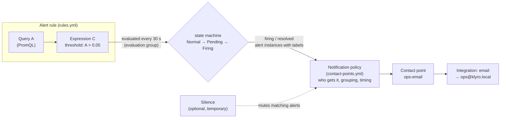

### 12.1 The alert rule

An **alert rule** is "a question, plus when to worry". Ours (`docker/grafana/provisioning/alerting/rules.yml`):

```yaml
- uid: api-error-rate
  title: API error rate above 5%
  condition: C
  for: 2m
  noDataState: OK
  execErrState: Error
  labels:
    severity: page
  annotations:
    summary: More than 5% of API requests failed with a 5xx over the last 2 minutes
    description: 'Error ratio {{ humanizePercentage $values.A.Value }} over the last 2 minutes (at least 20 requests in the window).'
  data:
    - refId: A        # the query
      datasourceUid: prometheus
      model: { expr: "(sum(rate(…5..…[2m])) / sum(rate(…[2m]))) and on() (sum(increase(…[2m])) >= 20)" }
    - refId: C        # the threshold expression
      datasourceUid: __expr__
      model: { type: threshold, expression: A, conditions: [{ evaluator: { type: gt, params: [0.05] } }] }
```

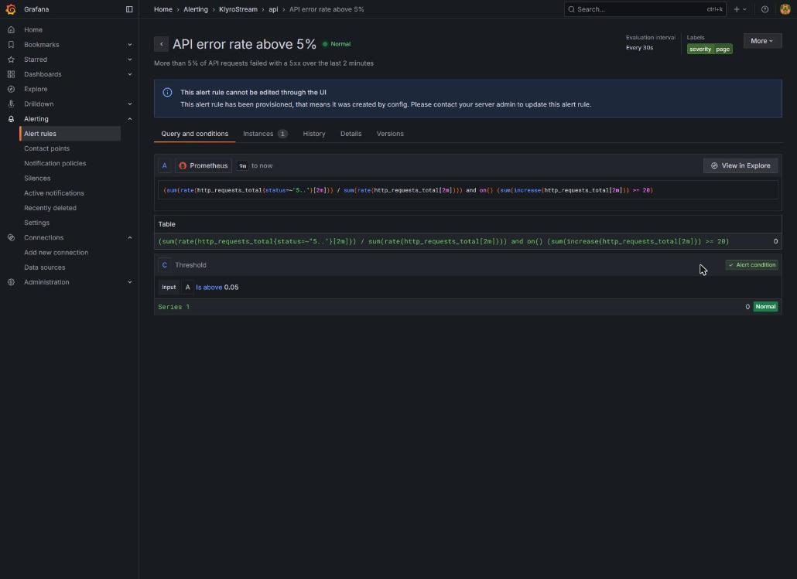

| Field | Means |
|---|---|
| **Query (A)** | Asks Prometheus for a number: the error ratio, only when there were ≥ 20 requests |
| **Expression (C)** | Grafana's own maths on the query results. A **threshold** expression returns 1 (true) or 0 (false): "is A above 0.05?" |
| **condition: C** | Which step decides firing. Shown in the UI as **Alert condition** |
| **for: 2m** | The **pending period**: C must stay true this long before firing |
| **noDataState: OK** | If the query returns nothing (too little traffic), treat it as fine |
| **execErrState: Error** | If the query itself fails (Prometheus down), show the rule as **Error** |
| **labels** | Key=value tags on the alert, used to **route** it (`severity=page`) |
| **annotations** | Human text attached to the alert: `summary`, `description`, optionally `runbook_url`. They appear in the email |

The `{{ humanizePercentage $values.A.Value }}` in the description is a **template**: at send time Grafana fills in A's value, formatted as a percentage ("50%").

### 12.2 Evaluation: groups and intervals

Rules live in an **evaluation group** (ours: group `api` in folder `KlyroStream`). All rules in a group are evaluated together at the group's **interval**: every **30 s** here. "Evaluated" means: run query A, compute C, update the state.

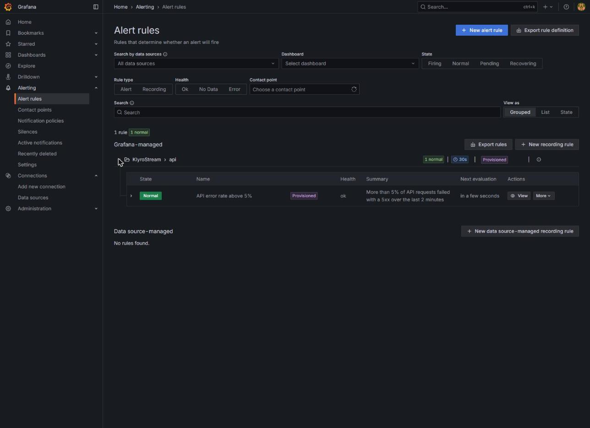

### 12.3 Alert instances

A query can return several series (one per route, say). Each becomes its own **alert instance**, with its own state, so "errors on route X" and "errors on route Y" fire separately. Our query sums everything into **one** series, so there's one instance (the "Instances 1" tab).

### 12.4 States

| State | Meaning |
|---|---|
| **Normal** | Condition false |
| **Pending** | Condition true, but not yet for the whole pending period |
| **Alerting** / **Firing** | True for the whole pending period; a notification is sent |
| **Recovering** | Was firing, now false, waiting out an optional "keep firing" period (we don't use one) |
| **Normal (NoData)** | The query returned nothing; with `noDataState: OK` that counts as normal |
| **Error** | The evaluation itself failed |

The **History** tab shows every change. This is our rule's real history from the alert test:

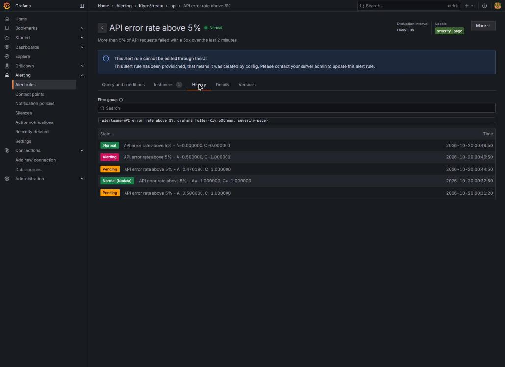

Read it bottom to top:

- **00:31:20 Pending** (A = 0.50): a first, too-gentle test run. Errors were high, but traffic barely reached the 20-request floor.
- **00:32:50 Normal (NoData)**: the window dropped below 20 requests, so the query returned nothing.
- **00:44:50 Pending** (A = 0.476): the real test, with sustained traffic and half of it failing.
- **00:46:50 Alerting** (A = 0.50): exactly 2 minutes later, the pending period ran out. Email sent.
- **00:48:50 Normal** (A = 0): storage was fixed and the errors aged out of the 2-minute window.

### 12.5 Notification policies: who gets told, and how often

When an instance fires or resolves, Grafana's built-in **Alertmanager** decides what to send, using a tree of **notification policies**:

- The **default policy** at the root catches everything.
- **Child policies** (we have none) match alerts by **label matchers** (e.g. `severity = page` → on-call phone; `team = video` → video team's chat) and send them elsewhere.

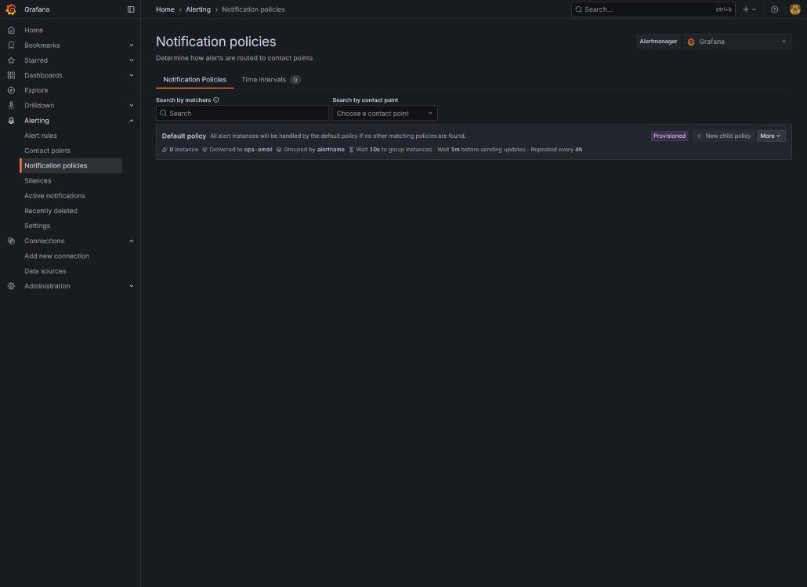

The policy also controls **grouping and timing**. That's what stops 50 related alerts from becoming 50 emails:

| Setting | Ours | Meaning |
|---|---|---|
| **Contact point** | `ops-email` | Where notifications go |
| **Group by** | `alertname` | Alerts with the same name are batched into one notification |
| **Group wait** | 10 s | After the first alert of a new group, wait this long for others to join before sending |
| **Group interval** | 1 m | After sending, wait at least this long before sending an update about that group (a new alert joining, one resolving) |
| **Repeat interval** | 4 h | If nothing changes and it's still firing, remind again after this long |

In `contact-points.yml`:

```yaml
policies:
  - orgId: 1
    receiver: ops-email
    group_by: ['alertname']
    group_wait: 10s
    group_interval: 1m
    repeat_interval: 4h
```

**Time intervals** (the tab next to policies; once called *mute timings*) are recurring windows, like "nights and weekends", when a policy stays quiet. We don't define any.

### 12.6 Contact points: where notifications go

A **contact point** is a named destination with one or more **integrations**: email, Slack, Microsoft Teams, Discord, a webhook, PagerDuty, Opsgenie and others. Ours is a single email integration:

```yaml
contactPoints:
  - orgId: 1
    name: ops-email
    receivers:
      - uid: ops-email
        type: email
        settings:
          addresses: ops@klyro.local
          singleEmail: true
```

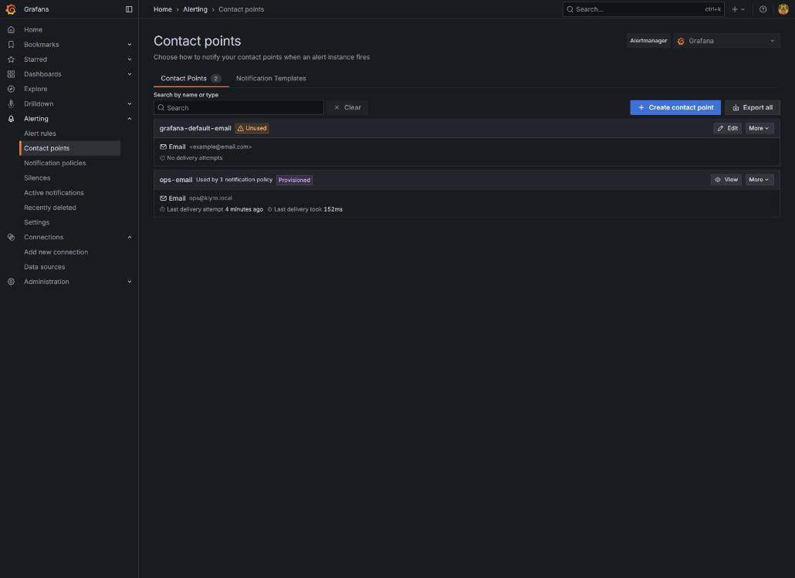

- **`singleEmail: true`** sends one email to all addresses together, instead of one per address.
- **"Used by 1 notification policy"** means the default policy points at it.
- **"Last delivery attempt … took 152 ms"** is the alert test's email. Delivery problems show up here first.
- `grafana-default-email` is created by Grafana itself; it's unused.

How does Grafana send email? Through the SMTP settings in `docker-compose.yml` (`GF_SMTP_HOST: mailpit:1025`, from `alerts@klyro.local`).

**Notification templates** (the second tab) customise the message layout. We use Grafana's default.

### 12.7 Silences: temporarily mute

A **silence** mutes notifications for alerts matching some labels, for a set time. Alerts keep evaluating and changing state; only the **notifications** stop. Use one for planned maintenance ("I'm restarting storage for 20 minutes").

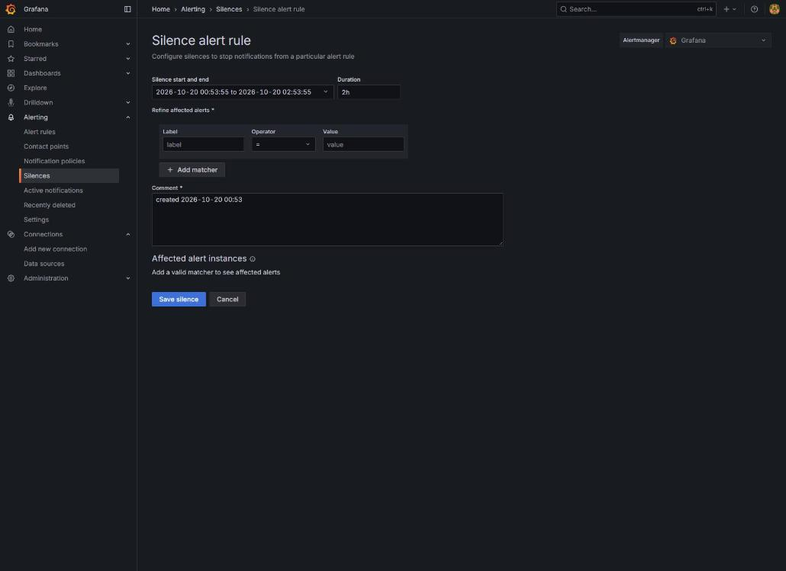

| Field | Use |
|---|---|
| **Start and end / Duration** | When the silence applies (default 2 h) |
| **Label matchers** | Which alerts: e.g. `alertname = API error rate above 5%` |
| **Comment** | Why, and who. Required, so others understand later |
| **Affected alert instances** | A live preview of what the matchers catch |

A silence vs a time interval: a **silence** is a one-off ("now, for 20 minutes"); a **time interval** repeats ("every Sunday 02:00–04:00").

### 12.8 Active notifications

**Alerting → Active notifications** lists what Alertmanager is currently holding: firing groups, and whether they're silenced. "Is anything firing right now?" is answered here.

## 13. Mailpit: where alert emails land

Mailpit pretends to be a mail server and shows everything it receives at http://localhost:8025, so nothing goes to a real inbox while developing. This is the real email from the alert test:

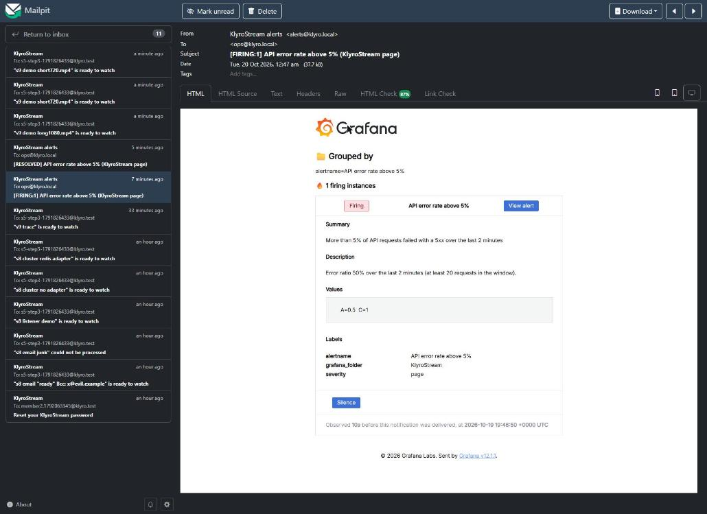

How it maps back:

| In the email | Comes from |
|---|---|
| Subject `[FIRING:1] API error rate above 5% (KlyroStream page)` | state + count, rule title, folder and `severity` label |
| **Grouped by** `alertname=…` | the policy's `group_by` |
| **Summary** / **Description** | the rule's annotations, with the template filled in ("Error ratio 50%") |
| **Values** `A=0.5 C=1` | query A's result and expression C's verdict |
| **Labels** | `alertname`, `grafana_folder`, `severity` |
| **Silence** button | opens the silence form, pre-filled for this alert |
| "Observed 10s before this notification was delivered" | the policy's **group wait** |

A second email, `[RESOLVED] …`, arrived when the errors stopped.

---

# Part C: using it on KlyroStream

## 14. Your first session: a guided tour with exercises

Do this once, with Grafana open. It takes about 30 minutes.

**Before you start:** the stack must be running, with the API in Docker ([section 15](#15-starting-stopping-logging-in)).

**Exercise 1: find your way around.** Open http://localhost:3000. You land on *KlyroStream overview*. Set the time picker to **Last 15 minutes** and refresh to **10s**. Use the app (browse videos, or run `npm run socket:listen` and upload something) and watch *Requests / s* move.

**Exercise 2: zoom and isolate.** On *Requests / s by status*, drag across a busy minute: every panel zooms to it. Click `200` in the legend to show only that line, then click it again. Zoom out with the magnifier next to the time picker.

**Exercise 3: read a stat panel.** Hover *p95 latency*. What value is it, and which colour band is it in? Open its menu → **Inspect → Query**: that's the PromQL behind it.

**Exercise 4: your first PromQL.** Left menu → **Explore**, data source **Prometheus**, switch the editor to **Code**, and run:

```text
sum by (route) (rate(http_requests_total[1m]))
```

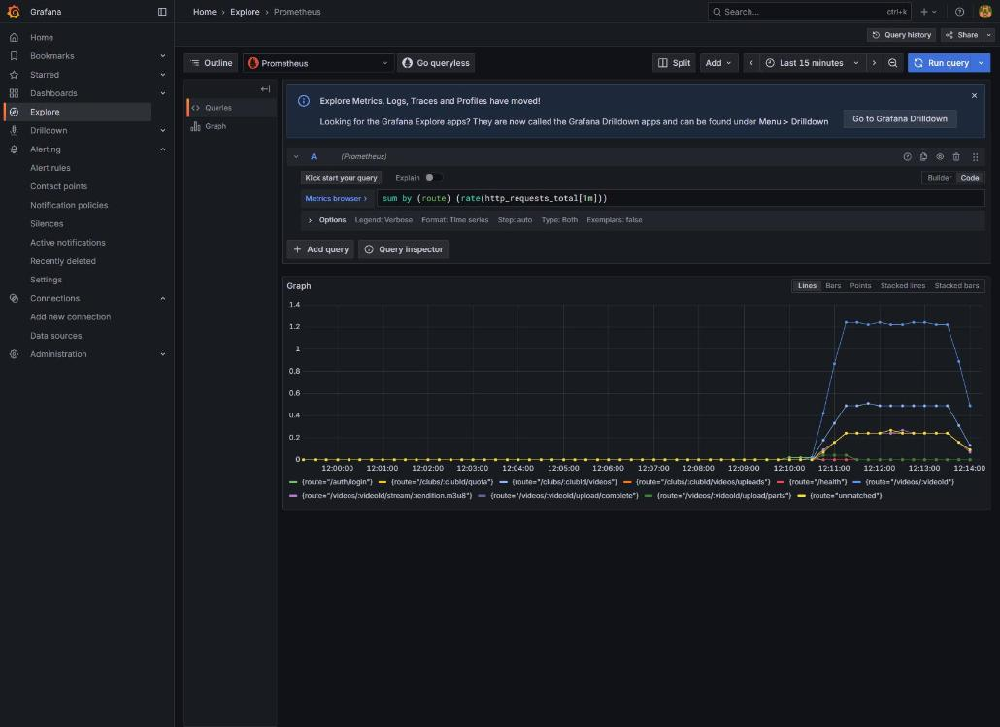

Each line is one route. Change `[1m]` to `[5m]`: the lines get smoother. Change `sum by (route)` to `sum by (status)`.

**Exercise 5: your first log search.** In Explore, switch the data source to **Loki** and run `{service="api"}`. Expand a line and look at its fields. Then:

```text
{service=~"api|worker"} |= "s9 demo"
```

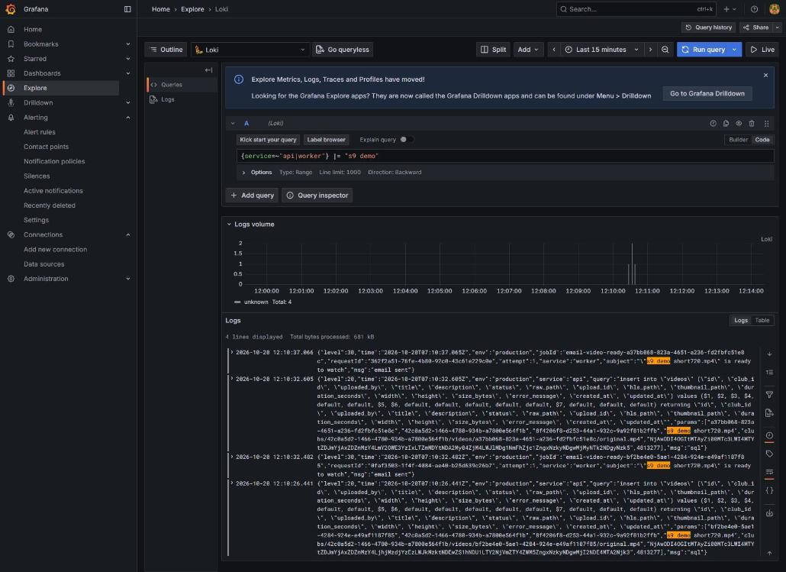

The **Logs volume** bar at the top shows how many lines matched over time; the lines are below. (This screenshot also shows `"level":20` lines with `"msg":"sql"`. Those were debug SQL logs that the containers wrote before their log level was pinned to `info`, a leak this very screenshot exposed and that's now fixed.)

**Exercise 6: follow one request through two programs.** Upload a video. In Explore → Loki run `{service="api"} |= "upload/complete"` and copy the `requestId` from that line. Then run:

```text
{service=~"api|worker"} | requestId="<paste it>"
```

You'll see the API's line, then the worker's *processing started → source probed → outputs uploaded → processing complete → email sent*.

**Exercise 7: look at the alert.** **Alerting → Alert rules → KlyroStream › api → View**. Read the query and the threshold, then open **History**.

**Exercise 8 (optional): make the alert fire.** Stop storage and send traffic that needs it:

```bash
docker stop klyro-rustfs-1
TOKEN=<an access token>      # from POST /auth/login
VIDEO=4dce8038-4c87-4472-99e6-635ad14a2216
for i in $(seq 1 400); do
  curl -s -o /dev/null -H "Authorization: Bearer $TOKEN" localhost:4000/videos/$VIDEO/stream/master.m3u8 &
  curl -s -o /dev/null -H "Authorization: Bearer $TOKEN" localhost:4000/videos/$VIDEO &
  sleep 0.5
done
docker start klyro-rustfs-1
```

Watch the rule go **Pending** (after about 40 s) and **Firing** (2 minutes later). Find the email in Mailpit, then the **Resolved** email about 2 minutes after storage is back. Always run `docker start klyro-rustfs-1` at the end, even if you stop the loop early.

**Exercise 9: silence it.** Repeat exercise 8, but first create a silence for `alertname = API error rate above 5%`. The rule still goes Firing, but no email arrives. Delete the silence afterwards (**Alerting → Silences → Expire**).

## 15. Starting, stopping, logging in

The monitoring stack is **opt-in**, so it doesn't use memory while you code:

```bash
# everything: core + API + worker + monitoring
docker compose --profile api --profile worker --profile observability up -d --build

# only the monitoring (when api/worker are already running)
docker compose --profile observability up -d

# stop the monitoring, keep the app running
docker compose stop prometheus loki alloy grafana
```

| Open | URL | Login |
|---|---|---|
| Grafana | http://localhost:3000 | Opens as a viewer. To edit or manage alerts, **Sign in** with `admin` / `admin`, or your `GRAFANA_ADMIN_PASSWORD` |
| Prometheus | http://localhost:9090 | none |
| Alloy | http://localhost:12345 | none |
| Mailpit | http://localhost:8025 | none |

**The API must run in Docker for its logs to reach Loki** (Alloy reads container output). With `npm run dev`, the API runs on your machine instead, Prometheus shows the `api` target as **down**, and its logs don't arrive. Switch with:

```bash
docker compose stop api                  # then: cd backend && npm run dev
docker compose --profile api up -d       # back (after stopping npm run dev)
```

Both use port 4000, so only one can run at a time. Metrics and logs are kept for 7 days in Docker volumes (`prometheus_data`, `loki_data`, `grafana_data`).

## 16. The KlyroStream dashboard, panel by panel


### Row 1: API

**Requests / s** (stat). All HTTP requests per second, averaged over 1 minute. The screenshot shows 2.44 req/s during demo traffic. It's meaningful mostly as **change**: a sudden drop to 0 while people are using the app means the API is unreachable.

**Error rate (5xx, 5m)** (stat; green / orange / red at 1% and 5%). The share of the last 5 minutes' requests that failed with a server error. **4xx are excluded**: a wrong password (401) or unknown video (404) is the client's mistake. When red, go to the logs: `{service="api", level="50"}`.

**p95 latency (5m)** (stat; orange from 0.5 s, red from 1 s). 95% of requests were faster than this. Normal here: **5–25 ms** (22 ms in the screenshot).

**Live sockets** (stat). Socket.io connections open now: app tabs plus any `socket:listen`. 3 in the screenshot (the demo script's three sockets).

**Requests / s by status** (stacked lines). Traffic split by status code. A band of `401` means token problems; `429` means rate limiting; any `5xx` deserves a look. The demo traffic deliberately mixed in 404s (unknown video ids) and 401s (no token).

**p95 latency by route** (lines). Which endpoint is slow. Labels are route **patterns**, never real ids. `unmatched` covers unknown URLs, and also requests refused by the login check before a route was chosen. Expected to be slowest: stream playlists and downloads, which talk to storage.

### Row 2: Queues and worker

**Queue depth.**

| Line | Meaning | Worry when |
|---|---|---|
| `video-processing waiting` | uploads waiting for the worker | it keeps **growing** |
| `video-processing active` | transcodes running (max 1) | stuck at 1 far longer than a video takes |
| `video-processing delayed` | failed attempts waiting to retry | often non-zero |
| `notifications waiting / active` | emails queued / sending | growing |
| `notifications delayed` | emails waiting to retry | non-zero means the mail server is down or refusing |

In the screenshot, the orange spike to 1 is a transcode running.

**Jobs finished / min.** `completed` (success), `retried` (an attempt failed and will try again), `failed` (final). A little `retried` is the queue doing its job; any `failed` deserves a look in the logs.

**Transcode time (per attempt)** (p50 and p95). About **5–10 s** for the 12-second 720p demo clips; about 70 s for a 90-second 1080p clip. It depends on video length and resolution, so compare like with like.

**Realtime events sent / min.** `video:progress` (at most 1/s per video, by design), `video:ready`, `video:failed`. If videos turn READY but no `video:ready` goes out, the API's queue listener is broken.

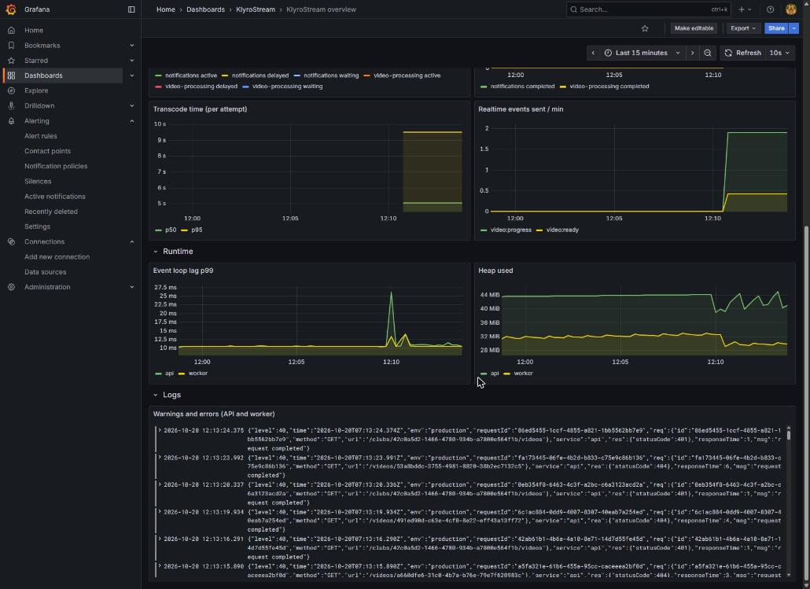

### Row 3: Runtime

**Event loop lag p99.** Node runs your code on **one** thread. If something hogs it (a huge synchronous computation), everything else waits. This shows how late scheduled work runs: about **10 ms** is the floor here; seconds would mean something is blocking. The small spikes in the screenshot are moments of load.

**Heap used.** JavaScript memory. A saw-tooth (up, then down when the garbage collector runs) is healthy. A floor that keeps rising for hours and never falls back is a **memory leak**.

### Row 4: Logs

**Warnings and errors (API and worker).** Level 40+ lines from both services, newest first; click one to see all its fields. The screenshot shows the demo's deliberate 401s and 404s as warnings.

## 17. Reading graphs without fooling yourself

- **Counters are graphed as rates.** A raw counter only climbs and resets on restart; `rate()` turns it into "per second" and handles the resets.
- **Watch percentiles, not averages.** See the example in [section 3](#percentiles-the-honest-way-to-talk-about-speed).
- **Percentiles from histograms are estimates.** "p95 = 18 ms" means "somewhere in the 10–25 ms bucket, probably near 18".
- **The window changes the picture.** `rate(x[1m])` reacts fast but is jumpy; `[5m]` is smooth but slow. A 20-second blip is obvious at 1m and nearly invisible at 5m.
- **"No data" is not zero.** No series exists until the event first happens (no 5xx yet, no transcode since the worker started). The Error rate stat uses `or vector(0)` to show 0% instead.
- **Stacked graphs add up.** The top edge is the total; don't read a band's top edge as its own value.
- **Restarts reset counters.** After `docker compose up --build`, counters start at 0 again.
- **Time zones.** Grafana shows your browser's time; log lines store UTC (`…Z`). 12:10 in Pakistan is 07:10Z.

## 18. Every KlyroStream metric

| Metric | Kind | Labels | Meaning |
|---|---|---|---|
| `http_requests_total` | counter | `method`, `route`, `status` | HTTP requests handled |
| `http_request_duration_seconds` | histogram | `method`, `route` | How long requests took |
| `socket_connections` | gauge | | Sockets connected to this API now |
| `realtime_events_total` | counter | `event` | Socket events sent |
| `queue_jobs_total` | counter | `queue`, `status` | Jobs finished: `completed` / `retried` / `failed` |
| `queue_active_jobs` | gauge | `queue` | Jobs running now |
| `queue_depth` | gauge | `queue`, `state` | Jobs in the queue: `waiting`, `prioritized`, `active`, `delayed`, `failed` |
| `video_processing_duration_seconds` | histogram | `status` | Duration of one transcode attempt |
| `up` | gauge (from Prometheus) | `job`, `instance` | 1 if the last scrape worked |
| `process_*`, `nodejs_*` | various | | Node's runtime: CPU, memory, event loop, garbage collection |

Every series also has `service` (`api` / `worker`), `job` and `instance`. Useful defaults: `process_resident_memory_bytes`, `process_start_time_seconds`, `nodejs_eventloop_lag_p99_seconds`, `nodejs_heap_size_used_bytes`.

## 19. PromQL from zero, then a cookbook

### The building blocks

**1. A selector picks series by name and labels.**

```text
http_requests_total                                  # every series of this metric
http_requests_total{status="404"}                    # only 404s
http_requests_total{status=~"5.."}                   # regex: any 5xx
http_requests_total{route!="/health"}                # not equal
```

**2. A range turns "now" into "the last N minutes".**
`http_requests_total[5m]` means "all samples from the last 5 minutes". You can't graph that directly; you feed it to a function.

**3. Functions turn ranges into one value per series.**

```text
rate(http_requests_total[5m])        # per-second increase, averaged over 5 min
increase(http_requests_total[1h])    # total increase over 1 hour
```

**4. Aggregation combines series.**

```text
sum(rate(http_requests_total[5m]))                 # everything added up: one line
sum by (route) (rate(http_requests_total[5m]))     # one line per route
```

**5. Arithmetic works on whole series.**

```text
sum(rate(http_requests_total{status=~"5.."}[5m])) / sum(rate(http_requests_total[5m]))   # error ratio
```

**6. Percentiles come from histogram buckets.**

```text
histogram_quantile(0.95, sum by (le) (rate(http_request_duration_seconds_bucket[5m])))
```

Always keep `le` (the bucket boundary label) in the `by (…)`.

### Cookbook

Paste into **Explore → Prometheus → Code**. Lines starting with `#` are explanations, not part of the query. Every query here was run against this project's Prometheus.

**Traffic and errors**

```text
# requests per second, per route
sum by (route) (rate(http_requests_total[5m]))

# the 5 busiest routes
topk(5, sum by (route) (rate(http_requests_total[5m])))

# 5xx per second, per route — where are the errors?
sum by (route) (rate(http_requests_total{status=~"5.."}[5m]))

# 4xx per route (lots of 401 = token problems)
sum by (route, status) (rate(http_requests_total{status=~"4.."}[5m]))

# requests in the last hour
sum(increase(http_requests_total[1h]))

# error ratio now, divided by the same time yesterday
  sum(rate(http_requests_total{status=~"5.."}[5m])) / sum(rate(http_requests_total[5m]))
/ (sum(rate(http_requests_total{status=~"5.."}[5m] offset 1d)) / sum(rate(http_requests_total[5m] offset 1d)))
```

**Latency**

```text
# p50, p95, p99
histogram_quantile(0.50, sum by (le) (rate(http_request_duration_seconds_bucket[5m])))
histogram_quantile(0.95, sum by (le) (rate(http_request_duration_seconds_bucket[5m])))
histogram_quantile(0.99, sum by (le) (rate(http_request_duration_seconds_bucket[5m])))

# p95 per route, slowest first (use the Table view)
sort_desc(histogram_quantile(0.95, sum by (le, route) (rate(http_request_duration_seconds_bucket[5m]))))

# average per route (fine for comparisons, hides the slow tail)
sum by (route) (rate(http_request_duration_seconds_sum[5m])) / sum by (route) (rate(http_request_duration_seconds_count[5m]))

# share of requests faster than 100 ms
sum(rate(http_request_duration_seconds_bucket{le="0.1"}[5m])) / sum(rate(http_request_duration_seconds_count[5m]))
```

**Queues and the worker**

```text
# transcodes completed in the last hour
sum(increase(queue_jobs_total{queue="video-processing", status="completed"}[1h]))

# share of attempts that were retried
  sum(rate(queue_jobs_total{status="retried"}[1h]))
/ sum(rate(queue_jobs_total[1h]))

# backlog right now, per queue
sum by (queue) (queue_depth{state=~"waiting|prioritized|delayed"})

# is the backlog growing? (positive = growing)
deriv(sum(queue_depth{queue="video-processing", state="waiting"})[10m:])

# median transcode time over 6 hours
histogram_quantile(0.5, sum by (le) (rate(video_processing_duration_seconds_bucket{status="completed"}[6h])))

# emails that gave up today
sum(increase(queue_jobs_total{queue="notifications", status="failed"}[1d]))
```

**Health of the processes**

```text
# is everything being scraped? (0 = down)
up

# when each process last started (set the unit to "Date & time")
process_start_time_seconds * 1000

# restarts in the last hour
changes(process_start_time_seconds[1h])

# memory per process, MiB
process_resident_memory_bytes / 1024 / 1024

# CPU per process (1 = one full core)
rate(process_cpu_seconds_total[1m])
```

### Reference

| Piece | Means |
|---|---|
| `{label="x"}` `!=` `=~` `!~` | equals / not equals / regex match / regex no-match |
| `rate(c[5m])` | per-second increase over 5 min |
| `increase(c[1h])` | total increase over 1 h |
| `sum by (l) (…)` / `sum without (l) (…)` | combine series, keeping / dropping label `l` |
| `topk(5, …)` / `sort_desc(…)` | largest 5 / sorted |
| `histogram_quantile(q, sum by (le) (rate(x_bucket[5m])))` | percentile `q` from a histogram |
| `offset 1d` | the same query, one day earlier |
| `deriv(g[10m:])` | how fast a gauge changes |
| `changes(x[1h])` | how often a value changed |
| `A and on() B` | A, but only where B has a result (used for the alert's 20-request floor) |
| `or vector(0)` | 0 instead of "no data" |

## 20. LogQL from zero, then a cookbook

### The building blocks

**1. A stream selector (required) picks streams by label.**

```text
{service="api"}
{service=~"api|worker", level="50"}
```

**2. Line filters keep or drop lines by text.**

```text
{service="worker"} |= "failed"         # contains
{service="api"} != "health"            # doesn't contain
{service="api"} |~ "40[134]"           # regex
```

**3. Parsers turn the JSON into fields; then filter on fields.**

```text
{service="api"} | json | res_statusCode >= 500
```

`| json` flattens nested keys with `_`: `res.statusCode` becomes `res_statusCode`.

**4. Structured metadata filters (our ids) need no parser.**

```text
{service=~"api|worker"} | requestId="685eca28-4df0-4b14-b5a2-97cb47c78eb7"
```

**5. Formatting changes how lines are shown.**

```text
{service="api"} | json | line_format "{{.req_method}} {{.req_url}} → {{.res_statusCode}} in {{.responseTime}} ms"
```

**6. Metric queries count lines over time.**

```text
sum by (service) (count_over_time({service=~"api|worker", level="50"}[1m]))
```

### What one API line contains

```json
{"level":30,"time":"2026-10-19T19:42:13.873Z","env":"production","requestId":"685eca28-…",
 "req":{"id":"685eca28-…","method":"GET","url":"/videos/4dce8038-…"},
 "service":"api","res":{"statusCode":200},"responseTime":8,"msg":"request completed"}
```

Worker lines carry `jobId`, `videoId`, `requestId` and `attempt`. The `outputs uploaded` line also has `timings`, `totalMs`, `sourceBytes`, `outputBytes` and `mediaSeconds`.

### Cookbook

```text
# errors from our two processes
{service=~"api|worker", level="50"}

# everything about one request, across API and worker
{service=~"api|worker"} | requestId="685eca28-4df0-4b14-b5a2-97cb47c78eb7"

# everything about one video
{service=~"api|worker"} |= "4dce8038-4c87-4472-99e6-635ad14a2216"

# slow requests (over half a second)
{service="api"} | json | responseTime > 500

# failed writes
{service="api"} | json | req_method="POST" | res_statusCode >= 400

# one readable line per transcode
{service="worker"} |= "outputs uploaded" | json | line_format "{{.videoId}}  total {{.totalMs}} ms  ({{.mediaSeconds}} s of video)"

# errors per minute, per service
sum by (service) (count_over_time({service=~"api|worker", level="50"}[1m]))

# admin password guesses in the last hour
sum(count_over_time({service="api"} |= "basic auth failed" [1h]))

# email retries per 10 minutes
sum(count_over_time({service="worker"} |= "email not sent, will retry" [10m]))
```

### Messages worth knowing

| Message | Service | Means |
|---|---|---|
| `request completed` | api | one HTTP request, with status and `responseTime` (ms) |
| `processing started` / `processing complete` | worker | a transcode began / ended READY |
| `attempt failed, will retry` | worker | a transcode attempt failed; it will retry |
| `processing failed for good` | worker | final failure; the video is ERROR |
| `email sent` / `email not sent, will retry` / `email gave up after every retry` | worker | the email queue's outcomes |
| `video deleted` | api | a delete finished |
| `could not relay a video event` / `queue events error` | api | the live-update relay has a problem |
| `basic auth failed` | api | wrong admin credentials |

## 21. Investigation playbooks

### "The error-rate alert fired"

1. **Dashboard → Requests / s by status:** when did 5xx start? Still going?
2. **Which route?** `sum by (route) (rate(http_requests_total{status=~"5.."}[5m]))`. One route points at one dependency; all routes point at something shared (database, Redis).
3. **Why?** Logs: `{service="api", level="50"}` at that time. Expand a line and read `err.message`. With storage down, it reads `the request socket did not establish a connection with the server within the configured timeout of 3000 ms`.
4. **Check the dependency:** `docker compose ps`. Is postgres/redis/rustfs up and healthy?
5. **After the fix,** the alert resolves by itself and sends a RESOLVED email.

### "A user says their upload is stuck"

1. Get the video id (the app, or `SELECT id, status FROM videos ORDER BY created_at DESC LIMIT 5`).
2. Logs: `{service=~"api|worker"} |= "<videoId>"`. You'll see where it stopped.
3. **Queue depth:** `waiting > 0` and `active = 0`? No worker is taking jobs: check `up{job="worker"}` and `docker compose ps worker`.
4. `delayed > 0`? It failed and will retry; the logs say why (`attempt failed, will retry`).
5. PROCESSING with no job anywhere? `npm run videos:requeue-stuck` ([queues.md](queues.md)).

### "The API feels slow"

1. **p95 latency by route:** one route or all?
2. **Event loop lag:** high means Node is blocked, which slows **all** routes.
3. **One route:** `{service="api"} | json | responseTime > 500` to find concrete slow requests, then check what that route depends on.
4. **Memory:** heap near its limit means constant garbage collection.

### "Nobody got the 'video ready' email"

1. **Queue depth → notifications:** emails waiting or delayed?
2. Logs: `{service="worker"} |= "email"`. Sent, retrying (with the SMTP error), or gave up?
3. Not there at all? Search the video id: `could not queue the video email` means the enqueue failed ([realtime.md §9](realtime.md#9-stage-5-email-through-a-queue)).
4. Locally: is it in Mailpit?

### "Live updates stopped arriving in the browser"

1. **Live sockets** is 0? The client isn't connected; the browser console will show `connect_error`.
2. **Realtime events sent** rising but nothing received? The client isn't in the room (did it `club:join` after reconnecting?).
3. Nothing sent while videos finish? `{service="api"} |= "queue events"`.

### "Is the worker keeping up?"

If `video-processing waiting` grows for an hour, it isn't. Add workers (`docker compose --profile worker up -d --scale worker=2`) or raise `WORKER_CONCURRENCY` on a bigger machine.

## 22. Alerts day to day: reading, silencing, adding

**Is anything firing?** **Alerting → Alert rules** (state column) or **Active notifications**.

**What happened while I was away?** The rule's **History** tab ([section 12.4](#124-states)).

**Planned maintenance?** Create a **silence** first ([section 12.7](#127-silences-temporarily-mute)), and expire it afterwards.

**Did the email go out?** **Contact points** shows the last delivery attempt and how long it took; Mailpit shows the email.

### Adding an alert

Rules are files, reviewed like code. Copy the existing rule in `docker/grafana/provisioning/alerting/rules.yml`, give it a new `uid` and `title`, change the query, threshold and `for`, then `docker compose restart grafana`. Good next candidates:

| Alert | Query A | Threshold | `for` |
|---|---|---|---|
| Worker down | `1 - up{job="worker"}` | above 0 | 1m |
| Transcode backlog | `sum(queue_depth{queue="video-processing", state="waiting"})` | above 10 | 10m |
| Emails failing | `sum(increase(queue_jobs_total{queue="notifications", status="failed"}[15m]))` | above 0 | 0s |
| Slow API | `histogram_quantile(0.95, sum by (le) (rate(http_request_duration_seconds_bucket[5m])))` | above 1 | 5m |

Ask of every new alert: *would someone need to do something about this, now?* If not, it belongs on a dashboard instead.

## 23. Changing the dashboard or adding a metric

### Changing the dashboard

The dashboard is the file `docker/grafana/dashboards/klyro.json`, and that file is what everyone sees.

1. Sign in as admin, open the dashboard, click **Make editable**.
2. Change what you need: **Edit** a panel (query, visualisation, unit, thresholds, legend), or **Add → Visualization**.
3. **Export → Export as JSON**, copy it, and replace the contents of `docker/grafana/dashboards/klyro.json` (keep `"uid": "klyro-overview"`).
4. `docker compose restart grafana`, check, commit.

Tips: always set the **unit**, use `{{label}}` in the legend, and prefer a few clear panels over many cluttered ones.

### Adding a metric in code

1. **Pick the kind:** counting events → Counter; a current level → Gauge; durations or sizes → Histogram.
2. **Name it `<thing>_<unit>`:** `_seconds`, `_bytes`, `_total` for counters.
3. **Labels from a small, fixed set only.** Never ids, emails, URLs or free text.
4. **Define it next to the code that updates it:**

```ts
const emailDuration = new Histogram({
  name: 'email_send_duration_seconds',
  help: 'Time to hand one email to SMTP',
  buckets: [0.05, 0.1, 0.25, 0.5, 1, 2.5, 5, 10],
  registers: [registry],
});
const end = emailDuration.startTimer();
await sendMail(mail);
end();
```

5. **Check it:** rebuild, then query it in Explore after the next scrape (15 s).

## 24. When the monitoring itself is broken

| Symptom | Check | Usual cause |
|---|---|---|
| Panels say "No data" | Prometheus → **Target health** | Target DOWN: the API runs outside Docker (`npm run dev`), or a container is stopped |
| Target DOWN with "no such host" | `docker compose ps api worker` | The app containers aren't running (they're behind their own profiles) |
| Only some panels empty | the panel's query in Explore | No such events yet (no 5xx, no transcode since the worker started), which is normal |
| No logs in Loki | Alloy UI (http://localhost:12345) | Alloy can't read the Docker socket, or Loki is down: `docker compose logs alloy loki` |
| Logs present, but no `level` / `requestId` | `docker compose logs api` | The line isn't JSON: the API was started in development mode (pretty logs) |
| `"msg":"sql"` lines in Loki | `docker exec klyro-api-1 printenv LOG_LEVEL` | A container running at `debug`; Compose pins `LOG_LEVEL: info` for api and worker |
| Alert never fires during a test | the rule's query value in **View** | Under 20 requests in 2 minutes never fires, by design |
| Email never arrives | **Contact points** → last delivery | Mailpit down, or SMTP settings wrong in compose |
| Machine short on memory | `docker stats` | Stop the stack when not needed: `docker compose stop prometheus loki alloy grafana` |

## 25. What we don't have yet

| Missing | What it is | Why it would help |
|---|---|---|
| **Tracing** (OpenTelemetry + Tempo) | Timed spans for every step of one request, across services | Shows *where* time went inside a slow upload, without guessing |
| **SLOs** (service level objectives) | A target like "99.5% of requests succeed over 30 days", with an error budget | Turns "is it bad?" into a number agreed in advance; alert on budget burn instead of raw thresholds |
| **On-call paging** | PagerDuty / Opsgenie / phone integrations, rotations | Email doesn't wake anyone at 2 a.m. |
| **More alerts** | Worker down, backlog, email failures, latency ([section 22](#22-alerts-day-to-day-reading-silencing-adding)) | One alert covers only one symptom |
| **Long-term storage, high availability** | Mimir/Thanos, replicated Loki, several Prometheus | Keep months of data; survive a monitoring server dying |
| **Database and Redis metrics** | `postgres_exporter`, `redis_exporter` | See slow queries, connection pool use, Redis memory |
| **Frontend monitoring** | Errors and timings from users' browsers | Sees what the server can't (slow networks, JavaScript errors) |
| **Runbooks** | A short "what to do" page linked from each alert (`runbook_url`) | The person woken up shouldn't have to think from scratch |

## 26. Glossary

| Term | Meaning |
|---|---|
| **Alert instance** | One series' worth of an alert rule, with its own state |
| **Alert rule** | Queries + expressions + condition + pending period + labels + annotations |
| **Alertmanager** | The part of Grafana (or a separate program) that groups, routes, silences and sends notifications |
| **Annotation** (alerting) | Human text on an alert: summary, description, runbook URL |
| **Cardinality** | How many series a metric (or streams a log label) has |
| **Contact point** | A named destination with one or more integrations (email, Slack …) |
| **Counter / Gauge / Histogram** | Only-up count / up-and-down level / bucketed distribution |
| **Dashboard / Row / Panel** | Page / collapsible group / one visualisation with its queries |
| **Data source** | A connection from Grafana to a database (Prometheus, Loki) |
| **Evaluation group / interval** | Rules evaluated together / how often (30 s) |
| **Expression** (alerting) | Grafana-side maths on query results: reduce, math, threshold |
| **Group wait / interval, repeat interval** | Notification timing: wait before the first send / between updates / between reminders |
| **Instance / Job / Target** (Prometheus) | One scraped address / a group of them / an address to scrape |
| **Instrumentation** | Code in the app that produces metrics and logs |
| **Label** | A key=value pair that splits a metric or a log stream |
| **LogQL / PromQL** | The query languages of Loki / Prometheus |
| **Notification policy** | A routing rule: which alerts go to which contact point, how grouped, how often |
| **Pending period (`for`)** | How long a condition must hold before firing |
| **Percentile (p50/p95/p99)** | The value 50% / 95% / 99% of observations are below |
| **Provisioning** | Loading Grafana configuration from files at startup |
| **Rate** | Per-second increase of a counter |
| **Sample** | One (timestamp, value) pair |
| **Scrape** | Prometheus fetching `/metrics` from a target |
| **Silence** | A temporary mute for matching alerts |
| **Stream** (Loki) | All log lines with the same label set |
| **Structured logs** | Log lines as machine-readable fields (JSON) |
| **Structured metadata** (Loki) | Per-line fields you can filter on without making them labels |
| **Threshold** | The value a condition compares against |
| **Time interval** (formerly mute timing) | A recurring window when notifications are muted |
| **Time series** | One metric name + one label set, with its samples over time |

## 27. Further reading

| Topic | Where |
|---|---|
| Prometheus concepts (data model, metric types) | https://prometheus.io/docs/concepts/data_model/ · https://prometheus.io/docs/concepts/metric_types/ |
| PromQL basics | https://prometheus.io/docs/prometheus/latest/querying/basics/ |
| Metric and label naming | https://prometheus.io/docs/practices/naming/ |
| Histograms and summaries | https://prometheus.io/docs/practices/histograms/ |
| LogQL | https://grafana.com/docs/loki/latest/query/ |
| Loki labels and cardinality | https://grafana.com/docs/loki/latest/get-started/labels/ |
| Grafana alerting fundamentals | https://grafana.com/docs/grafana/latest/alerting/fundamentals/ |
| Grafana provisioning | https://grafana.com/docs/grafana/latest/administration/provisioning/ |
| Alloy | https://grafana.com/docs/alloy/latest/ |
| Google SRE book, monitoring chapter | https://sre.google/sre-book/monitoring-distributed-systems/ |
