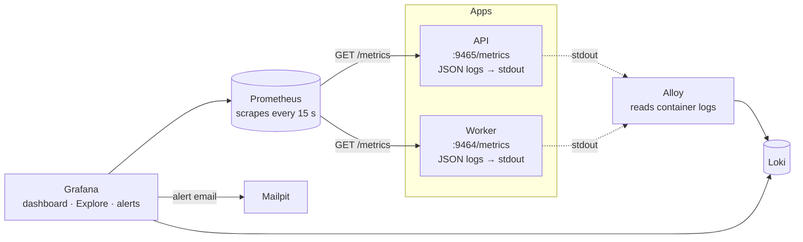
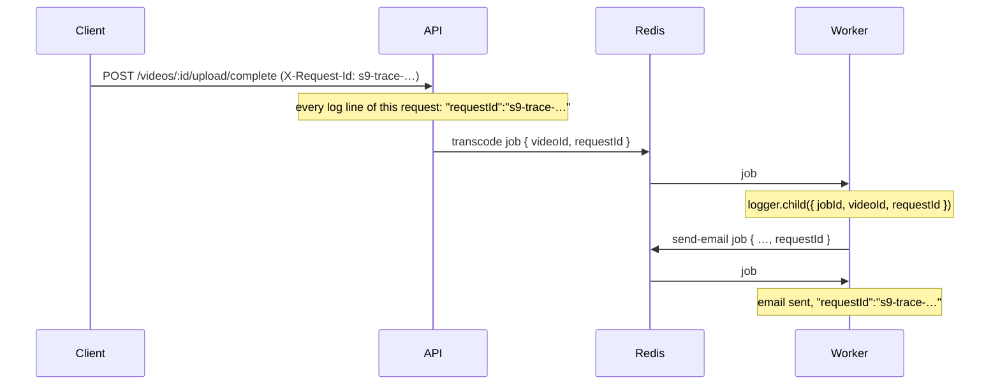
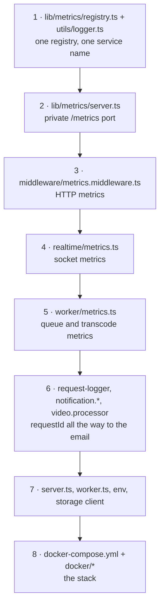

# Observability: metrics, logs and alerts

Sprint 9 makes KlyroStream answer questions about itself without anyone attaching a debugger. How many requests per second, and how many fail? How slow is the slowest 5%? Are jobs piling up? What exactly happened to video `4dce…`? Is anyone being woken up about it? Every number below was **measured on this project**.

**Reviewing Sprint 9?** Read sections 1–4 for the concepts, 5–9 for each stage and how it was tested, then [section 10](#10-code-walkthrough-reviewing-sprint-9) with the code open.

Related: [queues.md](queues.md) (the jobs being measured) · [realtime.md](realtime.md) (the sockets being counted) · [transcoding.md](transcoding.md) (what the worker spends its time on).

**Contents**

1. [Three questions, three tools](#1-three-questions-three-tools)
2. [How Prometheus sees the world](#2-how-prometheus-sees-the-world)
3. [Labels and cardinality: why ids never become labels](#3-labels-and-cardinality-why-ids-never-become-labels)
4. [PromQL in five queries](#4-promql-in-five-queries)
5. [Stages 1–2: API metrics](#5-stages-12-api-metrics)
6. [Stage 3: logs that tell one story](#6-stage-3-logs-that-tell-one-story)
7. [Stage 4: worker metrics](#7-stage-4-worker-metrics)
8. [Stages 5–7: the stack, provisioned from files](#8-stages-57-the-stack-provisioned-from-files)
9. [Stage 8: an alert that emails](#9-stage-8-an-alert-that-emails)
10. [Code walkthrough: reviewing Sprint 9](#10-code-walkthrough-reviewing-sprint-9)

**Using it day to day?** [monitoring-guide.md](monitoring-guide.md) is the hands-on guide: what each tool is, how to read every panel, a PromQL and LogQL cookbook, and investigation playbooks.

---

## 1. Three questions, three tools

| Question | Tool | Shape of the data | KlyroStream |
|---|---|---|---|
| *Is something wrong, and how much?* | **Metrics** | Numbers over time, cheap to keep for months | prom-client → Prometheus |
| *What exactly happened?* | **Logs** | One event per line, with details | pino (JSON) → Alloy → Loki |
| *Where did the time go in one request?* | **Traces** | A tree of timed steps across services | not built (decision 6); request ids cover the API → worker link |

They work together. A metric says "error rate jumped at 10:42"; the logs for 10:42 say which request failed and why; the request id in that log line finds the same request in the worker. **Grafana** puts all three on one screen and sends the alert.



---

## 2. How Prometheus sees the world

Prometheus **pulls**. Every 15 seconds it sends `GET /metrics` to each target and stores what comes back. The application only keeps **current** values in memory; history lives in Prometheus.

```text
# HELP http_requests_total HTTP requests by method, route pattern and status code
# TYPE http_requests_total counter
http_requests_total{method="GET",route="/videos/:videoId",status="200",service="api"} 3
http_requests_total{method="GET",route="/videos/:videoId",status="404",service="api"} 1
```

Each line is one **time series**: a metric name plus a unique set of labels, with one value. Pull has a useful side effect: if a target doesn't answer, Prometheus records `up == 0`, so "the worker is dead" is itself a metric.

### The three metric types we use

| Type | Goes | Example | Read it with |
|---|---|---|---|
| **Counter** | only up (resets to 0 on restart) | `http_requests_total`, `queue_jobs_total` | `rate()`, `increase()`; never the raw value |
| **Gauge** | up and down | `socket_connections`, `queue_depth`, heap size | the value itself |
| **Histogram** | counts observations into buckets | `http_request_duration_seconds`, `video_processing_duration_seconds` | `histogram_quantile()` |

**Why a histogram for latency, not an average?** An average hides the slow requests that users actually complain about. A histogram counts how many requests took ≤ 5 ms, ≤ 10 ms, … ≤ 10 s:

```text
http_request_duration_seconds_bucket{route="/videos/:videoId",le="0.005"} 0
http_request_duration_seconds_bucket{route="/videos/:videoId",le="0.01"}  2
http_request_duration_seconds_bucket{route="/videos/:videoId",le="0.025"} 3
...
http_request_duration_seconds_bucket{route="/videos/:videoId",le="+Inf"}  3
```

From those counts Prometheus **estimates** any percentile, and buckets from several instances can be **added together** before computing it. (A *summary*, the fourth type, computes percentiles inside each process; those can't be combined across instances, so we don't use it.) The cost is precision: p95 is interpolated within a bucket, so the bucket edges should sit near the numbers you care about. HTTP uses 5 ms … 10 s; transcoding uses 5 s … 30 min.

---

## 3. Labels and cardinality: why ids never become labels

Every **distinct combination** of label values is a separate series, with its own memory and storage in Prometheus. The number of series is the **cardinality**.

`route="/videos/:videoId"` is one series per method × status: a handful. `url="/videos/4dce8038-…"` would be one series **per video**, plus one per random id a scanner tries. Cardinality grows without limit until Prometheus runs out of memory. So the rule is: **label values must come from a small, fixed set.**

**Measured:** after the tests, the API exposed **225** series and the worker **129**, including Node's default metrics. A check that searches every label for a UUID found **none**, and neither `requestId` nor `videoId` exists as a label anywhere in Prometheus. Ids belong in **logs** (section 6).

### The route label, and a bug the first test found

```ts
const routeOf = (req: Request) => {
  const path: unknown = (req.route as { path?: unknown } | undefined)?.path;
  if (typeof path !== 'string') return 'unmatched';
  const pattern = segments(path);
  const url = segments(req.originalUrl.split('?')[0] ?? '');
  const mount = url.slice(0, Math.max(0, url.length - pattern.length));
  return `/${[...mount, ...pattern].join('/')}`;
};
```

The plan's version was `${req.baseUrl}${req.route.path}`. The first test showed `GET /videos/<random id>` → 404 recorded as **`route="/:videoId"`**, without `/videos`. When a handler throws, Express leaves the router (resetting `req.baseUrl` to `''`) before the response closes, but `req.route` is still set. Successful requests were fine, so only errors were mislabelled, which is exactly where you'd look first in an incident.

The fix rebuilds the mount from the URL: keep as many trailing segments as the pattern has, and use the rest as the prefix. That's safe because every router is mounted on a fixed path (`/videos`, `/clubs`, `/admin`), so the prefix can never contain an id.

- **`unmatched`** covers any request that matched no route: 404s for unknown paths, but also a **401 from `requireAuth`**, which runs as router middleware before a route is chosen. Its status label still says 401; the route just isn't known yet.
- **Recorded on `close`, not `finish`.** `finish` never fires when the client disconnects mid-response; `close` always does, so abandoned requests still count.

---

## 4. PromQL in five queries

These are the queries behind the dashboard.

```text
sum(rate(http_requests_total[1m]))
```
**Requests per second.** `rate(x[1m])` turns a counter into "per second, averaged over the last minute", and copes with counter resets after a restart. `sum` adds up every route, status and instance.

```text
sum(rate(http_requests_total{status=~"5.."}[5m])) / sum(rate(http_requests_total[5m]))
```
**Error ratio.** `=~"5.."` is a regex on the label: any 5xx. Divide failures by everything. 4xx don't count: a wrong password is the client's mistake, not an outage.

```text
histogram_quantile(0.95, sum by (le) (rate(http_request_duration_seconds_bucket[5m])))
```
**p95 latency:** 95% of requests were faster than this. `sum by (le)` keeps the bucket boundaries and adds everything else together; `by (le, route)` gives one line per route instead.

```text
sum by (queue, state) (queue_depth{state=~"waiting|active|delayed"})
```
**Queue depth.** A gauge, so no `rate()`. Waiting going up while active stays flat means workers can't keep up.

```text
sum by (queue, status) (rate(queue_jobs_total[5m])) * 60
```
**Jobs per minute,** by outcome: `completed`, `retried`, `failed`.

---

## 5. Stages 1–2: API metrics

### A private port for `/metrics`

```ts
export const startMetricsServer = (port: number): Server => {
  const server = createServer((req, res) => {
    if (req.method !== 'GET' || req.url !== '/metrics') {
      res.writeHead(404).end();
      return;
    }
    registry.metrics().then((body) => res.writeHead(200, { 'Content-Type': registry.contentType }).end(body)) ...
  });
  server.listen(port, ...);
  return server;
};
```

Metrics reveal internals: routes, error counts, memory, queue sizes. So they're served by a **separate tiny HTTP server** (API on 9465, worker on 9464), not by Express on port 4000 (decision 2). In Compose that port isn't published; only containers on the Docker network, meaning Prometheus, can reach it. **Measured:** `GET :4000/metrics` → 404.

### One registry, one service label

```ts
export const registry = new Registry();

export const initObservability = (service: ServiceName) => {
  setServiceName(service);
  registry.setDefaultLabels({ service });
  collectDefaultMetrics({ register: registry });
};
```

- **`collectDefaultMetrics`** adds Node's runtime numbers: CPU, heap, event-loop lag, garbage collection, open handles. The event-loop lag is the one to watch in Node: if it climbs, something is blocking the single thread.
- **`service` on every series** (`api` or `worker`) lets one dashboard query both. Prometheus also adds `job` and `instance` from its config.
- **An explicit `Registry`** rather than prom-client's global one, so only what we register is exposed and nothing a library registers on the global sneaks in.

### Socket metrics

```ts
export const socketConnections = new Gauge({
  name: 'socket_connections',
  help: 'Sockets connected to this API instance',
  registers: [registry],
  collect() {
    this.set(realtime()?.of('/').sockets.size ?? 0);
  },
});
```

`collect()` runs **at scrape time**, so the gauge always matches reality without inc/dec bookkeeping that a missed disconnect could throw off. `realtime_events_total{event}` counts `video:progress`, `video:ready` and `video:failed` as the relay sends them.

### What was tested

| Case | Result |
|---|---|
| `GET :9465/metrics` / `GET :4000/metrics` | Prometheus text / 404 |
| 3 × `GET /videos/:id`, one unknown id, one stream playlist, one list | `route="/videos/:videoId"` (200 ×3, 404 ×1), `…/stream/:rendition.m3u8`, `/clubs/:clubId/videos` |
| unknown path / no token | `route="unmatched"` with 404 / 401 |
| any label containing a UUID | none |
| two sockets open | `socket_connections 3` (two plus one still closing from the previous run) |
| latency histogram for one route | 12 bucket series (11 edges + `+Inf`) |
| default metrics | `process_cpu_seconds_total`, `nodejs_eventloop_lag_seconds`, `nodejs_heap_size_used_bytes` present |

---

## 6. Stage 3: logs that tell one story

### Two processes, one name each

Both processes used to log `"service":"klyro-api"`, because the logger was written when there was only an API. In Loki you couldn't tell the worker's lines from the API's. Now:

```ts
let serviceName: ServiceName = 'api';
export const setServiceName = (name: ServiceName) => { serviceName = name; };

export const logger = pino({
  level: env.LOG_LEVEL,
  base: { env: env.NODE_ENV },
  mixin: () => ({ service: serviceName }),
  ...
});
```

A **`mixin`** runs on every log call. `worker.ts` calls `initObservability('worker')` when it starts, and every logger, including child loggers created earlier, then writes `"service":"worker"`. A fixed `base` field couldn't change after the logger was created, and modules create the logger before `worker.ts`'s own code runs.

### One id from the request to the email



- **The API binds `requestId` on every line of a request.** pino-http's `quietReqLogger: true` + `customAttributeKeys: { reqId: 'requestId' }` give each request's child logger a top-level `requestId` (instead of nesting the id under `req.id`), so API and worker lines use the same key. An incoming `X-Request-Id` (from a proxy or the frontend) is reused; otherwise a UUID is created.
- **The transcode job carries it** (since Sprint 5), and the worker puts it on the job's child logger.
- **New in this sprint: the "ready"/"failed" email job carries it too**, so the chain ends at the email. The email processor strips it from the data before handing it to nodemailer.

**Measured:** an upload completed with `X-Request-Id: s9-trace-…`, then a Loki query for that id:

```text
{service=~"api|worker"} | requestId="s9-trace-…"

api      request completed
worker   processing started
worker   source probed
worker   outputs uploaded
worker   processing complete
worker   email sent
```

Six lines from two processes, one query. `{service=~"api|worker"} |= "<videoId>"` also returned lines from both services.

### How Loki stores them

Loki indexes only a few **labels** per stream, and stores the log lines compressed. Queries pick streams by label, then filter lines. That's why Loki is cheap, and why the same cardinality rule applies (section 3):

| Field | Stored as | Why |
|---|---|---|
| `service` (`api`, `worker`, `postgres`, …) | **label** | ~10 values; every query starts from it |
| `level` (pino's 30 / 40 / 50) | **label** | 6 values; "warnings and errors" panel |
| `requestId`, `videoId` | **structured metadata** | unlimited values, so not labels; still filterable with `| requestId="…"` without parsing the line |
| everything else | the JSON line | `| json` or `|= "text"` |

**Measured:** the stream labels of a matching line were `detected_level, level, service, service_name`. `requestId` and `videoId` were not among them (Loki adds `detected_level` and `service_name` itself).

### The Alloy pipeline

```alloy
discovery.docker "klyro"   { filter { name = "label"  values = ["com.docker.compose.project=klyro"] } }
discovery.relabel "klyro"  { rule { source_labels = ["__meta_docker_container_label_com_docker_compose_service"]  target_label = "service" } }
loki.source.docker "klyro" { targets = discovery.relabel.klyro.output  forward_to = [loki.process.json.receiver] }
loki.process "json"        { stage.json { … }  stage.labels { values = { level = "" } }  stage.structured_metadata { values = { requestId = "", videoId = "" } } }
loki.write "local"         { endpoint { url = "http://loki:3100/loki/api/v1/push" } }
```

Alloy reads container logs through the Docker socket (mounted read-only), keeps only this Compose project's containers, names each stream after its Compose service, parses our JSON lines, and pushes to Loki. Lines that aren't JSON (Postgres, Redis) still arrive, with only the `service` label.

---

## 7. Stage 4: worker metrics

| Metric | Type | Labels | How it's measured |
|---|---|---|---|
| `queue_jobs_total` | counter | `queue`, `status` = `completed` / `retried` / `failed` | the worker's `completed` / `failed` events |
| `queue_active_jobs` | gauge | `queue` | +1 on `active`, −1 on `completed` / `failed` |
| `video_processing_duration_seconds` | histogram | `status` | `now − job.processedOn` per attempt |
| `queue_depth` | gauge | `queue`, `state` | `getJobCounts()` from Redis, **at scrape time** |

- **Both queues, one set of names.** The plan named `video_jobs_total`. With emails on their own queue since Sprint 8, `queue_jobs_total{queue=…}` covers both, and one dashboard panel shows them side by side.
- **`retried` vs `failed`.** The worker's `failed` event fires on **every** failed attempt (unlike `QueueEvents`, see [realtime.md §8](realtime.md#8-stage-4-relaying-worker-events)). Counting each as `failed` would overstate failures by up to 3×. `attemptsMade >= attempts` tells the final one apart.
- **Queue depth on scrape.** The plan said "poll every 15 s". Reading inside `collect()` at scrape time gives the same freshness (Prometheus scrapes every 15 s) without a timer, and nothing is read when nobody is looking. If Redis is down, the read is logged and the previous values stay.
- **BullMQ 6 removed the `paused` state** that older examples count: jobs in a paused queue simply stay `waiting`. The type checker caught it, and `prioritized` took its place.

**Measured** (one upload): `queue_jobs_total{queue="video-processing",status="completed"}` went 0 → 1; the average transcode attempt was **7.7 s** for the 12 s 720p clip; `queue_jobs_total{queue="notifications",status="completed"}` = 1; `queue_depth` had 10 series (2 queues × 5 states).

---

## 8. Stages 5–7: the stack, provisioned from files

### Opt-in, with limits

```bash
docker compose --profile api --profile worker --profile observability up -d
```

| Service | Image | Port | Memory limit | Idle, measured |
|---|---|---|---|---|
| api | built from `backend/` (target `api`) | 4000 | none | 186 MiB |
| prometheus | `prom/prometheus:v3.5.0` | 9090 | 512 MiB | 19 MiB |
| loki | `grafana/loki:3.5.3` | not published | 512 MiB | 48 MiB |
| alloy | `grafana/alloy:v1.10.2` | 12345 (its own UI) | 256 MiB | 43 MiB |
| grafana | `grafana/grafana:12.1.1` | 3000 | 512 MiB | 85 MiB |

The four observability containers used about **195 MiB** at idle, and are capped at 1.75 GiB together. They sit behind the `observability` profile (decision 3), so a plain `docker compose up -d` starts only the core services. The images are **pinned to exact versions**: `latest` would change under you on the next pull.

### Running the API in Docker (decision 1)

Alloy collects **container** logs, so the API must run in a container for its logs to reach Loki. The `api` service builds the same `api` image target that has existed since Sprint 6. Its environment points at the containers (`postgres`, `redis`, `rustfs`), while `S3_PUBLIC_ENDPOINT` stays `http://localhost:9000`, because presigned URLs are opened by browsers on the host.

| You want to… | Run |
|---|---|
| develop with hot reload | `docker compose stop api`, then `npm run dev` in `backend/` |
| see everything in Grafana | stop `npm run dev`, then `docker compose --profile api --profile worker --profile observability up -d --build` |

Both use port 4000, so only one can run at a time. With `npm run dev`, Prometheus shows the `api` target as **down**, which is accurate.

### Grafana as code

Nothing in Grafana is set up by clicking. Everything is loaded from `docker/grafana/` when the container starts:

| File | Provisions |
|---|---|
| `provisioning/datasources/datasources.yml` | Prometheus (`uid: prometheus`, default) and Loki (`uid: loki`) |
| `provisioning/dashboards/dashboards.yml` | Load every JSON file in `/var/lib/grafana/dashboards` into the *KlyroStream* folder, read-only |
| `dashboards/klyro.json` | The 17-panel *KlyroStream overview* dashboard, also the home page |
| `provisioning/alerting/contact-points.yml` | The `ops-email` contact point and the notification policy |
| `provisioning/alerting/rules.yml` | The error-rate alert (section 9) |

The datasources have **fixed uids**, and the dashboard refers to them by uid. That's what makes the files portable: on a fresh machine, `docker compose up` produces exactly the same Grafana. **Measured** through Grafana's API after a fresh start: 2 datasources, the dashboard with 17 panels in the *KlyroStream* folder, rule `api-error-rate` with `for 2m`, and contact point `ops-email`.

Anonymous users get **Viewer** access, so opening http://localhost:3000 shows the dashboard immediately. The admin password is `GRAFANA_ADMIN_PASSWORD`, defaulting to `admin`. That's fine on a laptop, and must be set anywhere else.

### What was tested

| Case | Result |
|---|---|
| `localhost:9090/targets` | `api:9465` **up**, `worker:9464` **up** |
| Grafana after a fresh start | datasources, dashboard, alert rule and contact point all present, no clicks |
| Loki `service` label values | `alloy, api, grafana, loki, mailpit, postgres, prometheus, redis, rustfs, worker` |
| one request id across processes | 1 API line + 5 worker lines, ending with `email sent` |
| `requestId` / `videoId` as labels | neither, in Prometheus or Loki |


---

## 9. Stage 8: an alert that emails

### The rule

```text
(sum(rate(http_requests_total{status=~"5.."}[2m])) / sum(rate(http_requests_total[2m])))
  and on() (sum(increase(http_requests_total[2m])) >= 20)
```

Grafana evaluates it every 30 s. A threshold step fires when the result is above **0.05**, and only after it has stayed there **for 2 minutes**.

- **Why a ratio, not a count?** "10 errors a minute" is a disaster at 20 requests a minute and noise at 10,000. A ratio scales with traffic.
- **Why the `>= 20` floor (decision 4)?** On a quiet machine, one failed request out of three is 33%. `A and on() B` returns A only when B has a result. `on()` with no labels means "match regardless of labels", because both sides have been summed down to a single series. With fewer than 20 requests the query returns **nothing**, which the rule treats as OK (`noDataState: OK`).
- **Why `for: 2m`?** A burst of errors during a deploy or a single slow dependency shouldn't page anyone. The condition must hold through four consecutive evaluations.
- **Why 5xx only?** 4xx are the client's fault (bad token, unknown id); alerting on them pages you for other people's mistakes.

The route from rule to inbox is also provisioned: one contact point (`ops-email`, type email, to `ops@klyro.local`) and a notification policy that sends everything to it, grouped by alert name, re-notifying every 4 h while still firing. Grafana's SMTP settings point at Mailpit (`GF_SMTP_HOST: mailpit:1025`).

### Testing it for real

To produce genuine 5xx without touching the database, the test **stopped RustFS** and requested stream playlists (which read from storage) alongside normal video reads (which don't).

**Measured timeline:**

| Time | What happened |
|---|---|
| 0–137 s | **Phase 1:** RustFS stopped; 10 requests, 5 of them 500s (50%), then a wait. State stayed **inactive**: below the 20-request floor |
| 137 s | **Phase 2:** about 2 requests per second, half failing (165 × 200, 165 × 500) |
| 177 s | **Pending:** the first evaluation after the window held ≥ 20 requests |
| 301 s | **Firing:** 2 minutes after pending, as `for: 2m` requires |
| 313 s | Email `[FIRING:1] API error rate above 5% (KlyroStream page)` to `ops@klyro.local` in Mailpit |
| ~315 s | **Phase 3:** RustFS started again; healthy traffic only |
| 444 s | Email `[RESOLVED] API error rate above 5% (KlyroStream page)`; state back to inactive |

From the first sustained errors to the email: **~3 minutes**. From recovery to "resolved": **~2 minutes** (the 2-minute `rate()` window has to empty of errors).

### The first attempt failed, and found a real gap

The first run of the same test never fired. In 6 minutes it sent only **57** requests, because it sent them one at a time and each failing request took seconds. With about 10 requests a minute, the 2-minute window kept hovering around the 20-request floor; the rule reached *pending* once and never *firing*. The rule was right; the test traffic was too thin. The rerun sends requests concurrently.

It also exposed something about the **app**: how long does a request take when storage is down?

| S3 client config | Playlist request with RustFS stopped |
|---|---|
| SDK defaults | 500 after **4.0 s** (3 attempts, failing at DNS) |
| `connectionTimeout: 3_000`, `requestTimeout: 30_000` | 500 after **9.2 s**: each of 3 attempts stops at exactly 3 s, with `the request socket did not establish a connection with the server within the configured timeout of 3000 ms` |

The defaults happened to be fast here only because Docker's DNS failed straight away for a stopped container. Against a real endpoint that stops answering (a firewall dropping packets, a dead host), there's **no connection timeout** at all: each attempt waits for the operating system to give up, which can take minutes. That's the same trap Sprint 8 found with SMTP ([realtime.md §9](realtime.md#9-stage-5-email-through-a-queue)). The S3 clients now bound it:

```ts
requestHandler: { connectionTimeout: 3_000, requestTimeout: 30_000 },
```

- **`connectionTimeout`** limits establishing the TCP connection: 3 s is generous for storage on the same network.
- **`requestTimeout`** is an **idle** timeout on the socket (no bytes for 30 s), not a limit on the whole request. A 5 GB upload or download that keeps moving is never cut off.
- **The SDK retries 3 times,** so the worst case for a user-facing read is about 9 s. Lowering `maxAttempts` for reads would make it faster to fail but give up on brief blips; the default stays.

### What was tested

| Case | Result |
|---|---|
| 10 requests, 50% errors | stays inactive (floor) |
| sustained ~2 req/s, 50% errors | pending at 177 s, firing at 301 s |
| alert email | `[FIRING:1] …` at 313 s, to `ops@klyro.local` |
| storage restored | `[RESOLVED] …` at 444 s; state inactive |
| first attempt, sequential traffic | 57 requests in 6 min; pending only, never firing (traffic below the floor) |
| playlist with storage down, before / after S3 timeouts | 4.0 s / 9.2 s, bounded at 3 × 3 s |


---

## 10. Code walkthrough: reviewing Sprint 9

This section goes through **every file Sprint 9 added or changed**, from the metrics library outward to the containers. `git diff 53d54ac HEAD -- backend docker docker-compose.yml` shows the sprint's code: 30 files, +1,248 / −12, of which 724 lines are the generated dashboard JSON.

### Reading order



| # | File | Lines | Kind |
|---|---|---|---|
| 1 | `lib/metrics/registry.ts`, `utils/logger.ts` | 11 new, +11 | Process identity for metrics and logs |
| 2 | `lib/metrics/server.ts` | 24, new | The scrape endpoint |
| 3 | `middleware/metrics.middleware.ts` | 39, new | Request count and duration by route pattern |
| 4 | `realtime/metrics.ts`, `realtime/video-events.ts` | 19 new, +4 | Socket gauge, event counter |
| 5 | `worker/metrics.ts` | 69, new | Jobs, active jobs, transcode time, queue depth |
| 6 | `middleware/request-logger.middleware.ts`, `services/notification.service.ts`, `worker/notification.processor.ts`, `worker/video.processor.ts`, `lib/queue/queues.ts` | +27 | `requestId` on every line, into the email job |
| 7 | `server.ts`, `worker.ts`, `config/env.ts`, `lib/storage/client.ts`, `.env.example` | +20 | Wiring, ports, S3 timeouts |
| 8 | `docker-compose.yml`, `docker/**` | +998 | API service, Prometheus, Loki, Alloy, Grafana |

---

### 1. `lib/metrics/registry.ts` and `utils/logger.ts`

```ts
export const initObservability = (service: ServiceName) => {
  setServiceName(service);
  registry.setDefaultLabels({ service });
  collectDefaultMetrics({ register: registry });
};
```

One call at the top of each entry point (`server.ts`, `worker.ts`) sets **both** the log field and the metric label, so the two can't disagree. Scripts (`upload.ts`, `hls-player.ts`) never call it: they log as `api` and expose no metrics, which is fine for one-off tools.

Metrics such as the HTTP counter and the worker gauges are created at **import** time, before `initObservability` runs. That's fine: prom-client adds the default labels when it writes `/metrics`, not when a metric is created, so every series still gets `service`.

---

### 2. `lib/metrics/server.ts`

- **Plain `node:http`, not Express.** The endpoint serves one path; Express would add middleware (request logging, metrics middleware) that would then measure the scrapes themselves.
- **`registry.metrics()` is async** because `collect()` callbacks can be async (`queue_depth` reads Redis). A failure is logged and answered with 500, so Prometheus records a failed scrape (`up == 0`) instead of the process crashing.
- **`closeMetricsServer`** is part of both shutdowns, so the port is released before the process exits.

---

### 3. `middleware/metrics.middleware.ts`

```ts
export const metricsMiddleware: RequestHandler = (req, res, next) => {
  const end = httpDuration.startTimer();
  res.once('close', () => {
    const route = routeOf(req);
    httpRequests.inc({ method: req.method, route, status: String(res.statusCode) });
    end({ method: req.method, route });
  });
  next();
};
```

- **Mounted first in `app.ts`,** before the request logger, so the time includes everything Express does.
- **`startTimer()`** returns a function that records the elapsed time when called, with labels supplied at the end, because the route isn't known until routing has happened.
- **`routeOf`** (section 3) rebuilds the mount prefix from the URL because `req.baseUrl` is already reset when an error response closes. The first test caught this.
- **`status` is on the counter, not the histogram.** Latency by status would multiply the histogram's series (12 buckets each) for little gain; error rates come from the counter.

---

### 4. `realtime/metrics.ts`

The socket gauge reads `realtime()?.of('/').sockets.size` in `collect()`, so it's correct even if a disconnect handler never ran. `realtime_events_total` is incremented next to each `emit` in `video-events.ts`. Membership events aren't counted, because importing the counter into `rooms.ts` would create an import cycle (`metrics.ts` already imports `rooms.ts` for `realtime()`). They're rare, and the logs have them.

---

### 5. `worker/metrics.ts`

```ts
export const instrument = (worker: Worker) => {
  const queue = worker.name;
  worker.on('active', () => activeJobs.inc({ queue }));
  worker.on('completed', (job) => { … jobsTotal.inc({ queue, status: 'completed' }); … });
  worker.on('failed', (job) => {
    activeJobs.dec({ queue });
    if (!job) return;
    const status = isFinal(job) ? 'failed' : 'retried';
    …
  });
};
```

- **One function for both BullMQ workers.** `worker.name` is the queue name, so `queue` is the label value.
- **`failed` can arrive without a job** (BullMQ's types say `job | undefined`, e.g. when the job was removed meanwhile); the gauge is still decremented.
- **`seconds(job)`** uses `job.processedOn`, the moment **this attempt** started, so a retried job's duration doesn't include the backoff wait.

---

### 6. One request id, end to end

```ts
export const requestLogger = pinoHttp({
  logger,
  quietReqLogger: true,
  customAttributeKeys: { reqId: 'requestId' },
  …
});
```

```ts
const { requestId, ...mail } = job.data;
const log = logger.child({ jobId: job.id, requestId, attempt: job.attemptsMade + 1 });
await sendMail(mail);
```

The id goes in the job **data** (not its options), so it shows in Bull Board too. Destructuring it out before `sendMail` keeps nodemailer from receiving a field it doesn't know. `notifyVideoReady(videoId, job.data.requestId)` is the only change in `video.processor.ts`.

---

### 7. Wiring

- `server.ts`: `initObservability('api')` first, then `startMetricsServer(env.API_METRICS_PORT)` after the socket server, and `closeMetricsServer` in shutdown.
- `worker.ts`: the same with `'worker'` and `WORKER_METRICS_PORT`, plus `instrument(videoWorker)` and `instrument(emailWorker)`.
- `config/env.ts`: `API_METRICS_PORT` (9465) and `WORKER_METRICS_PORT` (9464), both with defaults, so old `.env` files keep working.
- `lib/storage/client.ts`: `requestHandler: { connectionTimeout: 3_000, requestTimeout: 30_000 }` for both S3 clients (section 9 explains how the alert test found it).

---

### 8. The stack

- **`docker-compose.yml`:** five new services. `api` is behind profile `api`; the other four are behind `observability`, with memory limits and pinned images. Their metrics ports aren't published; Prometheus reaches `api:9465` and `worker:9464` over the Compose network.
- **`docker/prometheus/prometheus.yml`:** two static scrape jobs, 15 s interval.
- **`docker/loki/config.yml`:** single-process Loki on its filesystem, schema v13, 7-day retention with the compactor deleting old data, structured metadata allowed.
- **`docker/alloy/config.alloy`:** discover the project's containers, label by Compose service, parse JSON, push to Loki.
- **`docker/grafana/**`:** datasources with fixed uids, a dashboard provider, the dashboard JSON, contact point + policy, and the alert rule. `provisioning/plugins/.gitkeep` exists only to stop Grafana logging "directory not found" at every start.

The dashboard JSON was **generated** by a short Python script during development, not hand-written: 17 panels of nested JSON are easy to get subtly wrong by hand. It's committed as the generated output; [monitoring-guide.md §12](monitoring-guide.md#12-changing-the-dashboard-or-adding-a-metric) shows how to change it through Grafana.

### Review checklist

- [ ] Every new metric has `registers: [registry]`, a unit in its name and a `help` text.
- [ ] Every label value comes from a small fixed set; no ids, URLs, emails or messages.
- [ ] Durations use histograms with buckets near the values that matter; counts use counters read through `rate()` / `increase()`.
- [ ] `collect()` callbacks catch their own errors.
- [ ] New log fields worth searching for across services (`…Id`) are added to Alloy's structured metadata, not as labels.
- [ ] Every network client has a timeout: Redis commands, enqueue, SMTP, and now S3.
- [ ] Dashboard and alert changes go into files under `docker/grafana/`, never only into the UI.

### Known gaps and follow-ups

| Gap | Why it's acceptable now | What would fix it |
|---|---|---|
| A 401 from `requireAuth` has `route="unmatched"` | Its status label is right; it's rare to care which route a token was refused on | Move `requireAuth` from `router.use` onto each route, or record the route earlier |
| No tracing | Request ids already link API → worker → email | OpenTelemetry + Tempo; spans for S3, Postgres and FFmpeg |
| Only one alert | It covers the user-visible symptom that matters most | Worker down, transcode backlog, failed emails ([monitoring-guide.md §11](monitoring-guide.md#11-alerts-reading-silencing-adding)) |
| Grafana admin password defaults to `admin`, with anonymous viewing on | Local only | Set `GRAFANA_ADMIN_PASSWORD`; turn anonymous access off anywhere shared |
| `npm run dev` (API on the host) isn't observed | Hot reload matters more while coding | Scrape `host.docker.internal:9465` and have Alloy tail a log file (decision 1, option B) |
| Dashboard screenshot is from local test traffic | It shows the panels working | Re-take once there's real traffic |
