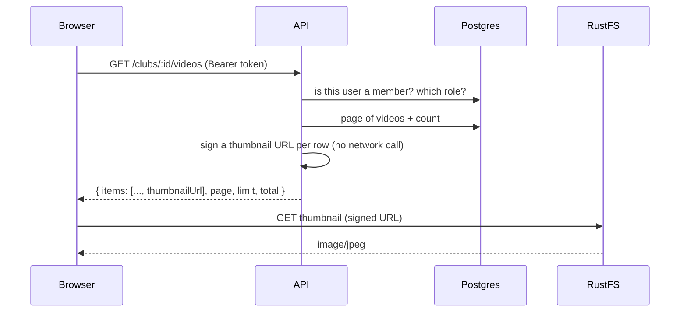
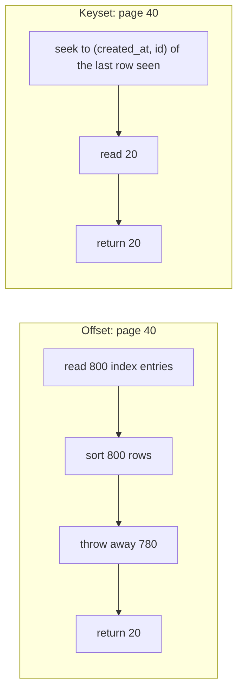
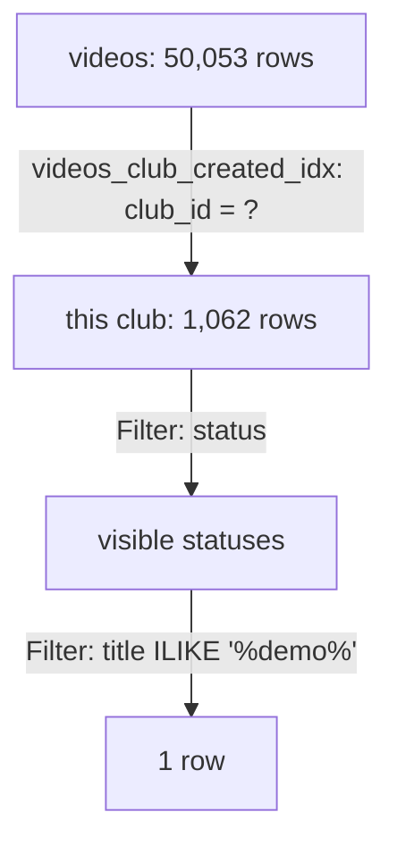

# Library, playback and downloads

Sprint 7 turns stored videos into a product: a club can browse its library, search it, watch a video and download it until its quota runs out. This guide grows one section per stage. The query plans and timings below were **measured on this project**.

Related: [indexes.md](indexes.md) (how B-tree indexes work) · [transactions.md](transactions.md) (atomic updates, locks) · [transcoding.md](transcoding.md) (what's in the `hls-output` bucket) · [uploads.md](uploads.md) (presigned upload URLs).

**Contents**

1. [The Sprint 7 API at a glance](#1-the-sprint-7-api-at-a-glance)
2. [Pagination: offset vs keyset](#2-pagination-offset-vs-keyset)
3. [Search with ILIKE, and why `%` and `_` must be escaped](#3-search-with-ilike-and-why--and-_-must-be-escaped)
4. [Reading the query plans](#4-reading-the-query-plans)
5. [Presigned GET URLs](#5-presigned-get-urls)
6. [Stage 1 code: the list endpoint](#6-stage-1-code-the-list-endpoint)

Coming in later stages: video detail, edit and delete, signed HLS streaming, atomic download quotas.

---

## 1. The Sprint 7 API at a glance

| Endpoint | Who | Stage |
|---|---|---|
| `GET /clubs/:clubId/videos?page&limit&status&q` | any member | 1 |
| `GET /videos/:id` | any member | 2 |
| `PATCH /videos/:id` | uploader or club admin | 3 |
| `DELETE /videos/:id` | uploader or club admin | 4 |
| `GET /videos/:id/stream/master.m3u8` and `/:variant.m3u8` | any member | 5 |
| `POST /videos/:id/download` | any member | 6 |
| `GET /clubs/:clubId/quota` | any member | 7 |
| `PATCH /admin/clubs/:clubId/quota` | operator (Basic auth) | 7 |

The rule that runs through all of them: **the API decides who may see something, storage serves the bytes.** The API never streams a 300 MB file through Node. It checks membership, then hands out a short-lived signed URL, and the browser fetches the bytes from RustFS directly.



---

## 2. Pagination: offset vs keyset

### Offset (what we use)

`?page=3&limit=20` becomes `LIMIT 20 OFFSET 40`. Simple, and the client can jump to any page and show "page 3 of 12".

The cost is hidden in `OFFSET`: Postgres can't skip rows it hasn't found. To return rows 781–800 it **finds and sorts 800 rows and throws 780 away**. Page 1 reads 20 rows; page 40 reads 800. The plan in section 4 shows exactly this.

Two more problems:

- **Rows shift under you.** If a video is uploaded while you're on page 1, page 2 starts one row later, and you see the last row of page 1 again.
- **Ties make pages unstable.** If two videos share a `created_at`, the database may return them in either order, so one can appear on both pages and the other on neither. That's why we sort by `created_at DESC, id DESC`: the `id` breaks every tie, so the order is total.

### Keyset (also called cursor or seek pagination)

Instead of "skip 40", the client says "give me 20 rows older than the last one I saw":

```sql
WHERE club_id = $1 AND (created_at, id) < ($lastCreatedAt, $lastId)
ORDER BY created_at DESC, id DESC
LIMIT 20
```

The index jumps straight to that point, so every page costs the same as page 1, and new uploads can't shift what you see. The price: no "page 7 of 12", no jumping to a page, only next and previous. The API returns an opaque `nextCursor` instead of `page`.



**Why offset is the right call here:** a club has hundreds of videos, not millions. Page 40 cost 1.9 ms on 1,062 rows (section 4). The convention in this codebase is `{ items, page, limit, total, totalPages }`, used by clubs and members too. If a list ever grows to a feed with millions of rows (comments, events, logs), keyset is the answer.

### What `total` costs

`total` is a second query: `SELECT count(*) ... WHERE <same filter>`. Postgres has no stored row count per filter, so it counts. We run it **in parallel** with the page query (`Promise.all`), so it adds no wait time, only database work. On a huge table this is the expensive part, which is another reason feeds use keyset and drop the total.

---

## 3. Search with ILIKE, and why `%` and `_` must be escaped

`ILIKE` is case-insensitive `LIKE`. In a pattern, two characters are special:

| Character | Means |
|---|---|
| `%` | any run of characters, including none |
| `_` | exactly one character |

So searching for `demo` becomes the pattern `%demo%`: "demo anywhere in the title".

### The bug if you don't escape

If the user's text goes into the pattern unchanged, their `%` and `_` become wildcards:

| User types | Pattern | Matches |
|---|---|---|
| `_` | `%_%` | **every title with at least one character**, i.e. all of them |
| `50%` | `%50%%` | "50% off" but also "500 views", "2050" |
| `a_b` | `%a_b%` | "a_b" but also "axb", "a b" |

It's not SQL injection: the value is still a bound parameter. It's **wildcard injection**: wrong results, and a cheap way to force the slowest possible search.

### The fix

Put a backslash in front of `\`, `%` and `_`. Postgres's default escape character for `LIKE` is `\`, so `\%` means "a literal percent sign":

```ts
const escapeLike = (text: string) => text.replace(/[\\%_]/g, '\\$&');
```

- `[\\%_]` matches one backslash, percent or underscore. The backslash must be escaped too, or a user typing `\` would escape our own `%`.
- `'\\$&'` puts a backslash in front of whatever matched (`$&` is "the matched text").

**Measured** on the real table (32 videos in the test club):

```text
title ILIKE '%_%'     → 32 rows  (unescaped: matches everything)
title ILIKE '%\_%'    → 0 rows   (escaped: only titles containing "_")
```

And the API: `?q=_` and `?q=%25` (a URL-encoded `%`) both return `total: 0`, while `?q=demo` returns the one demo video.

### Can an index help `ILIKE '%demo%'`?

Not a normal B-tree. A B-tree index is sorted, so it can answer "starts with" (`'demo%'`), but a pattern starting with `%` could match anywhere, so there's no place in the sorted order to start.

The Postgres answer is the **`pg_trgm`** extension and a **GIN trigram index**. It splits every title into three-letter chunks (`"dem"`, `"emo"`, ...) and finds titles that contain all the chunks of the search term:

```sql
CREATE EXTENSION pg_trgm;
CREATE INDEX videos_title_trgm_idx ON videos USING gin (title gin_trgm_ops);
```

We **don't** add it. Every search is already narrowed to one club by `videos_club_created_idx`, so `ILIKE` only runs over that club's rows: about 1,000 checks in well under a millisecond (section 4). A trigram index pays off when you search across a whole large table, for example a platform-wide search.

---

## 4. Reading the query plans

With only 53 rows, Postgres reads the whole table no matter what, because that's cheaper than using an index. To see what happens at scale, I inserted **50,000 fake videos across 50 clubs inside a transaction**, ran `EXPLAIN ANALYZE`, then rolled back, so nothing was kept. The test club got 1,062 rows.

### Page 1

```text
Limit (actual rows=20)
  ->  Incremental Sort (actual rows=20)
        Sort Key: created_at DESC, id DESC
        Presorted Key: created_at
        ->  Index Scan Backward using videos_club_created_idx (actual rows=21)
              Index Cond: (club_id = '42c0a5d2-...')
              Filter: (status = ANY ('{UPLOADING,PROCESSING,READY,ERROR}'))
```

Read it from the bottom up:

1. **`Index Scan Backward using videos_club_created_idx`**: the index is sorted by `(club_id, created_at)`. Postgres jumps to this club's section and walks it **backwards**, which gives newest first for free. A B-tree can be read in either direction, so an ascending index serves `DESC` too.
2. **`Filter: status = ANY(...)`**: status isn't in the index, so each row is checked after it's read. Cheap, because almost every row passes.
3. **`Incremental Sort`, `Presorted Key: created_at`**: the rows already arrive sorted by `created_at`; only rows with the *same* `created_at` need sorting by `id`. Postgres sorts tiny groups instead of the whole result.
4. **`Limit`**: stop after 20. It read **21 rows**, not 1,062.

### Page 40 (`OFFSET 780`)

```text
Limit (actual rows=20)
  ->  Sort (actual rows=800)
        ->  Bitmap Heap Scan on videos (actual rows=1032)
              ->  Bitmap Index Scan on videos_club_created_idx (actual rows=1062)
Execution Time: 1.940 ms
```

The plan changed shape. Postgres knew it needed 800 rows, so instead of walking the index row by row it collected **every** row of the club (a bitmap scan reads table pages in physical order, which is faster for many rows) and sorted them. **Sorted 800 to return 20**: the offset cost from section 2, made visible. Still under 2 ms at this size.

### Search `q=demo`

```text
Bitmap Heap Scan on videos (actual rows=1)
  Filter: ((title ~~* '%demo%') AND (status = 'READY'))
  Rows Removed by Filter: 1031
  ->  Bitmap Index Scan on videos_club_created_idx (actual rows=1062)
```

`~~*` is how Postgres spells `ILIKE`. The index narrows 50,000 rows to this club's 1,062, then `ILIKE` checks each one and throws away 1,031. This is why `pg_trgm` isn't needed yet: the club filter does the heavy lifting.



---

## 5. Presigned GET URLs

A bucket is private: an anonymous `GET` gets 403. A **presigned URL** is a normal URL plus a signature that says "the holder of this URL may `GET` this one key until this time":

```text
http://localhost:9000/thumbnails/4dce8038-....jpg
  ?X-Amz-Algorithm=AWS4-HMAC-SHA256
  &X-Amz-Credential=<access-key>/20261014/us-east-1/s3/aws4_request
  &X-Amz-Date=20261014T154500Z
  &X-Amz-Expires=600
  &X-Amz-SignedHeaders=host
  &X-Amz-Signature=3f9c...
```

- **The signature is an HMAC** of the method, bucket, key, expiry and date, made with the secret key. Storage recomputes it on every request. Change anything (the key, the expiry) and it no longer matches.
- **Signing happens locally.** `getSignedUrl` makes no network call; it's a hash. Signing 20 thumbnails per page costs microseconds, which is why the list endpoint can sign one per row.
- **It's a bearer credential.** Anyone holding the URL can use it until it expires, with no login. That's why expiries are short: 10 minutes for thumbnails here, 5 minutes for video segments in Stage 5.
- **Signed with `s3Public`, not `s3`.** The signature covers the host. The worker talks to `rustfs:9000` inside Docker, but a browser needs `localhost:9000`, so URLs for browsers are signed by the client configured with `S3_PUBLIC_ENDPOINT` ([uploads.md](uploads.md) explains the two clients).

**Measured:**

```text
signed URL                → 200 image/jpeg, 41,889 bytes, X-Amz-Expires=600
same URL, one key char changed → 403
same URL, query string removed → 403
```

Uploads used the same idea in Sprint 4 (a presigned `UploadPart` per chunk). Stage 6 will add one option: `ResponseContentDisposition`, which makes storage send `Content-Disposition: attachment` so the browser saves the file instead of playing it.

---

## 6. Stage 1 code: the list endpoint

Reading order, outside in:

| Layer | File | What it does |
|---|---|---|
| Route | `routes/clubs.routes.ts` | `GET /:clubId/videos` → `validate(listVideosSchemas)` → `requireClubRole('viewer')` → controller |
| Validator | `validators/video.schema.ts` | `listVideosSchemas`: `paginationQuery` (page ≥ 1, limit 1–50, defaults 1 and 20) extended with `status` (one of the enum) and `q` (trimmed, ≤ 100 chars, empty → `undefined`) |
| Controller | `controllers/video.controller.ts` | `list`: takes the validated query and the membership, calls the service |
| Service | `services/video.service.ts` | `listVideos`: decides which statuses this role may see, calls the repository, signs a thumbnail per row, wraps it in `paginated()` |
| Repository | `repositories/video.repository.ts` | `listForClub`: the page query and the count, in parallel, with the same `where` |
| Storage | `lib/storage/objects.ts` | `presignGet(bucket, key, expiresIn)` |

### Who sees which statuses

```ts
const visibleStatuses = (role: ClubRole): readonly VideoStatus[] =>
  UPLOADER_ROLES.includes(role) ? videoStatusEnum.enumValues : ['READY'];

const visible = visibleStatuses(role);
const statuses = status ? visible.filter((s) => s === status) : visible;
if (statuses.length === 0) return paginated([], 0, page, limit);
```

- Club owners and admins (the roles that can upload) see every status, including their failed and in-progress uploads. Viewers only see what they can watch.
- The `status` filter **narrows what you're allowed to see**; it can't widen it. A viewer asking for `?status=ERROR` gets an empty list, not a 403. A filter that matches nothing is an empty result, and returning 403 would tell a viewer that ERROR videos are a thing they're missing.
- When nothing can match, the service returns early without touching the database.

The repository takes the allowed statuses as a list and uses `inArray`, so the rule lives in the service, and the repository only knows how to query.

### One `where`, two queries

```ts
const where = and(
  eq(videos.clubId, clubId),
  inArray(videos.status, [...statuses]),
  search ? ilike(videos.title, `%${escapeLike(search)}%`) : undefined,
);
const [items, [total]] = await Promise.all([
  db.query.videos.findMany({ columns: {...}, where, orderBy: [desc(videos.createdAt), desc(videos.id)], limit, offset }),
  db.select({ value: count() }).from(videos).where(where),
]);
```

- Building `where` once guarantees `total` counts exactly the rows the page draws from. Two hand-written filters would drift apart.
- `and(...)` skips `undefined`, so "no search" just drops that condition.
- `db.query` for the rows (an entity fetch), `db.select` for `count()` (an aggregate): the project rule.
- `columns` picks only what a list needs. `description` and `errorMessage` can be long, and `rawPath`/`uploadId` are internal, so they stay out.

### Signing thumbnails

```ts
const thumbnailUrl = (key: string | null) =>
  key ? presignGet(BUCKETS.thumbnails, key, THUMBNAIL_URL_TTL_SECONDS) : null;

items.map(async ({ thumbnailPath, ...video }) => ({ ...video, thumbnailUrl: await thumbnailUrl(thumbnailPath) }))
```

The storage key (`thumbnailPath`) is taken out and replaced by a URL. Clients never see keys: a key is an internal detail and useless without a signature anyway. Videos that aren't READY have no thumbnail, so they get `null`.

**Known gap:** the 26 READY rows left by the Sprint 5 stub have a `thumbnailPath` but no file in storage, so their URLs return 404. Real uploads don't have this problem.

### What was tested

| Request | Result |
|---|---|
| no query | `total: 32`, `totalPages: 2`, newest first, the demo video has a working thumbnail URL |
| `?status=ERROR&limit=2` | 5 ERROR videos, 2 shown |
| `?status=READY&page=2&limit=5` | 27 READY, page 2 |
| `?q=demo` | 1 match |
| `?q=_`, `?q=%25` | 0 matches (escaped) |
| `?q=` | same as no search |
| `?limit=51`, `?status=DONE` | 400 `VALIDATION_ERROR` with the field message |
| as a viewer | 27, all READY; `?status=ERROR` → 0 |
