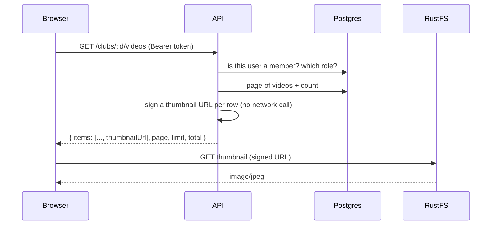
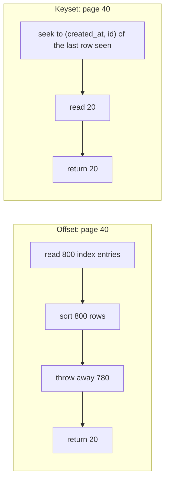
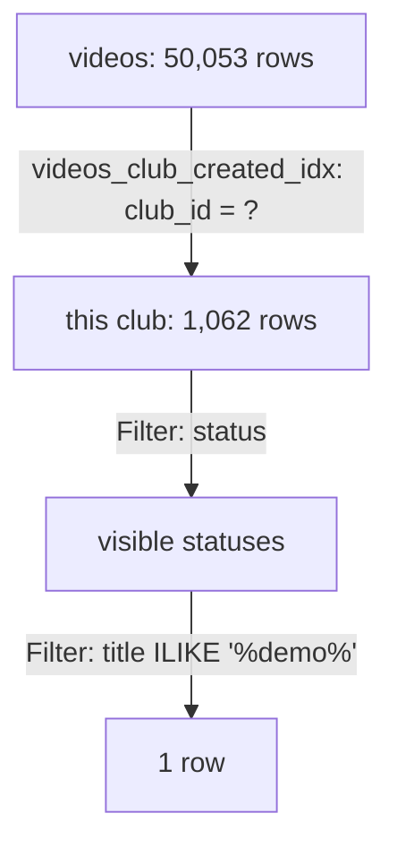
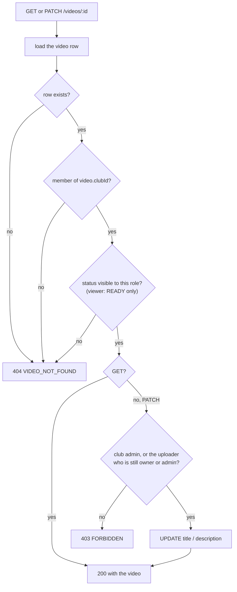
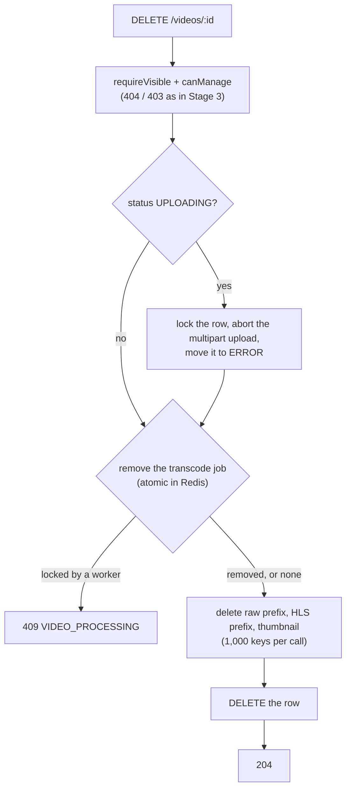
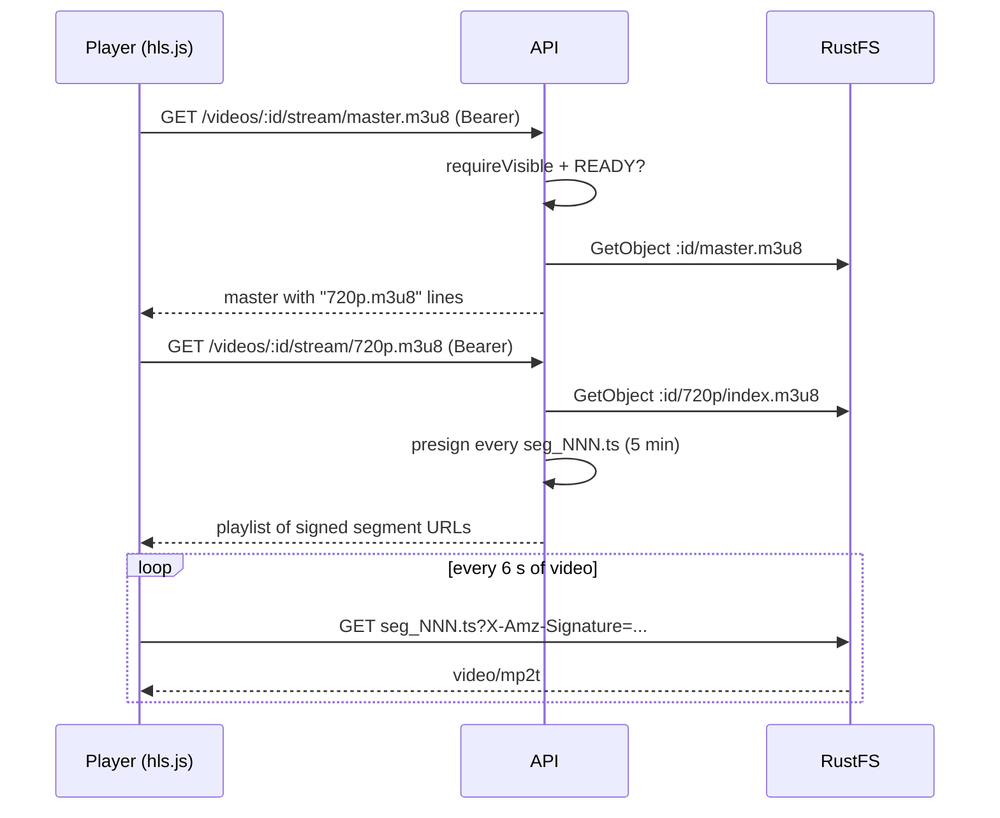

# Library, playback and downloads

Sprint 7 turns stored videos into a product: a club can browse its library, search it, watch a video and download it until its quota runs out. This guide grows one section per stage. The query plans and timings below were **measured on this project**.

Related: [indexes.md](indexes.md) (how B-tree indexes work) · [transactions.md](transactions.md) (atomic updates, locks) · [transcoding.md](transcoding.md) (what's in the `hls-output` bucket) · [uploads.md](uploads.md) (presigned upload URLs).

**Contents**

1. [The Sprint 7 API at a glance](#1-the-sprint-7-api-at-a-glance)
2. [Pagination: offset vs keyset](#2-pagination-offset-vs-keyset)
3. [Search with ILIKE, and why `%` and `_` must be escaped](#3-search-with-ilike-and-why--and-_-must-be-escaped)
4. [Reading the query plans](#4-reading-the-query-plans)
5. [Presigned GET URLs](#5-presigned-get-urls)
6. [Stage 1 code: the list endpoint](#6-stage-1-code-the-list-endpoint)
7. [Stages 2–3: one video, viewing and editing](#7-stages-23-one-video-viewing-and-editing)
8. [Stage 4: deleting a video](#8-stage-4-deleting-a-video)
9. [Stage 5: signed HLS streaming](#9-stage-5-signed-hls-streaming)

Coming in later stages: atomic download quotas.

---

## 1. The Sprint 7 API at a glance

| Endpoint | Who | Stage |
|---|---|---|
| `GET /clubs/:clubId/videos?page&limit&status&q` | any member | 1 |
| `GET /videos/:id` | any member | 2 |
| `PATCH /videos/:id` | uploader or club admin | 3 |
| `DELETE /videos/:id` | uploader or club admin | 4 |
| `GET /videos/:id/stream/master.m3u8` and `/:variant.m3u8` | any member | 5 |
| `POST /videos/:id/download` | any member | 6 |
| `GET /clubs/:clubId/quota` | any member | 7 |
| `PATCH /admin/clubs/:clubId/quota` | operator (Basic auth) | 7 |

The rule that runs through all of them: **the API decides who may see something, storage serves the bytes.** The API never streams a 300 MB file through Node. It checks membership, then hands out a short-lived signed URL, and the browser fetches the bytes from RustFS directly.



---

## 2. Pagination: offset vs keyset

### Offset (what we use)

`?page=3&limit=20` becomes `LIMIT 20 OFFSET 40`. Simple, and the client can jump to any page and show "page 3 of 12".

The cost is hidden in `OFFSET`: Postgres can't skip rows it hasn't found. To return rows 781–800 it **finds and sorts 800 rows and throws 780 away**. Page 1 reads 20 rows; page 40 reads 800. The plan in section 4 shows exactly this.

Two more problems:

- **Rows shift under you.** If a video is uploaded while you're on page 1, page 2 starts one row later, and you see the last row of page 1 again.
- **Ties make pages unstable.** If two videos share a `created_at`, the database may return them in either order, so one can appear on both pages and the other on neither. That's why we sort by `created_at DESC, id DESC`: the `id` breaks every tie, so the order is total.

### Keyset (also called cursor or seek pagination)

Instead of "skip 40", the client says "give me 20 rows older than the last one I saw":

```sql
WHERE club_id = $1 AND (created_at, id) < ($lastCreatedAt, $lastId)
ORDER BY created_at DESC, id DESC
LIMIT 20
```

The index jumps straight to that point, so every page costs the same as page 1, and new uploads can't shift what you see. The price: no "page 7 of 12", no jumping to a page, only next and previous. The API returns an opaque `nextCursor` instead of `page`.



**Why offset is the right call here:** a club has hundreds of videos, not millions. Page 40 cost 1.9 ms on 1,062 rows (section 4). The convention in this codebase is `{ items, page, limit, total, totalPages }`, used by clubs and members too. If a list ever grows to a feed with millions of rows (comments, events, logs), keyset is the answer.

### What `total` costs

`total` is a second query: `SELECT count(*) ... WHERE <same filter>`. Postgres has no stored row count per filter, so it counts. We run it **in parallel** with the page query (`Promise.all`), so it adds no wait time, only database work. On a huge table this is the expensive part, which is another reason feeds use keyset and drop the total.

---

## 3. Search with ILIKE, and why `%` and `_` must be escaped

`ILIKE` is case-insensitive `LIKE`. In a pattern, two characters are special:

| Character | Means |
|---|---|
| `%` | any run of characters, including none |
| `_` | exactly one character |

So searching for `demo` becomes the pattern `%demo%`: "demo anywhere in the title".

### The bug if you don't escape

If the user's text goes into the pattern unchanged, their `%` and `_` become wildcards:

| User types | Pattern | Matches |
|---|---|---|
| `_` | `%_%` | **every title with at least one character**, i.e. all of them |
| `50%` | `%50%%` | "50% off" but also "500 views", "2050" |
| `a_b` | `%a_b%` | "a_b" but also "axb", "a b" |

It's not SQL injection: the value is still a bound parameter. It's **wildcard injection**: wrong results, and a cheap way to force the slowest possible search.

### The fix

Put a backslash in front of `\`, `%` and `_`. Postgres's default escape character for `LIKE` is `\`, so `\%` means "a literal percent sign":

```ts
const escapeLike = (text: string) => text.replace(/[\\%_]/g, '\\$&');
```

- `[\\%_]` matches one backslash, percent or underscore. The backslash must be escaped too, or a user typing `\` would escape our own `%`.
- `'\\$&'` puts a backslash in front of whatever matched (`$&` is "the matched text").

**Measured** on the real table (32 videos in the test club):

```text
title ILIKE '%_%'     → 32 rows  (unescaped: matches everything)
title ILIKE '%\_%'    → 0 rows   (escaped: only titles containing "_")
```

And the API: `?q=_` and `?q=%25` (a URL-encoded `%`) both return `total: 0`, while `?q=demo` returns the one demo video.

### Can an index help `ILIKE '%demo%'`?

Not a normal B-tree. A B-tree index is sorted, so it can answer "starts with" (`'demo%'`), but a pattern starting with `%` could match anywhere, so there's no place in the sorted order to start.

The Postgres answer is the **`pg_trgm`** extension and a **GIN trigram index**. It splits every title into three-letter chunks (`"dem"`, `"emo"`, ...) and finds titles that contain all the chunks of the search term:

```sql
CREATE EXTENSION pg_trgm;
CREATE INDEX videos_title_trgm_idx ON videos USING gin (title gin_trgm_ops);
```

We **don't** add it. Every search is already narrowed to one club by `videos_club_created_idx`, so `ILIKE` only runs over that club's rows: about 1,000 checks in well under a millisecond (section 4). A trigram index pays off when you search across a whole large table, for example a platform-wide search.

---

## 4. Reading the query plans

With only 53 rows, Postgres reads the whole table no matter what, because that's cheaper than using an index. To see what happens at scale, I inserted **50,000 fake videos across 50 clubs inside a transaction**, ran `EXPLAIN ANALYZE`, then rolled back, so nothing was kept. The test club got 1,062 rows.

### Page 1

```text
Limit (actual rows=20)
  ->  Incremental Sort (actual rows=20)
        Sort Key: created_at DESC, id DESC
        Presorted Key: created_at
        ->  Index Scan Backward using videos_club_created_idx (actual rows=21)
              Index Cond: (club_id = '42c0a5d2-...')
              Filter: (status = ANY ('{UPLOADING,PROCESSING,READY,ERROR}'))
```

Read it from the bottom up:

1. **`Index Scan Backward using videos_club_created_idx`**: the index is sorted by `(club_id, created_at)`. Postgres jumps to this club's section and walks it **backwards**, which gives newest first for free. A B-tree can be read in either direction, so an ascending index serves `DESC` too.
2. **`Filter: status = ANY(...)`**: status isn't in the index, so each row is checked after it's read. Cheap, because almost every row passes.
3. **`Incremental Sort`, `Presorted Key: created_at`**: the rows already arrive sorted by `created_at`; only rows with the *same* `created_at` need sorting by `id`. Postgres sorts tiny groups instead of the whole result.
4. **`Limit`**: stop after 20. It read **21 rows**, not 1,062.

### Page 40 (`OFFSET 780`)

```text
Limit (actual rows=20)
  ->  Sort (actual rows=800)
        ->  Bitmap Heap Scan on videos (actual rows=1032)
              ->  Bitmap Index Scan on videos_club_created_idx (actual rows=1062)
Execution Time: 1.940 ms
```

The plan changed shape. Postgres knew it needed 800 rows, so instead of walking the index row by row it collected **every** row of the club (a bitmap scan reads table pages in physical order, which is faster for many rows) and sorted them. **Sorted 800 to return 20**: the offset cost from section 2, made visible. Still under 2 ms at this size.

### Search `q=demo`

```text
Bitmap Heap Scan on videos (actual rows=1)
  Filter: ((title ~~* '%demo%') AND (status = 'READY'))
  Rows Removed by Filter: 1031
  ->  Bitmap Index Scan on videos_club_created_idx (actual rows=1062)
```

`~~*` is how Postgres spells `ILIKE`. The index narrows 50,000 rows to this club's 1,062, then `ILIKE` checks each one and throws away 1,031. This is why `pg_trgm` isn't needed yet: the club filter does the heavy lifting.



---

## 5. Presigned GET URLs

A bucket is private: an anonymous `GET` gets 403. A **presigned URL** is a normal URL plus a signature that says "the holder of this URL may `GET` this one key until this time":

```text
http://localhost:9000/thumbnails/4dce8038-....jpg
  ?X-Amz-Algorithm=AWS4-HMAC-SHA256
  &X-Amz-Credential=<access-key>/20261014/us-east-1/s3/aws4_request
  &X-Amz-Date=20261014T154500Z
  &X-Amz-Expires=600
  &X-Amz-SignedHeaders=host
  &X-Amz-Signature=3f9c...
```

- **The signature is an HMAC** of the method, bucket, key, expiry and date, made with the secret key. Storage recomputes it on every request. Change anything (the key, the expiry) and it no longer matches.
- **Signing happens locally.** `getSignedUrl` makes no network call; it's a hash. Signing 20 thumbnails per page costs microseconds, which is why the list endpoint can sign one per row.
- **It's a bearer credential.** Anyone holding the URL can use it until it expires, with no login. That's why expiries are short: 10 minutes for thumbnails here, 5 minutes for video segments in Stage 5.
- **Signed with `s3Public`, not `s3`.** The signature covers the host. The worker talks to `rustfs:9000` inside Docker, but a browser needs `localhost:9000`, so URLs for browsers are signed by the client configured with `S3_PUBLIC_ENDPOINT` ([uploads.md](uploads.md) explains the two clients).

**Measured:**

```text
signed URL                → 200 image/jpeg, 41,889 bytes, X-Amz-Expires=600
same URL, one key char changed → 403
same URL, query string removed → 403
```

Uploads used the same idea in Sprint 4 (a presigned `UploadPart` per chunk). Stage 6 will add one option: `ResponseContentDisposition`, which makes storage send `Content-Disposition: attachment` so the browser saves the file instead of playing it.

---

## 6. Stage 1 code: the list endpoint

Reading order, outside in:

| Layer | File | What it does |
|---|---|---|
| Route | `routes/clubs.routes.ts` | `GET /:clubId/videos` → `validate(listVideosSchemas)` → `requireClubRole('viewer')` → controller |
| Validator | `validators/video.schema.ts` | `listVideosSchemas`: `paginationQuery` (page ≥ 1, limit 1–50, defaults 1 and 20) extended with `status` (one of the enum) and `q` (trimmed, ≤ 100 chars, empty → `undefined`) |
| Controller | `controllers/video.controller.ts` | `list`: takes the validated query and the membership, calls the service |
| Service | `services/video.service.ts` | `listVideos`: decides which statuses this role may see, calls the repository, signs a thumbnail per row, wraps it in `paginated()` |
| Repository | `repositories/video.repository.ts` | `listForClub`: the page query and the count, in parallel, with the same `where` |
| Storage | `lib/storage/objects.ts` | `presignGet(bucket, key, expiresIn)` |

### Who sees which statuses

```ts
const visibleStatuses = (role: ClubRole): readonly VideoStatus[] =>
  UPLOADER_ROLES.includes(role) ? videoStatusEnum.enumValues : ['READY'];

const visible = visibleStatuses(role);
const statuses = status ? visible.filter((s) => s === status) : visible;
if (statuses.length === 0) return paginated([], 0, page, limit);
```

- Club owners and admins (the roles that can upload) see every status, including their failed and in-progress uploads. Viewers only see what they can watch.
- The `status` filter **narrows what you're allowed to see**; it can't widen it. A viewer asking for `?status=ERROR` gets an empty list, not a 403. A filter that matches nothing is an empty result, and returning 403 would tell a viewer that ERROR videos are a thing they're missing.
- When nothing can match, the service returns early without touching the database.

The repository takes the allowed statuses as a list and uses `inArray`, so the rule lives in the service, and the repository only knows how to query.

### One `where`, two queries

```ts
const where = and(
  eq(videos.clubId, clubId),
  inArray(videos.status, [...statuses]),
  search ? ilike(videos.title, `%${escapeLike(search)}%`) : undefined,
);
const [items, [total]] = await Promise.all([
  db.query.videos.findMany({ columns: {...}, where, orderBy: [desc(videos.createdAt), desc(videos.id)], limit, offset }),
  db.select({ value: count() }).from(videos).where(where),
]);
```

- Building `where` once guarantees `total` counts exactly the rows the page draws from. Two hand-written filters would drift apart.
- `and(...)` skips `undefined`, so "no search" just drops that condition.
- `db.query` for the rows (an entity fetch), `db.select` for `count()` (an aggregate): the project rule.
- `columns` picks only what a list needs. `description` and `errorMessage` can be long, and `rawPath`/`uploadId` are internal, so they stay out.

### Signing thumbnails

```ts
const thumbnailUrl = (key: string | null) =>
  key ? presignGet(BUCKETS.thumbnails, key, THUMBNAIL_URL_TTL_SECONDS) : null;

items.map(async ({ thumbnailPath, ...video }) => ({ ...video, thumbnailUrl: await thumbnailUrl(thumbnailPath) }))
```

The storage key (`thumbnailPath`) is taken out and replaced by a URL. Clients never see keys: a key is an internal detail and useless without a signature anyway. Videos that aren't READY have no thumbnail, so they get `null`.

**Known gap:** the 26 READY rows left by the Sprint 5 stub have a `thumbnailPath` but no file in storage, so their URLs return 404. Real uploads don't have this problem.

### What was tested

| Request | Result |
|---|---|
| no query | `total: 32`, `totalPages: 2`, newest first, the demo video has a working thumbnail URL |
| `?status=ERROR&limit=2` | 5 ERROR videos, 2 shown |
| `?status=READY&page=2&limit=5` | 27 READY, page 2 |
| `?q=demo` | 1 match |
| `?q=_`, `?q=%25` | 0 matches (escaped) |
| `?q=` | same as no search |
| `?limit=51`, `?status=DONE` | 400 `VALIDATION_ERROR` with the field message |
| as a viewer | 27, all READY; `?status=ERROR` → 0 |

---

## 7. Stages 2–3: one video, viewing and editing

```text
GET   /videos/:videoId   → { video: { id, clubId, title, description, status, durationSeconds,
                                      resolution: { width, height } | null, sizeBytes, errorMessage,
                                      uploader: { id, email }, thumbnailUrl, createdAt, updatedAt } }
PATCH /videos/:videoId   { title?, description? } → same shape
```

### Where `resolution` comes from

The worker already runs `ffprobe` before transcoding (see [transcoding.md](transcoding.md)), and it swaps width and height for phone videos recorded sideways (rotation 90 or 270). It used to throw those numbers away. Migration `0003_video_resolution` adds nullable `width` and `height` columns, and the worker now returns them with the rest of its output, so `markVideoReady` saves them in the same `PROCESSING → READY` update.

They're nullable because a video only has a resolution once it has been probed. The API returns `resolution: null` until then, rather than two loose nulls. The 5 real videos that existed before the migration were backfilled once by running `ffprobe` against a 2-minute presigned URL of each raw source. ffprobe reads only the file's header over HTTP, so nothing was downloaded in full. That was a one-off script, not app code.

### The authorization problem: the URL has no club in it

The list route is `/clubs/:clubId/videos`, so the `requireClubRole` middleware reads `clubId` from the URL and checks membership before the controller runs. `/videos/:videoId` has no `clubId`. The club is only known **after loading the video**.

The classic bug here is called **IDOR** (insecure direct object reference). The API checks that you're logged in, loads whatever id you asked for, and returns it. Anyone could then read any club's video by copying an id. UUIDs are hard to guess, but ids leak through links, logs and screenshots. Being hard to guess is not access control.

So every `/videos/:id` handler runs the same guard first:

```ts
const requireVisible = async <T extends Pick<Video, 'clubId' | 'status'>>(video: T | undefined, userId: string) => {
  if (!video) throw videoNotFound();
  const role = await clubRepo.getMemberRole(video.clubId, userId);
  if (!role || !visibleStatuses(role).includes(video.status)) throw videoNotFound();
  return { video, role };
};
```



- **One guard, reused.** Delete, stream and download (Stages 4–6) start with the same `requireVisible`, so the rule lives in one place.
- **It's generic over the row type** (`<T extends Pick<...>>`). It accepts a plain `Video` or one loaded with its `uploader`, and returns the same type it was given.
- **It reuses `visibleStatuses` from Stage 1,** so a viewer can't open by id a video the list wouldn't show them.

### 404 or 403?

The project convention: **404 for things you may not know exist, 403 for things you can see but not change.**

| Who | Video | GET | PATCH |
|---|---|---|---|
| not in the club | any | 404 | 404 |
| viewer | READY | 200 | **403** |
| viewer | ERROR / PROCESSING | 404 | 404 |
| club owner, not the uploader | any | 200 | **403** |
| uploader, still club owner or admin | own | 200 | 200 |
| uploader, demoted to viewer | own, READY | 200 | **403** |
| club admin | any | 200 | 200 |

A 403 for a non-member would confirm "this id exists, you just can't have it". A 404 gives nothing away. A viewer **can** see a READY video, so for them a refused edit really is a 403.

### Who may edit

```ts
const canManage = (video: Pick<Video, 'uploadedBy'>, role: ClubRole, userId: string) =>
  role === 'admin' || (video.uploadedBy === userId && UPLOADER_ROLES.includes(role));
```

Owning the video isn't enough on its own: an uploader who is demoted to viewer loses the right to edit their old videos. Rights come from your **current** role. `uploadedBy` only decides which videos a club owner's rights apply to.

### PATCH semantics: missing, `null` and `""`

| Body | Effect on `description` |
|---|---|
| field left out | unchanged |
| `"description": "text"` | set, trimmed |
| `"description": null` | cleared |
| `"description": ""` | cleared (turned into `null`, so "empty" has one representation) |

This works because Zod leaves a missing key as `undefined`, and Drizzle's `.set()` skips `undefined` keys. The parsed body goes straight to `updateDetails`, and only the fields you sent are written. `updated_at` changes on every edit, because the shared `timestamps` columns have `$onUpdate`.

**Unknown fields are dropped.** A Zod object strips keys it doesn't declare, so `{"status":"READY","title":"x"}` changes only the title. Without that, passing the body to `.set()` would let a client write any column, including `status`, `clubId` or `uploadedBy`. That bug is called **mass assignment**, and the schema is the allow-list that prevents it.

### A validation bug this stage found

`PATCH {}` must fail, so the schema has a check on the whole body:

```ts
.refine((body) => body.title !== undefined || body.description !== undefined, {
  error: 'Send a title, a description, or both.',
})
```

The first test returned `400` with `"details": { "body": {} }`, so the message was lost. `validate.middleware.ts` only kept `fieldErrors` from `z.flattenError`. An error about the whole object isn't tied to a field, so Zod puts it in `formErrors` instead. The same gap hid the message for a body like `[]` on **every** route. The middleware now keeps both:

```ts
const { formErrors, fieldErrors } = z.flattenError(result.error);
issues[part] = formErrors.length > 0 ? { _errors: formErrors, ...fieldErrors } : fieldErrors;
```

`_errors` is the name Zod's own `format()` uses for errors about the object itself. Results:

```text
PATCH {}                            → { body: { _errors: ['Send a title, a description, or both.'] } }
PATCH []                            → { body: { _errors: ['Invalid input: expected object, received array'] } }
POST /clubs []                      → the same, on another route
PATCH {"title":"","description":5}  → { body: { title: [...], description: [...] } }   (unchanged)
```

### Races worth knowing about

- **The video is deleted between the load and the update.** `updateDetails` then matches no row and returns `undefined`, and the service answers 404. No lock is needed, because the update is a single statement on one row.
- **The role changes between the check and the update.** A demotion landing in that gap would let one last edit through. For a title edit that's harmless. Where it matters, as with the download quota in Stage 6, the check and the change go into one atomic statement.

### What was tested

| Case | Result |
|---|---|
| admin GET READY / ERROR | 200; the ERROR video shows its `errorMessage` |
| unknown id / `not-a-uuid` | 404 `VIDEO_NOT_FOUND` / 400 with the param message |
| a user from no club | 404 |
| viewer GET READY / ERROR | 200 / 404 |
| viewer PATCH READY / ERROR | 403 / 404 |
| club owner PATCH someone else's video | 403 |
| uploader as club owner / demoted to viewer | 200 / 403 |
| admin PATCH both fields, `""` description, title only | 200; trimmed; cleared; `updatedAt` changes each time |
| `{}`, `[]`, blank title | 400 with a message |
| `{"status":"READY","title":"x"}` | only the title changed |

---

## 8. Stage 4: deleting a video

```text
DELETE /videos/:videoId   → 204 No Content
                          → 403 FORBIDDEN          can see it, can't manage it (same rule as PATCH)
                          → 404 VIDEO_NOT_FOUND    can't see it, or it's already gone
                          → 409 VIDEO_PROCESSING   a worker is transcoding it right now
```

A video is spread over **four places**: one Postgres row, the raw upload in `raw-uploads`, the HLS playlists and segments in `hls-output`, and the thumbnail in `thumbnails`. A fifth exists while things are in flight: an open multipart upload, or a transcode job in Redis. Deleting the row is easy. Getting rid of everything else without leaving **orphans** (objects nothing points to, which you pay to store forever) is the real work.

### The order: everything else first, the row last



Why the row goes **last**: if storage cleanup fails halfway, the row still exists and still points at what's left. The request returns 500 and the client can simply send `DELETE` again; every step is safe to repeat (deleting a missing key succeeds, removing a missing job succeeds). The other order, row first, would leave objects that nothing references and nobody can find again.

### Each status needs something different

| Status | What could still be running | What delete does |
|---|---|---|
| `UPLOADING` | the client is still sending parts | takes the row lock (`SELECT … FOR UPDATE`, the same `withUploadLock` that `complete` uses), aborts the multipart upload, moves the row to `ERROR`, then carries on |
| `PROCESSING`, job waiting or delayed | nothing yet; the job is queued | removes the job so no worker ever starts it |
| `PROCESSING`, job active | FFmpeg, writing segments | **409**. Deleting now would race the worker: it would upload outputs after our cleanup, and they'd be orphans |
| `READY` / `ERROR` | nothing | removes the leftover completed or failed job (so Bull Board doesn't show a job for a video that no longer exists) |

**Why lock for `UPLOADING`?** Without the lock, `complete` could run between our abort and our row delete: it would assemble the object and enqueue a transcode for a video that's being deleted. With the lock, the two serialize. If `complete` wins, the row is `PROCESSING` when we get the lock, `abortLockedUpload` finds nothing to do, and the job check below handles it. If delete wins, `complete` waits, then finds no `UPLOADING` row and returns 404.

### Removing the job without a race

The obvious code has a gap:

```ts
const job = await videoQueue.getJob(id);
if ((await job.getState()) === 'active') throw conflict();   // ← a worker can take the job right here
await job.remove();
```

BullMQ's `Queue.remove(jobId)` is a Lua script that runs inside Redis in one step: "if no worker holds the lock, delete the job". It returns `1` (removed, or there was nothing to remove) or `0` (a worker holds the lock). The check and the delete can't be split by a worker, so there's no gap:

```ts
export const removeTranscodeJob = async (videoId: string) =>
  (await videoQueue.remove(transcodeJobId(videoId))) === 1;
```

This is the same idea as the quota update in Stage 6: **make the check and the change one atomic operation**, here in Redis, there in Postgres.

### Deleting a "folder" in S3

S3 has no folders, only keys that share a prefix. `deletePrefix` (written in Sprint 6, see [transcoding.md](transcoding.md)) lists 1,000 keys at a time with `ListObjectsV2` and deletes each page with one `DeleteObjects` call, which also takes at most 1,000 keys. Stage 4 fixed one gap in it: `DeleteObjects` returns **200 even when some keys fail**, listing them in `Errors`. The old code ignored that array. Now it throws, so a partial failure surfaces as a 500 and the row survives for a retry:

```ts
const { Errors } = await s3.send(new DeleteObjectsCommand({ Bucket, Delete: { Objects, Quiet: true } }));
if (Errors && Errors.length > 0) throw new Error(`Could not delete ${Errors.length} objects ...`);
```

`Quiet: true` means "only tell me about failures", so a successful batch returns an almost empty body.

The three prefixes:

| Bucket | Prefix or key |
|---|---|
| `raw-uploads` | `clubs/<clubId>/videos/<videoId>/` |
| `hls-output` | `<videoId>/` |
| `thumbnails` | `<videoId>.jpg` |

The raw delete uses the **prefix**, not `raw_path`, so anything under that video's folder goes, whatever its file extension.

### Known limits

- **Delete runs inside the request.** 2,500 objects took **8.2 s** against local RustFS: three list calls and three `DeleteObjects` calls, each waiting on the one before. A 2-hour video has ~3,600 segments across its renditions, so that's fine for now, but a platform with 10-hour videos would mark the row `DELETING`, return `202 Accepted`, and let a queue job do the cleanup with retries.
- **`requeue-stuck` could race a delete.** If the operator script re-enqueues a stuck `PROCESSING` video in the moment between our job removal and our row delete, a job is created for a video that then disappears. The worker loads the row, finds nothing, and fails the job as `UnrecoverableError('Video not found')` without retrying. That's harmless, just noise in Bull Board.
- **Download history.** Until Stage 6, `download_logs.video_id` is `ON DELETE CASCADE`, so deleting a video erases its download history. Stage 6 changes that.

### What was tested

| Case | Result |
|---|---|
| `not-a-uuid` / unknown id / no token | 400 / 404 `VIDEO_NOT_FOUND` / 401 |
| viewer deletes READY / ERROR | 403 / 404 |
| admin deletes a READY stub with **2,500** HLS objects + raw + thumbnail | 204 in 8.2 s; 0 objects left in all three buckets; row gone; GET and a second DELETE → 404 |
| delete while `UPLOADING` (part 1 of 2 sent) | 204; `ListMultipartUploads` empty; a late part `PUT` → 404 from storage; `complete` → 404 `UPLOAD_NOT_FOUND` |
| real 720p upload → READY → delete | resolution saved as 1280×720; 1 raw + 7 HLS + 1 thumbnail before, 0 after; completed job removed |
| 90 s 1080p upload, delete while the job is **active** | 409 `VIDEO_PROCESSING`; row stays `PROCESSING`; transcode finishes normally (49 HLS objects); delete then → 204, 0 left |
| queue paused, delete while the job is **waiting** | 204; job gone from Redis; 0 objects; queue resumed with nothing stuck |


---

## 9. Stage 5: signed HLS streaming

```text
GET /videos/:videoId/stream/master.m3u8   → the master playlist, variant lines rewritten to API routes
GET /videos/:videoId/stream/720p.m3u8     → one rendition, every segment line replaced by a presigned URL
```

### Why you can't just presign `master.m3u8`

An HLS video isn't one file. It's a tree of files, and the player discovers each one by reading the one above it ([transcoding.md](transcoding.md) shows the layout):

```text
master.m3u8 ──► 1080p/index.m3u8 ──► seg_000.ts, seg_001.ts, … (20 for a 2-minute video)
            ──► 720p/index.m3u8  ──► …
            ──► 480p/index.m3u8  ──► …
```

A presigned URL covers **exactly one key**. Sign `master.m3u8` and the player can read it, but it then requests `1080p/index.m3u8` relative to that URL, without a signature, and gets 403. Signing the master doesn't sign anything it points to.

Two ways out:

1. **Make the bucket public.** No. Anyone with a video id could watch, member or not.
2. **Rewrite the playlists so that every URI is already authorized.** That's what we do. The playlists are tiny text files, so the API reads them, checks access, rewrites them and returns them. The big files (segments) still go straight from storage to the browser.



**Access is checked on every playlist request,** so removing a member stops them within one playlist fetch. The worst case is a stream that keeps going on segment URLs signed before the removal, for at most 5 minutes.

### The rewrite

```ts
const VARIANT_LINE = /^(\d{3,4}p)\/index\.m3u8$/;
const SEGMENT_LINE = /^[\w-]+\.ts$/;

masterPlaylist:  "720p/index.m3u8"  →  "720p.m3u8"
variantPlaylist: "seg_000.ts"       →  presignGet(hls, ":id/720p/seg_000.ts", 300)
```

- **Only URI lines change.** In an `.m3u8` file, a line starting with `#` is a tag (`#EXTINF:6.0,`, `#EXT-X-ENDLIST`) and stays as it is. Any other non-empty line is a URI.
- **A URI we don't recognize is an error,** not something to pass through unchanged. If the worker ever writes a different layout, we want a loud 500 in the logs, not a silently broken player.
- **The variant URIs are relative** (`720p.m3u8`, not `http://localhost:4000/videos/.../720p.m3u8`). The player resolves them against the master's own URL, so the API never needs to know its public host name, and the same code works behind any domain or path prefix.
- **The plan's sample used `v\d+`.** Our worker names renditions `1080p`, `720p`, `480p`, so the pattern is `\d{3,4}p`.

### Never build a storage key from raw input

The route is `/:videoId/stream/:rendition.m3u8`, and `rendition` goes into a storage key. Express decodes the path before matching it:

```text
GET /videos/:id/stream/..%2F..%2Fsecret.m3u8   →   rendition = "../../secret"
```

Without validation, that becomes the key `:id/../../secret/index.m3u8`. S3 keys are plain strings, so `..` doesn't "go up" the way it does on a disk. It's still a key we never meant to build, though, and on a filesystem-backed store it can be a real **path traversal**. The schema allows exactly two shapes and rejects everything else with a 400:

```ts
rendition: z.union([z.literal('master'), z.string().regex(/^\d{3,4}p$/)])
```

A well-formed rendition the video doesn't have (`2160p`) reaches storage, gets `NoSuchKey`, and becomes 404 `RENDITION_NOT_FOUND`.

### The VOD trap: playlists are read once

A playlist ending in `#EXT-X-ENDLIST` is a **VOD** (video on demand) playlist: complete and never changing, so players read it **once**. With 5-minute URLs, a viewer who watches for 6 minutes (or pauses for 5) will request a segment whose URL has expired:

```text
13.2s  error: fragLoadError 403             ← storage refuses the expired URL
13.3s  fresh segment URLs for 1080p (20)    ← re-fetch 1080p.m3u8 through the API
13.7s  segment 16 @ 1080p, 4.41 MB          ← hls.js retries with the new URL
```

That log is from the dev player against an API instance started with `STREAM_URL_TTL_SECONDS=10`, so the expiry shows up in seconds instead of minutes. The fix lives in the player:

- **Retry on 403.** hls.js normally doesn't retry 4xx errors. A custom `fragLoadPolicy.errorRetry.shouldRetry` allows up to 3 retries for a 403.
- **Swap in fresh URLs.** On the error, re-fetch that rendition's playlist and write the new URLs into the fragments hls.js already holds (`frag.url = ...`).
- **What you keep.** The retry 300 ms later uses the fresh URL, so the buffer and the playback position are untouched.

The first attempt reloaded the whole source with `hls.loadSource()`. It worked, but it rebuilt the player: playback jumped from 10.9 s back to 6.1 s and every segment downloaded again. Patching the URLs in place avoids both.

**Why not just sign for longer?** The TTL is the window in which a **leaked** URL works. Signing for the video's whole length (2 hours) makes every copied link last 2 hours. Short URLs plus a refresh keep that window at 5 minutes and cost one small API request per 5 minutes of viewing.

### Browser details that bite

- **Send the token to the API only.** hls.js's `xhrSetup(xhr, url)` runs for every request, segments included. The player adds `Authorization` only when `url` starts with the API origin. **Measured:** RustFS ignores an extra `Authorization: Bearer` header on a presigned URL and returns 200. **AWS S3 doesn't:** it rejects a request that carries two auth mechanisms with 400 `InvalidArgument`. Code that only works because the local storage is lenient would break on the first deploy.
- **CORS on the bucket.** hls.js downloads segments with XHR, and XHR to another origin needs CORS. `storage:init` now gives `hls-output` a `GET` rule for `FRONTEND_URL`, which also lists the dev player's origin (`http://localhost:4100`). Thumbnails don't need one, because an `` tag isn't subject to CORS.
- **`Cache-Control: no-store`.** A variant playlist contains URLs signed for one moment and fetched with one user's token. A browser or proxy cache that replays it later would hand out expired URLs, or another user's access.

### Cost: signing isn't free

`getSignedUrl` is local (no network), but the SDK builds and signs a full request object each time. **Measured:** 1,200 URLs (a 2-hour rendition of 6-second segments) took **525–916 ms**, about 0.45 ms each. The 2-minute demo's 20 segments took 39 ms for the whole request. That's fine for Phase 1. With long videos and many viewers, the API spends real CPU on signing.

**Phase 2 with a CDN:** CloudFront can use **signed cookies**. The API checks membership once and sets a cookie whose policy says "this browser may read `hls-output/<videoId>/*` until 10:35". The playlists are then served unchanged straight from the CDN and cached at the edge for everyone, because the signature moves from the URLs into a cookie. No per-segment signing, no rewriting, and the same expiry guarantee.

### What was tested

| Case | Result |
|---|---|
| viewer gets `master.m3u8` | 200, `application/vnd.apple.mpegurl`, `no-store`, lines `1080p.m3u8, 720p.m3u8, 480p.m3u8`, 3 `#EXT-X-STREAM-INF` tags kept |
| viewer gets `720p.m3u8` | 200 in 39 ms; 20 segment lines, all `http://localhost:9000/hls-output/<id>/720p/seg_…` with `X-Amz-Expires=300`; `#EXT-X-ENDLIST` kept |
| fetch a signed segment | 200 `video/mp2t`, 2,143,576 bytes |
| same, with an extra `Authorization: Bearer` header | 200 on RustFS (AWS S3 would return 400) |
| storage `GET` with `Origin: http://localhost:4100` / API preflight from it | `Access-Control-Allow-Origin` set on both |
| no token / `..%2F..%2Fsecret` / `2160p` / `seg_000.ts` | 401 / 400 / 404 `RENDITION_NOT_FOUND` / 404 (no such route) |
| admin, ERROR video / viewer, ERROR video / unknown id | 409 `VIDEO_NOT_READY` / 404 / 404 |
| instance with `STREAM_URL_TTL_SECONDS=10`: segment URL fresh / after 12 s | 200 / 403 `AccessDenied` |
| dev player in API mode against that instance, in Chrome | plays; a 403 every ~12 s is followed by fresh URLs and a successful retry; playback reached 48.5 s with no restart |
