# Job queues, workers and BullMQ

How KlyroStream moves slow work (transcoding, emails, captions) out of HTTP requests and into a separate worker process. It starts from zero: what a queue is, what BullMQ is, what a "worker" actually is, how jobs get processed, concurrency vs parallelism, and the limits. It then compares BullMQ with RabbitMQ and Kafka, and ends with how to structure multi-stage work (single job, step job, flow). Every section points at real code, a measurement, or the sprint that will use it. See also [uploads.md](uploads.md) for how a video reaches PROCESSING, [locking.md](locking.md) for the state-machine transition the worker relies on, and [transactions.md](transactions.md) for every transaction and lock on the Postgres side.

**Contents**

1. [Fundamentals](#part-1-fundamentals): the problem, queues, BullMQ, workers, how a job is processed, concurrency, limits, durability
2. [BullMQ vs RabbitMQ vs Kafka](#part-2-bullmq-vs-rabbitmq-vs-kafka)
3. [What KlyroStream built in Sprint 5](#part-3-what-klyrostream-built-in-sprint-5): the whole flow on one page, the three locks, connections, `enqueueTranscode` (Promise.race + AbortController), the transactional outbox, the worker and its stub, `FAIL_RATE` fault injection, `WORKER_CONCURRENCY` and how jobs are shared between workers, shutdown, Bull Board, recovery scripts, measurements
4. [Structuring multi-stage work](#part-4-structuring-multi-stage-work): single job, step job, flow, and why transcode + thumbnail is not a flow
5. [The plan per sprint](#part-5-the-plan-for-klyrostream), gotchas, further reading

---

# Part 1: Fundamentals

## The problem

Transcoding a 1 GB video takes minutes of CPU. If `POST /videos/:id/complete` did it inline:

- **The request hangs for minutes.** Proxies and browsers time out long before FFmpeg finishes.
- **A restart loses the work.** Deploy, crash, Ctrl+C: the half-done transcode is gone, and nobody remembers that it was needed.
- **Spikes hurt everyone.** Ten uploads finishing together means ten FFmpeg processes fighting the API for CPU, and login gets slow.
- **No retries.** A transient failure (RustFS briefly down) becomes a permanent failure.

## What a queue is

A restaurant. The waiter (API) takes an order, writes a ticket, pins it on the rail, and goes back to the customers. The cooks (workers) take tickets off the rail one by one and cook. The waiter never waits at the stove, and if one cook goes home the tickets are still on the rail for the next one.


- The **producer** only says *what* needs doing ("transcode video 42") and moves on.
- The **queue** stores that note somewhere that survives restarts.
- The **consumer** does the work at its own pace, and tells the queue whether it succeeded.

This *decouples* the two sides in time (the work happens later), in speed (spikes wait in the queue instead of overloading the API) and in failure (a crashed worker doesn't break uploads; the job waits).

## What BullMQ is

BullMQ is **an npm library, not a server.** There is no "BullMQ process" running anywhere. The server is **Redis**, which already runs in our Compose stack. BullMQ is code that runs *inside your Node processes* and stores the queue as Redis keys.

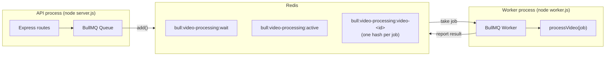

The two processes never call each other. Redis is the only thing between them.

BullMQ gives you three main classes:

| Class | Side | Does |
|---|---|---|
| `Queue` | producer | `add()` jobs, inspect counts, pause, clean |
| `Worker` | consumer | takes jobs one by one and runs your function on each |
| `QueueEvents` | anyone | listens to "progress / completed / failed" events from any process |

Plus `FlowProducer` for trees of jobs (Part 4).

## What a "worker" is

The word means three different things, and mixing them up is the usual source of confusion:

| Meaning | What it is concretely | In KlyroStream |
|---|---|---|
| **The processor** | A plain async function: `(job) => Promise<result>`. Return = success, throw = failure. It knows nothing about Redis. | `processVideo(job)` in `src/worker/…` |
| **The `Worker` object** | A BullMQ class instance. It loops: wait for a job, lock it, call the processor, record the result, repeat. | `new Worker('video-processing', processVideo, …)` |
| **The worker process** | A separate running Node program (its own PID, memory, CPU), whose whole job is to hold `Worker` objects. | `node dist/worker.js` (dev: `npm run dev:worker`) |

So the processor is a function, the `Worker` is the machine that calls that function, and the worker process is the program the machine runs in.

### Same codebase, two programs

The API and the worker are **two entry points into one codebase**:

```
backend/src/
├── server.ts     → starts Express + creates a Queue (producer). Never processes jobs.
├── worker.ts     → creates a Worker (consumer). Never listens on HTTP.
├── lib/          → db, redis, storage, queue: shared by both
└── modules/      → repositories, services: shared by both
```

```ts
// src/worker.ts (Sprint 5, step 4), roughly
const worker = new Worker<TranscodeJob>(VIDEO_QUEUE, processVideo, {
  connection: queueConnection('worker'),
  concurrency: env.WORKER_CONCURRENCY,
});
// …plus graceful shutdown on SIGTERM
```

You run them as two commands, two terminals in dev, two containers in Docker (the Sprint 6 Dockerfile builds one image with two targets, and only the worker target installs FFmpeg). The worker imports the same `videoRepository` and `transition` helper the API uses, so the rules for "PROCESSING → READY" live in one place.

### Why not run the Worker inside the API process?

It would work, since a `Worker` is just an object. We don't do it, because:

- **CPU competition.** A transcode next to Express makes every API request slow. Separate processes let the OS schedule them, and in production they run on different machines.
- **Independent scaling.** Need more transcoding? Start more worker processes. The API count stays the same, and vice versa.
- **Crash isolation.** A bug that kills the worker (FFmpeg on a weird file, out of memory) doesn't take the API down.
- **Different needs.** The worker needs FFmpeg, lots of temp disk and long shutdown times. The API needs none of that.

## How BullMQ processes a job, step by step

What actually happens between `add()` and "completed":

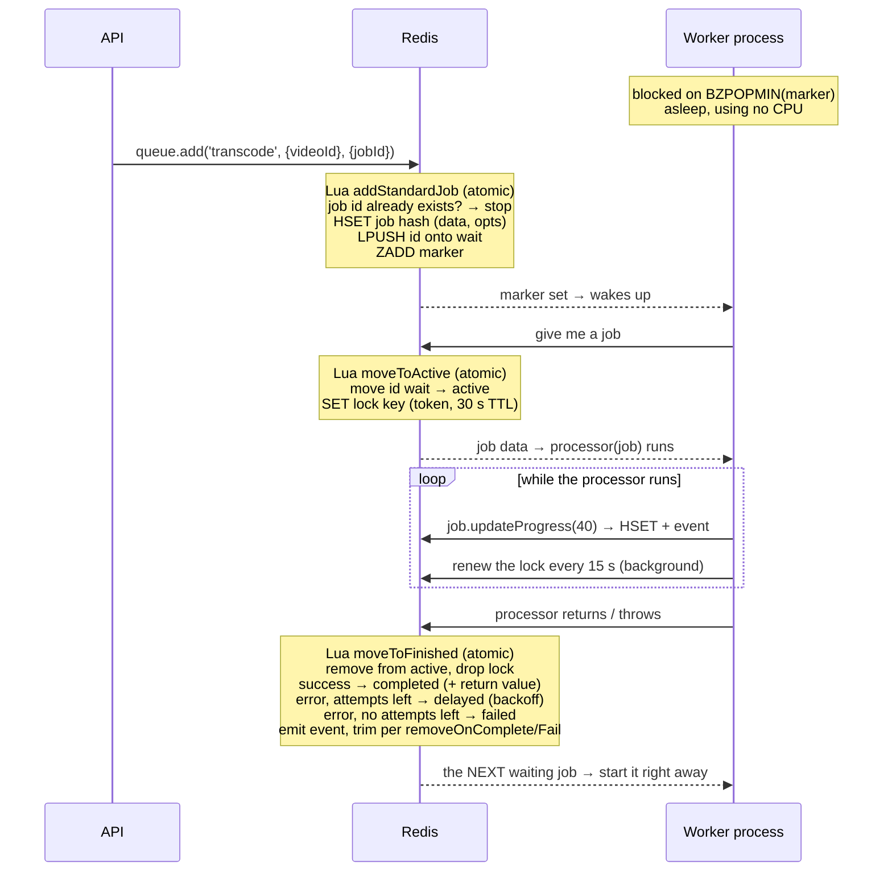

Points worth noticing:

- **Waiting costs nothing.** The worker isn't polling every 100 ms. It sends a *blocking* Redis command (`BZPOPMIN` on a "marker" key) on its own connection, which is why BullMQ opens a second, blocking connection. Redis replies the moment a job arrives.
- **Every state change is one Lua script.** Redis runs one script at a time, so two workers can never both take the same job, and "does this job id exist? then create it" can't race. This is the same idea as the atomic Redis commands in [locking.md](locking.md), just bigger.
- **Finishing a job fetches the next one** in the same round trip, so a busy worker doesn't go back to blocking between jobs.
- **Order:** jobs are taken FIFO (oldest first), unless they have a `priority` or a `delay`. With concurrency above 1, jobs *start* in order but can *finish* in any order.

### Job states

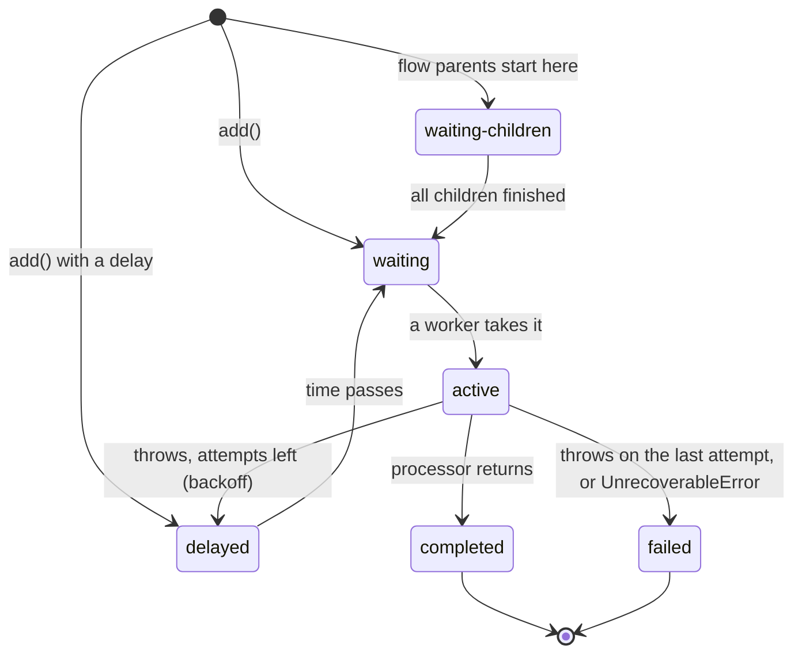

There is also `prioritized` (waiting, but sorted by priority) and `paused` (the queue is paused).

### Locks and stalled jobs

When a worker takes a job it gets a **lock** in Redis (`lockDuration`, default 30 s) and renews it every 15 s while the processor runs. If the worker process dies, the renewals stop, the lock expires, and a periodic check (`stalledInterval`, default 30 s) moves the job back to waiting so another worker can pick it up. After `maxStalledCount` (default 1) stalls it fails instead, so a job that crashes the worker every time can't loop forever.

The lock is one plain Redis key holding a random token, with an expiry:

```
bull:video-processing:video-42:lock  =  "a1b2c3…:7"     PX 30000   (expires in 30 s)
                                         └ token: which Worker, which slot
```

- `moveToActive` creates it (`SET … PX 30000`) in the same Lua script that moves the id from `wait` to `active`.
- `extendLock` renews it **only if the token still matches** (`GET` = my token → `SET … PX 30000`).
- `moveToFinished` also checks the token. If it doesn't match (the lock expired and someone else took the job), the late result is **rejected** ("Missing lock for job"), so a slow worker can't overwrite the newer run's outcome.

#### Healthy job: the lock never expires

```mermaid
gantt
    title Healthy job - the lock is renewed every 15 s, the job runs 72 s
    dateFormat X
    axisFormat %M:%S
    section Lock (30 s TTL)
    moveToActive sets the lock :0, 30s
    renew at 15 s :15, 30s
    renew at 30 s :30, 30s
    renew at 45 s :45, 30s
    renew at 60 s :60, 30s
    section Processor
    processVideo runs :0, 72s
    moveToFinished - token ok, completed, lock deleted :milestone, 72, 0s
```

The job can run for an hour. The lock only needs to outlive the gap between two renewals.

#### Crashed worker: how the job is rescued

The stalled check is a **two-pass mark-and-sweep**, run by every worker every `stalledInterval`:

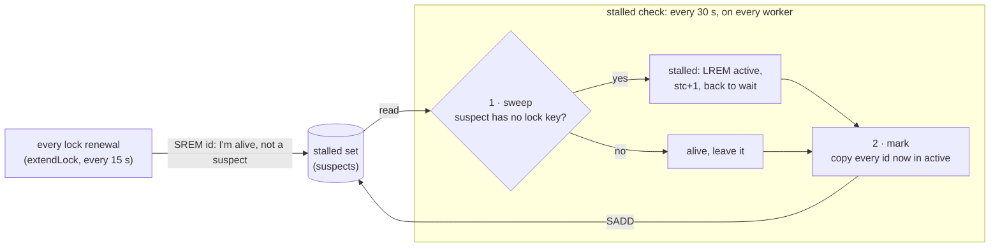

A job that is renewed between two passes is removed from the suspects and survives. A job whose worker died is still a suspect at the next pass *and* has no lock, so it's moved back.

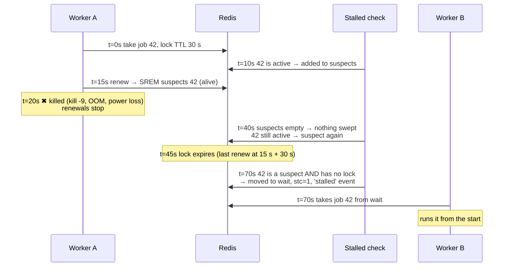

So a dead worker's job comes back after somewhere between ~30 s and ~60 s plus the remaining lock time. It doesn't use up one of the 3 `attempts`. Stalls are counted separately (`stc` on the job hash). With `maxStalledCount: 1`, the second stall marks it to fail with "job stalled more than allowable limit" when it is next picked up.

This is the run that happened in the Sprint 5 test: double Ctrl+C mid-job, and the next worker recovered it about 30 s later.

Renewal runs on the worker's event loop. If the processor blocks the loop (a long synchronous loop, heavy JSON parsing), renewals stop and a healthy job is marked stalled and **run twice**. FFmpeg runs in a child process via `spawn`, so the event loop stays free. Keep it that way.

### Delivery is at least once

A crash after the work is done but before BullMQ records "completed" means the job runs again. Every processor must be **safe to run twice**:

- re-read the row and check the state before doing anything (the worker requires `PROCESSING`);
- write outputs to deterministic paths (`hls-output/<videoId>/…`), so a rerun overwrites instead of duplicating;
- make the final write a conditional state transition (`PROCESSING → READY` via the Sprint 4 `transition` helper), so a second "mark ready" is a no-op or a clear error.

## Concurrency vs parallelism

Two words that sound the same and aren't:

- **Concurrency:** several tasks are *in progress* at the same time, taking turns on one CPU core. A single cook with three pans: while one pan heats, they chop for another.
- **Parallelism:** several tasks are *executing* at the same instant on different cores. Three cooks.

Node runs your JavaScript on **one thread**. So inside one Node process you get concurrency, never parallelism, for JavaScript code. Waiting (network, disk, a child process) doesn't use the thread, so while one job waits another can run.

BullMQ's `concurrency` option is **concurrency**: how many processors one `Worker` keeps in flight at once (default 1). Extra **processes** give **parallelism**.

Measured on this machine (8 cores, Redis in Docker, 6 jobs of 1 s each):

| Setup | Job is… | Total time | Why |
|---|---|---|---|
| 1 process, `concurrency: 1` | waiting (`setTimeout`, like I/O) | **6.2 s** | one at a time |
| 1 process, `concurrency: 3` | waiting | **2.1 s** | three wait at once: concurrency helps |
| 1 process, `concurrency: 3` | busy CPU loop in JS | **6.0 s** | one thread: the "three" just queue up behind each other |
| 2 processes, `concurrency: 1` each | busy CPU loop in JS | **3.1 s** | two threads on two cores: real parallelism |

Rules that follow:

- I/O-heavy jobs (send an email, call an API, small DB work): raise `concurrency`.
- CPU-heavy **JavaScript**: concurrency doesn't help (and blocks lock renewal). Use more processes, or BullMQ's *sandboxed processors* (pass a file path instead of a function, optionally with `useWorkerThreads: true`) so each job runs in its own child process or thread.

### Where FFmpeg fits

FFmpeg is a separate OS process. From Node's point of view, `await runFfmpeg(…)` is *waiting*, so `concurrency: 3` really would run three FFmpegs in parallel on the CPU. But **libx264 already uses all cores for a single encode**. Three at once just split the same 8 cores three ways: each runs about 3× slower, uses 3× the RAM and temp disk, and total throughput barely changes. Hence `WORKER_CONCURRENCY=1` for the video queue to start, and Sprint 11 measures 1 vs 2 workers instead of guessing.

## Limits: what bounds throughput

| Knob / limit | Scope | What it does | KlyroStream |
|---|---|---|---|
| `concurrency` | one `Worker` object | max jobs in flight in that process | 1 for video (CPU-bound), higher for emails later |
| Number of worker processes | your deployment | parallelism; each process has its own `concurrency` | 1 in dev; scale in Sprint 11 / Phase 2 |
| `queue.setGlobalConcurrency(n)` | the whole queue, all workers | caps active jobs across every worker | not needed yet |
| `limiter: { max, duration }` | the whole queue | at most `max` jobs started per `duration` ms | e.g. "10 emails/s" for an SMTP provider |
| Redis memory | Redis | every waiting job and kept result is RAM | small payloads (ids) + `removeOnComplete/Fail` |
| Redis throughput | Redis | single-threaded, still far more jobs/s than we'll ever add | not a concern: our jobs take minutes, not ms |
| Lock / stalled settings | per worker | how fast a dead worker's job is rescued | defaults (30 s) are fine |

The real limit for us is **CPU minutes of FFmpeg**, not anything in BullMQ. The queue's job is to make that limit safe: excess work waits in Redis instead of overloading a machine.

## Durability: what if Redis restarts?

The queue lives in Redis, so it is only as durable as Redis. Our `docker-compose.yml` runs `redis-server --appendonly yes`: every write is appended to a file on the `redis_data` volume and replayed on restart. With the default `appendfsync everysec`, a hard crash loses at most about the last second of writes. Verified on the running container: `appendonly yes`, `maxmemory-policy noeviction`.

`noeviction` matters. With an eviction policy like `allkeys-lru`, Redis would *silently delete* job keys when memory fills up. With `noeviction` it refuses new writes instead, and `add()` fails loudly.

For a video platform that's the right trade-off. A job lost in that last second leaves a video stuck in PROCESSING, and the requeue script (Sprint 5, step 8) picks it up. Postgres stays the source of truth; the queue is a to-do list derived from it.

---

# Part 2: BullMQ vs RabbitMQ vs Kafka

All three move work or messages between processes, but they are different kinds of tools.

| | **BullMQ** | **RabbitMQ** | **Kafka** |
|---|---|---|---|
| What it is | Job-queue **library** on top of Redis | Message **broker** (a server) | Distributed **log** (a server cluster) |
| Mental model | A to-do list where every item has a state | A post office that routes letters into mailboxes | An append-only journal that many readers replay at their own pace |
| Unit | A *job* with state, attempts, progress, result | A *message*, deleted once acknowledged | A *record* at an offset in a partition; kept for days, read many times |
| Retries + backoff | Built in (`attempts`, `backoff`) | Manual: nack + requeue, or dead-letter exchange + TTL tricks | Manual: retry topics, or block the partition |
| Delayed jobs | Built in (`delay`) | Plugin or TTL + dead-letter | Not really: build it yourself |
| Progress, return values, job history | Built in | No | No |
| Parent/child workflows | Built in (flows) | No | No (stream processing frameworks instead) |
| Routing | By queue name | Rich: exchanges, topics, headers, fan-out | By topic + partition key |
| Replay old messages | No, completed jobs are eventually removed | No, acked = gone | **Yes**, that's the point |
| Ordering | FIFO per queue (completion order varies with concurrency) | FIFO per queue | Strict per partition |
| Parallelism | Add workers / concurrency, freely | Add consumers, freely | Capped by partition count |
| Throughput sweet spot | Thousands of jobs/s, long-running jobs | Tens of thousands of msgs/s | Millions of records/s |
| Languages | Node first (ports exist for Python, Elixir, PHP) | Any (AMQP is a standard protocol) | Any |
| Ops cost for us | **Zero new servers**: Redis already runs | A new server (Erlang) to run, monitor, back up | A cluster: brokers, KRaft controllers, partitions, retention tuning |
| Dashboard | Bull Board (job-level) | Management UI (queue-level) | Third-party UIs (topic/offset-level) |

### When each one fits

- **BullMQ:** "do this task, eventually, with retries, and tell me how it went". Background jobs in a Node app: transcoding, emails, reports, webhooks, scheduled tasks.
- **RabbitMQ:** many services, possibly in different languages, exchanging messages with flexible routing ("send `order.created` to billing and shipping, and everything matching `order.*` to audit"). The classic microservices message bus.
- **Kafka:** high-volume **event streams** that several systems consume independently and may need to **replay**: clickstreams, video-view analytics, change-data-capture, audit logs, event sourcing. It isn't a task queue; there are no per-message retries or delays, and one slow message blocks its whole partition.

### Why BullMQ for KlyroStream

- **The shape of our work is "jobs", not "events".** A few long, expensive tasks (minutes each) that need retries, backoff, progress for the UI, a final failed/completed state, and a dashboard. That's exactly BullMQ's built-in feature set; with RabbitMQ or Kafka we'd rebuild most of it.
- **No new infrastructure.** Redis is already there for rate limits and token blacklists.
- **One language.** The whole backend is Node + TypeScript, and BullMQ is native to it, with typed job data shared by producer and worker.
- **Scale fits.** Kafka shines at millions of events per second; we'll have dozens of uploads per hour. Kafka here would be like renting a cargo ship to deliver a letter.

### When we'd add something else

- **Kafka**, if Phase 2+ tracks every play/pause/seek for analytics and several consumers (recommendations, billing, dashboards) read the same stream. Even then, transcoding stays on BullMQ: events and jobs coexist.
- **RabbitMQ**, if a service in another language joins (say, a Python ML service) and we need cross-language routing. BullMQ's Python port might cover that too.

Being able to say *why not* Kafka is a good interview answer. "Kafka is a log for event streams; our workload is a small number of expensive jobs that need retries and progress" shows you picked the tool for the workload, not the hype.

---

# Part 3: What KlyroStream built in Sprint 5

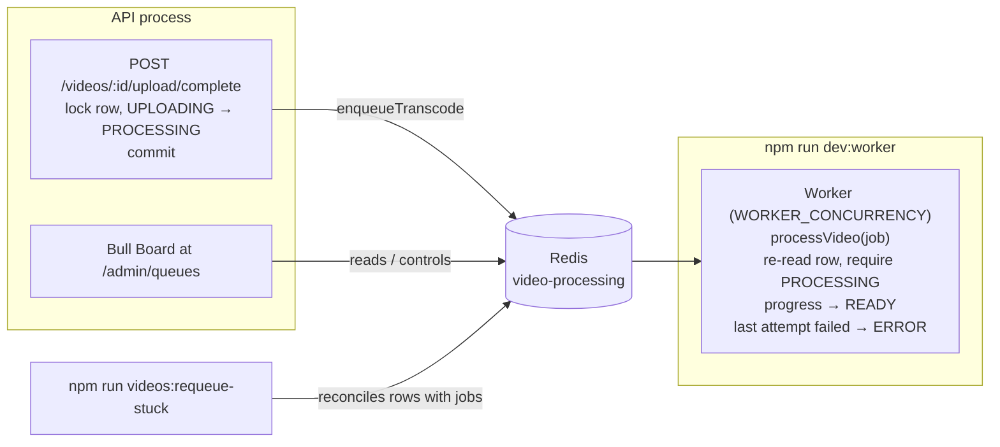

### The whole flow on one page

One video, from the last uploaded part to READY, with every lock and every place it can break. Columns are the four things involved; time runs downward.

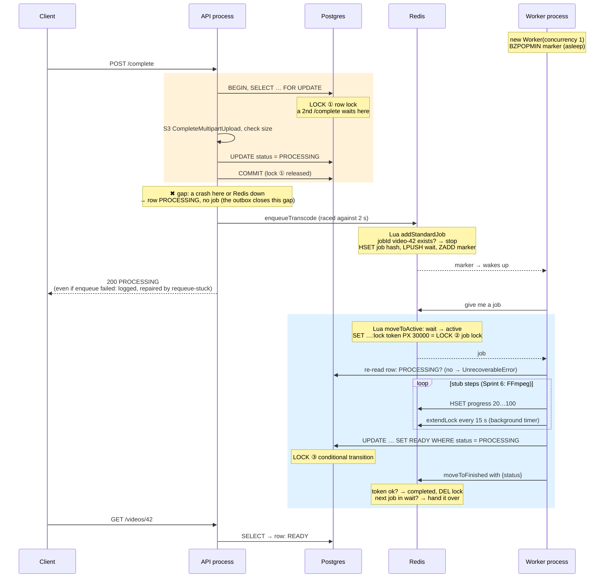

What happens on the error paths:

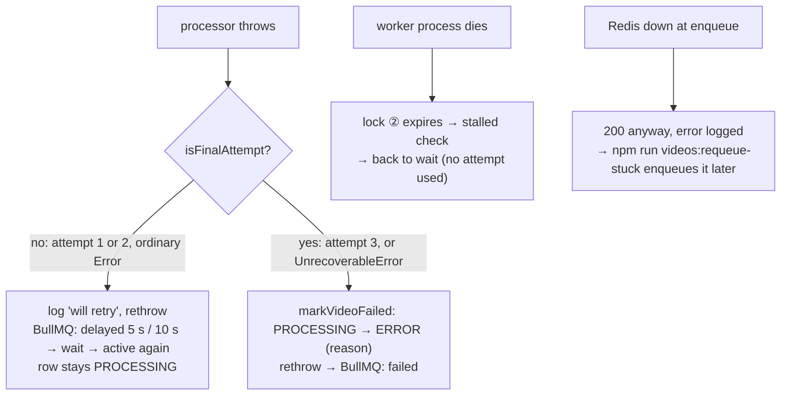

### The three locks, side by side

"Locking" shows up three times in this flow. They protect different things and live in different places:

| | ① Postgres row lock | ② BullMQ job lock | ③ Conditional transition |
|---|---|---|---|
| Where | Postgres, `SELECT … FOR UPDATE` in `withUploadLock` | Redis key `bull:video-processing:<jobId>:lock` | Postgres, `UPDATE … WHERE status = 'PROCESSING'` |
| Protects against | two `/complete` (or `/complete` + abort + expire script) running at once on one video | two workers running one job at once | writing READY/ERROR over a row that changed meanwhile (deleted, already failed) |
| Held for | milliseconds, until COMMIT | the whole job, renewed every 15 s | a single statement (it's atomic, not held) |
| If the holder dies | Postgres releases it when the connection drops | expires after 30 s, stalled check rescues the job | nothing to release |
| Kind | pessimistic (wait your turn) | lease (expires unless renewed) | optimistic (check-and-set, 0 rows = someone else won) |
| Covered in | [locking.md](locking.md) | Part 1, *Locks and stalled jobs* | [locking.md](locking.md) |

Plus the idempotent **jobId**, which isn't a lock but works like one at enqueue time: `addStandardJob` checks "does `video-42` exist?" and creates it in one atomic Lua script, so two enqueues can't both create a job.

### Connections: `src/lib/queue/connection.ts`

BullMQ gets its own Redis connections, separate from the cache/rate-limit client in `src/lib/redis/client.ts`:

| | Producer (API) | Worker |
|---|---|---|
| `maxRetriesPerRequest` | `null` (BullMQ requirement) | `null` (a `Worker` throws without it) |
| `enableOfflineQueue` | `false`: when Redis is down, `add()` rejects in ~1 ms, so the request fails fast | `true`: the worker waits for Redis to come back |
| `connectionName` | `klyro:producer` | `klyro:worker` (BullMQ also opens a blocking copy, `bull:<base64 queue name>`, for `BZPOPMIN`) |

`closeQueueConnections()` uses `quit()` on connections that are `ready` and `disconnect()` on the rest. `quit()` *sends a command*, which fails when Redis is already down, and shutdown has to work exactly then.

Each connection is created on first use (`queueConnection('producer' | 'worker')`), so the API never opens a worker connection. They are deliberately **not** `lazyConnect`. A `Queue` or `Worker` runs its setup once, in its constructor, and caches the result. With a lazy connection and Redis down at boot, that setup fails and the queue stays broken **even after Redis returns**. With an eager connection, setup waits for Redis instead. So `enqueueTranscode` puts a 2-second limit on `add()`: a request during that "Redis has never been up" window fails quickly. The job is still created once Redis arrives, which is harmless because the jobId is idempotent.

Measured, API booted with Redis down:

| | lazyConnect (before) | eager + 2 s limit (now) |
|---|---|---|
| Enqueue while Redis has never been up | rejects in 1 ms | rejects after 2 s |
| Enqueue after Redis comes back | **"Connection is closed" forever** | works |
| Enqueue after Redis drops later | rejects in 1 ms | rejects in 1 ms |

The same trap exists in `rate-limit-redis`: it loads its Lua scripts once at boot and caches the promise. With `passOnStoreError: true`, a failed load meant **every rate limit silently turned off** until a restart. `RecoveringRedisStore` in `rate-limit.middleware.ts` reloads a failed script, so limiting resumes once Redis is back. The lesson is general: **anything that does one-time setup against a dependency must handle that dependency being down at boot.**

### The queue: `src/lib/queue/queues.ts`

```ts
export const videoQueue = new Queue<TranscodeJob>(VIDEO_QUEUE, {
  connection: queueConnection('producer'),
  defaultJobOptions: {
    attempts: 3,
    backoff: { type: 'exponential', delay: 5_000 }, // retry after 5 s, then 10 s
    removeOnComplete: { count: 100 },                // keep the last 100 successes
    removeOnFail: { count: 500 },                    // keep more failures, those get debugged
  },
});

videoQueue.on('error', …); // without a listener, a Redis outage crashes the process
```

- **Pointers, not state.** The payload is an id. The worker reads the current row from Postgres, never a snapshot from enqueue time.
- **Idempotent id.** `video-<uuid>`, so a double `/complete` or a requeue script creates one job. Use `-`, not `:`, because `:` separates Redis key parts. Measured: adding the same id twice stores one job, and the stored `requestId` is the first one. The `Job` returned by the second `add()` shows the data you passed, not the stored data.
- **The id only blocks while the job exists.** Once `removeOnComplete` evicts it (after 100 newer completions), the same id can be added again and runs again. A "re-process this video" feature should use a new id (e.g. `video-<uuid>-r2`) instead of relying on eviction timing.
- **Enqueue after commit.** `completeVideoUpload` commits `UPLOADING → PROCESSING` first, then enqueues. Enqueueing inside the transaction could start a worker that reads the row *before* the commit and sees `UPLOADING`. If the enqueue fails after the commit, `/complete` still answers **200 PROCESSING** and logs `failed to enqueue transcode`. Returning an error would be worse: the client would retry, hit `409 UPLOAD_NOT_IN_PROGRESS` (the row is already PROCESSING), and conclude the upload failed when it didn't. The stuck video is repaired by `npm run videos:requeue-stuck` (below). The fully robust version is the [transactional outbox](#the-transactional-outbox-and-why-it-fits-here) (below); it is out of scope for Phase 1.

### `enqueueTranscode`: Promise.race and AbortController

```ts
export const enqueueTranscode = async (videoId: string, requestId?: string) => {
  const timeout = new AbortController();
  try {
    return await Promise.race([
      videoQueue.add('transcode', { videoId, requestId }, { jobId: transcodeJobId(videoId) }),
      sleep(ENQUEUE_TIMEOUT_MS, undefined, { signal: timeout.signal }).then(() => {
        throw new Error(`Enqueue timed out after ${ENQUEUE_TIMEOUT_MS} ms`);
      }),
    ]);
  } finally {
    timeout.abort();
  }
};
```

**The problem it solves.** `videoQueue.add()` can, in one situation, hang without ever settling. When the API boots while Redis is down, the `Queue`'s one-time setup waits for Redis to connect, and every `add()` waits for that setup. That could take minutes. A `/complete` request must not hang that long just because the *follow-up* step is slow, so `add()` gets a 2-second deadline.

(When Redis drops *after* boot, the producer connection has `enableOfflineQueue: false`, so `add()` rejects in ~1 ms by itself. The timeout only matters in the never-connected case.)

**Piece by piece:**

1. **`Promise.race([a, b])`** returns a promise that settles **the same way as whichever input settles first**: resolved with its value or rejected with its error. The other promise is *not* stopped; JavaScript promises can't be cancelled. The race just stops listening to it.
2. **Promise `a`: `videoQueue.add(…)`** resolves with the `Job`, or rejects (Redis down, offline queue off).
3. **Promise `b`: the timeout.** `sleep` is `setTimeout` from `node:timers/promises`: `sleep(2000)` is a promise that resolves after 2 s. The `.then(() => { throw … })` turns "2 s passed" into a *rejection* with a clear message. So `b` can never win with a value, only with "timed out".
4. **`AbortController` + `{ signal }`.** The promise version of `setTimeout` accepts an abort signal. `timeout.abort()` clears the underlying timer and makes `sleep` reject with an `AbortError`.
5. **`finally { timeout.abort() }`** runs on every way out: `add` won, `add` failed, or the timer won.

**Why abort the timer at all?** Without it, every successful enqueue (which takes ~2 ms) would leave a 2-second timer behind. That timer keeps the process alive during shutdown, and under load you'd have thousands of pointless timers pending. Aborting cleans it up as soon as the race is decided.

**Why no "unhandled rejection" from the loser?** When `abort()` makes `sleep` reject, `b` rejects too, *after* the race already settled. That's fine, because `Promise.race` attached its own handlers to both inputs when it was called. A rejection on a promise that has a handler is never "unhandled", even if the handler ignores it. The same goes for a late `add()` rejection.

The three cases on a timeline:

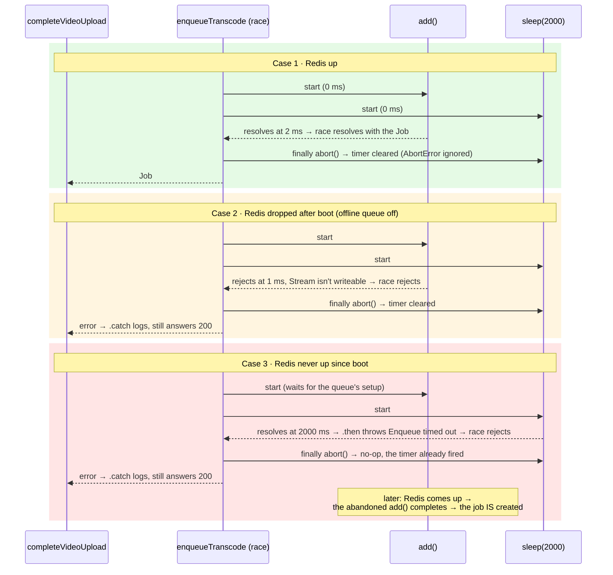

That last line is surprising but harmless. The timeout gives up on *waiting*, not on the *write*. When Redis arrives, the pending `add()` goes through and the video gets processed anyway. If someone ran `requeue-stuck` meanwhile, the idempotent `jobId` makes the second add a no-op. This is why "fire, maybe twice" is safe here, and why an idempotent jobId matters.

**The caller decides what a failure means.** `enqueueTranscode` just reports success or failure. `completeVideoUpload` catches the error and logs it, because the upload itself *did* succeed (see *Enqueue after commit* above).

### The transactional outbox, and why it fits here

**The problem: two writes, two systems, no shared transaction.** `/complete` makes two writes:

1. Postgres: `UPLOADING → PROCESSING` (committed).
2. Redis: "transcode video 42" (the job).

No single transaction spans Postgres and Redis. Whichever order you choose, a crash between them leaves the two out of sync:

| Order | Crash between the two writes leaves… | Result |
|---|---|---|
| Enqueue, then commit | a job for a row still `UPLOADING` (or rolled back) | worker runs too early, or for nothing |
| **Commit, then enqueue** (ours) | a `PROCESSING` row with **no job** | video stuck forever, until someone notices |

This is the classic **dual-write problem**. We picked the second order because its failure is *detectable*: a PROCESSING row that's been sitting there too long. `requeue-stuck` fixes it, but only when someone runs it.

**The outbox pattern** removes the second write from the request entirely:

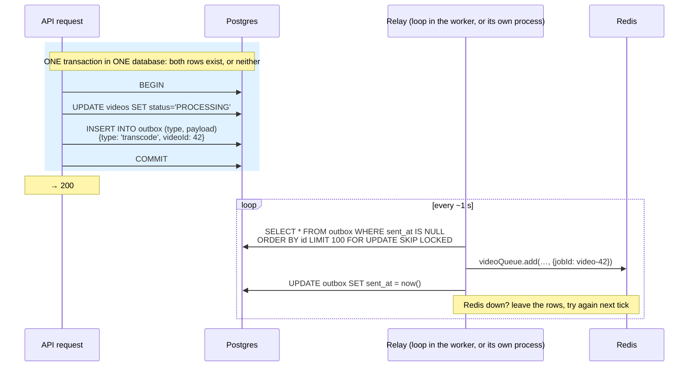

The trick: the request only writes to **one** system, Postgres, so it can use **one** transaction. Getting the message from Postgres to Redis becomes a separate, retryable background step. If the relay crashes after `add()` but before marking the row sent, it sends again next tick, so the relay is *at least once*, and the idempotent `jobId` turns the duplicate into a no-op. Every part of this flow can now fail and recover without a human.

**Why it would be good here:**
- No gap. A committed PROCESSING always gets its job eventually, with no "run the script" step.
- `/complete` no longer depends on Redis at all: no 2 s timeout, no "200 but enqueue failed".
- It generalises. Sprint 7's delete, emails and later events (`video.ready` → notify the club) all become "insert an outbox row in the same transaction".

**What it costs:**
- A new table, a relay loop, cleanup of sent rows, and monitoring for "relay is behind".
- Extra latency: a job starts up to one polling interval later (or use Postgres `LISTEN/NOTIFY` to wake the relay early).
- Ordering and concurrency details: `FOR UPDATE SKIP LOCKED` so two relays don't send the same rows.

**Why Phase 1 doesn't need it: our `videos` table already is an outbox.** The row's own status is the record of pending work: "PROCESSING with no job" *is* an unsent outbox entry. `requeue-stuck` is a relay that a human runs, and it finds exactly those rows. Running it on a schedule (every few minutes, `--min-age-minutes 10`) gives nearly all of the outbox's benefit without a new table. A real outbox becomes worth it once several kinds of events need reliable delivery and no single status column describes them.

(The industrial version replaces the polling relay with *change data capture*: a tool like Debezium reads Postgres's write-ahead log and publishes outbox inserts to Kafka.)

### Retries and the state machine

| What happened | BullMQ | Video row |
|---|---|---|
| Processor returns | `completed` | `PROCESSING → READY` (done by the processor) |
| Throws, attempts left | `delayed` → retried with backoff | stays `PROCESSING` |
| Throws on the 3rd attempt | `failed` | `PROCESSING → ERROR` with the reason |
| Throws `UnrecoverableError` (no video stream, row not PROCESSING) | `failed` immediately, no retries | `ERROR` (or untouched if it wasn't ours) |

Retrying only helps for failures that can change: network blips, RustFS restarting, a full disk. A corrupt file fails identically three times, so it throws `UnrecoverableError` and fails at once.

### The worker: `src/worker.ts` and `src/worker/video.processor.ts`

`worker.ts` is the second entry point (`npm run dev:worker`, `npm run start:worker`). It creates one `Worker` on `queueConnection('worker')`, logs its events (`ready`, `completed`, `stalled`, `error`; `failed` at debug level), and handles shutdown. It never listens on HTTP.

The processor (a Sprint 5 stub; Sprint 6 replaces the middle with FFmpeg):

1. Re-read the video. Missing, or not `PROCESSING` → `UnrecoverableError` (retrying can't help).
2. Report progress 20 → 100 (`job.updateProgress`), optionally failing on purpose (`FAIL_RATE`).
3. `videoService.markVideoReady(id)`: a conditional `PROCESSING → READY`. Zero rows changed → `UnrecoverableError`.

#### Why a stub, and what the stub steps are

Sprint 5 is about the *plumbing*: enqueue, retry, fail, shut down, recover. FFmpeg (Sprint 6) brings its own problems (temp files, child processes, S3 streaming). Building both at once would make every bug ambiguous: is it the queue or the encoder? So the processor's "work" is fake, while everything around it is the real code Sprint 6 keeps.

```ts
const STUB_STEPS = 5;
const STUB_STEP_MS = 500;

for (let step = 1; step <= STUB_STEPS; step++) {
  await sleep(STUB_STEP_MS);
  if (step === 3 && Math.random() < env.FAIL_RATE) {
    throw new Error('Simulated transient failure (FAIL_RATE)');
  }
  await job.updateProgress(Math.round((step / STUB_STEPS) * 100));
}
```

- **5 steps × 500 ms = 2.5 s of "work".** Long enough to watch progress move in Bull Board and to press Ctrl+C mid-job when testing shutdown. Short enough that a test run doesn't drag.
- **`await sleep(…)`, not a busy loop.** A real transcode is *waiting* from Node's point of view (FFmpeg is another process), so the stub waits too. That keeps the event loop free for lock renewal, just as FFmpeg will. It's also why `WORKER_CONCURRENCY=3` sped the stub up 2.7×: three waits overlap. Real encodes won't scale like that (see *Where FFmpeg fits*).
- **`job.updateProgress(20 / 40 / 60 / 80 / 100)`** writes the number into the job hash and emits a `progress` event. Bull Board shows it as a bar. Sprint 6 will report FFmpeg's real `time=` progress, and Sprint 9 can push it to the browser.
- **The failure is at step 3, not step 1**, on purpose: the job has *already reported 40%* when it fails. That shows what a retry really does: it starts over from zero (progress goes back to 20%). BullMQ doesn't resume. Sprint 6 must be able to restart cleanly (outputs to deterministic paths, temp dir wiped).
- **`Math.random() < env.FAIL_RATE`.** `Math.random()` is uniform in [0, 1), so the condition is true with probability `FAIL_RATE`: 0 → never, 0.5 → half the attempts, 1 → always. Each *attempt* rolls independently, so with 3 attempts a video ends in ERROR with probability `FAIL_RATE³` (0.5 → 12.5%, which matched the 8-upload test).
- **It throws a plain `Error`, not `UnrecoverableError`.** It simulates the *transient* kind (network blip), the kind retries exist for.

#### `transcode` vs `processVideo`: work vs policy

The file has two functions on purpose:

| | `transcode(job, log)` | `processVideo(job)` |
|---|---|---|
| Job | do the work: check row, (stub) encode, mark READY | decide what a failure *means* |
| Knows about retries? | no, it just throws | yes: final or not |
| Sprint 6 changes it? | yes, the loop becomes FFmpeg | no |

```ts
export const processVideo = async (job: Job<TranscodeJob>) => {
  const { videoId, requestId } = job.data;
  const log = logger.child({ jobId: job.id, videoId, requestId, attempt: job.attemptsMade + 1 });

  try {
    return await transcode(job, log);
  } catch (err) {
    if (!isFinalAttempt(job, err)) {
      log.warn({ err }, 'attempt failed, will retry');
      throw err;
    }
    const reason = err instanceof Error ? err.message : 'Processing failed';
    const failed = await videoService.markVideoFailed(videoId, reason).catch((markErr: unknown) => {
      log.error({ err: markErr }, 'could not mark video as ERROR');
      return undefined;
    });
    log.error({ err, markedError: Boolean(failed) }, 'processing failed for good');
    throw err;
  }
};
```

- **`logger.child({...})`** makes a logger that stamps every line with jobId, videoId, the request id from the original `/complete` and the attempt number. One `grep requestId` follows a video from the HTTP request into the worker.
- **`return await`**, not `return`, so a rejection from `transcode` is caught by *this* `try`. A plain `return transcode(…)` would hand the promise out of the function before it rejects, and the `catch` would never run.
- **Always rethrow.** The processor's throw is how BullMQ learns the attempt failed. Swallowing the error would mark the job *completed*.
- **`markVideoFailed(...).catch(...)`.** If Postgres is down at that moment, marking ERROR fails too. That second error is logged but not thrown, so BullMQ still records the *original* reason on the job. The row stays PROCESSING with a failed job, which is exactly the case `requeue-stuck` turns into ERROR later.

Failure handling lives **in the processor**, not in a `failed` listener:

```ts
const isFinalAttempt = (job: Job, err: unknown) =>
  err instanceof UnrecoverableError || job.attemptsMade + 1 >= (job.opts.attempts ?? 1);
```

`attemptsMade` counts *finished* attempts, so it is 0 during the first one. With `attempts: 3`:

| Attempt | `attemptsMade` during it | `attemptsMade + 1 >= 3`? | If it throws a plain Error |
|---|---|---|---|
| 1st | 0 | no | warn, rethrow → delayed 5 s |
| 2nd | 1 | no | warn, rethrow → delayed 10 s |
| 3rd | 2 | **yes** | mark ERROR, rethrow → failed |
| any | – | (UnrecoverableError → final) | mark ERROR, rethrow → failed, no retries |

Why not the worker's `failed` event, as the plan's reference code does? A `Worker` emits `failed` only for errors thrown by its own processor (checked in BullMQ's `worker.js`). A job that fails because it stalled too many times reaches neither place. Since neither covers everything, the processor keeps the decision next to its context, and the requeue script handles the rest.

#### `FAIL_RATE`: failing on purpose

Retries, backoff and the final ERROR are code paths that almost never run in a healthy dev setup. Code that never runs is code you can't trust. `FAIL_RATE` is a **fault-injection** switch: it makes the worker fail on purpose, so you can watch the failure handling work.

```ts
FAIL_RATE: z.coerce.number().min(0).max(1).default(0),

.refine((value) => value.NODE_ENV !== 'production' || value.FAIL_RATE === 0, {
  message: 'FAIL_RATE must be 0 in production.',
  path: ['FAIL_RATE'],
});
```

- **`min(0).max(1)`.** It's a probability. `1.5` or `-1` is a typo and fails at boot.
- **`default(0)`.** It's off unless you ask for it. `.env.example` lists it as `FAIL_RATE=0` so you know it exists.
- **The `.refine`.** A schema-wide rule: if `NODE_ENV=production` and `FAIL_RATE` isn't 0, the process refuses to start. A test switch left on by accident must never fail real users' videos. It checks the whole object, not one field, because the rule involves two variables.
- **Only the worker reads it**, in `transcode` at step 3 (see the stub steps above).

**What a run looks like.** Each attempt rolls the dice independently:

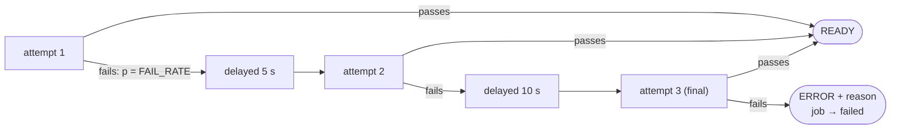

| `FAIL_RATE` | an attempt fails | video ends READY on the 1st try | needs a retry but ends READY | ends ERROR (`FAIL_RATE³`) |
|---|---|---|---|---|
| 0 | never | 100% | 0% | 0% |
| 0.2 | 20% | 80% | 19.2% | 0.8% |
| 0.5 | 50% | 50% | 37.5% | 12.5% |
| 0.9 | 90% | 10% | 17.1% | 72.9% |
| 1 | always | 0% | 0% | 100% |

That table is the whole argument for retries. With a 20% transient failure rate, a single attempt loses 1 video in 5, and three attempts lose fewer than 1 in 100.

How to use it:

```powershell
$env:FAIL_RATE=1; npm run dev:worker      # every attempt fails: watch backoff, then ERROR
$env:FAIL_RATE=0.5; npm run dev:worker    # a mix: some first try, some retried, ~1 in 8 ERROR
```

What to look at:
- **Bull Board**: the job moves `active → delayed → waiting → active` with growing gaps, and the attempt count rises. On the last failure it lands in `failed`, with the error and a stack trace per attempt.
- **Worker logs**: `attempt failed, will retry` (warn) with `attempt: 1`, `2`, then `processing failed for good` (error) with `markedError: true`.
- **Postgres**: `SELECT status, error_message FROM videos WHERE id = '…'` shows `ERROR` and `Simulated transient failure (FAIL_RATE)`.

Measured in Sprint 5 (the table below): `FAIL_RATE=1` gave 3 attempts then ERROR. `FAIL_RATE=0.5` over 8 uploads gave 6 READY first time, 1 READY on attempt 3 and 1 ERROR, close to the expected 12.5%.

**In Sprint 6**, the stub loop goes away, but the switch stays. It will fire *before* the expensive part (right after the download), so a simulated failure doesn't waste a full FFmpeg encode. It will still throw a plain `Error`, because the point is to exercise retries, not the bad-input path.

### `WORKER_CONCURRENCY`

```ts
WORKER_CONCURRENCY: z.coerce.number().int().min(1).max(16).default(1),

const videoWorker = new Worker<TranscodeJob>(VIDEO_QUEUE, processVideo, {
  connection: queueConnection('worker'),
  concurrency: env.WORKER_CONCURRENCY,
});
```

It is BullMQ's `concurrency` option (see [Concurrency vs parallelism](#concurrency-vs-parallelism)) read from the environment: **how many jobs this one worker process runs at the same time.** It doesn't create threads or processes. One Node thread keeps N `processVideo` calls in flight, and they take turns whenever one of them `await`s.

```mermaid
gantt
    title 3 stub jobs of 2.5 s each, one worker process
    dateFormat x
    axisFormat %S s
    section concurrency 1 (B and C wait in Redis)
    slot 1 - job A :0, 2500
    slot 1 - job B :2500, 5000
    slot 1 - job C :5000, 7500
    section concurrency 3 (3 locks, 3 renewal timers)
    slot 1 - job A :0, 2500
    slot 2 - job B :0, 2500
    slot 3 - job C :0, 2500
```

What each slot means in practice:
- One more job taken from `wait` and moved to `active`, with its own lock and renewal.
- `worker.close()` waits for **all** of them, so the 30 s shutdown budget has to cover the slowest.
- In Sprint 6, each slot is one FFmpeg process, its RAM and its temp files. That's why it's an env var: the right number depends on the machine, not the code.

The schema details:
- **`z.coerce.number()`.** Env vars are always strings; `"3"` becomes `3`. `"abc"` fails at boot instead of becoming `NaN`.
- **`.int().min(1)`.** `0` would make a worker that never takes a job, and `2.5` is meaningless.
- **`.max(16)`.** A sanity cap. A typo like `100` would start 100 FFmpegs on one machine and take it down. Going above 16 should be a deliberate code change.
- **`.default(1)`.** CPU-bound video work: FFmpeg already uses every core.

How to change it:

```bash
# backend/.env
WORKER_CONCURRENCY=3
# or for one run (PowerShell)
$env:WORKER_CONCURRENCY=3; npm run dev:worker
```

The `worker ready` log line prints the value in use. Measured with the 2.5 s stub and 3 jobs: `1` → 7.8 s, `3` → 2.9 s.

**Concurrency or more processes?**

| Want | Use |
|---|---|
| More jobs that mostly *wait* (emails, HTTP calls) | raise `concurrency` |
| More CPU work (encoding) on a machine with spare cores | maybe `concurrency: 2`, *measure* (Sprint 11) |
| More CPU work than one machine has | more worker processes on more machines, each `concurrency: 1` |
| A cap across *all* workers (e.g. an external API limit) | `queue.setGlobalConcurrency(n)` or a `limiter`, not this |

The API process ignores this variable; only `worker.ts` reads it.

#### How many jobs at once, and who gets which job?

**Capacity is the total number of slots:** `jobs in flight = Σ (worker processes × their concurrency)`. With one worker at `concurrency: 1`, exactly one video is processed at a time. The other 49 of a 50-video batch sit in `wait`, safe in Redis, until a slot frees up. Nothing is lost or rejected; the queue *is* the buffer.

**It is not round-robin, and nobody hands out jobs.** There's no dispatcher that pushes job 1 to worker A and job 2 to worker B. Each worker **pulls**: whenever one of its slots is free, it asks Redis for the next job. These are called *competing consumers*.

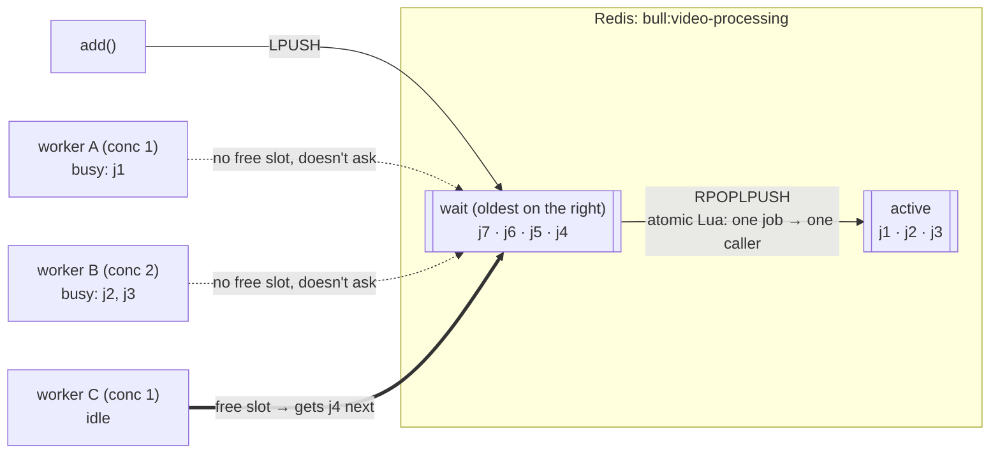

How a fetch works (BullMQ 6, from `worker.js` and `moveToActive-11.lua`):
1. The worker's main loop keeps asking while `jobs in progress < concurrency`.
2. If `wait` is empty, it blocks on Redis with `BZPOPMIN` on the queue's marker key (up to 10 s at a time), so idle workers don't poll in a busy loop. `add()` touches the marker and wakes one blocked worker.
3. The `moveToActive` Lua script does `RPOPLPUSH wait → active` and sets the job lock. Redis runs scripts one at a time, so **two workers can never pop the same job**.

What that gives you:
- **Load balancing for free.** A worker that is busy doesn't ask, so jobs go to whoever has spare capacity. A slow machine simply takes fewer jobs, which beats round-robin: round-robin would hand a busy worker its turn anyway.
- **Order is FIFO** (oldest job first) by default. `priority` and `lifo` job options change that; we use neither.
- **Order of *completion* isn't guaranteed** once there's more than one slot. A 2 GB video started first finishes after a 50 MB one started second.

**Do we need more worker instances?** Only when jobs wait longer than you want. Run the numbers:

```
 throughput ≈ slots × 60 / minutes-per-job       (jobs per hour)
 1 slot, 3 min per video  → 20 videos / hour
 a batch of 50            → the last one waits ~2.5 h
 3 workers (3 slots)      → 60 / hour, last one ~50 min
```

Scaling out needs **no code or config change**. Start another `npm run dev:worker` (or `docker compose up --scale worker=3` in Sprint 6) pointing at the same Redis and Postgres, and it starts pulling. Each new process brings its own Redis connections and its own `DB_POOL_MAX` Postgres pool, so watch the total connection count when scaling far.

What scaling out doesn't fix:
- **CPU on one machine.** Three workers on a 4-core laptop compete for the same cores. Each FFmpeg gets slower, and total throughput barely moves. Scale across machines, or measure first (Sprint 11).
- **Storage bandwidth.** Every worker downloads the raw file and uploads the HLS output. Eventually the object store is the bottleneck.
- **Correctness.** That doesn't need fixing: idempotent jobIds, job locks and the conditional `UPDATE … WHERE status='PROCESSING'` already make several workers safe. That's exactly why they were built in Sprint 5.

### Graceful shutdown

```mermaid
flowchart TD
    SIG["SIGINT / SIGTERM"] --> CLOSE["worker.close()<br/>stop taking jobs, wait for active ones"]
    CLOSE --> CONN["close queue + connections, Postgres, Redis"]
    CONN --> EXIT0(["exit 0"])
    SIG2["second signal, or 30 s passed"] --> EXIT1(["exit 1 now"])
    EXIT1 --> LOCK["the unfinished job keeps its lock until it expires"]
    LOCK --> STALL["any worker's stalled check moves it back to waiting"]
```

Docker's default stop grace period is 10 s. The worker container (Sprint 6) needs a `stop_grace_period` at least as long as the shutdown timeout, or every deploy kills jobs mid-way.

### Bull Board: `/admin/queues`

- Mounted in the **API** (`src/routes/admin.routes.ts`), and only when `BULL_BOARD_USER` and `BULL_BOARD_PASSWORD` (at least 12 characters) are both set.
- HTTP basic auth (`basic-auth.middleware.ts`): both sides are SHA-256 hashed, then compared with `timingSafeEqual`, and the user and password are always both checked, so response time leaks nothing.
- `adminLimiter`: 10 **failed** requests per 15 min per IP (`skipSuccessfulRequests`), because the dashboard itself polls every few seconds. It runs before auth, so a locked-out IP can't keep guessing.
- Its polling `GET`s are kept out of the request log; actions (retry, clean, promote) are logged.
- **Retry in Bull Board re-runs the job, not the video.** Retrying the job of an ERROR video fails at once with "Video is ERROR, expected PROCESSING". Bringing a failed video back needs an explicit `ERROR → PROCESSING` decision in the app.

### Recovery scripts: `src/scripts/`

The row is the truth; these reconcile the queue (and storage) with it. The logic is in `services/video-recovery.service.ts`, so a scheduled job could call it later.

`npm run videos:requeue-stuck -- [--dry-run] [--club <id>] [--min-age-minutes 10]`

| Job for a PROCESSING video | Meaning | Action |
|---|---|---|
| waiting / active / delayed | healthy | leave it |
| none | enqueue failed, or Redis lost it | enqueue |
| completed | finished without marking READY | remove the old job (the same id would block `add`), enqueue |
| failed | gave up, row never marked (stalled out, DB down) | mark ERROR with the job's reason |

`npm run videos:expire-uploads -- [--dry-run] [--club <id>] [--older-than-hours 24]` aborts the multipart upload of UPLOADING rows older than the cutoff (freeing the stored parts) and marks them ERROR. It takes the same row lock as the uploader's abort and `/complete`, so it can't race them.

Both are safe to run repeatedly, and `--dry-run` changes nothing. Always dry-run first on real data.

### Measured in Sprint 5

| Behaviour | Result |
|---|---|
| Enqueue with Redis down (after boot) | `/complete` 200 PROCESSING in 61 ms, error logged |
| Two `/complete` calls in parallel | one 200, one 409, one job (the row lock serialises them) |
| `FAIL_RATE=1` | attempts at +0 s, +5 s, +10 s, then ERROR with the reason and 3 stack traces |
| `FAIL_RATE=0.5`, 8 uploads | 6 READY on the first try, 1 READY on attempt 3, 1 ERROR (expected rate 0.5³ = 12.5%) |
| Ctrl+C mid-job | job finishes, exit 0 |
| Double Ctrl+C mid-job | exit 1; the next worker's stalled check recovered the job 30 s later, without using up a retry |
| `WORKER_CONCURRENCY` 1 vs 3, 3 stub jobs | 7.8 s vs 2.9 s (the stub only waits; FFmpeg won't scale like this) |
| API booted with Redis down | enqueue times out after 2 s, then works once Redis is up; rate limits resume |
| Requeue script on 4 real cases | missing → READY, completed → READY, failed → ERROR, waiting → untouched; a second run finds nothing |

### Running it locally

```bash
docker compose up -d                 # Postgres, Redis, RustFS, Mailpit
cd backend
npm run dev                          # terminal 1: API on :4000
npm run dev:worker                   # terminal 2: worker
# upload:    npm run upload -- <file> --club <clubId>
# dashboard: http://localhost:4000/admin/queues  (BULL_BOARD_* in .env)
# failures:  $env:FAIL_RATE=0.5; npm run dev:worker   (PowerShell)
```

---

# Part 4: Structuring multi-stage work

The Sprint 6 pipeline has several stages:


BullMQ gives three shapes for this.

## 1. Single job

One processor does every stage, in order, in one temp folder (the Sprint 6 reference `processVideo`).

```ts
export const processVideo = async (job: Job<TranscodeJob>) => {
  const dir = path.join(os.tmpdir(), 'klyro', job.id!);
  try {
    const src = await downloadToFile(video.rawPath, path.join(dir, 'source'));
    const meta = await probe(src);
    await transcodeHls(src, path.join(dir, 'hls'), meta, (pct) => job.updateProgress(pct));
    await makeThumbnail(src, path.join(dir, 'thumb.jpg'), meta.duration);
    await uploadDir(…); await uploadFile(…);
    await markReady(…);
  } finally {
    await fs.rm(dir, { recursive: true, force: true });
  }
};
```

- **Good:** simplest to read, test and debug; one entry in Bull Board; stages share the local file system, so the source is downloaded and decoded **once**.
- **Bad:** a retry starts from zero. If the upload fails after a 4-minute transcode, attempt 2 transcodes again.

## 2. Step job

Still one job, but it records which stage finished in its own data, so a retry resumes:

```ts
enum Step { Download, Transcode, Upload, Finalize, Done }

export const processVideo = async (job: Job<TranscodeJob & { step?: Step }>) => {
  let step = job.data.step ?? Step.Download;
  while (step !== Step.Done) {
    switch (step) {
      case Step.Download:
        await downloadToFile(…);
        step = Step.Transcode;
        break;
      case Step.Transcode:
        await transcodeHls(…);
        await uploadDir(…); // the output must be durable before the step counts as done
        step = Step.Finalize;
        break;
      // …
    }
    await job.updateData({ ...job.data, step }); // saved in Redis; a retry starts here
  }
};
```

The catch is **durability**. A retry may run on a different machine, or on the same one after a restart, with an empty `/tmp`. "Transcode done" is only true if the segments are already in RustFS. Each step must:

1. make its output durable (RustFS, Postgres) **before** `updateData`;
2. be safe to re-run, because the process can die after the work but before `updateData`.

So in practice the checkpoints sit at "outputs uploaded" boundaries, not after every local command.

- **Good:** expensive stages aren't repeated; still one job, readable in Bull Board.
- **Bad:** more code; every checkpoint needs a durable output; easy to get subtly wrong.

## 3. Flow: parent and children

A flow is a **tree of jobs** added atomically by a `FlowProducer`. Children run first, possibly in parallel on different workers and in different queues. The parent sits in `waiting-children` and runs only when they have all finished, and it can read their return values.

```ts
const flows = new FlowProducer({ connection: queueConnection('producer') });

await flows.add({
  name: 'finalize',
  queueName: 'video-processing',
  data: { videoId },
  opts: { jobId: `video-${videoId}` },
  children: [
    { name: 'rendition', queueName: 'renditions', data: { videoId, height: 1080 }, opts: { jobId: `video-${videoId}-1080` } },
    { name: 'rendition', queueName: 'renditions', data: { videoId, height: 720 },  opts: { jobId: `video-${videoId}-720` } },
    { name: 'rendition', queueName: 'renditions', data: { videoId, height: 480 },  opts: { jobId: `video-${videoId}-480` } },
    { name: 'thumbnail', queueName: 'renditions', data: { videoId },               opts: { jobId: `video-${videoId}-thumb` } },
  ],
});

// parent processor, runs after all children
const finalize = async (job: Job) => {
  const results = await job.getChildrenValues(); // { 'bull:renditions:video-…-720': { playlist, bandwidth }, … }
  await writeMasterPlaylist(videoId, Object.values(results));
  await markReady(videoId, …);
};
```

Trees can nest: a child can have its own children. That gives you "A then B then C" ordering, where the deepest job runs first and each stage is a separate job.

### What happens when a child fails

This is the part that bites. Measured on bullmq 6.3.12 with two children (720 succeeds, 480 throws `UnrecoverableError`):

| Option on the failing child | Parent ends up | Parent processor ran? | Parent sees |
|---|---|---|---|
| *(none, the default)* | **`waiting-children` forever** | no | nothing |
| `failParentOnFailure: true` | `failed`, reason `child …:480 failed` | **no** | n/a |
| `ignoreDependencyOnFailure: true` | `completed` | yes | 720 in `getChildrenValues()`, 480 in `getIgnoredChildrenFailures()` |
| `continueParentOnFailure: true` | `completed` | yes, **as soon as a child fails**, even if siblings are still running | same as above |
| `removeDependencyOnFailure: true` | `completed` | yes | 720 only; the failure is invisible |

Consequences for KlyroStream:

- **Always set a failure option.** The default leaves the video in PROCESSING with a parent nobody will ever run.
- **With `failParentOnFailure`, the parent's processor never runs**, so "on the final failure, set ERROR" cannot live in the parent. It has to move to a `failed` event listener on the worker (or into the child's own last attempt).
- **`ignoreDependencyOnFailure`** fits "a missing rendition is acceptable": publish 1080 + 720 without 480. **`failParentOnFailure`** fits "all or nothing".
- **Re-adding a finished flow** with the same parent id returned the existing id, and the parent did not run again, so deterministic ids keep flows idempotent too.

### Dynamic children

The rendition ladder depends on the source height ("never upscale"), which is only known after `ffprobe`. So the tree can't be built at enqueue time. The pattern: a running job adds children pointing at itself, then pauses until they finish.

```ts
import { WaitingChildrenError } from 'bullmq';

const plan = async (job: Job, token?: string) => {
  if (job.data.step === 'probe') {
    const meta = await probeRemote(job.data.videoId);
    for (const height of ladderFor(meta.height)) {
      await renditionQueue.add('rendition', { videoId: job.data.videoId, height }, {
        jobId: `video-${job.data.videoId}-${height}`,
        parent: { id: job.id!, queue: job.queueQualifiedName },
      });
    }
    await job.updateData({ ...job.data, step: 'finalize' });
    if (await job.moveToWaitingChildren(token!)) throw new WaitingChildrenError(); // resumes when children finish
  }
  // step === 'finalize': read children, write master playlist, mark READY
};
```

This combines the step-job idea (`updateData`) with flows.

## Why not a flow of steps (transcode job, thumbnail job, …)?

The tempting design is one job per stage:

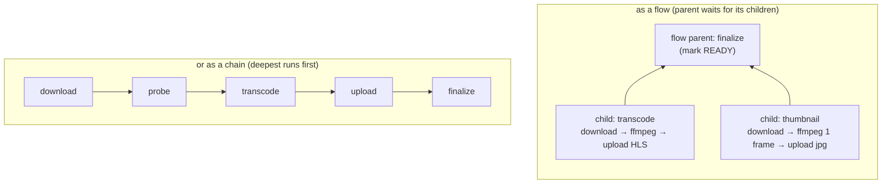

It looks cleaner on a diagram. Three things make it worse for us, though.

**1. Jobs don't share a disk.** Each job may run on a different worker process, possibly on a different machine. Whatever one stage leaves in `/tmp` is invisible to the next. So every stage has to start by downloading its input from RustFS and finish by uploading its output:

| Design, 1 GB source | Source downloads | Extra uploads of intermediate files |
|---|---|---|
| Single job (Sprint 6 plan) | 1 | 0 |
| Flow: transcode child + thumbnail child | 2 | 0 |
| Chain: download → probe → transcode → upload as separate jobs | 1 per stage that touches the file (3+) | each stage re-uploads what the next needs |

A 1-second thumbnail job that first downloads a 1 GB file is 99% overhead.

**2. The parts aren't independent.** The thumbnail needs the duration (5 s, or 10% of short clips), which comes from `ffprobe`. The rendition ladder needs the height, also from `ffprobe`. So the "parallel" children all depend on a probe stage, which means either another job level or probing twice.

**3. The cost isn't spread.** Transcode is about 99% of the time. Splitting off a 1-second thumbnail doesn't make anything faster, and on one machine it competes for the same cores.

Splitting into jobs helps when the stages are **independent, expensive and retryable on their own**, and preferably when there are **several machines** to run them. The thumbnail is cheap and dependent. The transcode is one FFmpeg run that already uses every core.

**When the thumbnail *would* make sense as its own job:** if we wanted a thumbnail on screen **before** the transcode finishes, it could run as an early, separate job that reads the source *directly from a presigned URL*. FFmpeg can seek over HTTP with range requests (`ffmpeg -ss 5 -i "<presigned url>" -frames:v 1 thumb.jpg`), fetching only the bytes around that frame instead of the whole file. That's a reasonable later improvement, and it's a chain ("enqueue thumbnail and transcode side by side"), not a flow, because nothing needs to wait for both.

## Choosing: rules of thumb

| Situation | Use |
|---|---|
| Work is cheap to repeat, or one stage dominates the cost | **Single job** |
| Sequential stages, each expensive, with durable outputs between them | **Step job** |
| Independent pieces that can run in parallel on different workers, then one combining step | **Flow** |
| Follow-up work that must not delay the main result | **Chain**: the processor enqueues the next job when it succeeds |
| "Wait until all of these finish, then do X" | **Flow** (that is exactly what a parent is) |

Chaining vs flow is a common confusion. A flow parent **waits for every child**. If the video should be playable as soon as HLS is ready, with captions arriving later, captions must *not* be a child of anything that gates READY. Chain them instead.

---

# Part 5: The plan for KlyroStream

| Sprint | Work | Shape | Why |
|---|---|---|---|
| **5** Job queue ✅ | Stub processor: re-read row, fake progress, `PROCESSING → READY` | Single job | Nothing expensive yet; learn retries, failure, shutdown first. Built, see Part 3 |
| **6** Transcoding | download → probe → one FFmpeg run (all renditions) → thumbnail → upload → READY | Single job | One download, one decode, FFmpeg writes the master playlist, one machine. Measure first. If the "X minutes per GB" number shows retries re-transcoding hurts, add step checkpoints at the upload boundary |
| **7** Delete video | Remove a still-waiting job before deleting objects and the row | `videoQueue.getJob(id)` → `remove()` | Removing an `active` job throws (it's locked); the processor's "row must be PROCESSING" check covers that race |
| **8** Real-time + email | API listens with `QueueEvents`; READY triggers a `send-email` job on a `notifications` queue | Chain | The email must not delay or fail the video. Its own queue gets its own retries (and a higher `concurrency`, since it's I/O) |
| **9** Observability | Queue depth, processing time, failure rate in Grafana | Metrics from `getJobCounts` | Queue depth growing faster than it drains = add workers |
| **11** Proof | Time a 1 GB file with 1 and 2 workers | Extra worker processes | Shows the queue scaling horizontally |
| **12** AI captions (optional) | Extract audio → Whisper → VTT → add subtitles to master | Chain from READY, or a small flow (`audio` child → `captions` parent) | Captions must not gate playback; a flow only makes sense *within* the caption pipeline |
| **Phase 2** | Several worker machines, long videos | Flow with dynamic children (one rendition per child), or segment-level parallel encoding | Only now does parallelism across machines beat one FFmpeg run |

Measured in Sprint 6 ([transcoding.md, section 9](transcoding.md#9-one-job-or-a-flow-measured)): one FFmpeg run for all three renditions took 46 s; three separate runs, as three flow children would do, took 123–139 s, mostly because each one decodes the 4K source again.

So: **flows are a real option, but not for the core transcode yet.** The first place they will likely earn their keep is captions (Sprint 12) or multi-machine transcoding (Phase 2).

## Gotchas checklist

- [ ] Every `Queue`/`Worker` has an `'error'` listener (an unhandled `'error'` crashes Node).
- [ ] Worker connections use `maxRetriesPerRequest: null`.
- [ ] Redis runs with persistence (AOF) and `maxmemory-policy noeviction`.
- [ ] Job ids are deterministic and contain no `:`.
- [ ] Payload holds ids, not state; the processor re-reads and checks the row.
- [ ] Processors are safe to run twice (at-least-once delivery).
- [ ] Non-retryable failures throw `UnrecoverableError`.
- [ ] The final failure sets the video to ERROR, in the processor's last attempt or in a `failed` listener (always the listener for flow parents with `failParentOnFailure`).
- [ ] Flow children always have a failure option set.
- [ ] Nothing blocks the worker's event loop for more than a few seconds (lock renewal).
- [ ] `concurrency` matches the work: 1 for FFmpeg, higher for I/O jobs.
- [ ] `removeOnComplete` / `removeOnFail` are set, so Redis doesn't grow forever.
- [ ] Shutdown closes workers first (lets active jobs finish), then queues, then connections, and works with Redis down.

## Further reading

- [BullMQ guide](https://docs.bullmq.io/guide/introduction): queues, workers, jobs
- [Workers](https://docs.bullmq.io/guide/workers), [concurrency](https://docs.bullmq.io/guide/workers/concurrency) and [sandboxed processors](https://docs.bullmq.io/guide/workers/sandboxed-processors)
- [Retrying failing jobs](https://docs.bullmq.io/guide/retrying-failing-jobs) and [stalled jobs](https://docs.bullmq.io/guide/workers/stalled-jobs)
- [Rate limiting](https://docs.bullmq.io/guide/rate-limiting) and [global concurrency](https://docs.bullmq.io/guide/queues/global-concurrency)
- [Flows](https://docs.bullmq.io/guide/flows) and [failure options for children](https://docs.bullmq.io/guide/flows/fail-parent)
- [Process step jobs](https://docs.bullmq.io/patterns/process-step-jobs) (includes the dynamic-children pattern)
- [Idempotent jobs](https://docs.bullmq.io/patterns/idempotent-jobs)
- [Redis persistence](https://redis.io/docs/latest/operate/oss_and_stack/management/persistence/) (RDB vs AOF)
- [RabbitMQ tutorials](https://www.rabbitmq.com/tutorials) and [Kafka introduction](https://kafka.apache.org/intro)
- [Transactional outbox](https://microservices.io/patterns/data/transactional-outbox.html)
