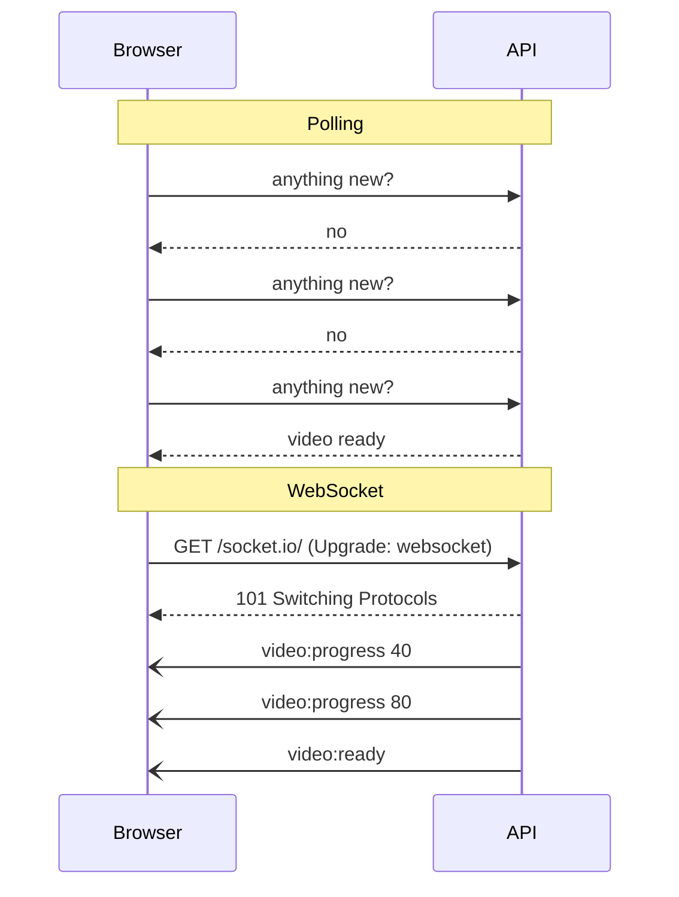
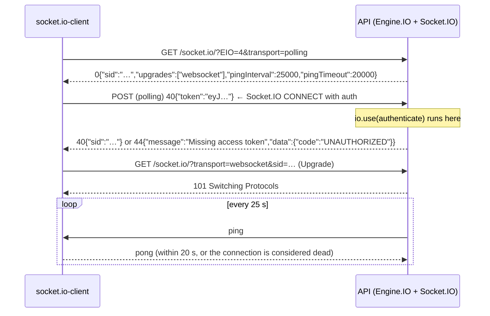

# Real-time events and notifications

Sprint 8 makes the API **tell** clients when something happens, instead of waiting to be asked. While a video transcodes, its club sees the progress; when it's done, a `video:ready` event arrives and the uploader gets an email. This guide grows one section per stage. Timings and outputs were **measured on this project**.

Related: [queues.md](queues.md) (BullMQ, workers, retries) · [transcoding.md](transcoding.md) (what the worker does while you wait) · [playback.md](playback.md) (who may see which video) · [transactions.md](transactions.md) (the outbox idea, for later).

**Contents**

1. [Getting news to a browser](#1-getting-news-to-a-browser)
2. [How a Socket.io connection starts](#2-how-a-socketio-connection-starts)
3. [Authentication on a connection that lasts for hours](#3-authentication-on-a-connection-that-lasts-for-hours)
4. [CORS doesn't protect WebSockets](#4-cors-doesnt-protect-websockets)
5. [Shutting down with connections open](#5-shutting-down-with-connections-open)
6. [Stages 1–2 code: the socket server](#6-stages-12-code-the-socket-server)

Coming in later stages: rooms and membership, relaying worker events, email through a queue, several API processes.

---

## 1. Getting news to a browser

HTTP is **request → response**: the server can only answer, never start a conversation. To learn that a video finished, a browser has four options:

| Technique | How it works | Cost | Fits when |
|---|---|---|---|
| **Polling** | `GET /videos/:id` every few seconds | One request per client per interval, mostly answered "nothing new"; news arrives up to one interval late | Rare updates, few clients |
| **Long polling** | The request stays open until there's news (or ~30 s pass), then the client asks again | One open request per client; a new HTTP request after every message | Fallback when nothing better works |
| **Server-Sent Events (SSE)** | One long HTTP response that the server keeps writing `data: ...` lines into | One open connection; **server → client only**; the browser reconnects automatically | Feeds and notifications |
| **WebSocket** | An HTTP request "upgrades" into a two-way connection; both sides send messages whenever they like | One open TCP connection per client; no HTTP overhead per message | Two-way, frequent messages |



**Why Socket.io and not plain WebSockets?** We need two things a raw WebSocket doesn't have:

- **Rooms.** "Send this to every member of club X" is one call, `io.to('club:X').emit(...)`.
- **Two-way requests with replies.** The client says `club:join` and gets back "ok" or an error, called an **acknowledgement**.

Socket.io also handles reconnection, heartbeats and a fallback to long polling where WebSockets are blocked. (That fallback matters less today; it was built for old proxies.)

The cost: **Socket.io is its own protocol on top of WebSocket.** A plain `new WebSocket('ws://...')` can't talk to it; clients need the `socket.io-client` library. SSE would also cover our needs (every event goes server → client), but `club:join` with a reply, and Sprint 8's plan, point to Socket.io.

**Important limit:** Socket.io delivers **at most once**. If the connection is down when an event is sent, that event is gone; the client doesn't get it on reconnect. So events are a **hint** ("refresh this video"), not the source of truth. A client that reconnects should re-fetch with HTTP (`GET /clubs/:id/videos`). Anything that must not be lost, like the "ready" email, goes through a queue instead (stage 5).

---

## 2. How a Socket.io connection starts

Socket.io is two layers:

- **Engine.IO** moves bytes. It opens the connection, keeps it alive and picks the transport.
- **Socket.IO** adds events, rooms, acknowledgements and middleware on top.



- **Polling first, then upgrade.** By default the client starts with long polling, which works everywhere, then upgrades to WebSocket. **Measured:** a client started with `['polling', 'websocket']` was on `websocket` half a second later. Clients that know WebSockets work (our test scripts) can skip polling with `transports: ['websocket']`.
- **The heartbeat.** A TCP connection can die silently: a laptop lid closes, a phone loses signal. Without traffic, neither side would notice. Every 25 s the server sends a ping; no pong within 20 s means the connection is closed and the client's `disconnect` fires. So a dead client is noticed within about 45 s.
- **Message size.** `maxHttpBufferSize` caps what a client may send in one message. The default is 1 MB. Our clients only ever send a club id, so it's set to **16 KB**, and a client can't make the server buffer megabytes of junk.

---

## 3. Authentication on a connection that lasts for hours

HTTP requests carry the token every time. A socket connects **once** and may then stay open for hours, so there are two questions: where does the token go, and what happens when it expires?

### Where the token goes

| Option | Problem |
|---|---|
| Query string (`?token=…`) | URLs end up in access logs, proxies and browser history |
| `Authorization` header | Browsers can't set headers on a WebSocket |
| A cookie | Works, but makes cross-site WebSocket hijacking possible (section 4) |
| **`auth` payload** (`io(url, { auth: { token } })`) | Sent in the CONNECT packet, after the transport is open; never in a URL |

We use `auth`. On the server, `io.use(authenticate)` is middleware for the **connection**: it runs once, before the `connection` event, and can refuse it.

```ts
const authenticate = (socket: RealtimeSocket, next: (err?: Error) => void) => {
  const token: unknown = socket.handshake.auth.token;
  if (typeof token !== 'string' || token === '') {
    next(unauthorized('Missing access token'));
    return;
  }
  try {
    const { userId, expiresAt } = readAccessToken(token);
    socket.data.userId = userId;
    socket.data.expiresAt = expiresAt;
    next();
  } catch {
    next(unauthorized('Invalid or expired access token'));
  }
};
```

- **`next(err)` refuses the connection.** The client gets a `connect_error` with `err.message`, and with `err.data` if the server set it. We set `data: { code: 'UNAUTHORIZED' }`, the same code as the HTTP API, so a client can tell "log in again" apart from "the server is down".
- **`token: unknown`.** `handshake.auth` is whatever JSON the client sent. A number or an object must be refused, not crash `jwt.verify`. **Measured:** `{ token: 12345 }` → "Missing access token".
- **`socket.data`** is per-connection storage. Everything later (`club:join`, the room checks) reads `socket.data.userId` instead of trusting anything the client sends.
- **Only access tokens are accepted.** A refresh token is signed with a different secret, so it fails verification. **Measured:** a token signed with `JWT_REFRESH_SECRET` was refused.

### When the token expires

An access token lives 15 minutes. HTTP checks it on every request, so an expired token stops working at once. A socket that authenticated at 10:00 would, unchecked, keep receiving club events at 18:00, long after the user logged out or was removed.

The server schedules a disconnect for the moment the token expires:

```ts
const disconnectAtExpiry = (socket: RealtimeSocket) => {
  const timer = setTimeout(() => {
    socket.emit('auth:expired');
    socket.disconnect(true);
  }, socket.data.expiresAt - Date.now());
  socket.once('disconnect', () => clearTimeout(timer));
};
```

- **`auth:expired` first, then disconnect.** The event tells the client why, so it can refresh its token (`POST /auth/refresh`) and connect again, rather than show an error.
- **`disconnect(true)`** closes the underlying connection too. A server-initiated disconnect (`reason: 'io server disconnect'`) is the one case where `socket.io-client` does **not** reconnect by itself, so the client must reconnect deliberately, with a new token.
- **`clearTimeout` on disconnect.** Without it, every closed connection would leave a timer holding a reference to its socket for up to 15 minutes, a slow memory leak.
- **Measured:** a token minted to expire 3 s later was told `auth:expired` and disconnected **2.1 s** after connecting. A JWT's `exp` is in whole seconds, so "3 s from now" really means "at the start of the third second".

`setTimeout` can't wait longer than about 24.8 days (2³¹ ms; anything bigger fires at once). That's no problem for 15-minute tokens, but worth knowing before reusing this for long-lived tokens.

---

## 4. CORS doesn't protect WebSockets

CORS is a **browser** rule about **reading responses to HTTP requests** made by JavaScript. A WebSocket handshake is an HTTP request too, but browsers **don't apply CORS to it**. They just send an `Origin` header and connect. It's up to the server to look at that header.

**Measured:**

```text
polling handshake, Origin: http://localhost:5173   → Access-Control-Allow-Origin: http://localhost:5173
polling handshake, Origin: http://evil.example     → no Access-Control-Allow-Origin  (a browser blocks the response)
websocket,         Origin: http://evil.example     → connected
```

So the `cors` option on the Socket.io server only affects the long-polling transport. Is that a hole? It depends on **how** clients authenticate:

- **With cookies,** it would be a hole called **cross-site WebSocket hijacking**. A page on `evil.example` opens a socket to our API, the browser attaches the user's cookie automatically, and the attacker's page receives that user's events.
- **With a token in `auth`,** which is what we do, it isn't. The evil page doesn't have the user's access token: it lives in our frontend's memory, and the browser won't add it to anyone else's requests. A connection from `evil.example` without a valid token is refused by `authenticate`, whatever its origin.

If the API ever switches sockets to cookie auth, it must also check `Origin` itself, with Socket.io's `allowRequest` option.

---

## 5. Shutting down with connections open

The API's shutdown (Sprint 0) calls `server.close()`. That stops new connections and **waits for open ones to finish**. An HTTP request finishes in milliseconds. A WebSocket never finishes on its own.

**Measured with Docker** (`docker stop` sends SIGTERM, which Windows can't send to a local Node process), with one client connected:

| Shutdown code | `docker stop` took | Log |
|---|---|---|
| `server.close()` (before) | **10.9 s** | `graceful shutdown timed out, forcing exit` |
| `io.close()` (after) | **0.7 s** | `socket disconnected` → `shutdown complete` |

Before, the 10-second force-exit timer had to kill the process, which would also have cut off any HTTP request in flight. `io.close()` disconnects every socket, closes Engine.IO, then calls `server.close()` itself and resolves when it's done:

```ts
const closing = realtime.close();
server.closeIdleConnections(); // drop idle keep-alive sockets now; busy ones finish first
await closing;
```

The client saw `disconnect: transport close`. That's a **network-level** reason, so `socket.io-client` reconnects automatically, and behind a load balancer it would land on a healthy instance. This is the opposite of the token-expiry case, where the server says "go away" on purpose.

---

## 6. Stages 1–2 code: the socket server

### Files

| File | What |
|---|---|
| `src/lib/realtime/socket.ts` | `createRealtime(httpServer)`: CORS, message size limit, auth middleware, per-user room, expiry timer |
| `src/utils/tokens.ts` | `readAccessToken(token)` returns `{ userId, expiresAt }`; `verifyAccessToken` is unchanged for HTTP |
| `src/server.ts` | `createRealtime(server)` after `listen`; shutdown uses `realtime.close()` |

### Typed events

```ts
export type ServerToClientEvents = {
  'auth:expired': () => void;
};
export type ClientToServerEvents = Record<string, never>;
export type SocketData = { userId: string; expiresAt: number };

export type RealtimeServer = Server<ClientToServerEvents, ServerToClientEvents, InterServerEvents, SocketData>;
```

Socket.io's generics make `socket.emit('auth:expird')` (typo) or `socket.data.userID` a **compile error**. The event maps are the protocol documentation: stage 3 adds `club:join` to `ClientToServerEvents`, stage 4 adds `video:*` to `ServerToClientEvents`.

### One room per user

```ts
export const userRoom = (userId: string) => `user:${userId}`;

const onConnection = (socket: RealtimeSocket) => {
  void socket.join(userRoom(socket.data.userId));
  disconnectAtExpiry(socket);
  ...
};
```

Every connection joins `user:<id>` straight away. One user can have several connections (two tabs, a phone), and the room lets the server reach all of them at once. Stage 3 uses it to pull a removed member's connections out of their club's rooms (decision 2).

### What was tested

| Case | Result |
|---|---|
| no `auth`, `token: 'not-a-jwt'`, `token: 12345` | refused: `Missing access token` / `Invalid or expired access token` / `Missing access token`, all with `data.code = UNAUTHORIZED` |
| token signed with the refresh secret / token expired 5 s ago | refused |
| valid access token | connected over `websocket` |
| token expiring 3 s after minting | `auth:expired` at 2.1 s, then `disconnect: io server disconnect`; no automatic reconnect |
| WebSocket with `Origin: http://evil.example` and a valid token | connected (CORS doesn't apply; the token is the protection) |
| polling handshake from `localhost:5173` / `evil.example` | `Access-Control-Allow-Origin` set / absent |
| default client (`polling` then `websocket`) | on `websocket` after 0.5 s |
| `docker stop` with a socket open: old / new shutdown | 10.9 s, forced / 0.7 s, clean |
