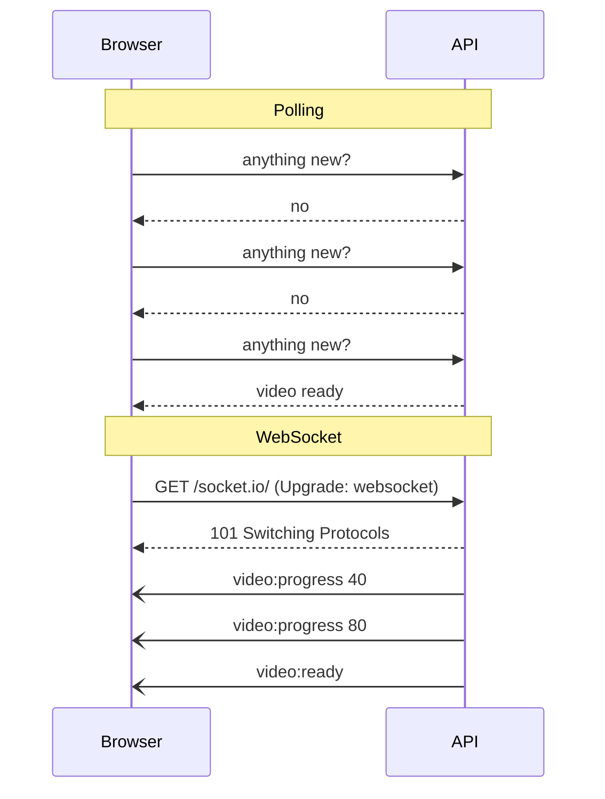
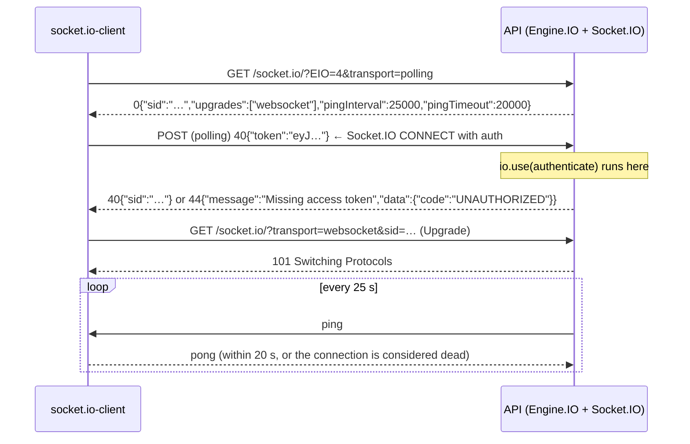
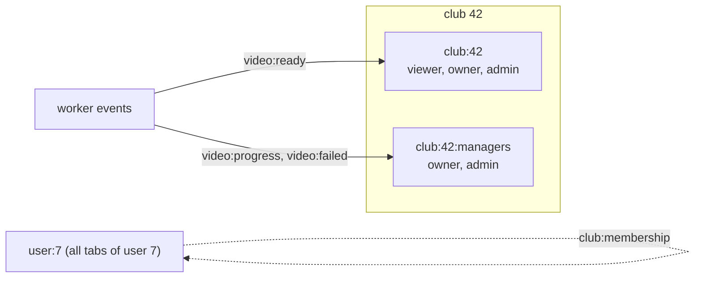
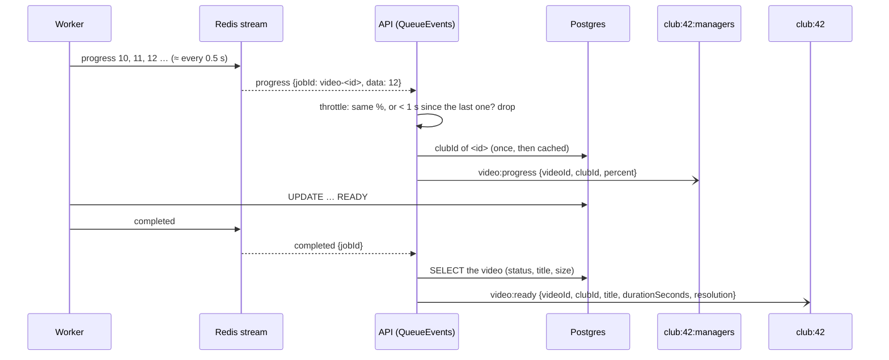
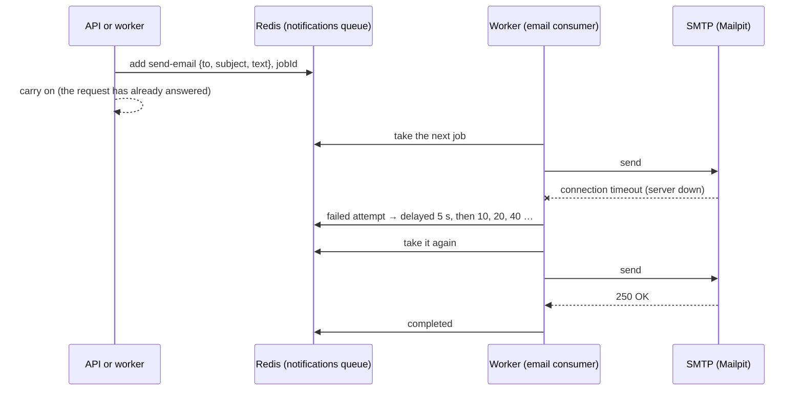

# Real-time events and notifications

Sprint 8 makes the API **tell** clients when something happens, instead of waiting to be asked. While a video transcodes, its club sees the progress; when it's done, a `video:ready` event arrives and the uploader gets an email. This guide grows one section per stage. Timings and outputs were **measured on this project**.

Related: [queues.md](queues.md) (BullMQ, workers, retries) · [transcoding.md](transcoding.md) (what the worker does while you wait) · [playback.md](playback.md) (who may see which video) · [transactions.md](transactions.md) (the outbox idea, for later).

**Contents**

1. [Getting news to a browser](#1-getting-news-to-a-browser)
2. [How a Socket.io connection starts](#2-how-a-socketio-connection-starts)
3. [Authentication on a connection that lasts for hours](#3-authentication-on-a-connection-that-lasts-for-hours)
4. [CORS doesn't protect WebSockets](#4-cors-doesnt-protect-websockets)
5. [Shutting down with connections open](#5-shutting-down-with-connections-open)
6. [Stages 1–2 code: the socket server](#6-stages-12-code-the-socket-server)
7. [Stage 3: rooms, and who hears what](#7-stage-3-rooms-and-who-hears-what)
8. [Stage 4: relaying worker events](#8-stage-4-relaying-worker-events)
9. [Stage 5: email through a queue](#9-stage-5-email-through-a-queue)

Coming in later stages: the listener script, several API processes.

---

## 1. Getting news to a browser

HTTP is **request → response**: the server can only answer, never start a conversation. To learn that a video finished, a browser has four options:

| Technique | How it works | Cost | Fits when |
|---|---|---|---|
| **Polling** | `GET /videos/:id` every few seconds | One request per client per interval, mostly answered "nothing new"; news arrives up to one interval late | Rare updates, few clients |
| **Long polling** | The request stays open until there's news (or ~30 s pass), then the client asks again | One open request per client; a new HTTP request after every message | Fallback when nothing better works |
| **Server-Sent Events (SSE)** | One long HTTP response that the server keeps writing `data: ...` lines into | One open connection; **server → client only**; the browser reconnects automatically | Feeds and notifications |
| **WebSocket** | An HTTP request "upgrades" into a two-way connection; both sides send messages whenever they like | One open TCP connection per client; no HTTP overhead per message | Two-way, frequent messages |



**Why Socket.io and not plain WebSockets?** We need two things a raw WebSocket doesn't have:

- **Rooms.** "Send this to every member of club X" is one call, `io.to('club:X').emit(...)`.
- **Two-way requests with replies.** The client says `club:join` and gets back "ok" or an error, called an **acknowledgement**.

Socket.io also handles reconnection, heartbeats and a fallback to long polling where WebSockets are blocked. (That fallback matters less today; it was built for old proxies.)

The cost: **Socket.io is its own protocol on top of WebSocket.** A plain `new WebSocket('ws://...')` can't talk to it; clients need the `socket.io-client` library. SSE would also cover our needs (every event goes server → client), but `club:join` with a reply, and Sprint 8's plan, point to Socket.io.

**Important limit:** Socket.io delivers **at most once**. If the connection is down when an event is sent, that event is gone; the client doesn't get it on reconnect. So events are a **hint** ("refresh this video"), not the source of truth. A client that reconnects should re-fetch with HTTP (`GET /clubs/:id/videos`). Anything that must not be lost, like the "ready" email, goes through a queue instead (stage 5).

---

## 2. How a Socket.io connection starts

Socket.io is two layers:

- **Engine.IO** moves bytes. It opens the connection, keeps it alive and picks the transport.
- **Socket.IO** adds events, rooms, acknowledgements and middleware on top.



- **Polling first, then upgrade.** By default the client starts with long polling, which works everywhere, then upgrades to WebSocket. **Measured:** a client started with `['polling', 'websocket']` was on `websocket` half a second later. Clients that know WebSockets work (our test scripts) can skip polling with `transports: ['websocket']`.
- **The heartbeat.** A TCP connection can die silently: a laptop lid closes, a phone loses signal. Without traffic, neither side would notice. Every 25 s the server sends a ping; no pong within 20 s means the connection is closed and the client's `disconnect` fires. So a dead client is noticed within about 45 s.
- **Message size.** `maxHttpBufferSize` caps what a client may send in one message. The default is 1 MB. Our clients only ever send a club id, so it's set to **16 KB**, and a client can't make the server buffer megabytes of junk.

---

## 3. Authentication on a connection that lasts for hours

HTTP requests carry the token every time. A socket connects **once** and may then stay open for hours, so there are two questions: where does the token go, and what happens when it expires?

### Where the token goes

| Option | Problem |
|---|---|
| Query string (`?token=…`) | URLs end up in access logs, proxies and browser history |
| `Authorization` header | Browsers can't set headers on a WebSocket |
| A cookie | Works, but makes cross-site WebSocket hijacking possible (section 4) |
| **`auth` payload** (`io(url, { auth: { token } })`) | Sent in the CONNECT packet, after the transport is open; never in a URL |

We use `auth`. On the server, `io.use(authenticate)` is middleware for the **connection**: it runs once, before the `connection` event, and can refuse it.

```ts
const authenticate = (socket: RealtimeSocket, next: (err?: Error) => void) => {
  const token: unknown = socket.handshake.auth.token;
  if (typeof token !== 'string' || token === '') {
    next(unauthorized('Missing access token'));
    return;
  }
  try {
    const { userId, expiresAt } = readAccessToken(token);
    socket.data.userId = userId;
    socket.data.expiresAt = expiresAt;
    next();
  } catch {
    next(unauthorized('Invalid or expired access token'));
  }
};
```

- **`next(err)` refuses the connection.** The client gets a `connect_error` with `err.message`, and with `err.data` if the server set it. We set `data: { code: 'UNAUTHORIZED' }`, the same code as the HTTP API, so a client can tell "log in again" apart from "the server is down".
- **`token: unknown`.** `handshake.auth` is whatever JSON the client sent. A number or an object must be refused, not crash `jwt.verify`. **Measured:** `{ token: 12345 }` → "Missing access token".
- **`socket.data`** is per-connection storage. Everything later (`club:join`, the room checks) reads `socket.data.userId` instead of trusting anything the client sends.
- **Only access tokens are accepted.** A refresh token is signed with a different secret, so it fails verification. **Measured:** a token signed with `JWT_REFRESH_SECRET` was refused.

### When the token expires

An access token lives 15 minutes. HTTP checks it on every request, so an expired token stops working at once. A socket that authenticated at 10:00 would, unchecked, keep receiving club events at 18:00, long after the user logged out or was removed.

The server schedules a disconnect for the moment the token expires:

```ts
const disconnectAtExpiry = (socket: RealtimeSocket) => {
  const timer = setTimeout(() => {
    socket.emit('auth:expired');
    socket.disconnect(true);
  }, socket.data.expiresAt - Date.now());
  socket.once('disconnect', () => clearTimeout(timer));
};
```

- **`auth:expired` first, then disconnect.** The event tells the client why, so it can refresh its token (`POST /auth/refresh`) and connect again, rather than show an error.
- **`disconnect(true)`** closes the underlying connection too. A server-initiated disconnect (`reason: 'io server disconnect'`) is the one case where `socket.io-client` does **not** reconnect by itself, so the client must reconnect deliberately, with a new token.
- **`clearTimeout` on disconnect.** Without it, every closed connection would leave a timer holding a reference to its socket for up to 15 minutes, a slow memory leak.
- **Measured:** a token minted to expire 3 s later was told `auth:expired` and disconnected **2.1 s** after connecting. A JWT's `exp` is in whole seconds, so "3 s from now" really means "at the start of the third second".

`setTimeout` can't wait longer than about 24.8 days (2³¹ ms; anything bigger fires at once). That's no problem for 15-minute tokens, but worth knowing before reusing this for long-lived tokens.

---

## 4. CORS doesn't protect WebSockets

CORS is a **browser** rule about **reading responses to HTTP requests** made by JavaScript. A WebSocket handshake is an HTTP request too, but browsers **don't apply CORS to it**. They just send an `Origin` header and connect. It's up to the server to look at that header.

**Measured:**

```text
polling handshake, Origin: http://localhost:5173   → Access-Control-Allow-Origin: http://localhost:5173
polling handshake, Origin: http://evil.example     → no Access-Control-Allow-Origin  (a browser blocks the response)
websocket,         Origin: http://evil.example     → connected
```

So the `cors` option on the Socket.io server only affects the long-polling transport. Is that a hole? It depends on **how** clients authenticate:

- **With cookies,** it would be a hole called **cross-site WebSocket hijacking**. A page on `evil.example` opens a socket to our API, the browser attaches the user's cookie automatically, and the attacker's page receives that user's events.
- **With a token in `auth`,** which is what we do, it isn't. The evil page doesn't have the user's access token: it lives in our frontend's memory, and the browser won't add it to anyone else's requests. A connection from `evil.example` without a valid token is refused by `authenticate`, whatever its origin.

If the API ever switches sockets to cookie auth, it must also check `Origin` itself, with Socket.io's `allowRequest` option.

---

## 5. Shutting down with connections open

The API's shutdown (Sprint 0) calls `server.close()`. That stops new connections and **waits for open ones to finish**. An HTTP request finishes in milliseconds. A WebSocket never finishes on its own.

**Measured with Docker** (`docker stop` sends SIGTERM, which Windows can't send to a local Node process), with one client connected:

| Shutdown code | `docker stop` took | Log |
|---|---|---|
| `server.close()` (before) | **10.9 s** | `graceful shutdown timed out, forcing exit` |
| `io.close()` (after) | **0.7 s** | `socket disconnected` → `shutdown complete` |

Before, the 10-second force-exit timer had to kill the process, which would also have cut off any HTTP request in flight. `io.close()` disconnects every socket, closes Engine.IO, then calls `server.close()` itself and resolves when it's done:

```ts
const closing = realtime.close();
server.closeIdleConnections(); // drop idle keep-alive sockets now; busy ones finish first
await closing;
```

The client saw `disconnect: transport close`. That's a **network-level** reason, so `socket.io-client` reconnects automatically, and behind a load balancer it would land on a healthy instance. This is the opposite of the token-expiry case, where the server says "go away" on purpose.

---

## 6. Stages 1–2 code: the socket server

### Files

| File | What |
|---|---|
| `src/realtime/server.ts` (started as `src/lib/realtime/socket.ts`; moved in stage 3, see section 7) | `createRealtime(httpServer)`: CORS, message size limit, auth middleware, per-user room, expiry timer |
| `src/utils/tokens.ts` | `readAccessToken(token)` returns `{ userId, expiresAt }`; `verifyAccessToken` is unchanged for HTTP |
| `src/server.ts` | `createRealtime(server)` after `listen`; shutdown uses `realtime.close()` |

### Typed events

```ts
export type ServerToClientEvents = {
  'auth:expired': () => void;
};
export type ClientToServerEvents = Record<string, never>;
export type SocketData = { userId: string; expiresAt: number };

export type RealtimeServer = Server<ClientToServerEvents, ServerToClientEvents, InterServerEvents, SocketData>;
```

Socket.io's generics make `socket.emit('auth:expird')` (typo) or `socket.data.userID` a **compile error**. The event maps are the protocol documentation: stage 3 adds `club:join` to `ClientToServerEvents`, stage 4 adds `video:*` to `ServerToClientEvents`.

### One room per user

```ts
export const userRoom = (userId: string) => `user:${userId}`;

const onConnection = (socket: RealtimeSocket) => {
  void socket.join(userRoom(socket.data.userId));
  disconnectAtExpiry(socket);
  ...
};
```

Every connection joins `user:<id>` straight away. One user can have several connections (two tabs, a phone), and the room lets the server reach all of them at once. Stage 3 uses it to pull a removed member's connections out of their club's rooms (decision 2).

### What was tested

| Case | Result |
|---|---|
| no `auth`, `token: 'not-a-jwt'`, `token: 12345` | refused: `Missing access token` / `Invalid or expired access token` / `Missing access token`, all with `data.code = UNAUTHORIZED` |
| token signed with the refresh secret / token expired 5 s ago | refused |
| valid access token | connected over `websocket` |
| token expiring 3 s after minting | `auth:expired` at 2.1 s, then `disconnect: io server disconnect`; no automatic reconnect |
| WebSocket with `Origin: http://evil.example` and a valid token | connected (CORS doesn't apply; the token is the protection) |
| polling handshake from `localhost:5173` / `evil.example` | `Access-Control-Allow-Origin` set / absent |
| default client (`polling` then `websocket`) | on `websocket` after 0.5 s |
| `docker stop` with a socket open: old / new shutdown | 10.9 s, forced / 0.7 s, clean |


---

## 7. Stage 3: rooms, and who hears what

A **room** is a named group of connections on the server. `socket.join('club:42')` adds a connection, and `io.to('club:42').emit(...)` reaches everyone in it. Rooms live **only on the server**: a client can't see which rooms it's in, and can't join one by itself. It has to ask, and the server decides.

### The rooms

| Room | Who's in it | Gets |
|---|---|---|
| `user:<userId>` | every connection of that user, joined automatically | membership changes (`club:membership`) |
| `club:<clubId>` | members who sent `club:join` | `video:ready` |
| `club:<clubId>:managers` | club owners and admins who sent `club:join` | `video:progress`, `video:failed` |

The split follows the visibility rule from Sprint 7 ([playback.md §6](playback.md#6-stage-1-code-the-list-endpoint)): a viewer can't see a video until it's READY, so a viewer mustn't get progress for it, or learn from a failure event that it ever existed.



### Joining: a request with a reply

```ts
socket.emit('club:join', clubId, (result) => { ... });   // client

// server reply:
{ ok: true, clubId, role: 'viewer', rooms: ['club:42'] }
{ ok: false, error: { code: 'CLUB_NOT_FOUND', message: 'Club not found' } }
```

The function passed as the last argument is an **acknowledgement**: Socket.io sends the server's reply back to exactly that call, like the response to an HTTP request. Without it the client couldn't tell "joined" from "refused".

The handler follows the same rules as the HTTP API:

- **Validate input, never trust it.** `clubId` is typed `unknown` and checked with `z.uuid()`. **Measured:** `'not-a-uuid'` and `{ $ne: null }` (a NoSQL-injection-style object) both got `VALIDATION_ERROR`.
- **404, not 403, for clubs you're not in,** so a socket can't be used to discover which club ids exist.
- **The role comes from the database, not the client.** `roomsFor(clubId, role)` decides the rooms.
- **No ack, no crash.** A client may leave out the callback, and the handler then replies into a no-op function. **Measured:** `emit('club:join', id)` without an ack → the server stayed healthy and the socket joined.

### Async errors in socket handlers

Express 5 catches a rejected promise from a route and turns it into a 500. **Socket.io doesn't**: an `async` listener that throws becomes an *unhandled rejection*, and our `server.ts` treats that as a bug and **shuts the process down** (Sprint 0). One failed database query in `club:join` would take the whole API with it. So every handler goes through a wrapper:

```ts
const handle =
  (socket: RealtimeSocket, event: string, work: (clubId: string) => Promise<RoomResult>) =>
  (input: unknown, ack?: Ack) => {
    const reply: Ack = typeof ack === 'function' ? ack : () => undefined;
    const parsed = clubId.safeParse(input);
    if (!parsed.success) {
      reply(invalidClubId);
      return;
    }
    work(parsed.data)
      .then(reply)
      .catch((err: unknown) => {
        logger.error({ err, event, socketId: socket.id, userId: socket.data.userId }, 'socket handler failed');
        reply(fail('INTERNAL_ERROR', 'Something went wrong'));
      });
  };
```

It's the socket version of the error middleware: validate, run, and turn any failure into a logged error plus a polite reply.

### When membership changes while connected

Rooms are checked at **join** time. If an admin then removes a member, or demotes an owner to viewer, the connection would stay in the rooms it joined and keep hearing events it's no longer allowed to.

So `member.service.ts` calls `syncMembership` right after the database change commits:

```ts
const member = await memberRepo.changeRole(clubId, userId, role);
syncMembership(userId, clubId, role);
```

```ts
const sockets = await io.in(userRoom(userId)).fetchSockets();
for (const socket of sockets) {
  if (!socket.rooms.has(clubRoom(clubId))) continue;
  if (role === null) socket.leave(clubRoom(clubId));
  if (role === null || !isManager(role)) socket.leave(managersRoom(clubId));
  else socket.join(managersRoom(clubId));
  socket.emit('club:membership', { clubId, role });
}
```

- **`user:<id>` finds every connection of that user,** across all their tabs and devices. Only those that actually joined the club are changed and told.
- **`fetchSockets()` returns a list we can filter,** because Socket.io has no "in room A **and** room B" query. `io.in(a).in(b)` means "in A **or** B".
- **It runs after the commit and doesn't block the HTTP response.** A failure is logged, not thrown, so a hiccup in the realtime layer never fails a membership change that already happened in the database. The worst case is that the user keeps hearing events until their token expires (at most 15 minutes, section 3).
- **Promotion works the same way:** a viewer promoted to club owner joins the managers room without reconnecting.

### Where this code lives

Socket code does two jobs: it's an **entry point** (it handles `club:join` from clients, like a controller) and an **output** (services push room changes through it, like the queue). So it has its own top-level folder, next to `routes/` and `worker/`:

| File | Role |
|---|---|
| `realtime/events.ts` | The typed protocol: what the client may send, what the server may emit |
| `realtime/server.ts` | `createRealtime`: CORS, auth, expiry, wiring the handlers |
| `realtime/club-handlers.ts` | `club:join` / `club:leave` |
| `realtime/rooms.ts` | Room names, `roomsFor`, `syncMembership`, and the one reference to the server |
| `realtime/video-events.ts` | The worker → client relay (section 8) |
| `utils/roles.ts` | `hasRole`, `isManager`: one role ranking, shared with `requireClubRole` and the video rules |

`rooms.ts` holds the server instance in a module variable (`setRealtime`). The worker process never creates one, so `syncMembership` is a safe no-op there.

### What was tested

| Case | Result |
|---|---|
| join with `'not-a-uuid'` / `{ $ne: null }` | `VALIDATION_ERROR` |
| join a club you're not in / leave before joining | `CLUB_NOT_FOUND` |
| join without an acknowledgement | no crash; `/health` still 200 |
| viewer joins / admin joins | rooms `[club]` / `[club, managers]` |
| promote the viewer to club owner (two tabs joined) | both tabs get `club:membership { role: 'club_owner' }` |
| demote back to viewer | `club:membership { role: 'viewer' }` |
| tab 2 leaves, then the member is removed | tab 1 gets `role: null`; tab 2 (not in the club rooms) gets nothing |
| the removed member tries to join again | `CLUB_NOT_FOUND` |

---

## 8. Stage 4: relaying worker events

### The problem: the worker can't reach browsers

The worker runs in its own process (in Docker, even). Browsers are connected to the **API**. The worker doesn't know which connections exist, and shouldn't: it would then need the socket server, the rooms and the auth.

They already share one thing: **Redis**. BullMQ writes every job event to a **Redis stream** (`bull:video-processing:events`): `progress`, `completed`, `failed`. `QueueEvents` in the API reads that stream and turns each entry into a Node event.



`QueueEvents` blocks on Redis (`XREAD BLOCK`), waiting for new entries, so it gets its own connection. `queueConnection('events')` is a third role next to `producer` and `worker`. A blocking command on the shared producer connection would stall every `queue.add` behind it.

### Turning job events into video events

```ts
export const videoIdFromJobId = (jobId: string) =>
  jobId.startsWith('video-') ? jobId.slice('video-'.length) : undefined;
```

Jobs are named `video-<videoId>` (Sprint 5), so the relay knows which video an event is about with no lookup table. Anything else on the queue is ignored.

- **`completed` → `video:ready`, after re-reading the row.** The relay checks `status === 'READY'` in the database rather than trusting the event: the database is the truth, the event is a hint. The title and resolution come from the same read.
- **`failed` only fires for the final failure.** A failed attempt that will be retried goes to `delayed`, not `failed`. BullMQ's `moveToFinished` script writes the `failed` entry only when the job lands in the failed set. So `video:failed` means "this video is ERROR", never "attempt 1 of 3 failed".
- **Each instance sends to its own sockets** (`io.local.to(...)`). That matters once there are several API processes (section 11). With one process, it's the same as `io.to(...)`.

### Throttling progress

The worker reports progress on every FFmpeg progress line, about twice a second. Every report travels Redis → API → every manager's browser, and re-renders a progress bar. Nobody needs 10.4% then 10.9%.

```ts
const shouldSend = (videoId: string, percent: number) => {
  const now = Date.now();
  const last = lastSent.get(videoId);
  if (last && (percent === last.percent || now - last.at < PROGRESS_INTERVAL_MS)) return false;
  lastSent.set(videoId, { percent, at: now });
  return true;
};
```

**Measured** on a 90 s 1080p upload: the worker published **104** progress updates; managers received **56**, never closer together than **996 ms**, each a whole-number percent different from the one before. The video was READY and `video:ready` arrived **71 s** after the upload finished.

The state (`lastSent`, plus a cached promise of each video's club id) is per video and is dropped on `completed` or `failed`. The cache holds a **promise**, so ten progress events arriving at once for a new video share one database query instead of making ten.

### What a client should do with these

They're hints. At most once, no replay (section 1):

- **`video:progress`:** update a progress bar. Missing one doesn't matter.
- **`video:ready`:** refresh the list or that video with HTTP. If the socket was down at that moment, the next `GET /clubs/:id/videos` shows it anyway.
- **`video:failed`:** show the reason to the managers. The video is also in the list as `ERROR` with its `errorMessage`.

### What was tested

| Case | Result |
|---|---|
| 90 s 1080p upload, admin joined | 56 `video:progress` (10 → 100, min gap 996 ms) out of 104 raw updates; `video:ready` with title, `durationSeconds: 90`, `resolution: 1920×1080` |
| same upload, viewer joined | only `video:ready`, no progress |
| a 6 MB file of random bytes | admin: `video:failed` with `ffprobe could not read the file: … Invalid data found when processing input`; viewer: nothing |
| `video:ready` timing | the row was already `READY` when the event arrived |


---

## 9. Stage 5: email through a queue

### Why not just send it?

Until now, invitations and password resets were sent like this:

```ts
void sendMail({ to, subject, text }).catch((err) => logger.error({ err }, 'reset email failed'));
```

The request doesn't wait for SMTP, which is good. But if the mail server is down, slow or restarting at that moment, the email is **gone**: one log line and nothing more. The user waits for a reset link that will never come.

Sockets have the same weakness (section 1: at most once). Email is the opposite kind of message: it **must** arrive, and it may arrive a bit late. That's what a queue is for ([queues.md](queues.md)):



### What goes on the queue

```ts
export const notificationQueue = new Queue<EmailJob>(NOTIFICATION_QUEUE, {
  connection: queueConnection('producer'),
  defaultJobOptions: {
    attempts: 8,
    backoff: { type: 'exponential', delay: 5_000 },
    removeOnComplete: { age: 60 * 60 },
    removeOnFail: { age: 24 * 60 * 60 },
  },
});
```

- **The job carries the finished email** (`to`, `subject`, `text`), not "send the reset email for user 7". The email consumer then needs no database, no templates and no business rules, and the producer decides the wording while it has all the data.
- **8 attempts, starting 5 s apart and doubling:** 5 + 10 + 20 + 40 + 80 + 160 + 320 s, so about **10½ minutes** of retrying before giving up. That covers a mail server restart or a short outage. When the last attempt fails, the worker logs `email gave up after every retry` at error level; that's the line to alert on.
- **Completed jobs stay for 1 hour, failed ones for 24 hours** (more on why below).

### Who sends what

| Email | Queued by | Job id |
|---|---|---|
| Password reset | API, `auth.service.ts` | generated by BullMQ |
| Invitation | API, `invitation.service.ts` | `email-invitation-<invitationId>` |
| "Your video is ready" | **worker**, right after `markVideoReady` succeeds | `email-video-ready-<videoId>` |
| "Your video could not be processed" | **worker**, right after `markVideoFailed` succeeds, in `failForGood` | `email-video-failed-<videoId>` |

The video emails are queued by the **worker** (decision 6), the process that just changed the row. The API also hears `completed` (section 8), but with two APIs both would hear it and queue the email. Only one worker attempt can win the `PROCESSING → READY` update (Sprint 6's conditional `UPDATE`), so "queue the email if my update succeeded" happens exactly once.

### Job ids make adding idempotent

`queue.add(name, data, { jobId })` does nothing if a job with that id already exists. **Measured:** adding `email-s8-dedupe-…` twice returned the same job and delivered **one** email. A worker crash and retry right after queueing can't send "ready" twice.

The protection lasts as long as the job is kept: **1 hour** after completion. A second test run reused an id from the first run an hour earlier, and BullMQ silently ignored the add, which is exactly the point.

### The dual-write gap

`markVideoReady` (Postgres) and `enqueueEmail` (Redis) are two separate writes. If the worker dies between them, the video is READY and no email is ever queued. Nothing can make two different systems commit together. The standard fix is the **transactional outbox**: write an `outbox` row in the **same Postgres transaction** as the status change, and have a relay move outbox rows to the queue ([queues.md](queues.md#the-transactional-outbox-and-why-it-fits-here) describes it). We don't build that yet. A missing "ready" email is an annoyance, not data loss: the video is still READY, the socket event still fires, and the club list shows it. It's listed as a known gap.

`notifyVideoReady` never throws:

```ts
const notify = (kind: VideoEmail, videoId: string) =>
  queueVideoEmail(kind, videoId).catch((err: unknown) =>
    logger.error({ err, videoId, kind }, 'could not queue the video email'),
  );
```

If Redis is briefly unreachable, the transcode still succeeds. An email must never be the reason a video job fails or retries.

### A bug the outage test found: SMTP that never answers

The first "stop Mailpit" test waited 60 s for a retry that never came. The worker had picked up the reset email and was **still on attempt 1**: no error, no log line, nothing. When Mailpit came back 69 s later, the email went out, still on attempt 1.

A stopped container doesn't refuse connections. Its address just stops answering, so the connection attempt waits for a reply that never comes. **Nodemailer's default `connectionTimeout` is 2 minutes,** so every attempt would have hung for up to 2 minutes before it even counted as a failure.

```ts
const transport = nodemailer.createTransport({
  host: env.SMTP_HOST,
  port: env.SMTP_PORT,
  secure: false,
  connectionTimeout: 10_000,
  greetingTimeout: 10_000,
  socketTimeout: 30_000,
});
```

**Measured after the fix,** with Mailpit stopped: attempt 1 failed at 10 s with `Connection timeout`; the job went to `delayed`; attempt 2 failed the same way (25 s in); Mailpit was started again; attempt 3 delivered it. That's **35 s** from request to inbox, with nothing lost. `POST /auth/forgot-password` answered at once with 200 the whole time.

The general rule: **every network call needs a timeout shorter than the patience of whatever waits for it.** Default timeouts are written to suit everyone, so they usually suit nobody.

### Secrets in job data

A reset or invitation email contains a **link with a secret token**. The database only stores a hash of it (Sprint 2), but the job stores the email **as written**, so the plaintext token now sits in Redis, and Bull Board shows job data to the operator.

- **The exposure is bounded:** completed jobs are deleted after 1 hour, failed ones after 24. A reset token expires after 30 minutes anyway.
- **Redis is now sensitive data.** It already held refresh-token state; it should never be reachable from outside the private network, and its backups need the same care as Postgres's.
- **The alternative** would be to put only an id in the job and have the consumer build the email. But the consumer would then need to create or fetch the token itself, which means database access and business rules in the email sender. That's not worth it at this size.

### Header injection, again

The video title goes into the email's `Subject`. A title like `x\r\nBcc: someone@evil.example` could add a header if it were copied as-is. `notification.service.ts` flattens control characters first, as `downloadFilename` does for `Content-Disposition` ([playback.md §10](playback.md#10-stage-6-downloads-and-an-atomic-quota)):

```ts
const oneLine = (text: string) => text.replace(/\p{Cc}+/gu, ' ').trim();
```

**Measured:** a video titled `s8 email "ready"\r\nBcc: x@evil.example` produced the subject `"s8 email "ready" Bcc: x@evil.example" is ready to watch`, with no `Bcc` header.

### Where it runs

The worker process now runs **two** BullMQ workers: `video-processing` (concurrency 1, CPU-heavy) and `notifications` (concurrency 5, network-bound). Shutdown closes both, then the mailer. The API no longer opens an SMTP connection at all; it only adds jobs.

### What was tested

| Case | Result |
|---|---|
| upload a 720p clip | "… is ready to watch" in Mailpit, to the uploader |
| upload random bytes | "… could not be processed", with `Reason: ffprobe could not read the file: …` |
| title with `\r\nBcc:` | one-line subject, no `Bcc` header |
| same job id added twice | same job returned; one email |
| create an invitation | job `email-invitation-<id>` completed; email delivered |
| Mailpit stopped, then `forgot-password` | 200 at once; attempts fail with `Connection timeout` after 10 s each, job `delayed`; after Mailpit is restarted, delivered on attempt 3, 35 s after the request |
| before the timeout fix | attempt 1 hung for 69 s until Mailpit returned; no retry happened |
