# Transactions, locks and the database

A map of every place KlyroStream talks to Postgres in a way that matters for correctness: what a transaction is, where each one lives, what it locks, and why it is shaped the way it is. [locking.md](locking.md) goes deeper on each race; this doc is the overview you keep in your head. See also [indexes.md](indexes.md) and [queues.md](queues.md).

Contents:
- [Part 1: Fundamentals](#part-1-fundamentals): connections and the pool, what a transaction is, isolation, MVCC, row locks, deadlocks
- [Part 2: How the code is organised](#part-2-how-the-code-is-organised): layers, `db` vs `tx`, commit and rollback in Drizzle
- [Part 3: Every transaction and lock in KlyroStream](#part-3-every-transaction-and-lock-in-klyrostream): the map, then each one with a timeline
- [Part 4: What is deliberately outside a transaction](#part-4-what-is-deliberately-outside-a-transaction)
- [Part 5: Rules of thumb and a cheat sheet](#part-5-rules-of-thumb)

---

# Part 1: Fundamentals

## Connections and the pool

Postgres speaks to each client over a **connection**, and each connection is served by its own backend process on the server. A connection runs one statement at a time. Opening one costs a TCP handshake, auth and a fork on the server, so apps keep a **pool** of open connections and lend them out.

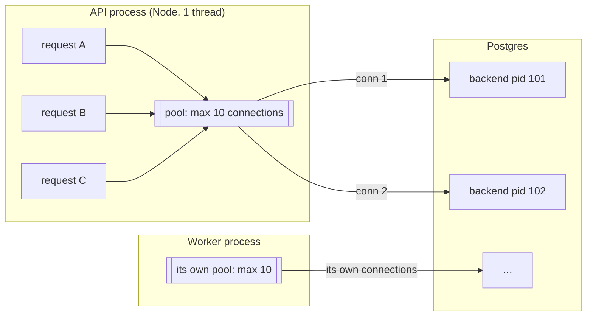

In KlyroStream (`backend/src/lib/db/client.ts`):
- `postgres(env.DATABASE_URL, { max: env.DB_POOL_MAX })`: `DB_POOL_MAX` defaults to 10 **per process**. The API and the worker each have their own pool, so together they can open 20.
- A plain query (`db.query…`, `db.update…`) borrows a connection for that one statement and gives it back.
- A **transaction borrows one connection for its whole life**, from `BEGIN` to `COMMIT`. Every statement inside it must go over that same connection, and that is why `tx` exists (see [Part 2](#db-vs-tx)).

So a slow transaction costs twice: it holds its locks and it holds a pool slot. If all 10 slots are held, the 11th request waits for a free connection before it can even start.

## What a transaction is

A transaction groups statements so they behave as one unit. The four guarantees are called **ACID**:

| Letter | Meaning | What it means for us |
|---|---|---|
| **A**tomicity | All statements commit, or none do | A club is never created without its admin member and quota row |
| **C**onsistency | Constraints (unique, FK, NOT NULL) hold at commit | Two users can't end up with the same email |
| **I**solation | Concurrent transactions don't see each other's half-done work | Nobody sees a club with no members, even for a moment |
| **D**urability | Once `COMMIT` returns, it survives a crash | The write-ahead log (WAL) is flushed to disk before `COMMIT` returns |

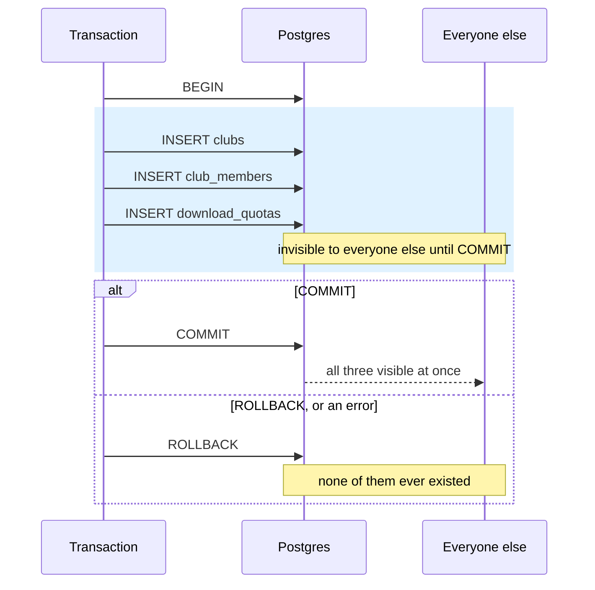

Important: **atomicity is about your own writes, not about other people's.** A transaction doesn't freeze the database, and other transactions keep committing around you. Protection from other writers comes from isolation and locks, below.

## Isolation levels

Postgres has three useful levels. They differ in what a statement is allowed to see of other transactions' commits.

| Level | Each statement sees… | Cost | Used here? |
|---|---|---|---|
| **READ COMMITTED** (default) | everything committed before *that statement* started | none | **Yes, everywhere** |
| REPEATABLE READ | everything committed before the *transaction's first statement* | may fail with a serialization error, and you must retry | No |
| SERIALIZABLE | as if transactions ran one at a time | more serialization errors and retries | No |

Picture READ COMMITTED with two transactions:

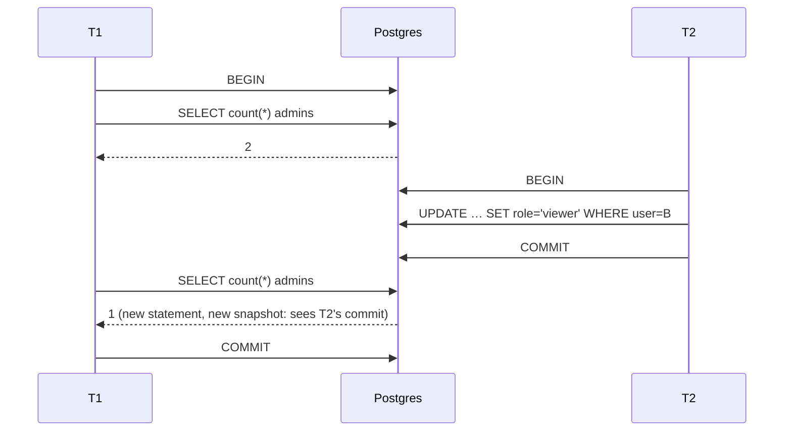

T1's two reads disagree. That's allowed under READ COMMITTED, and it's why "read, decide, write" is unsafe even inside a transaction ([locking.md: check-then-act](locking.md#the-problem-check-then-act)). We fix it with locks or conditional writes, not by raising the isolation level. Those tools are explicit, need no retry loop, and only cost something where they're used.

## MVCC: why readers never wait

Postgres doesn't overwrite a row in place. An `UPDATE` writes a **new version** of the row and marks the old one as dead from that point on. Each statement reads the versions that were committed when it started (its *snapshot*).

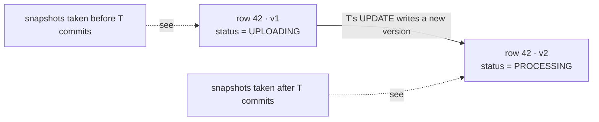

This is **M**ulti-**V**ersion **C**oncurrency **C**ontrol. Consequences:
- **A reader never blocks a writer, and a writer never blocks a reader.** `GET /clubs/:id/videos` never waits on an upload's `FOR UPDATE`.
- **Writers do block writers on the same row.** Two transactions can't both create the next version of row 42. The second one waits for the first to commit or roll back.
- Old versions are cleaned up later by `VACUUM` (autovacuum does it for you).

## Row locks and the re-check rule

Row locks are taken automatically by `UPDATE` and `DELETE`, and on purpose by `SELECT … FOR UPDATE`. They are held until `COMMIT` or `ROLLBACK`, never released early.

| Statement | Locks | Blocks |
|---|---|---|
| `SELECT` | nothing | nothing |
| `SELECT … FOR UPDATE` | the matched rows | other `UPDATE` / `DELETE` / `FOR UPDATE` on those rows |
| `UPDATE` / `DELETE` | the changed rows | the same |
| `INSERT` into a unique index | the new key | another insert of the same key, until commit (then it gets `23505`) |

**The rule that makes everything work:** when a blocked `UPDATE` or `FOR UPDATE` finally gets the row, Postgres **re-checks its `WHERE` against the newest committed version** (this is called EvalPlanQual). If the row no longer matches, it's skipped, and you get 0 rows.

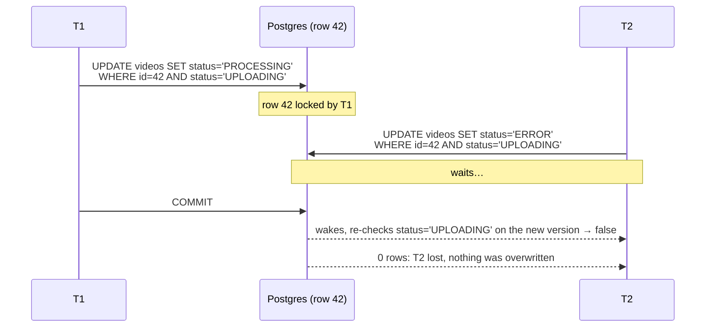

T2 didn't overwrite T1. It noticed it lost. Every conditional write and every `FOR UPDATE` in this codebase relies on this.

## Deadlocks

Two transactions each hold a lock the other wants:

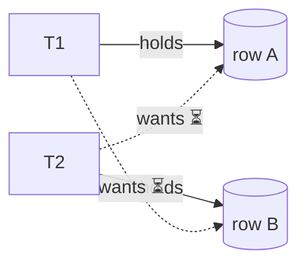

Postgres checks for cycles after `deadlock_timeout` (1 s by default), kills one transaction with `ERROR: deadlock detected`, and the other one continues. The fix is to **always lock rows in the same order**. That's what `ORDER BY user_id` does in `lockMember`.

---

# Part 2: How the code is organised

## Layers

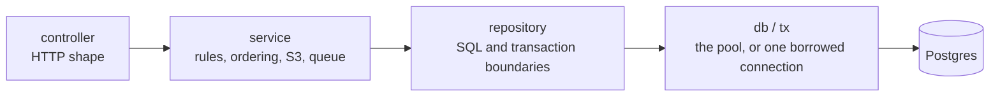

- **Only repositories import `db`** (`lib/db/client.ts`). Services never write SQL and never call `db.transaction` directly.
- **A transaction lives inside one repository function** (`createWithOwner`, `acceptForUser`, `changeRole`, …). The service calls it like any other function and doesn't know a transaction is involved.
- **One exception:** `videoRepo.withUploadLock(id, fn)` opens the transaction and the lock, then hands control back to the *service* with `(video, tx)`. The service has to do an S3 call while the lock is held, and S3 isn't the repository's business. The repository still owns `BEGIN`, the lock and `COMMIT`. The service only borrows `tx` to pass back into `videoRepo.transition(…, tx)`.

## `db` vs `tx`

```ts
export type Tx = Parameters<Parameters<Db['transaction']>[0]>[0];
```

This reads as: "the type of the first argument of the callback you pass to `db.transaction`". It is the transaction handle.

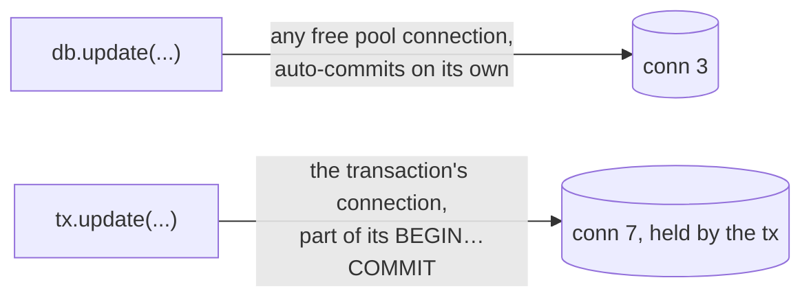

If a helper inside a transaction used `db` by mistake, its statement would run **on another connection, outside the transaction**. It wouldn't see the uncommitted rows, it would commit on its own even if the outer transaction rolled back, and it could **wait forever on a lock the outer transaction holds** (a self-deadlock that Postgres can't detect, because it spans two connections). That's why every helper that runs inside a transaction takes `tx` as a parameter:

| Helper | Signature | Called inside |
|---|---|---|
| `lockMember` | `(tx, clubId, userId)` | `changeRole`, `remove` |
| `claim` | `(tx, id, status)` | `acceptForUser`, `acceptForNewUser`, `reject` |
| `transition` | `(id, from, to, changes, executor = db)` | `withUploadLock` callers pass `tx`; the worker uses the default `db` |

`transition` defaults to `db` so the same function works both standalone (the worker's `markVideoReady`) and inside a lock (`completeVideoUpload`).

## Commit and rollback in Drizzle

```ts
db.transaction(async (tx) => {
  …
  return value;
});
```

| The callback… | Drizzle sends | `db.transaction` |
|---|---|---|
| returns normally | `COMMIT` | resolves with the returned value |
| throws (or a statement fails) | `ROLLBACK` | rejects with the same error |

There's no `commit()` to forget. The shape of the callback *is* the boundary. That has one consequence used deliberately in `completeVideoUpload`: **if you want a write to stick, you must not throw after it inside the callback.** See [the size-mismatch path](#3-complete-an-upload-withuploadlock).

---

# Part 3: Every transaction and lock in KlyroStream

## The map

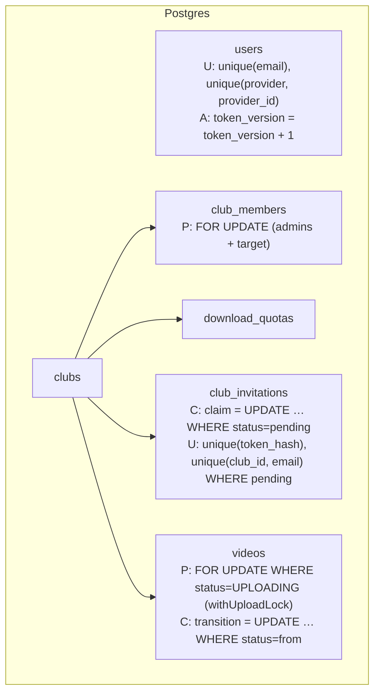

**P** = pessimistic lock, **C** = conditional write, **U** = unique index, **A** = atomic expression.

| # | Operation | File | Transaction? | Lock / guard | Why |
|---|---|---|---|---|---|
| 1 | Create club | `club.repository.ts` `createWithOwner` | yes, 3 inserts | none needed | all-or-nothing: club + admin + quota |
| 2 | Change role / remove member | `member.repository.ts` `changeRole`, `remove` | yes | **P**: `FOR UPDATE` on all admins, then the target | last-admin rule depends on a *set* of rows |
| 3 | Complete upload | `video.service.ts` via `withUploadLock` | yes | **P** on the video row + **C** `transition` | an S3 call must pair with the status change |
| 4 | Abort / expire upload | `video.service.ts` `abortLockedUpload` | yes | **P** + **C** | same pairing, with `AbortMultipartUpload` |
| 5 | Accept invitation (existing user) | `invitation.repository.ts` `acceptForUser` | yes | **C** claim + `ON CONFLICT DO NOTHING` | claim and membership together |
| 6 | Accept invitation (new user) | `acceptForNewUser` | yes | **C** claim + **U** on email | claim, user and membership together |
| 7 | Reject invitation | `reject` | yes (one statement) | **C** claim | reuses `claim(tx, …)` |
| 8 | Revoke / expire invitation | `revoke`, `markExpired` | no | **C** | single statement is already atomic |
| 9 | Worker: READY / ERROR | `markVideoReady`, `markVideoFailed` → `transition` | no | **C** | single statement; 0 rows = someone else moved it |
| 10 | Register, Google sign-in, invite | `user.repository.ts`, `invitation.repository.ts` `create` | no | **U** + catch `23505` → 409 | the index is the real guard; the pre-check is just for a nicer message |
| 11 | Log out everywhere, password change | `bumpTokenVersion`, `updatePassword` | no | **A** `token_version + 1` | no read-modify-write in Node |

A single `UPDATE` or `INSERT` is already its own transaction (auto-commit). You only need `db.transaction` when **two or more statements** have to succeed or fail together, or when a lock must be **held across** several steps.

## 1. Create a club

```ts
export const createWithOwner = (name: string, ownerId: string): Promise<Club> =>
  db.transaction(async (tx) => {
    const [club] = await tx.insert(clubs).values({ name, ownerId }).returning();
    if (!club) throw new Error('insert into clubs returned no row');
    await tx.insert(clubMembers).values({ clubId: club.id, userId: ownerId, role: 'admin' });
    await tx.insert(downloadQuotas).values({ clubId: club.id });
    return club;
  });
```

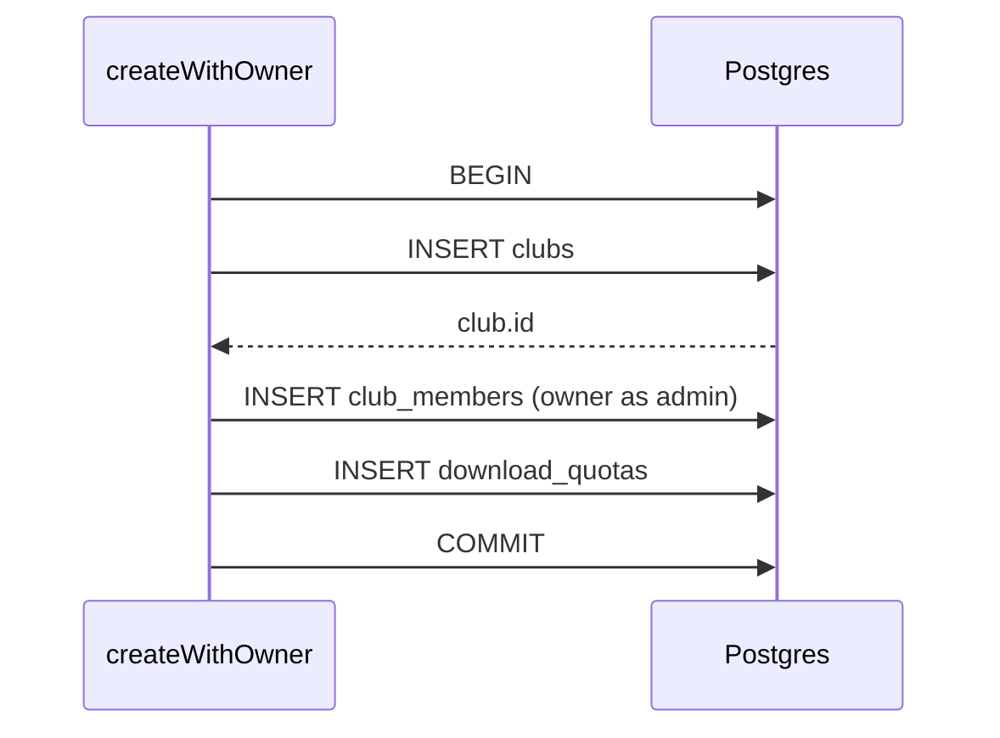

**Why a transaction:** without it, a crash or an FK error after the first insert would leave a club nobody can administer. **Why no lock:** the rows are brand new, so nobody else can see them until `COMMIT`. There's nothing to race on.

## 2. Change a member's role, or remove them

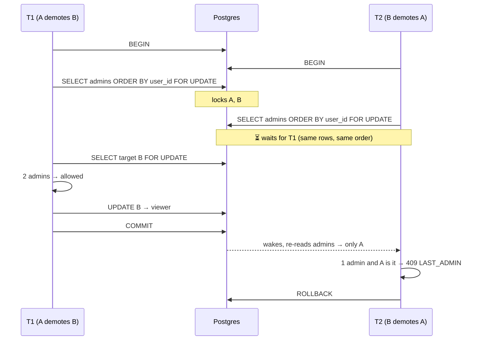

**Why `FOR UPDATE` and not a conditional write:** the rule ("at least one admin") is about a *set* of rows, so no single row's `WHERE` can express it. Locking every admin row makes the count stable until commit. **Why `ORDER BY user_id`:** both transactions take the locks in the same order, so they queue instead of deadlocking. Full walkthrough: [locking.md §1](locking.md#1-pessimistic-lock-the-last-admin-rule).

## 3. Complete an upload: `withUploadLock`

```ts
export const withUploadLock = <T>(id: string, fn: (video: Video, tx: Tx) => Promise<T>) =>
  db.transaction(async (tx) => {
    const [video] = await tx
      .select()
      .from(videos)
      .where(and(eq(videos.id, id), eq(videos.status, 'UPLOADING')))
      .for('update');
    return video ? fn(video, tx) : undefined;
  });
```

The whole of `/complete`, with what's held at each moment:

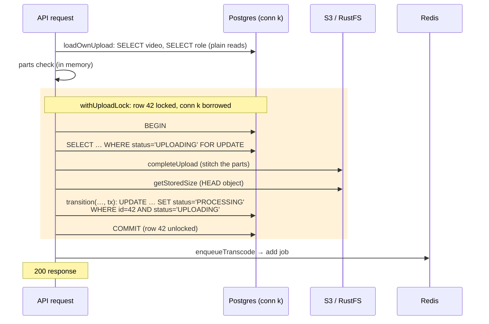

Each piece, and why:
- **The lock's `WHERE` includes `status='UPLOADING'`.** If the video already moved on, the `SELECT` matches nothing. No row is locked, `fn` never runs, and the service turns `undefined` into `409 UPLOAD_NOT_IN_PROGRESS`.
- **The S3 call sits inside the lock on purpose.** "Stitch the object" and "mark PROCESSING" must be one decision. Otherwise a concurrent `/abort` could win the row between them, and you'd have an object for an ERROR video ([locking.md §7](locking.md#7-video-status-conditional-write--a-lock-across-an-external-call)).
- **`transition` still has `AND status='UPLOADING'`, even though we hold the lock.** That's belt and braces: `transition` is the one place a status changes, and it never trusts its caller.
- **The enqueue is *after* `COMMIT`.** If the job were added inside the transaction, a fast worker could pick it up and read the row *before* the commit. It would still see `UPLOADING` and fail with `UnrecoverableError`. Enqueue after commit means the worker always sees `PROCESSING`. The price is the gap between commit and enqueue, covered in [queues.md: the transactional outbox](queues.md#the-transactional-outbox-and-why-it-fits-here).

### The size-mismatch path: why it returns instead of throwing

```ts
if (actual !== declared) {
  await deleteRawObject(locked.rawPath);
  const video = await videoRepo.transition(videoId, 'UPLOADING', 'ERROR', { … }, tx);
  return { video, sizeMismatch: { declared, actual } };
}
```

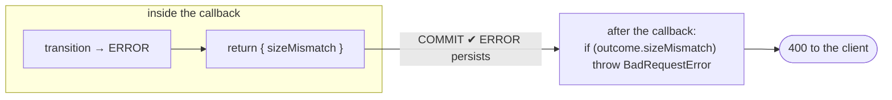

If it threw `BadRequestError` inside the callback, Drizzle would `ROLLBACK`, the ERROR transition would vanish, and the video would sit in `UPLOADING` with its object already deleted. **Return what happened from inside the transaction, and decide the HTTP error outside it.**

### An honest edge case

If `completeUpload` succeeds but `getStoredSize` then throws (say, a network blip), the transaction rolls back and the row stays `UPLOADING`. The multipart session no longer exists, though, so the client's retry gets `NoSuchUpload` → 409, and the video waits for `videos:expire-uploads`. It's rare and recoverable, but it shows the limit of the pattern: **Postgres can roll back, S3 can't.** Any external call inside a transaction is a step the rollback won't undo.

## 4. Abort or expire an upload

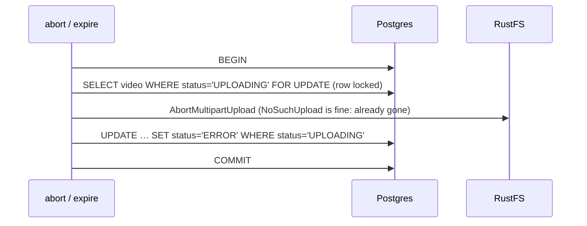

It's the same shape as complete. Because both go through `withUploadLock`, complete and abort on the same video **queue up behind each other**, and the second always sees the first's result. The recovery script `videos:expire-uploads` calls the same `expireUpload`, so a user finishing an upload at the moment the script expires it is safe too.

## 5–7. Invitations: claim, then act

`claim` is a conditional write. Only one transaction can move an invitation out of `pending`:

```sql
UPDATE club_invitations SET status = $2, responded_at = now()
 WHERE id = $1 AND status = 'pending' AND expires_at > now()
RETURNING club_id, role;
```

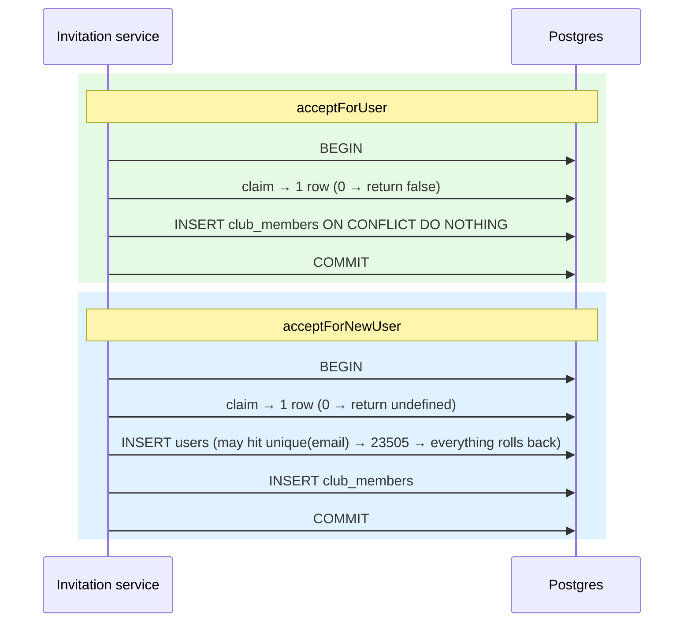

- **Two people clicking accept on the same link:** both run `claim`, the second waits on the row lock, re-checks `status='pending'`, gets 0 rows → "invalid invitation".
- **`ON CONFLICT DO NOTHING`:** if the user somehow is already a member, accepting is still a success and doesn't error.
- **`acceptForNewUser` and a unique violation:** if the email was registered a moment ago, `INSERT users` fails and the **whole transaction rolls back, including the claim.** The invitation stays `pending`, and the service maps `23505` → 409 "account exists". Without the transaction, the invite would be burned and nobody would be a member.
- **`reject` is a transaction around one statement.** It doesn't need one. It's written that way because `claim` takes `tx`, and the extra `BEGIN`/`COMMIT` round trip is cheap.
- **`hashPassword` runs before the transaction opens** (in the service). Hashing takes about 100 ms of CPU, and holding a connection and a row lock during it would be wasted.

## 8–11. Single statements: no transaction needed

| Operation | Statement | Guard |
|---|---|---|
| revoke, markExpired | `UPDATE … WHERE id=$1 AND status='pending'` | conditional write |
| markVideoReady / Failed | `UPDATE videos … WHERE id=$1 AND status='PROCESSING'` | conditional write; 0 rows → worker throws `UnrecoverableError` |
| register, Google sign-in, invite create | `INSERT …` | unique index; `isUniqueViolation(err)` → 409 |
| bumpTokenVersion, updatePassword | `SET token_version = token_version + 1` | atomic expression |

The pattern for unique indexes:

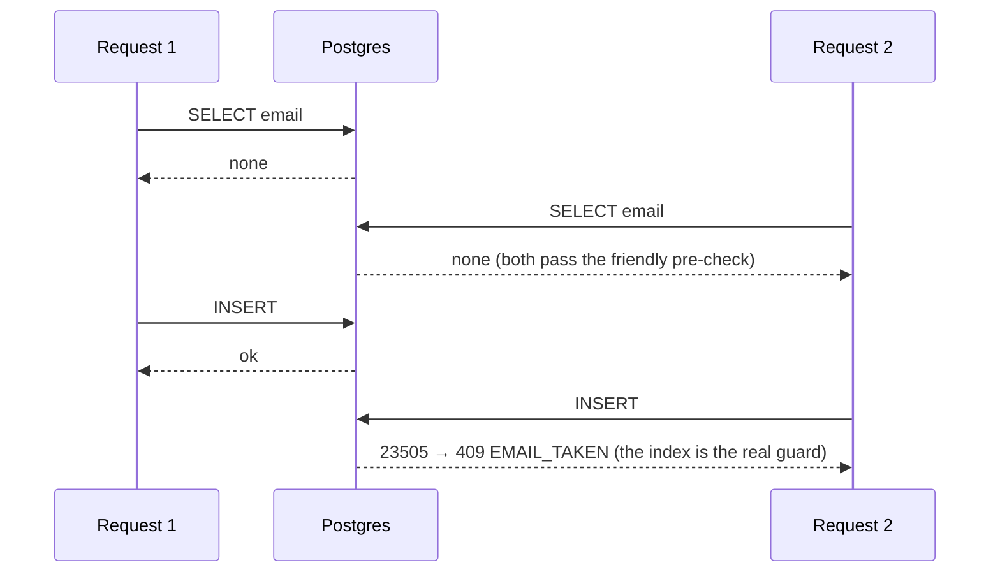

---

# Part 4: What is deliberately outside a transaction

| Thing | Where it runs | Why not inside |
|---|---|---|
| `startUpload` (S3 `CreateMultipartUpload`) in `initiateUpload` | **before** the `INSERT videos` | if the insert fails, we abort the S3 upload in `catch` (a *compensating action*) |
| `enqueueTranscode` | **after** `withUploadLock` commits | the worker must see `PROCESSING` |
| `sendMail` for invitations | **after** the insert, `void …catch` | SMTP can be slow; a lost email is retryable, a held lock isn't |
| `hashPassword` | **before** `acceptForNewUser` / `create` | CPU work doesn't belong in a transaction |
| The worker's whole job | no transaction | it runs for seconds to minutes; it ends with one conditional `UPDATE` |
| Reads (lists, previews, auth checks) | plain `db.query` | MVCC: a reader never blocks and is never blocked |

**Compensating action vs rollback.** Postgres can undo a statement; an external system can't be rolled back, so you undo it by hand:

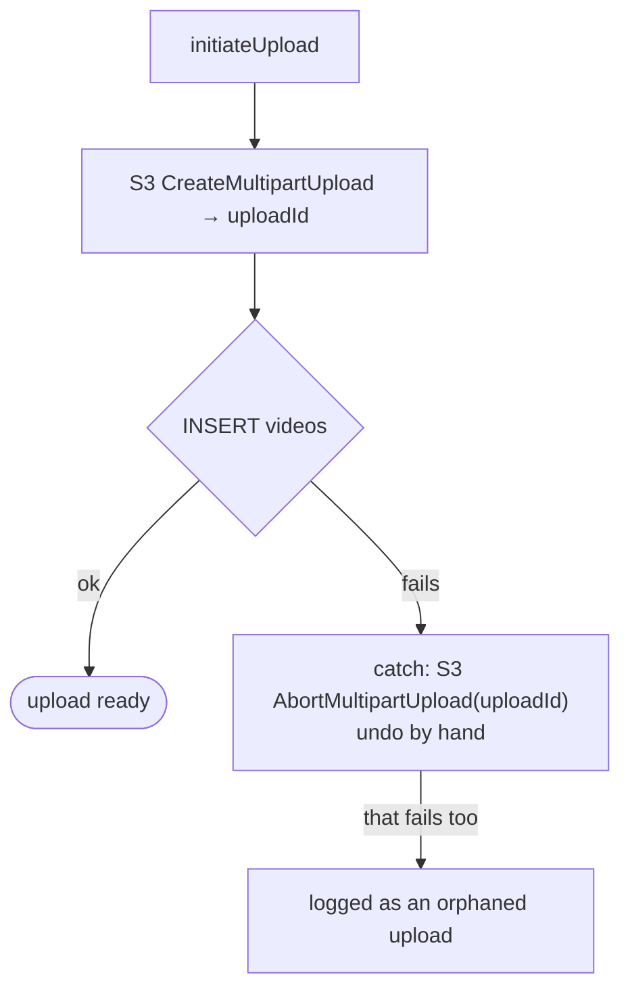

The order is chosen so that the failure that's left over is harmless. An S3 session with no row only wastes some storage and is logged with its key and uploadId. A row with no session would be a video the user can never finish. (A bucket lifecycle rule, `AbortIncompleteMultipartUpload`, would clean such sessions up automatically; we don't have one yet.)

**The worker and Sprint 6.** The worker never holds a transaction while it transcodes. A 5-minute transaction would pin a connection and keep row 42 locked, so `/abort` or the recovery scripts would hang behind it. Instead it reads the row (no lock), works, and ends with a single conditional `UPDATE … WHERE status='PROCESSING'`. If that returns 0 rows, someone changed the video while the worker was busy, and the worker gives up. This is **optimistic concurrency** over a long operation.

---

# Part 5: Rules of thumb

1. **One statement is already atomic.** Reach for `db.transaction` only when several statements must succeed or fail together, or when a lock must be held across steps.
2. **Keep transactions short.** No bcrypt, no email, no queue add. The one external call allowed inside (S3 in `withUploadLock`) is short, per-row and justified.
3. **Pass `tx`, never `db`, inside a transaction.** Using `db` means another connection: outside the transaction, and able to deadlock against yourself.
4. **Return outcomes from the callback; throw HTTP errors outside it.** A throw rolls back the writes you wanted to keep.
5. **Put the check in the `WHERE`.** `UPDATE … WHERE status = expected RETURNING`; 0 rows means you lost.
6. **Set rules need `FOR UPDATE` on the set, in a fixed order.**
7. **Uniqueness belongs to an index.** A pre-check gives a nice message, and `23505` is the real answer.
8. **External side effects go after `COMMIT`**, or get a compensating action, or (later) an outbox.
9. **Never hold a transaction across long work.** Read, work, then conditional write.

## Cheat sheet

| Question | Answer in KlyroStream |
|---|---|
| Default isolation? | READ COMMITTED, everywhere |
| Who imports `db`? | Only `repositories/*` |
| Where do transactions start? | Inside repository functions; `withUploadLock` lends `tx` to the service |
| How does it commit? | The callback returns |
| How does it roll back? | The callback throws, or any statement errors |
| Pessimistic locks | `lockMember` (admins + target), `withUploadLock` (video row) |
| Conditional writes | `transition`, `claim`, `revoke`, `markExpired` |
| Unique guards | `users_email_uniq`, `users_provider_uniq`, `club_invitations_token_uniq`, `club_invitations_pending_uniq` |
| Connections per process | `DB_POOL_MAX` (10); a transaction holds one for its whole life |

## Try it

```bash
docker exec -it klyro-postgres-1 psql -U klyro -d klyro
```

```sql
-- session 1: hold a video's upload lock
BEGIN;
SELECT id, status FROM videos WHERE id = '<uploading-video-id>' AND status = 'UPLOADING' FOR UPDATE;

-- now call POST /videos/<id>/complete from Bruno: it hangs on the lock

-- session 2: see who waits on whom
SELECT pid, state, wait_event_type, left(query, 60), pg_blocking_pids(pid) AS blocked_by
  FROM pg_stat_activity WHERE datname = 'klyro' AND pid <> pg_backend_pid();

-- session 1: release it
ROLLBACK;   -- the request continues
```
