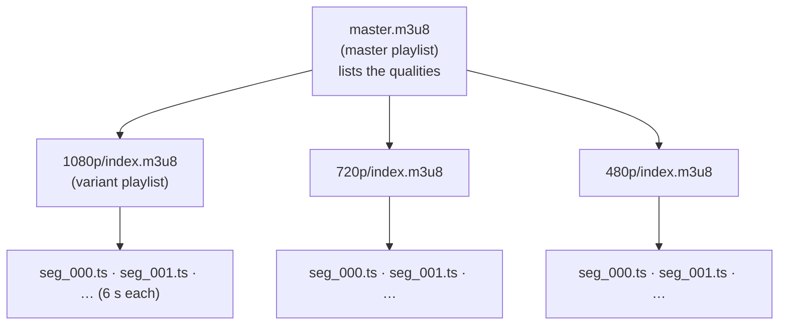
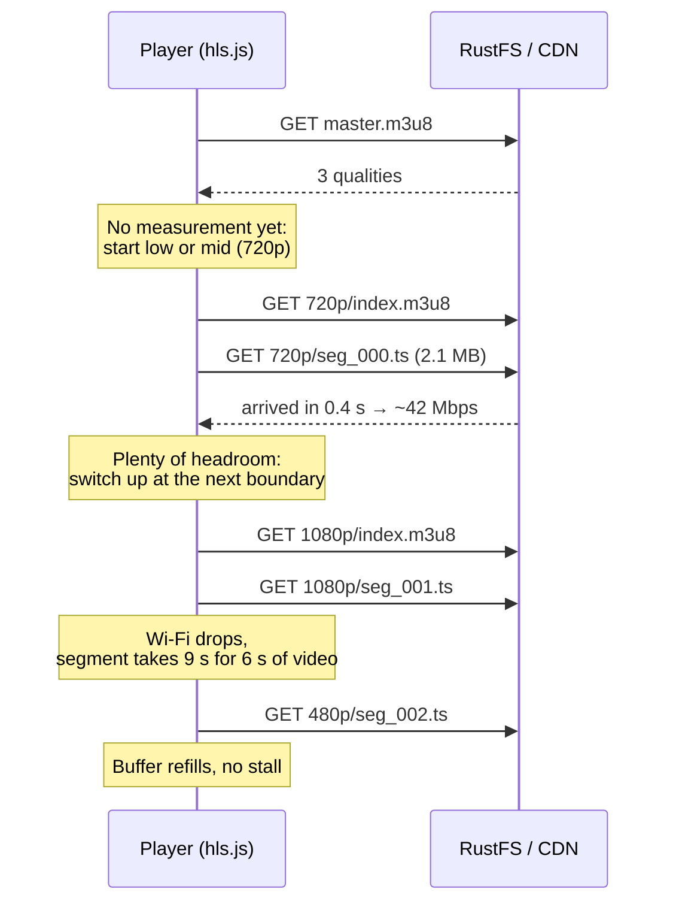
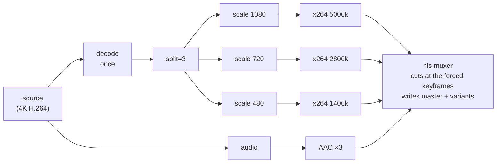
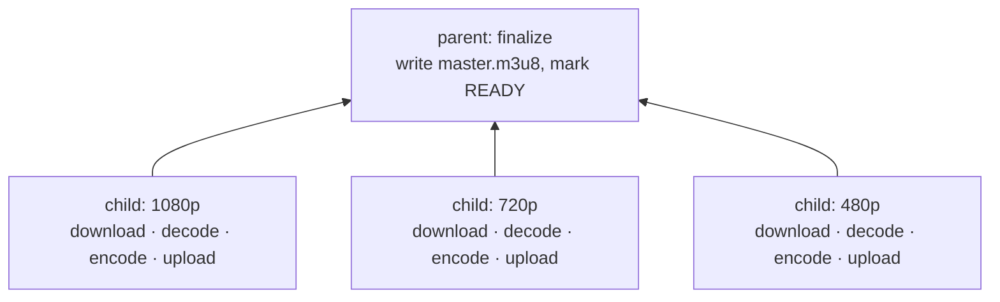
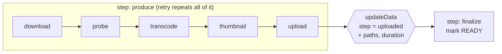
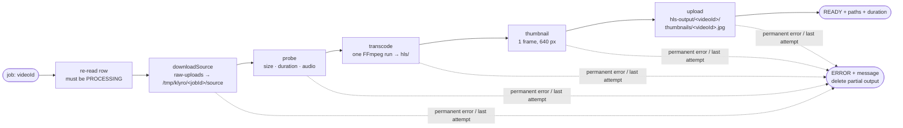

# Transcoding and HLS

Sprint 6 turns the raw upload into something every viewer can play. This guide explains what we produce (HLS), why it's shaped the way it is, the FFmpeg command that builds it, and how the work fits into a BullMQ job.

The numbers below were **measured on this project**: the 4K sample in `bruno/videos/fixtures/`, FFmpeg 9 on Windows, 8 cores, `-preset veryfast`.

Related: [queues.md](queues.md) (jobs, retries, flows) · [uploads.md](uploads.md) (how the raw file got into RustFS).

**Contents**

1. [Why transcode at all](#1-why-transcode-at-all)
2. [HLS: playlists and segments](#2-hls-playlists-and-segments)
3. [How the player picks a quality](#3-how-the-player-picks-a-quality)
4. [The bitrate ladder](#4-the-bitrate-ladder)
5. [Keyframes: why segments need them, and why they must line up](#5-keyframes-why-segments-need-them-and-why-they-must-line-up)
6. [Codecs, containers and the `CODECS` string](#6-codecs-containers-and-the-codecs-string)
7. [The FFmpeg command, piece by piece](#7-the-ffmpeg-command-piece-by-piece)
8. [Probing the input first](#8-probing-the-input-first)
9. [One job or a Flow? Measured](#9-one-job-or-a-flow-measured)
10. [The Sprint 6 pipeline](#10-the-sprint-6-pipeline)
11. [Glossary and further reading](#11-glossary-and-further-reading)

---

## 1. Why transcode at all

The sample upload:

| Property | Value | Problem for viewers |
|---|---|---|
| Resolution | 3840×2160 (4K) | A phone screen shows ~1080 lines at most; the rest is wasted bandwidth |
| Bitrate | 60 Mbps | A typical mobile connection is 5–20 Mbps. The video would stall every few seconds |
| Size | 229 MB for 32 s | ~26 GB per hour of video |
| Format | One MP4 file | The player needs a quality that fits *right now*, and that changes as you walk out of Wi-Fi range |

Serving the original file as-is (a "progressive download") has one quality for everyone. **Adaptive streaming** fixes it: encode several smaller versions, cut each into short pieces, and let the player choose piece by piece.

After transcoding, the same 32 s takes **19 MB at 1080p, 11 MB at 720p and 5.4 MB at 480p**. All three together are 15% of the original.

## 2. HLS: playlists and segments

HLS (HTTP Live Streaming, from Apple) is plain files over plain HTTP. No streaming server is needed: RustFS (or any CDN) just serves files. There are three kinds:



These are the real files FFmpeg wrote for the sample.

**The master playlist** (`master.m3u8`) is the menu. One entry per quality:

```text
#EXTM3U
#EXT-X-VERSION:6
#EXT-X-STREAM-INF:BANDWIDTH=5302853,AVERAGE-BANDWIDTH=4968908,RESOLUTION=1920x1080,CODECS="avc1.640028,mp4a.40.2"
1080p/index.m3u8

#EXT-X-STREAM-INF:BANDWIDTH=3542399,AVERAGE-BANDWIDTH=2816603,RESOLUTION=1280x720,CODECS="avc1.64001f,mp4a.40.2"
720p/index.m3u8

#EXT-X-STREAM-INF:BANDWIDTH=1773599,AVERAGE-BANDWIDTH=1413278,RESOLUTION=854x480,CODECS="avc1.64001e,mp4a.40.2"
480p/index.m3u8
```

| Attribute | Meaning |
|---|---|
| `BANDWIDTH` | **Peak** bits per second of this rendition. The player uses it to decide whether the connection can keep up |
| `AVERAGE-BANDWIDTH` | The average. 4,968,908 ≈ our 5000 kbps target, so the encoder hit it |
| `RESOLUTION` | Lets the player skip renditions bigger than its screen |
| `CODECS` | Lets the player skip renditions it can't decode, before downloading anything ([section 6](#6-codecs-containers-and-the-codecs-string)) |

**A variant playlist** (`720p/index.m3u8`) is the list of pieces for one quality:

```text
#EXTM3U
#EXT-X-VERSION:6
#EXT-X-TARGETDURATION:6
#EXT-X-MEDIA-SEQUENCE:0
#EXT-X-PLAYLIST-TYPE:VOD
#EXT-X-INDEPENDENT-SEGMENTS
#EXTINF:6.000000,
seg_000.ts
#EXTINF:6.000000,
seg_001.ts
…
#EXTINF:1.880000,
seg_005.ts
#EXT-X-ENDLIST
```

| Tag | Meaning |
|---|---|
| `TARGETDURATION:6` | No segment is longer than 6 s |
| `PLAYLIST-TYPE:VOD` + `ENDLIST` | The list is complete and will never change (video on demand, not live) |
| `INDEPENDENT-SEGMENTS` | Every segment starts with a keyframe, so each one decodes on its own ([section 5](#5-keyframes-why-segments-need-them-and-why-they-must-line-up)) |
| `EXTINF:6.0` | This segment's duration. 31.88 s = 5 × 6 s + 1.88 s |

**Segments** (`seg_000.ts`) are short, self-contained video files. Ours are MPEG-TS (`.ts`), the classic HLS container.

Paths inside playlists are **relative**. The player resolves `720p/index.m3u8` against the master's URL, and `seg_000.ts` against the variant's URL. That's why we upload the folder as-is to `hls-output/<videoId>/` and never rewrite the files.

## 3. How the player picks a quality

The player (hls.js in a browser, AVPlayer on iOS) does all the deciding. The server is dumb on purpose.



The key points:

- The player **measures** throughput from each segment download and keeps a buffer of upcoming video.
- It can switch quality **only at a segment boundary**: segment 2 of 480p continues exactly where segment 1 of 1080p ended. That only works if every rendition's segment N covers **exactly the same time range** and starts with a keyframe. Section 5 is about guaranteeing that.
- Shorter segments switch faster but mean more requests and slightly worse compression. **6 s** is Apple's recommendation and a common default.

## 4. The bitrate ladder

The ladder is the list of renditions we produce:

| Rung | Height | Video kbps | Audio kbps | `maxrate` | `bufsize` |
|---|---|---|---|---|---|
| 1080p | 1080 | 5000 | 128 | 5350 | 10000 |
| 720p | 720 | 2800 | 128 | 2996 | 5600 |
| 480p | 480 | 1400 | 96 | 1498 | 2800 |

These sit inside the ranges in Apple's [HLS authoring spec](https://developer.apple.com/documentation/http-live-streaming/hls-authoring-specification-for-apple-devices).

### Bitrate, `maxrate` and `bufsize`

- `-b:v 5000k` is the **average** target.
- Video is bursty: an explosion costs more bits than a still shot. Without limits a 6 s segment could be 3× the average, and a player that chose 1080p based on the average would stall right there.
- `-maxrate 5350k -bufsize 10000k` caps the bursts (this is called VBV, the video buffering verifier). The encoder is allowed to go above average for a while, but never so far that a viewer's buffer would run dry. The measured `BANDWIDTH` (peak) of 5.30 Mbps stayed just under the 5.35 cap.

### Never upscale

The ladder is filtered by the source: only rungs **at or below** the source height.

| Source | Renditions | Why |
|---|---|---|
| 2160p (our sample) | 1080, 720, 480 | Top rung capped at 1080 |
| 720p | 720, 480 | A "1080p" made from 720p has no extra detail, just 1.8× the bytes |
| 360p | one rendition at 360 | Smaller than every rung, so keep its own size |

Upscaling makes the file bigger without making the picture better, and the player would happily pick the wasteful version on a fast connection.

### Portrait video

Phones record portrait: 720 wide × 1280 tall. "720p" really means "the **short side** is 720". If we filtered on height, a portrait 720×1280 clip would get a "1080p" rung, which is an upscale of its short side. So the ladder uses `min(width, height)`, and scaling targets the short side. The probe ([section 8](#8-probing-the-input-first)) already reports the **displayed** width and height after rotation.

## 5. Keyframes: why segments need them, and why they must line up

### Frame types

Compressed video doesn't store every frame as a full picture:

| Frame | Stores | Size | Can be decoded… |
|---|---|---|---|
| **I** (keyframe) | A complete picture | Large | On its own |
| **P** | Only the changes since an earlier frame | Small | Only if the earlier frame was decoded |
| **B** | Changes relative to frames before *and* after | Smallest | Only with both neighbours |


A **GOP** (group of pictures) is the run from one keyframe to the next. You can only start decoding at a keyframe.

### Why that matters for HLS

1. **Every segment must start with a keyframe.** A player that jumps into `seg_003.ts` (after a seek or a quality switch) has nothing earlier to decode from. A segment that starts with P frames shows garbage or a frozen picture until the next keyframe.
2. **The keyframes must be at the same times in every rendition.** Segment N of 480p must start at the exact moment segment N of 1080p starts, or the switch jumps backward or forward in time.
3. **FFmpeg can only cut a segment at a keyframe.** `-hls_time 6` is a *wish*. The cut happens at the first keyframe after 6 s.

### What happens without forcing keyframes (measured)

Same sample, `-hls_time 6`, but leaving keyframe placement to x264:

```text
default x264 GOP : 10.0, 10.0, 10.0, 1.88       ← asked for 6 s, got 10 s
forced keyframes : 6.0, 6.0, 6.0, 6.0, 6.0, 1.88
```

x264's default is a keyframe every 250 frames, or sooner if it detects a scene cut. At 25 fps that's every 10 s, so the 6 s wish was ignored. Scene-cut keyframes are worse: they land at different times in each rendition, because each rendition is encoded separately and the detector sees slightly different pictures.

### The two flags that fix it

```text
-force_key_frames "expr:gte(t,n_forced*6)"     a keyframe at 0 s, 6 s, 12 s, … by the clock
-sc_threshold 0                                 no extra keyframes on scene cuts
```

- `expr:gte(t,n_forced*6)` means "force a keyframe once the time reaches 6 × the number already forced". It's based on **time**, not frames, so it works for 24, 25, 30 or 60 fps sources without knowing the frame rate. (The alternative, `-g 150`, is frames, and only means 6 s at exactly 25 fps.)
- `-sc_threshold 0` turns the scene-cut detector off, so the only keyframes are the aligned ones.

Measured result: every segment of every rendition starts with an `I` frame, and all three playlists list identical durations (`6, 6, 6, 6, 6, 1.88`).

## 6. Codecs, containers and the `CODECS` string

| Choice | What we use | Why |
|---|---|---|
| Video codec | **H.264** (`libx264`), High profile | Plays everywhere: every browser, phone and TV. HEVC/AV1 compress better but aren't universal yet |
| Pixel format | **`yuv420p`**, 8-bit | Phones increasingly record 10-bit HDR or 4:2:2. Browsers' H.264 decoders only reliably handle 8-bit 4:2:0, so we always convert |
| Audio | **AAC** stereo (`-ac 2`) | The HLS default. A 5.1 source becomes stereo |
| Container | **MPEG-TS** (`.ts`) | The classic HLS segment format, simplest to inspect. fMP4 (`.m4s`) is the modern option, needed for HEVC, and a later improvement |

**The `CODECS` string** lets a player reject a rendition before downloading it:

```text
avc1.640028
│    │ │ └─ level 0x28 = 40 → "4.0", enough for 1080p30
│    │ └─── constraint flags
│    └───── profile 0x64 = 100 → High
└────────── H.264

mp4a.40.2 → AAC-LC audio
```

720p gets level `1f` (3.1) and 480p `1e` (3.0). FFmpeg picks the lowest level that fits each rendition, so older devices can still play the small ones.

## 7. The FFmpeg command, piece by piece

One FFmpeg run makes all renditions:

```text
ffmpeg -y -i source
  -filter_complex "[0:v]split=3[v0][v1][v2];
                   [v0]scale=-2:1080[o0];[v1]scale=-2:720[o1];[v2]scale=-2:480[o2]"
  -map [o0] -map 0:a:0   -map [o1] -map 0:a:0   -map [o2] -map 0:a:0
  -c:v libx264 -preset veryfast -profile:v high -pix_fmt yuv420p
  -force_key_frames "expr:gte(t,n_forced*6)" -sc_threshold 0
  -b:v:0 5000k -maxrate:v:0 5350k -bufsize:v:0 10000k -b:a:0 128k
  -b:v:1 2800k -maxrate:v:1 2996k -bufsize:v:1 5600k  -b:a:1 128k
  -b:v:2 1400k -maxrate:v:2 1498k -bufsize:v:2 2800k  -b:a:2 96k
  -c:a aac -ac 2
  -f hls -hls_time 6 -hls_playlist_type vod -hls_flags independent_segments
  -hls_segment_filename "%v/seg_%03d.ts"
  -master_pl_name master.m3u8
  -var_stream_map "v:0,a:0,name:1080p v:1,a:1,name:720p v:2,a:2,name:480p"
  "%v/index.m3u8"
```



| Part | What it does |
|---|---|
| `-filter_complex "[0:v]split=3…"` | Decode the source **once**, copy the decoded frames three ways, scale each copy. This is the main reason one run beats three ([section 9](#9-one-job-or-a-flow-measured)) |
| `scale=-2:1080` | Height 1080, width calculated to keep the shape; `-2` rounds it to an even number, which H.264 requires |
| `-map [o0] -map 0:a:0` … | Output streams in order: video 0, audio 0, video 1, audio 1, … The audio is mapped three times so each rendition carries its own track |
| `-b:v:0` / `-b:a:2` | Per-stream options: `:v:0` is the first output video stream, `:a:2` the third audio stream |
| `-preset veryfast` | The speed vs compression trade-off. Slower presets make smaller files for the same quality, at much more CPU |
| `-var_stream_map "v:0,a:0,name:1080p …"` | Groups streams into renditions. `name:` becomes `%v` in the paths |
| `-master_pl_name master.m3u8` | Also write the master playlist, with `BANDWIDTH`, `RESOLUTION` and `CODECS` filled in |
| `-hls_segment_filename "%v/seg_%03d.ts"` | Segment names: `1080p/seg_000.ts`, … |

### Gotcha: run FFmpeg *inside* the output folder

The first attempt passed absolute Windows paths (`C:\…\single\%v\index.m3u8`) and failed with `Could not write header … Permission denied`, even after creating the `1080p/`, `720p/` and `480p/` folders by hand. The same command with relative paths worked. The likely cause is how FFmpeg derives the master playlist's location from a templated absolute path; it isn't worth chasing, because relative paths avoid it entirely.

The fix, and what the worker does: start FFmpeg with its working directory set to the output folder, and use **relative** paths (`%v/index.m3u8`). FFmpeg then creates `1080p/`, `720p/` and `480p/` itself and puts `master.m3u8` next to them. In Node that's `spawn('ffmpeg', args, { cwd: outDir })`. The probe uses the same trick for a different reason: ffprobe's error messages then contain `source`, not the temp path.

### Progress

`-progress pipe:1` makes FFmpeg print `key=value` lines to stdout every ~0.5 s, including `out_time_us` (how far into the video it is). Progress % = `out_time_us / (duration × 1,000,000)`.

### In the code: `src/worker/pipeline/transcode.ts`

| Function | Pure? | Job |
|---|---|---|
| `planRenditions({ width, height })` | yes | Filters the ladder by the **short side**, scales both sides by the same factor, rounds to even numbers. A source smaller than 480 keeps its own size |
| `buildHlsArgs(source, renditions, hasAudio)` | yes | Builds the argument array from section 7. Without audio it drops the `0:a:0` maps, the AAC options and the `a:i` parts of `var_stream_map` |
| `runFfmpeg(args, { cwd, durationSeconds, onProgress, signal })` | no | `spawn('ffmpeg', args)` with **no shell**. Reads `-progress pipe:1` line by line, calls `onProgress` only when the whole percent goes up (so Redis isn't flooded), keeps the last 2 KB of stderr for the error message |
| `transcodeHls(source, outDir, meta, onProgress, signal)` | no | Plans, creates `outDir`, runs FFmpeg inside it, returns the renditions |

`buildHlsArgs` returns an array, and `spawn` passes each element to FFmpeg as one argument. No shell ever parses the command, so a file name with spaces, quotes or `; rm -rf` in it can't break out. The same reason we never build a command string.

**Errors:** a non-zero exit becomes `UnrecoverableError` when stderr says the input is bad (`Invalid data found`, `moov atom not found`), otherwise a plain `Error`, which is retried. When the `signal` is aborted, Node kills FFmpeg and the promise rejects with `AbortError`; Stage 6 uses that on SIGTERM.

**Planned ladders:**

| Source | Renditions |
|---|---|
| 3840×2160 | 1920×1080, 1280×720, 854×480 |
| 1280×720 | 1280×720, 854×480 |
| 1080×1920 (portrait) | 1080×1920, 720×1280, 480×854 |
| 640×360 | 640×360 only |
| 1440×1080 (4:3) | 1440×1080, 960×720, 640×480 |
| 3840×1608 (cinema 2.39:1) | 2580×1080, 1720×720, 1146×480 |

**Measured:**

| Input | Result |
|---|---|
| 4K sample, Windows, FFmpeg 9 | 30.7 s for 31.88 s of video; 52 progress updates rising to 100; every segment of every rendition starts with `I`; durations `6 6 6 6 6 1.88` everywhere |
| 4K sample, worker container, FFmpeg 5.1 | 37.6 s; same renditions and segment durations |
| Portrait phone clip | 720×1280 and 480×854, no upscale to 1080 |
| Clip without audio | One 360p rendition, `CODECS="avc1.64001e"` with no audio codec |
| Random bytes | `UnrecoverableError … moov atom not found … Invalid data` |
| Aborted after 3 s | `AbortError` after 3004 ms, no FFmpeg process left running |

**FFmpeg 5.1 vs 9.0.** The container's 5.1 writes `BANDWIDTH` from the *configured* rates (5,640,800 = (5000k + 128k) × 1.1) and no `AVERAGE-BANDWIDTH`; 9.0 measures the real peak and average. Both are valid HLS. ffprobe also reported the duration slightly differently (31.91 s vs 31.88 s). The container is what runs in production, so its output is the one that counts.

## 8. Probing the input first

Before encoding, `ffprobe` reads the file's headers (it doesn't decode the video, so it takes milliseconds):

```text
ffprobe -v error -print_format json -show_format -show_streams source
```

`src/worker/pipeline/probe.ts` validates the JSON with Zod and returns:

```ts
type ProbeResult = { durationSeconds; width; height; hasAudio; videoCodec };
```

| Field | Used for |
|---|---|
| `width`, `height` (**after rotation**) | The ladder (never upscale, short side for portrait) |
| `durationSeconds` | Progress %, the thumbnail time (5 s, or 10% of short clips), `videos.duration_seconds` |
| `hasAudio` | Without audio, FFmpeg must not map `0:a:0`, or it fails |

**Rotation.** Phones store a portrait clip as landscape pixels plus a "rotate 90°" note (a display matrix). ffprobe reports `width: 1280, height: 720, rotation: -90`. The probe swaps them so the result is what the viewer sees (720×1280). FFmpeg applies the rotation automatically when encoding.

**Which failures are permanent.** Measured with test files:

| Input | Result | Retried? |
|---|---|---|
| The real 4K upload | `3840×2160, 31.88 s, h264, audio` | n/a |
| Landscape test clip | `1280×720, audio` | n/a |
| Same clip tagged as phone portrait | `720×1280` (rotated) | n/a |
| Video without sound | `hasAudio: false` | n/a |
| Audio-only `.m4a` | `UnrecoverableError: File has no video stream` | **No** |
| 200 KB of random bytes named `.mp4` | `UnrecoverableError: ffprobe could not read the file: … moov atom not found … Invalid data` | **No** |
| Raw object missing in RustFS | `UnrecoverableError: Source object … does not exist` | **No** |
| `ffprobe` not installed | plain error (`ENOENT`) | Yes: it's the machine's fault, not the video's |

A corrupt file fails identically on every attempt, so retrying would burn three attempts (and, after the probe, three full transcodes) for nothing. That's what `UnrecoverableError` is for.

## 9. One job or a Flow? Measured

BullMQ Flows ([queues.md, Part 4](queues.md#3-flow-parent-and-children)) can split work into child jobs that run in parallel, with a parent that runs once they all finish. The obvious design for transcoding is one child per rendition:



So we measured it: the same three renditions, made three ways on the same machine.

| Approach | What it simulates | Wall time | vs one run |
|---|---|---|---|
| **One FFmpeg run**, `split=3` | Sprint 6 plan: single job | **46 s** | 1× |
| Three FFmpeg runs, one after another | A Flow with 3 children on one worker slot | 139 s | 3.0× slower |
| Three FFmpeg runs **at the same time** | A Flow with 3 children on 3 worker slots, one machine | 123 s | 2.7× slower |
| Decoding the 4K source alone, no encoding | n/a | 27–33 s | n/a |

### Why the Flow loses here

1. **Decoding is most of the cost.** Just decoding the 4K H.264 source takes ~30 s of the 46. One run decodes once and feeds all three encoders. Three children decode three times: about 60 s of pure waste, before any encoding.
2. **Running them in parallel doesn't help on one machine.** x264 already uses all 8 cores. Three FFmpegs at once just share the same cores, so 123 s is barely better than 139 s.
3. **The renditions can't be finished separately anyway.** The master playlist needs all of them, and they need identical keyframe timing. A parent job would have to assemble `master.m3u8` itself, which FFmpeg otherwise writes for free.
4. **Each child also downloads the source.** Jobs may run on different machines, so they can't share `/tmp`. That's 3× the 229 MB download (1–2.5 s here, much more over a real network).

### So can we use Flows? Yes, where they fit

A Flow is the right tool when the pieces are **independent, expensive, and there are several machines**. For KlyroStream:

| Where | Shape | When it's worth it |
|---|---|---|
| Core transcode (Sprint 6) | **Single job** | Now. One decode, one machine, measured 2.7–3× faster than splitting |
| Thumbnail before the transcode finishes | Separate job enqueued alongside (a chain, not a Flow), reading a few MB from a presigned URL with `ffmpeg -ss 5 -i <url>` | If the UI should show a poster while the video is still processing |
| AI captions (Sprint 12) | Flow: `extract-audio` child → `transcribe` parent, or a chain from READY | Captions must not delay playback |
| Long videos on several machines (Phase 2) | Flow with **segment children**: split the source at keyframes into 1-minute chunks, one child per chunk encodes every rendition, the parent joins them | When videos are long and there are many workers. This is how large platforms parallelise; each child decodes only its own chunk, so nothing is decoded twice |

The Sprint 6 pipeline functions (`downloadSource`, `probe`, `transcode`, `makeThumbnail`, `uploadDir`) take paths and return results; none of them knows about jobs. Turning the single job into a Flow later only changes the orchestrator, not the pieces.

### What about a step job, or a step job with a Flow?

A **step job** ([queues.md](queues.md#2-step-job)) is still one job, but it saves "I finished stage X" in its own data with `job.updateData`, so a retry skips the stages that are already done. A **step job with a Flow** goes further: the job probes, adds child jobs pointing at itself, throws `WaitingChildrenError`, and resumes as the parent once they finish.

A checkpoint is only worth saving if (a) the stage before it is expensive and (b) its output survives the retry. Measured costs per stage for the 4K sample:

| Stage | Cost | Output durable? |
|---|---|---|
| Download | 1–2.5 s | No: `/tmp` is deleted in `finally`, and a retry may run on another worker |
| Probe | milliseconds | No (but it's free to redo) |
| **Transcode** | **31–46 s** | No, still in `/tmp` |
| Thumbnail | < 1 s | No |
| Upload | a few seconds | **Yes**, in RustFS |
| Mark READY | milliseconds | Yes, in Postgres |

The only stage worth not repeating is the transcode, and its output only becomes durable **after the upload**. So a step job has exactly one useful checkpoint:



It saves us from exactly one failure: everything uploaded, then the READY update fails (Postgres restarting, a connection blip). Without the checkpoint, the retry re-transcodes; with it, the retry goes straight to READY. That's cheap to add (one `updateData`, one `if` at the start), so **Stage 6 adds it**.

Checkpoints *inside* the produce step don't help: a transcode that's half done can't be resumed, and an upload that fails halfway is simply redone, because objects with the same key are overwritten.

**Step job with a Flow** (dynamic children) only pays off when the children are worth spreading over several machines: the Phase 2 "one child per chunk" design. With one machine and one FFmpeg run, the parent would add a single child and wait for it, which is a step job with extra Redis keys.

| Option | Sprint 6? | Why |
|---|---|---|
| Single job | ✅ base | One decode, simplest to follow in Bull Board |
| + one step checkpoint after upload | ✅ Stage 6 | Cheap; avoids a re-transcode when only the READY update failed |
| Step job + Flow children | ❌ Phase 2 | Needs several machines and chunked encoding to beat one FFmpeg run |

## 10. The Sprint 6 pipeline



| Stage | Status | Code |
|---|---|---|
| 1. Container with FFmpeg | Done | `backend/Dockerfile` (`worker` target), `docker-compose.yml` (`worker` service, `profiles: [worker]`) |
| 2. Download + probe | Done | `lib/storage/objects.ts`, `worker/pipeline/download.ts`, `worker/pipeline/probe.ts` |
| 3. Transcode | Done | `worker/pipeline/transcode.ts`: `planRenditions`, `buildHlsArgs` (pure), `runFfmpeg` (`spawn`, progress, stop on abort), `transcodeHls` |
| 4. Thumbnail | Done | `worker/pipeline/thumbnail.ts`: `thumbnailTime`, `makeThumbnail` |
| 5. Upload outputs | Done | `lib/storage/objects.ts` (`uploadObject`), `worker/pipeline/upload.ts` (`uploadDir`, `uploadFile`, `contentTypeFor`) |
| 6. Wire the processor | Next | Temp dir, weighted progress, READY/ERROR, SIGTERM stops FFmpeg, the "uploaded" checkpoint |
| 7. Prove it | | hls.js with a throttled network, "minutes per GB" |

### Thumbnail (Stage 4)

```text
ffmpeg -y -ss 5.000 -i source -frames:v 1
       -vf "scale='min(640,iw)':'min(640,ih)':force_original_aspect_ratio=decrease"
       -q:v 3 thumbnail.jpg
```

| Part | Why |
|---|---|
| `-ss 5` **before** `-i` | Input seeking: FFmpeg jumps to the nearest keyframe before 5 s and decodes only from there. After `-i` it would decode every frame from 0 s |
| 5 s, or 10% for clips ≤ 10 s | Frame 0 is often black or a fade-in. A 3 s clip has no 5 s mark, so it uses 0.3 s |
| `-frames:v 1` | Write one frame and stop |
| `scale=…min(640,…)…decrease` | Fit inside a 640×640 box, keep the shape, never upscale: landscape → 640×360, portrait → 360×640 |
| `-q:v 3` | JPEG quality (2 = best, 31 = worst); 3 keeps a 640×360 frame around 40 KB |

It reuses `runFfmpeg`, so it gets the same no-shell spawn, error classification and abort support.

Measured: 4K sample at 5.00 s → 640×360 in 1.5 s; portrait clip at 0.30 s → 360×640, upright; 2 s clip at 0.20 s.

### Upload (Stage 5)

The player trusts the `Content-Type` header, not the file extension. Safari's native HLS player and some TVs refuse a playlist served as `application/octet-stream` (what you get when no type is set). So every object gets its type at upload time:

| Extension | Content-Type |
|---|---|
| `.m3u8` | `application/vnd.apple.mpegurl` |
| `.ts` | `video/mp2t` |
| `.jpg` | `image/jpeg` |

An unknown extension is an error, and `uploadDir` checks every file **before** uploading any, so a stray file can't cause a half-uploaded folder.

**Keys:** `hls-output/<videoId>/master.m3u8`, `hls-output/<videoId>/720p/seg_000.ts`, `thumbnails/<videoId>.jpg`. The folder layout is uploaded unchanged, so the relative paths inside the playlists keep working. On Windows, `path.relative` returns `720p\seg_000.ts`; the key is rebuilt with `/`, because S3 keys always use forward slashes.

**Concurrency without a library.** `uploadDir` starts 4 small loops that each take the next file from a shared index until none are left. Node runs them on one thread, so `files[next++]` never hands the same file to two loops. Plain `PutObject` is enough because the largest file is a ~3.5 MB segment; multipart only pays off for large objects. The first failure sets a flag that stops the other loops, so no upload lands after the job has given up.

**A bug found by measuring.** The first version reported 12.2 MB uploaded for a 36.7 MB folder:

```ts
bytes += await uploadFile(file, bucket, key);     // wrong with concurrency
```

`a += await b` means `a = a + await b`, and `a` is read **before** the `await`. Four loops all read the same old total, wait, then each writes "old total + my file", overwriting the others. All 22 files were uploaded; only the count was lost. It's the same lost-update race as two transactions doing read-modify-write without a lock ([locking.md](locking.md)). The fix is to await first, then add:

```ts
const size = await uploadFile(file, bucket, key);
bytes += size;
```

Measured after the fix: 22 files, 36.7 MB, uploaded in 0.55–0.68 s. Fetching through a presigned URL returned `application/vnd.apple.mpegurl` for `master.m3u8` and `video/mp2t` for `720p/seg_000.ts`.

**Download speed, for the record:** the 229 MB raw object streamed from RustFS to disk in 1.2–2.5 s. The transcode (46 s for 32 s of 4K) is roughly 20–40× the download, so the download is not worth optimising.

## 11. Glossary and further reading

| Term | Meaning |
|---|---|
| **Transcode** | Decode a video and encode it again in a different format, size or bitrate |
| **Rendition / variant** | One quality level (e.g. 720p at 2800 kbps) |
| **Ladder** | The list of renditions |
| **Segment** | A short, independently playable piece of one rendition |
| **Master playlist** | Lists the renditions; the URL you give the player |
| **Variant playlist** | Lists the segments of one rendition |
| **ABR** | Adaptive bitrate: the player switches renditions as bandwidth changes |
| **Keyframe (I frame)** | A complete picture; decoding can start here |
| **GOP** | The frames from one keyframe to the next |
| **VBV** (`maxrate`/`bufsize`) | Limits how far the bitrate may burst above average |
| **Profile / level** | Which H.264 features and how much resolution × frame rate a decoder must support |
| **Mux / container** | The file wrapper around encoded streams (`.ts`, `.mp4`) |

- [Apple: HTTP Live Streaming](https://developer.apple.com/documentation/http-live-streaming) and the [HLS authoring spec](https://developer.apple.com/documentation/http-live-streaming/hls-authoring-specification-for-apple-devices) (ladder, segment length, keyframes)
- [FFmpeg HLS muxer](https://ffmpeg.org/ffmpeg-formats.html#hls-2) (`var_stream_map`, `master_pl_name`, `hls_flags`)
- [FFmpeg H.264 encoding guide](https://trac.ffmpeg.org/wiki/Encode/H.264) (presets, CRF vs bitrate, VBV)
- [ffprobe documentation](https://ffmpeg.org/ffprobe.html)
- [hls.js demo page](https://hlsjs.video-dev.org/demo/): paste a master URL, watch the level switches
- [RFC 8216](https://datatracker.ietf.org/doc/html/rfc8216): the HLS specification
